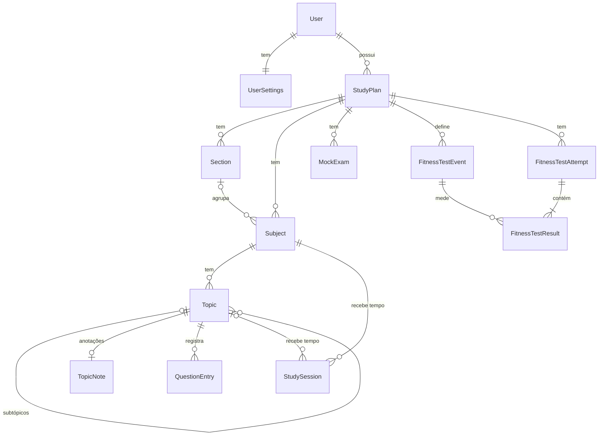

# 2. Domínio e regras

## 2.1 Glossário

A interface usa os termos em pt-BR, e o código usa os identificadores em inglês
([ADR 0007](adr/0007-idiomas.md)). Esta tabela é a fonte única dessa correspondência.

| Termo na interface | Identificador no código | Definição |
|---|---|---|
| Plano de estudo | `StudyPlan` | Conteúdo que a pessoa estuda, como um edital ou uma trilha |
| Bloco | `Section` | Agrupamento opcional de disciplinas (ex.: Conhecimentos Gerais) |
| Disciplina | `Subject` | Matéria dentro do plano (ex.: Língua Portuguesa) |
| Tópico | `Topic` | Item do conteúdo, que pode ter subtópicos |
| Código do tópico | `Topic.Code` | Numeração do edital ("4.1"), opcional |
| Status | `TopicStatus` | `ToStudy` (A estudar), `Studying` (Estudando), `Studied` (Estudado), `Reviewing` (Revisando) |
| Anotações | `TopicNote` | Texto livre em Markdown sobre um tópico |
| Lançamento de questões | `QuestionEntry` | Questões resolvidas sobre um tópico num dia |
| Regra de pontuação | `ScoringRule` | `Cebraspe` (certa − errada), `Standard` (% de acertos), `None` (sem pontuação) |
| Sumário do plano | `StudyPlan.Outline` | Ordem dos blocos e das disciplinas, e o bloco de cada disciplina |
| Período de desempenho | `PerformancePeriod` | Quais lançamentos entram no cálculo, pela data (ex.: últimos 15 dias, últimos 30 dias ou todos) |
| Faixas de desempenho | `PerformanceBands` | Limites das cores do desempenho, configuráveis por plano |
| Simulado | `MockExam` | Prova completa feita como treino |
| TAF | `FitnessTest` | Teste de aptidão física, um módulo opcional do plano |
| Prova do TAF | `FitnessTestEvent` | Ex.: barra, salto, natação, corrida |
| Tentativa do TAF | `FitnessTestAttempt` | Uma vez em que o TAF foi simulado, numa data |
| Sessão de estudo | `StudySession` | Um período de estudo de uma disciplina (e, opcionalmente, de um tópico) |
| Modo da sessão | `StudySessionMode` | `Stopwatch` (cronômetro), `Pomodoro`, `Manual` |
| Usuário | `User` | Conta de acesso (ASP.NET Core Identity) |
| Preferências | `UserSettings` | Fuso horário e tempos do pomodoro de cada usuário |
| Fuso horário | `UserSettings.TimeZoneId` | Define onde começam o dia e a semana nos relatórios |

## 2.2 Modelo

| Entidade | Campos principais |
|---|---|
| `User` | Campos do Identity. Fica na `Infrastructure` ([3.5](03-arquitetura.md#35-camadas-módulos-e-padrões-internos)) |
| `UserSettings` | `UserId`, `TimeZoneId` (padrão `America/Sao_Paulo`), `PomodoroFocusMinutes` (25), `PomodoroBreakMinutes` (5) |
| `StudyPlan` | `Id`, `OwnerId`, `Name`, `Description`, `ScoringRule`, `DefaultPerformancePeriod` (padrão: todas), `PerformanceBands`, `ExamDate?`, `DefaultMockExamQuestions` (120), `FitnessTestEnabled` |
| `Section` | `Id`, `StudyPlanId`, `Name`, `Order` |
| `SubjectPlacement` | `StudyPlanId`, `SubjectId`, `SectionId?`, `Order` (o sumário do plano) |
| `Subject` | `Id`, `OwnerId`, `StudyPlanId`, `Name` |
| `Topic` | `Id`, `SubjectId`, `ParentId?`, `Code?`, `Title`, `Order`, `Status`, `SearchText` |
| `TopicNote` | `Id`, `OwnerId`, `TopicId`, `Markdown` |
| `QuestionEntry` | `Id`, `OwnerId`, `TopicId`, `Date`, `Total`, `Correct`, `Wrong`, `CreatedAt` |
| `StudySession` | `Id`, `OwnerId`, `SubjectId`, `TopicId?`, `Mode`, `StartedAt`, `EndedAt?`, `PlannedDuration?` (pomodoro), `Notes` |
| `MockExam` | `Id`, `OwnerId`, `StudyPlanId`, `Number` (único no plano), `Date?`, `Name`, `Total`, `Correct`, `Wrong`, `Notes`. Os brancos são derivados (`Total − Correct − Wrong`), sem coluna própria |
| `FitnessTestEvent` | `Id`, `StudyPlanId`, `Name`, `Unit` (repetições, centímetros, milissegundos), `Order` |
| `FitnessTestAttempt` | `Id`, `OwnerId`, `StudyPlanId`, `Date`, `Comment` |
| `FitnessTestResult` | `AttemptId`, `EventId`, `Value` (inteiro, na menor unidade), `Points` |

As datas seguem duas convenções:

- `Date` é o dia escolhido pelo usuário (`DateOnly`).
- `CreatedAt`, `StartedAt` e `EndedAt` são instantes em UTC.

### Invariantes

- O pai de um tópico pertence à mesma disciplina, e a árvore não tem ciclos.
- `QuestionEntry`: `Total > 0`, `Correct ≥ 0`, `Wrong ≥ 0` e `Correct + Wrong ≤ Total`.
- `MockExam`: as mesmas contagens do `QuestionEntry`, com os brancos derivados
  (`Total − Correct − Wrong`), e `Number > 0`, único no plano.
- `StudySession`:
  - `EndedAt > StartedAt`, com duração máxima de 24 h.
  - No máximo uma sessão aberta por usuário.
  - O tópico, quando informado, pertence à disciplina da sessão.
- Toda entidade pertence a exatamente um usuário. As raízes de agregado guardam o
  `OwnerId`, igual ao do plano a que se referem.
- Resultados do TAF são guardados como inteiros na menor unidade (2,35 m vira 235 cm;
  45,8 s vira 45.800 ms). Isso evita problemas de precisão e de comparação de decimais
  no SQLite ([3.10](03-arquitetura.md#310-dados-dois-bancos-integridade-e-concorrência)).

### Modelo tático (DDD)

Decidido na [ADR 0014](adr/0014-ddd-tatico.md). O modelo abaixo foi validado contra cada
regra de negócio: para cada regra, qual agregado a garante e quantos agregados cada
operação altera. O modelo e todas as regras foram aprovados pelo autor.

#### Agregados

| Raiz | Contém | Referencia por ID | Por que essa fronteira |
|---|---|---|---|
| `StudyPlan` | Configuração (regra, período padrão, faixas), blocos, sumário (ordem e bloco de cada disciplina), provas do TAF | — | Ordem, blocos e provas são regras do plano. Reordenar, mover uma disciplina entre blocos e excluir um bloco alteram só ele |
| `Subject` | Nome e árvore de tópicos (código, título, status, ordem) | `StudyPlanId` | As invariantes da árvore precisam de todos os tópicos da disciplina. São dezenas, então carregá-los é barato |
| `TopicNote` | Anotações em Markdown de um tópico | `TopicId` | Não tem regra em comum com a árvore. É texto longo, editado devagar: separado, não entra em conflito com mudanças de status nem pesa ao carregar a árvore |
| `QuestionEntry` | — | `TopicId` | Cresce sem limite. Dentro do tópico, cada lançamento carregaria todo o histórico |
| `StudySession` | Intervalo, modo e duração planejada | `SubjectId`, `TopicId` | Ciclo de vida próprio (aberta → encerrada) |
| `MockExam` | Número, data e contagem | `StudyPlanId` | Independente |
| `FitnessTestAttempt` | `FitnessTestResult` | `StudyPlanId`, `FitnessTestEventId` | Uma tentativa e os resultados dela são gravados juntos |
| `UserSettings` | — | `UserId` | Preferências, separadas da conta do Identity |

#### Regras de negócio e onde são garantidas

| Regra | Garantida por |
|---|---|
| Ordem dos blocos e das disciplinas, e o bloco de cada disciplina | `StudyPlan` (sumário) |
| Excluir um bloco deixa as disciplinas dele sem bloco | `StudyPlan` |
| Árvore de tópicos: pai na mesma disciplina, sem ciclos | `Subject` |
| Um tópico só muda de pai dentro da própria disciplina | `Subject` |
| Código do tópico único dentro da disciplina | `Subject` + índice único |
| Lançamento: `Total > 0` e `Correct + Wrong ≤ Total` | `QuestionCount` + `CHECK` no banco |
| Lançamento com data futura é recusado (no fuso do usuário) | `QuestionEntry` |
| Plano "sem pontuação" não aceita lançamentos novos e esconde os antigos, sem apagá-los | Caso de uso (lê a regra do plano) |
| Trocar a regra de pontuação recalcula todo o histórico | Cálculo feito na leitura |
| O desempenho de um tópico soma os lançamentos dos subtópicos | Consulta de desempenho |
| Questões importadas recebem a data informada na prévia | Importação |
| No máximo uma sessão aberta por usuário | Caso de uso + índice único parcial (`OwnerId` onde `EndedAt` é nulo) |
| Sessões do mesmo usuário não se sobrepõem, para as horas não contarem em dobro | Caso de uso |
| Sessão com fim depois do início e no máximo 24 h | `SessionInterval` |
| O pomodoro termina sozinho no fim do bloco planejado | `StudySession` (duração planejada) |
| O tópico da sessão pertence à disciplina da sessão. Continua válido porque tópicos não mudam de disciplina | Caso de uso |
| Simulado: `Total > 0` e `Correct + Wrong ≤ Total`, com os brancos derivados | `QuestionCount` + `CHECK` no banco |
| Simulados sem data são ordenados pelo número | Consulta de simulados |
| O número do simulado é único no plano | Índice único `(StudyPlanId, Number)` |
| TAF: no máximo um resultado por prova, na unidade da prova. A tentativa pode ter só parte das provas | `FitnessTestAttempt` (recebe as provas do plano) |
| Excluir algo com histórico (tópico, disciplina, prova do TAF, plano) apaga tudo em cascata, depois de uma confirmação que mostra o que será perdido | Caso de uso (contagens) + chaves estrangeiras em cascata |
| Toda raiz de agregado pertence a um usuário | `OwnerId` + filtro global |
| Conflito entre aparelhos: uma mudança de status é reaplicada automaticamente; uma edição de texto mostra o conflito sem perder o que foi digitado | Caso de uso + ponto único de saída |

#### Exceções à regra "um agregado por transação"

- A importação e a restauração criam planos inteiros.
- Criar e excluir uma disciplina alteram a disciplina e o sumário do plano.
- As exclusões em cascata são feitas pelo banco (chaves estrangeiras), depois da
  confirmação do usuário. Elas não passam pelos agregados filhos nem geram eventos.
- Excluir uma prova do TAF exclui junto as tentativas que ficam sem nenhum resultado,
  avisando na prévia (decisão do autor, Onda 0, P7).
- O acerto do pomodoro vencido (encerrar a sessão no fim planejado) é gravado numa
  operação própria, antes do comando que o detectou (decisão do autor, Onda 0, P7).

#### Value objects

| Value object | Representa | Garante | Usado em |
|---|---|---|---|
| `QuestionCount` | Total, certas e erradas (brancos derivados) | `Total > 0` e `Correct + Wrong ≤ Total` | `QuestionEntry`, `MockExam` |
| `TopicCode` | Numeração do edital ("4.1.2") | Segmentos numéricos, código do pai, ordem numérica (4.10 depois de 4.9) | `Topic` |
| `PerformancePeriod` | Todas, últimos N dias ou um intervalo de datas | `N > 0` e início ≤ fim | `StudyPlan`, consultas de desempenho |
| `PerformanceBands` | Limites das faixas de cor do desempenho | Limites crescentes, dentro da faixa da regra | `StudyPlan` |
| `Score` | Desempenho calculado e a regra usada | Faixa da regra (−100 a 100 ou 0 a 100) | Cálculos de desempenho |
| `SessionInterval` | Início, fim e duração planejada de uma sessão | Fim depois do início, no máximo 24 h. No pomodoro, o fim não passa da duração planejada | `StudySession` |
| `Measurement` | Valor inteiro na menor unidade e a unidade | Valor ≥ 0 | `FitnessTestResult` |

Os IDs também são tipados (`StudyPlanId`, `SubjectId`, `TopicId`…).

#### Eventos de domínio

| Evento | Levantado quando | Consumidor na 1.0 |
|---|---|---|
| `StudyPlanCreated` | Um plano é criado à mão, por importação ou por restauração (com a origem) | Métrica de planos criados, por origem |
| `TopicStatusChanged` | O status de um tópico muda | Métrica de mudanças de status, por status de origem e de destino |
| `QuestionsRecorded` | Um lançamento é registrado | Métrica de questões, por certas, erradas e em branco |
| `QuestionEntryCorrected` | Um lançamento é editado | Métrica de correções |
| `QuestionEntryDeleted` | Um lançamento é excluído | Métrica de exclusões |
| `StudySessionStarted` | Uma sessão começa | Métrica de sessões iniciadas, por modo |
| `StudySessionEnded` | Uma sessão termina | Métrica de minutos estudados, por modo |
| `MockExamRecorded` | Um simulado é registrado | Métrica de simulados |
| `FitnessTestAttemptRecorded` | Uma tentativa do TAF é registrada | Métrica de tentativas |

Além dos consumidores, o despachante registra cada evento no log estruturado.

Corrigir e excluir sessões de estudo, simulados e tentativas do TAF não levantam eventos.
Essas operações aparecem na métrica `trail.usecase.results`, que o ponto único de saída
registra por caso de uso e `Status` (decisão do autor, Onda 0, P6). Só os lançamentos de
questões têm eventos de correção e exclusão.

## 2.3 Regras de cálculo

Notação: **T** = total de questões, **C** = certas, **E** = erradas, **B** = brancos = T − C − E.

### Desempenho

| Regra do plano | Fórmula | Faixa | Planilha | Mudança |
|---|---|---|---|---|
| Cebraspe | (C − E) / T × 100 | −100 a 100 | Só calculava se C ≠ 0 | Calcula sempre que T > 0 (corrige E1) |
| Tradicional | C / T × 100 | 0 a 100 | Não existia | Nova |
| Sem pontuação | — | — | — | O plano não mostra campos de questões |
| T = 0 | "—" | — | Célula vazia | Igual |

A mesma fórmula vale para tópico, disciplina, bloco e plano. Ela é sempre aplicada sobre
as **questões somadas do período**, então cada questão tem o mesmo peso. Com isso, a média
simples dos tópicos (E2) e a mediana por bloco deixam de existir, e um resultado zero
aparece como 0% (corrige E3).

### Período de desempenho

[ADR 0010](adr/0010-periodo-de-desempenho.md).

1. Entram os lançamentos do escopo (tópico, disciplina, bloco ou plano) cuja `Date` está
   dentro do período. Cada lançamento entra inteiro.
2. O tópico inclui os lançamentos dos subtópicos.
3. A tela mostra sempre o volume ("42 questões nos últimos 15 dias"). Um período sem
   questões mostra "—".
4. **Opções:** Todas, últimos 7, 15, 30 e 90 dias, e um intervalo de datas
   livre. "Últimos N dias" conta o dia de hoje, no fuso do usuário.
5. **Configuração:** o plano tem um período padrão ("Todas" ao criar), e o
   painel tem um seletor para trocar na hora.

Exemplo com "últimos 15 dias", consultado em 16/10 (o período vai de 02/10 a 16/10):

| Lançamento | Data | T | C | E | Entra? |
|---|---|---|---|---|---|
| A | 15/10 | 30 | 20 | 10 | Sim |
| B | 08/10 | 40 | 30 | 10 | Sim |
| C | 25/09 | 50 | 20 | 25 | Não |
| **Período** | | **70** | **50** | **20** | Cebraspe: (50 − 20) / 70 = **42,9%** |

### Histórico

- **Evolução semanal:** desempenho e volume de questões por semana (segunda a domingo),
  no plano e por disciplina.
- **Lançamentos por tópico:** lista com edição e exclusão.
- **Agrupamento:** os lançamentos de questões usam `Date`. As sessões de estudo usam
  `StartedAt`, convertido para o fuso do usuário.

### Tempo de estudo

- Duração da sessão = `EndedAt − StartedAt`.
- **Pomodoro:** cada bloco de foco vira uma sessão, e as pausas não contam. A duração
  padrão (25/5 min) é configurável por usuário.
- **Totais** por tópico, disciplina, dia e semana, no fuso do usuário. Uma sessão que
  atravessa a meia-noite conta no dia em que começou.
- **Sessão esquecida aberta:** ao voltar, o sistema pergunta se deve encerrá-la agora ou
  num horário informado, respeitando o limite de 24 h.

### Simulados

| Indicador | Fórmula | Planilha |
|---|---|---|
| Nota tradicional | C / T × 100 | Igual |
| Nota Cebraspe | C − E (pontos líquidos) | Igual |
| Resumo | Mediana de **todos** os simulados do plano | Só os 10 primeiros (E4) |
| Evolução | Gráfico das duas notas por data | Não existia |

### TAF

- Total da tentativa = soma dos pontos das provas.
- Os pontos são digitados, como na planilha. O cálculo pela tabela do edital é candidato
  para depois da 1.0.

### Faixas de desempenho

A planilha usa conjuntos de ícones do Excel, que são relativos aos próprios valores. O
sistema usa **faixas fixas e configuráveis por plano** (ex.: abaixo de 50%, de 50% a
69%, 70% ou mais), sempre com texto além da cor. Os valores padrão serão confirmados na
Fase 3.

### Regressão

Cada erro da seção [1.2](01-visao-e-escopo.md#12-o-que-a-análise-da-planilha-encontrou)
(E1 a E5) vira um caso de teste nomeado, que documenta o comportamento corrigido.

## 2.4 Importação da planilha

### Mapeamento

| Aba | Origem | Destino |
|---|---|---|
| Conteúdo Programático | Título em A1 | Nome do plano (regra Cebraspe) |
| | B (CONHECIMENTOS) | `Section` |
| | C (ÁREA DE CONHECIMENTO) | `Subject` (sem espaços nas pontas) |
| | D (CONTEÚDO) | `Topic`: código + título |
| | E (STATUS) | `Topic.Status` |
| | F (ANOTAÇÕES) | `TopicNote` |
| | G, H, I (questões) | Um `QuestionEntry` por tópico, com a data informada na prévia (padrão: o dia da importação) |
| | J, K e linhas 331–354 | Ignoradas: são recalculadas |
| Simulados | A (nº), B (total), D (certas), E (erradas) | `MockExam`, só as linhas com valores preenchidos |
| | C (branco) | Não é gravada: os brancos são derivados. A importação confere C com B − D − E e avisa quando divergem (Onda 0, P7) |
| Simulado TAF | Cabeçalhos da linha 3 (Barra, Salto, Natação, Corrida) | `FitnessTestEvent` |
| | B (data), resultados em C/E/G/I, pontos em D/F/H/J, L (comentário) | `FitnessTestAttempt` + `FitnessTestResult` |
| Imagens e gráficos | — | Ignorados |

### Numeração dos tópicos

1. Remover espaços nas pontas.
2. Aplicar `^\s*(\d+(?:\.\d+)*)\.?\s+(.+)$`, que separa o código (sem o ponto final) do
   título. Se não casar, o tópico fica sem código, com um aviso.
3. O pai é o tópico com o código sem o último segmento, **dentro da mesma disciplina**.
   Se ele não existir, o tópico é anexado à raiz da disciplina, com um aviso.
4. A ordem segue a ordem das linhas.

Medido na planilha atual: 80 tópicos de nível 1, 192 de nível 2, 49 de nível 3, 3 de
nível 4 e 1 sem número. Esse tópico sem número gera 8 avisos de pai ausente (3.1 a 3.8).
Não há códigos duplicados dentro de uma mesma disciplina.

### Robustez

- Abas e colunas são localizadas pelo **texto do cabeçalho** (sem acento, sem diferenciar
  maiúsculas), não pela posição. Outros alunos podem ter alterado a planilha.
- Status desconhecido vira "A estudar", com aviso.
- Números inválidos (texto, negativos, certas + erradas > total) fazem o tópico ser
  importado sem questões, com aviso.
- **Prévia antes de gravar:** contagens e avisos. Nada é salvo até a confirmação.
- A importação sempre cria um plano novo; nunca mescla com um existente.
- Limites: arquivo de até 10 MB e verificação do tamanho descompactado (um `.xlsx` é um
  zip).

## 2.5 Backup e restauração

### Formato

Arquivo `trail-backup-AAAA-MM-DD.zip` contendo:

- `manifest.json`: `formatVersion` (inteiro), `appVersion`, `exportedAt` (UTC),
  contagens por entidade e SHA-256 do `data.json`.
- `data.json`: os planos completos (estrutura, status, anotações, lançamentos de
  questões, sessões de estudo, simulados e TAF) e as preferências do usuário (fuso e
  pomodoro).

### Regras

- **Independente do banco:** um backup restaura tanto em SQLite quanto em PostgreSQL.
  Isso também serve para migrar de um banco para o outro.
- **Restaurar cria planos novos** e nunca sobrescreve os existentes, para evitar perda
  acidental.
- **Compatibilidade:** versões novas do app leem formatos antigos, com teste para cada
  `formatVersion`.
- **Escopo:** é possível exportar um plano ou todos. O backup não inclui conta nem senha.

O backup operacional do servidor (o banco inteiro) está descrito na
[arquitetura, seção 3.12](03-arquitetura.md#312-implantação).
