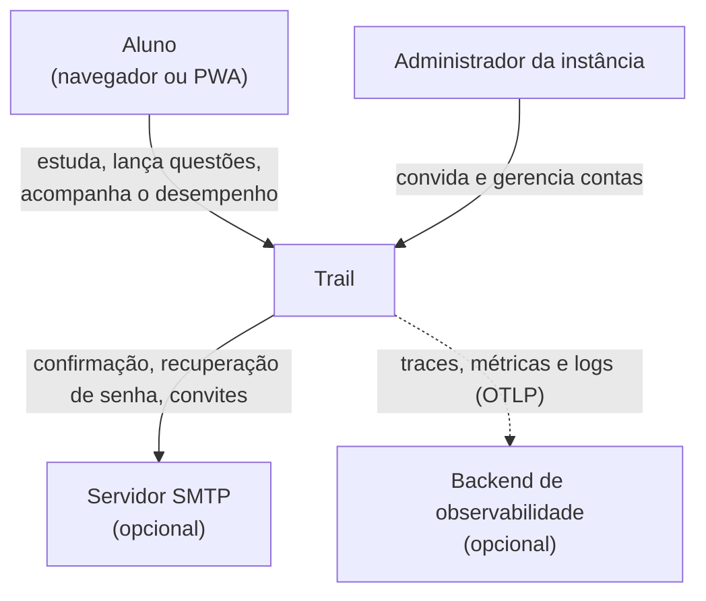
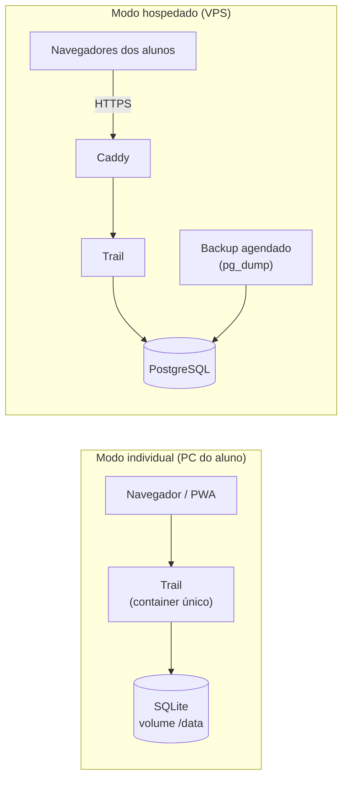
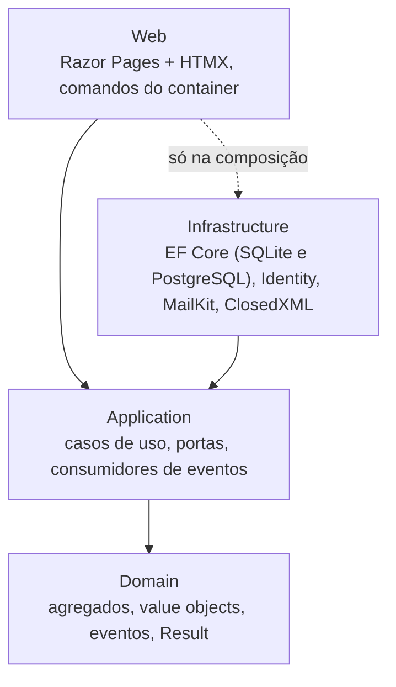
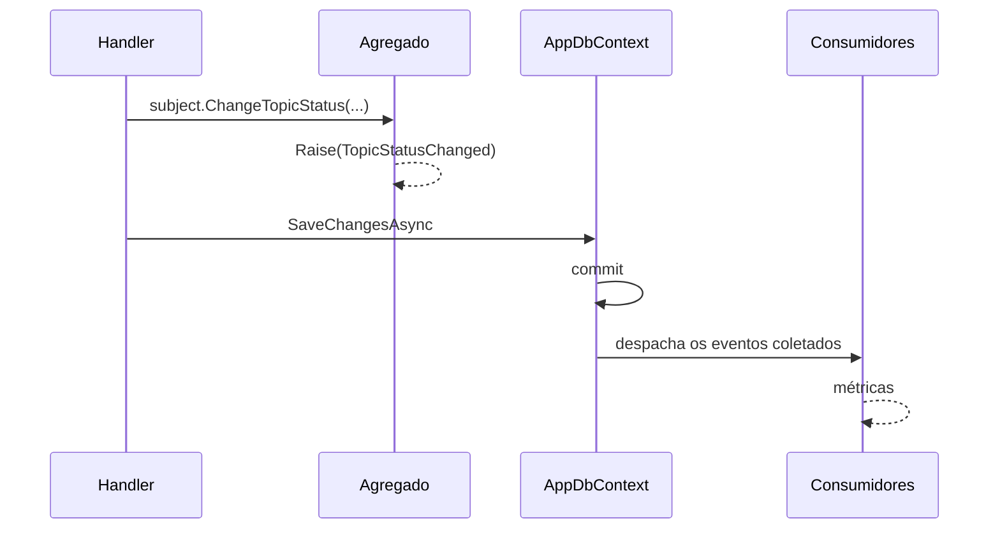
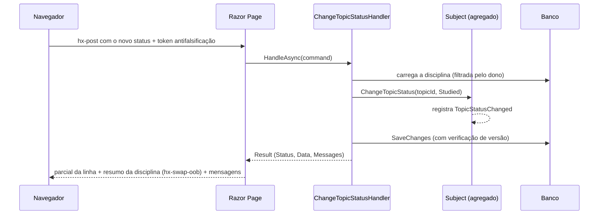

# 3. Arquitetura

> As decisões aceitas indicam o número da ADR. O estilo arquitetural está na
> [ADR 0011](adr/0011-estilo-arquitetural.md), o DDD tático na
> [ADR 0014](adr/0014-ddd-tatico.md), o resultado padrão na
> [ADR 0015](adr/0015-resultado-padrao.md) e a observabilidade na
> [ADR 0016](adr/0016-observabilidade.md). Os itens marcados como **proposta** aguardam
> aprovação.

## 3.1 Abordagem

**Clean Architecture com fatias verticais, DDD tático e módulos por pasta, num único
processo.** Os padrões são reconhecidos. A proporção vem da forma como são aplicados.

O sistema terá dezenas de usuários por instância, um mantenedor e dados que representam
anos de estudo. A complexidade vai para onde está o risco (os dados e os cálculos) e fica
fora de onde ele não existe (escala e distribuição).

### Padrões adotados

| Padrão | Referência | Onde aparece |
|---|---|---|
| Clean Architecture | Robert C. Martin | Quatro projetos, com as dependências apontando para o `Domain` ([3.5](#35-camadas-módulos-e-padrões-internos)) |
| Vertical Slice | Jimmy Bogard | Casos de uso organizados por funcionalidade dentro da `Application` |
| Monólito modular | — | Sete módulos como pastas em cada camada, com fronteiras verificadas por testes |
| DDD tático | Eric Evans, Vaughn Vernon | Agregados, value objects, IDs tipados e eventos de domínio ([2.2](02-dominio-e-regras.md#modelo-tático-ddd)) |
| Notification / Result | Martin Fowler | Retorno padrão dos casos de uso ([ADR 0015](adr/0015-resultado-padrao.md)) |
| Ports & Adapters | Alistair Cockburn | Portas na `Application`, adaptadores na `Infrastructure` ([3.6](#36-pontos-de-variação)) |

### Regras práticas

1. **Decidir cedo só o que é caro de mudar:** modelo de dados, agregados, formato do
   backup e fronteiras dos módulos. O resto espera até haver informação.
2. **Toda abstração aponta a mudança provável que absorve** ([3.6](#36-pontos-de-variação)).
   Se não há mudança provável, não há abstração.
3. **As regras de arquitetura que importam são verificadas pelo compilador ou por testes**
   ([3.15](#315-verificações-automáticas-da-arquitetura)), não só documentadas.

## 3.2 Características de arquitetura

### Prioridades

| # | Característica | Por quê | Como é atendida |
|---|---|---|---|
| 1 | **Integridade e portabilidade dos dados** | São anos de registro de estudo, e perdê-los é inaceitável | Invariantes nos agregados e restrições no banco, concorrência otimista, backup restaurável entre bancos, cópia antes de cada migração |
| 2 | **Corretude dos cálculos** | É o valor central do sistema | Domínio puro, testes de regressão dos erros da planilha e testes baseados em propriedades |
| 3 | **Simplicidade de operação** | Quem instala pode não ser técnico | 1 container, padrões seguros, configuração validada na inicialização com mensagens claras, atualização com 1 comando |

Também são importantes, mas sem exigir estrutura própria: observabilidade
([3.16](#316-observabilidade-e-operação)), segurança no modo hospedado, usabilidade no
celular e facilidade de evolução.

### Não são objetivos

Deixar isso explícito é o que permite manter a solução simples.

| Característica | Por que não |
|---|---|
| Escalabilidade horizontal | Dezenas de usuários por instância: uma instância basta |
| Alta disponibilidade | Alguns minutos fora do ar durante uma atualização são aceitáveis |
| Elasticidade | A carga é baixa e previsível |
| Latência extrema | Páginas geradas no servidor com pouco dado já ficam bem abaixo da meta |

## 3.3 Subdomínios e onde investir

| Subdomínio | Tipo | Investimento |
|---|---|---|
| Prática (questões, período de desempenho, histórico, simulados) | **Central** | Modelo rico, maior cobertura de testes, testes baseados em propriedades |
| Planejamento (planos, disciplinas, árvore de tópicos, status) | Suporte | Agregado com as invariantes da árvore |
| Tempo de estudo | Suporte | Regras de sessão no domínio e relógio controlado nos testes |
| TAF | Suporte | Cadastro simples |
| Intercâmbio (importação, backup) | Suporte, de alto risco | Pipeline explícito, formatos versionados, um teste por versão |
| Contas, e-mail, gráficos, layout | Genérico | Só soluções prontas: ASP.NET Core Identity, MailKit, Chart.js, Tailwind CSS e daisyUI |

## 3.4 Contexto e containers

### Contexto (C4, nível 1)



### Containers (C4, nível 2)



A mesma imagem atende aos dois modos. O que muda é só a configuração (variáveis de
ambiente).

## 3.5 Camadas, módulos e padrões internos

Decidido na [ADR 0011](adr/0011-estilo-arquitetural.md).

### Camadas (C4, nível 3)



| Projeto | Contém | Depende de |
|---|---|---|
| `Domain` | Agregados, value objects, IDs tipados, eventos de domínio, `Result`, regras de pontuação | Só do .NET |
| `Application` | Casos de uso por módulo, portas e consumidores de eventos | `Domain` e as abstrações de injeção de dependência |
| `Infrastructure` | `AppDbContext`, os stores e as migrações de cada banco, Identity, MailKit, ClosedXML, despacho de eventos, backup agendado | `Application` |
| `Web` | Razor Pages, parciais HTMX, ponto único de saída do `Result`, comandos do container, `.resx`, `wwwroot` | `Application`, e a `Infrastructure` só para registrar os serviços |

### Módulos

| Módulo | `Domain` | `Application` | `Web` | Responsabilidade |
|---|---|---|---|---|
| Planning | ✔ | ✔ | ✔ | Planos, blocos, disciplinas, tópicos, status, anotações |
| Practice | ✔ | ✔ | ✔ | Lançamentos, período de desempenho, histórico, simulados |
| StudyTime | ✔ | ✔ | ✔ | Cronômetro, pomodoro, sessões manuais |
| Fitness | ✔ | ✔ | ✔ | TAF |
| Dashboard | — | ✔ (só consultas) | ✔ | Compõe Planning, Practice e StudyTime |
| Interchange | — | ✔ | ✔ | Importação do `.xlsx`, backup e restauração |
| Accounts | ✔ (`UserSettings`) | ✔ | ✔ | Contas, convites, administração, preferências |

**Contas:** o usuário do Identity fica na `Infrastructure`. A `Application`
fala com ele pela porta `IAccountIdentityGateway`, e as preferências (fuso, pomodoro) ficam
no agregado `UserSettings`, no `Domain`. Assim o `Domain` não conhece o Identity.

### Estrutura

```text
trail/
├─ src/
│  ├─ Trail.Domain/
│  │  ├─ Common/                  AggregateRoot, IDomainEvent, Result, Message, CalendarWeek
│  │  ├─ Planning/                StudyPlan, Subject, Topic, TopicNote, TopicCode, eventos
│  │  ├─ Practice/                QuestionEntry, QuestionCount, MockExam, regras de pontuação
│  │  └─ StudyTime/  Fitness/  Accounts/
│  ├─ Trail.Application/
│  │  ├─ Abstractions/            ICurrentUser, IUserCalendar, contratos da prévia de exclusão e da atividade do plano
│  │  ├─ Practice/
│  │  │  ├─ PracticeApplicationServices.cs    AddPracticeApplication
│  │  │  ├─ IQuestionEntryStore.cs            porta de store do módulo (Fase 3); a reserva fica no FallbackQuestionEntryStore
│  │  │  ├─ RecordQuestions/      RecordQuestionsCommand, RecordQuestionsHandler
│  │  │  └─ GetPerformance/       GetPerformanceQuery, GetPerformanceHandler, PerformanceView
│  │  ├─ Planning/  StudyTime/  Fitness/  Dashboard/  Interchange/  Accounts/
│  │  └─ Telemetry/               classes *Metrics e consumidores de eventos que geram as métricas
│  ├─ Trail.Infrastructure/
│  │  ├─ PracticeInfrastructureServices.cs    AddPracticeInfrastructure (um arquivo por módulo)
│  │  ├─ Persistence/             AppDbContext, stores (EfPlanningStore…), interceptor de eventos
│  │  │  ├─ Configurations/       uma configuração por entidade, numa pasta por módulo
│  │  │  ├─ Sqlite/               contexto derivado e migrações
│  │  │  └─ PostgreSql/           contexto derivado e migrações
│  │  └─ Identity/  Email/  Spreadsheets/  Backups/
│  └─ Trail.Web/
│     ├─ Pages/                   Plans/ Practice/ StudyTime/ Fitness/ Account/ Admin/; o painel é a Index
│     ├─ Practice/  Fitness/  StudyTime/  Pwa/    AddPracticeWeb e equivalentes
│     ├─ Dashboard/               IDashboardBlock
│     ├─ Planning/                IPlanLinkContributor
│     ├─ Results/                 ponto único de saída do Result e registro de prefixos dos .resx
│     ├─ Forms/                   erros de formulário compartilhados
│     ├─ Charts/                  modelo do componente <chart>
│     ├─ Cli/                     comandos do container
│     ├─ Resources/               textos da interface (.resx, pt-BR), um por módulo
│     ├─ Styles/                  app.css (entrada do Tailwind), bundle e tema do daisyUI
│     └─ wwwroot/                 CSS gerado, HTMX, Chart.js, ícones, manifest, service worker
├─ tests/
│  ├─ Trail.Domain.Tests/
│  ├─ Trail.Application.Tests/   casos de uso contra banco real, nos dois bancos
│  ├─ Trail.Web.Tests/           HTTP, HTMX e isolamento, nos dois bancos
│  ├─ Trail.Architecture.Tests/
│  └─ Trail.E2E.Tests/           Playwright
├─ deploy/                        compose.sqlite.yml, compose.postgres.yml, compose.dev.yml, Caddyfile
├─ docs/
├─ Dockerfile
├─ Directory.Build.props
├─ Directory.Packages.props
└─ Trail.slnx
```

### Regras de dependência

Garantidas pelo compilador, pelas referências entre projetos:

1. O `Domain` não referencia nenhum projeto nem pacote.
2. A `Application` referencia só o `Domain` e pacotes de abstração
   (`Microsoft.Extensions.*.Abstractions`). O EF Core fica na `Infrastructure`, atrás das
   portas de store ([3.6](#36-pontos-de-variação)).
3. A `Infrastructure` referencia a `Application`.
4. A `Web` referencia a `Application` e a `Infrastructure`.

Verificadas por testes, onde o compilador não alcança:

5. A `Web` usa tipos da `Infrastructure` só na composição (`Program.cs`).
6. As páginas não usam o `IAppDbContext`: todo acesso a dados passa por um caso de uso.
7. Um agregado referencia outro só por ID tipado.
8. Um módulo da `Application` não usa tipos internos de outro. As exceções são
   `Dashboard`, `Interchange` e `Telemetry`, que leem vários módulos por definição.
9. Só a `Infrastructure` usa os provedores do EF Core, o Identity, o MailKit e o
   ClosedXML. Sem esse teste, as dependências transitivas chegariam à `Web`.
10. Os handlers são `sealed`, terminam em `Handler` e têm um único método público,
    `HandleAsync`, que devolve `Result` ou `Result<T>`.
11. As entidades não têm setters públicos, e os eventos de domínio são `sealed record`.
12. As classes públicas terminadas em `Metrics` ficam em `Trail.Application.Telemetry`,
    onde a descoberta por convenção as encontra.

### Composição por módulo

Decidido na [Onda 0](fases/onda-0-base-compartilhada.md) (D1). Os pontos de composição
(`Program.cs`, `AddApplication` e `AddInfrastructure`) só mudam quando muda a arquitetura.
Cada módulo registra o que é seu num método próprio, que o ponto de composição já chama:

| Módulo | `Application` (chamado pelo `AddApplication`) | `Infrastructure` (chamado pelo `AddInfrastructure`) | `Web` (chamado pelo `Program.cs`) |
|---|---|---|---|
| Accounts e Planning | No próprio `AddApplication` | No próprio `AddInfrastructure` | No `Program.cs` |
| Practice | `AddPracticeApplication` | `AddPracticeInfrastructure` | `AddPracticeWeb` |
| Fitness | `AddFitnessApplication` | `AddFitnessInfrastructure` | `AddFitnessWeb` |
| StudyTime | `AddStudyTimeApplication` | `AddStudyTimeInfrastructure` | `AddStudyTimeWeb` |
| Pwa | — | — | `AddPwaWeb` |

- **Arquivos:** `src/Trail.Application/<Módulo>/<Módulo>ApplicationServices.cs`,
  `src/Trail.Infrastructure/<Módulo>InfrastructureServices.cs` e
  `src/Trail.Web/<Módulo>/<Módulo>WebServices.cs`.
- **Portas:** a `Application` registra a implementação de reserva (`Fallback*`, neutra) com
  `TryAdd`, e a `Infrastructure` a troca pelo adaptador real com `Replace`. Assim a
  `Application` se compõe sozinha, e a troca fica num lugar só.
- **Handlers e consumidores de eventos** são registrados pela varredura do assembly da
  `Application` (classes públicas terminadas em `Handler` e implementações de
  `IDomainEventConsumer<T>`), sem linha por caso de uso.

### Pontos de extensão

Um módulo acrescenta peças ao painel, à página do plano, à prévia de exclusão e às
métricas sem editar arquivo de outro módulo. A descoberta é por convenção: só classes
públicas, concretas e não genéricas, registradas uma vez cada, e só contratos que são
interfaces.

| Peça | Contrato | Descoberta | O que o módulo informa |
|---|---|---|---|
| Métricas | Classe pública terminada em `Metrics` em `Trail.Application.Telemetry`, sobre o `Meter` da `ApplicationMetrics` | Singleton, no assembly da `Application` | Os instrumentos do módulo (ex.: `QuestionMetrics`) |
| Atividade do plano | `IPlanActivityContributor` (`Application/Abstractions`) | Scoped, nos assemblies da `Application` e da `Infrastructure` | `PlanActivity(PlanId, LastActivityAtUtc)`: a última atividade de cada plano do usuário, que escolhe o plano padrão do painel |
| Prévia de exclusão | `IDeletionImpactContributor` (`Application/Abstractions`) | Scoped, nos assemblies da `Application` e da `Infrastructure` | Itens `DeletionImpactItem.Create(code, count)` do que a exclusão apaga junto, para o `DeletionScope` recebido |
| Bloco do painel | `IDashboardBlock` (`Trail.Web.Dashboard`) | Scoped, no assembly da `Web` | `Order` e `ViewComponent`, que recebe o `DashboardContext` |
| Link do plano | `IPlanLinkContributor` (`Trail.Web.Planning`) | Scoped, no assembly da `Web` | `Order` e `GetLink(StudyPlanDetailView)`, que devolve um `PlanLink` ou `null` |

- **Prévia de exclusão:** o `GetDeletionImpactHandler` do `Planning` resolve o alcance
  (`DeletionScope(Kind, PlanId, SubjectIds, TopicIds)`) e chama cada contribuinte. Na
  exclusão do plano, as listas trazem todas as disciplinas e todos os tópicos; na da
  disciplina, ela e os seus tópicos; na do tópico, só ele e os subtópicos (`SubjectIds`
  vazio); na do bloco, as duas listas ficam vazias. O contribuinte devolve só o que aquela
  exclusão alcança, e quem conta linhas fica na `Infrastructure` ou conta pela porta do
  módulo. O parcial `Pages/Shared/_DeletionImpact.cshtml` mostra a lista, com o texto de
  cada item pela regra de [textos com quantidade](#textos-e-mensagens).
- **Painel:** a página inicial (`/`) monta o `DashboardContext` pelo
  `GetDashboardContextHandler` (`Application/Dashboard`): os planos do usuário para o
  seletor e o plano escolhido (`?plano=`, ou o de atividade mais recente). Cada bloco é um
  view component que recebe esse contexto. O endpoint HTMX de um bloco fica na pasta de
  páginas do módulo dele, coberto pela varredura de isolamento do módulo
  ([3.11](#isolamento)).
- **Consultas do painel:** uma consulta que lê um módulo fica nele (ex.: o desempenho, em
  `Practice`); uma que lê vários fica em `Application/Dashboard`, uma das exceções da
  regra 8.
- **Link do plano:** o `PlanLink` leva o texto já traduzido pelo `.resx` do módulo, a
  página, os valores de rota e um ícone do `PlanLinkIcon`.

### Casos de uso

- Cada caso de uso é um **comando** (altera estado) ou uma **consulta** (só lê), com o
  seu handler, na pasta do caso de uso.
- **Comando:** o handler carrega o agregado pela porta de store do módulo (já filtrado
  pelo dono), chama o método do agregado, grava com um único `SaveChanges` e devolve um
  `Result`. A exceção aprovada é o acerto do pomodoro vencido, gravado antes do comando
  que o detectou ([3.10](#integridade)).
- **Consulta:** nos módulos novos, o store projeta direto para um modelo de leitura (ex.:
  `PerformanceView`), com `AsNoTracking`. O `Planning` ainda monta as suas views no
  handler, a partir dos agregados; só o `ListStudyPlanOptionsAsync` projeta no store.
- **Validação:** as regras ficam no handler e no domínio e acumulam mensagens (padrão
  Notification). Erros de conversão da entrada (ex.: texto num campo numérico) seguem a
  regra global da [3.9](#formulários-e-erros): resposta 422, com as mensagens
  `ModelBinding*`, sem chamar o caso de uso.
- **A página** monta o comando, chama o handler e entrega o `Result` ao ponto único de
  saída. Os comandos do container e as tarefas agendadas chamam os mesmos handlers.

### Resultado padrão

Decidido na [ADR 0015](adr/0015-resultado-padrao.md). Todo caso de uso devolve o mesmo
envelope, e só o `Data` varia:

```text
Result<T>
├─ Status     Ok | Invalid | NotFound | Conflict | Forbidden
├─ Data       T, só quando Ok
└─ Messages   [ { Code, Severity, Target? } ]
```

As mensagens levam códigos, não textos. A `Web` traduz o código pelo `.resx` e converte o
`Status` em resposta HTTP num único lugar ([3.9](#39-interação-com-htmx)).

### Textos e mensagens

Decidido na [Onda 0](fases/onda-0-base-compartilhada.md) (D2).

- **Um `.resx` por módulo**, em `src/Trail.Web/Resources/`, com a classe marcadora em
  `src/Trail.Web/`: `SharedResource` (layout, Contas, Planejamento e o que não tem módulo),
  `PracticeResource`, `FitnessResource`, `StudyTimeResource` e `PwaResource`. O
  `Interchange` ganha o seu na Onda B.
- **Registro de prefixos:** o `MessageResourceRegistry` (`Trail.Web.Results`) escolhe o
  `.resx` pelo prefixo do código: `practice.` → `PracticeResource`, `fitness.` →
  `FitnessResource`, `studytime.` → `StudyTimeResource`, `pwa.` → `PwaResource`, e o
  `SharedResource` para os demais. O `ResultResponder` e a prévia de exclusão traduzem por
  ele, e uma tradução ausente vai para o log como aviso, com o código e o `.resx`. Um
  módulo novo acrescenta a classe marcadora, o `.resx` e uma linha no registro.
- **Views:** os `_ViewImports.cshtml` de `Pages/Practice`, `Pages/Fitness` e
  `Pages/StudyTime` injetam o localizador do módulo (`PracticeLocalizer`,
  `FitnessLocalizer` e `StudyTimeLocalizer`), além do `SharedLocalizer`.
- **Teste de tradução:** o `MessageCodeTranslationTests` lê o código de produção com o
  Roslyn e exige, para todo código passado a `Message.*`, `AddErrorIf` e
  `DeletionImpactItem.Create`, o texto no `.resx` do seu prefixo. Literais e constantes
  são resolvidos; um código calculado precisa estar na lista explícita do teste.
- **Textos com quantidade:** a chave `<código>.one` vale só para exatamente 1, e
  `<código>.other` para os demais, inclusive o 0 ("0 anotações"). O número entra como
  `{0:N0}` ("1.000 tópicos"). O `CountedMessage` (`KeyFor` e `LocalizeCount`) escolhe a
  chave, e o teste de tradução confere as duas formas de cada código do
  `DeletionImpactItem.Create`. A regra difere de propósito da regra do CLDR para o
  português, em que o 0 também usa o singular; ela e o formato "2 blocos" aguardam a
  confirmação do autor
  ([P10](fases/onda-0-base-compartilhada.md#p10--regra-do-plural-nos-textos-com-quantidade)
  e [P11](fases/onda-0-base-compartilhada.md#p11--formato-dos-itens-da-prévia-de-exclusão)
  da Onda 0).
- **E2E:** o `UiText` lê os cinco `.resx`: os códigos de mensagem pelo prefixo
  (`UiText.Get(code)`), e as demais chaves pelo módulo informado
  (`UiText.Get(UiResource.Practice, key)`).

### Eventos de domínio

Decidido na [ADR 0014](adr/0014-ddd-tatico.md).



A lista de eventos e os consumidores estão em
[2.2](02-dominio-e-regras.md#modelo-tático-ddd).

## 3.6 Pontos de variação

As portas ficam na `Application`, e os adaptadores, na `Infrastructure`.

| O que tende a mudar | Como fica isolado |
|---|---|
| Regras de pontuação (bancas novas) | `IScoringRule` no `Domain`, uma implementação por regra |
| Formatos de entrada (`.xlsx` hoje, texto do edital depois) | Porta de leitura e um adaptador por formato. Pipeline: leitor do formato → modelo neutro → validação → prévia → gravação |
| Formato do backup | `formatVersion`, com conversores de uma versão para a seguinte, testados com um arquivo de cada versão |
| Banco de dados | Uma porta de store por módulo, um provedor por banco na `Infrastructure` e as regras de portabilidade ([3.10](#310-dados-dois-bancos-integridade-e-concorrência)) |
| Envio de e-mail | Porta `IEmailSender`: MailKit quando há SMTP, links manuais quando não há |
| Relógio | `TimeProvider`, nativo do .NET, para os testes controlarem o tempo. O "hoje" e o fuso do usuário vêm do `IUserCalendar` ([3.10](#calendário-do-usuário)) |
| Usuário atual | Porta `ICurrentUser`: vem da requisição na `Web` e do sistema nos comandos e tarefas |
| Destino da telemetria | OTLP configurável. Nenhum fornecedor aparece no código |

O que é estável não ganha abstração:

- **Sem repositório genérico:** cada módulo tem só a sua porta de store.
- **Sem interface para os handlers:** a página depende da classe concreta do caso de uso.
- **A árvore de tópicos não tem camada intermediária.**

### Uma porta de store por módulo

É o padrão desde a [Fase 2](fases/fase-2-planos-e-conteudo.md) e substitui o acesso direto
pelo `IAppDbContext` previsto na [ADR 0011](adr/0011-estilo-arquitetural.md):

- Cada módulo da `Application` declara uma porta com as operações de que os seus casos de
  uso precisam: `IPlanningStore` e `IUserSettingsStore` hoje, e `IQuestionEntryStore`,
  `IMockExamStore`, `IFitnessStore` e `IStudyTimeStore` na Onda A.
- A `Infrastructure` implementa a porta com o EF Core, pelo `AppDbContext` já filtrado
  pelo dono. O `EfPlanningStore` usa os `DbSet` existentes; os stores novos usam
  `Set<T>()`, sem `DbSet` novo no contexto, e precisam converter os erros próprios de cada
  banco (ex.: índice único violado) em resultados da porta. Hoje o `EfPlanningStore` só
  converte o conflito de versão (`DbUpdateConcurrencyException`).
- Comandos recebem agregados e gravam pelo próprio store (ex.: `TrySaveChangesAsync`,
  que informa o conflito de versão). Nos módulos novos, consultas recebem modelos de
  leitura projetados no store; o `Planning` ainda monta as views no handler
  ([casos de uso](#casos-de-uso)).
- Um módulo que precisa de dados de outro lê pela própria porta, com modelos de leitura
  próprios (regra 8 de [3.5](#regras-de-dependência)).
- A `Application` registra a reserva neutra (`FallbackPlanningStore`), e a
  `Infrastructure` a troca pelo adaptador real ([composição](#composição-por-módulo)).

Não é um repositório genérico nem um por agregado: é uma fachada por módulo, que mantém as
consultas do EF Core (`Include`, projeções, `GROUP BY`) fora dos handlers. O
`IAppDbContext` ficou só com o `SaveChangesAsync` e não é usado pelos casos de uso; a
regra 6 de [3.5](#regras-de-dependência) continua impedindo as páginas de usá-lo.

## 3.7 O que deliberadamente não fazemos

| Padrão | Por que não aqui |
|---|---|
| Microsserviços | Um mantenedor e um domínio pequeno. Só traria rede, implantação e consistência distribuídas |
| CQRS com modelos ou bancos separados | As consultas projetam direto, mas o modelo e o banco são um só |
| Event sourcing | Os eventos de domínio notificam, não são a fonte do estado. Os lançamentos já guardam o histórico necessário |
| MediatR, ou interface genérica com decorators | Cada página chama o seu caso de uso direto. O que seria transversal tem lugar fixo: a transação no `SaveChanges`, a telemetria na instrumentação automática e no ponto único de saída |
| Repositórios (genéricos ou por agregado) | O EF Core já é repositório e unit of work. Cada módulo tem uma única porta de store, com as operações dos seus casos de uso ([3.6](#uma-porta-de-store-por-módulo)) |
| Outbox e mensageria | Os eventos são consumidos no mesmo processo, e os consumidores da 1.0 toleram a perda de um evento |
| Biblioteca de `Result` | Um tipo pequeno mantém o `Domain` dependente só do .NET |
| AutoMapper | O mapeamento explícito é curto e verificado pelo compilador |
| Projetos separados por módulo | Seriam cerca de 28 projetos. Os módulos são pastas em cada camada, e o gatilho para separar está em [3.17](#317-gatilhos-de-evolução) |
| Fila ou cache distribuído | O volume é baixo. As tarefas em segundo plano usam `BackgroundService` |
| SPA | Ver a [ADR 0002](adr/0002-stack-aspnetcore-razor-htmx.md) |

## 3.8 Stack

| Camada | Tecnologia | Situação |
|---|---|---|
| Runtime | .NET 10 (LTS, suporte até nov/2028) | Aceita ([0002](adr/0002-stack-aspnetcore-razor-htmx.md)) |
| Web | ASP.NET Core Razor Pages + HTMX 4 | Aceita ([0002](adr/0002-stack-aspnetcore-razor-htmx.md)) |
| Interface | Tailwind CSS 4 + daisyUI 5 (build pelo executável standalone, sem Node) e Chart.js, servidos pelo app | Aceita ([0013](adr/0013-frontend-tailwind-daisyui.md)) |
| Ícones | Lucide, em sprite SVG | Aceita ([0013](adr/0013-frontend-tailwind-daisyui.md)) |
| Textos da interface | Arquivos `.resx` (pt-BR) acessados por `IStringLocalizer` | Aceita ([0007](adr/0007-idiomas.md)) |
| Dados | EF Core 10, SQLite e PostgreSQL | Aceita ([0003](adr/0003-sqlite-e-postgresql.md)) |
| Contas | ASP.NET Core Identity, com e-mail via MailKit | Aceita ([0012](adr/0012-autenticacao-identity.md)) |
| Planilhas | ClosedXML | Proposta, confirmada na Fase 6 |
| Markdown | Markdig, com HTML desabilitado | Proposta, confirmada na Fase 2 |
| Observabilidade | OpenTelemetry (traces, métricas e logs) e Aspire Dashboard no desenvolvimento | Aceita ([0016](adr/0016-observabilidade.md)) |
| Testes | xUnit v3, CsCheck, Testcontainers, Playwright, axe e ArchUnitNET | Aceita ([Fase 0](fases/fase-0-fundacao.md)) |
| Imagem | .NET chiseled `extra`, usuário não root | Aceita ([Fase 0](fases/fase-0-fundacao.md)) |
| HTTPS no modo hospedado | Caddy | Aceita ([Fase 0](fases/fase-0-fundacao.md)) |
| E-mail em desenvolvimento | Mailpit | Aceita ([Fase 0](fases/fase-0-fundacao.md)) |

Todas as bibliotecas têm licença compatível com AGPL-3.0 (MIT, BSD ou Apache-2.0).

## 3.9 Interação com HTMX

Exemplo: mudar o status de um tópico.



Convenções:

- **Mesma rota, duas respostas:** se a requisição tem o cabeçalho
  `HX-Request-Type: partial`, a página devolve só o trecho (parcial). Sem ele, devolve a
  página inteira. Assim os formulários continuam funcionando sem JavaScript, e os links
  reforçados e a restauração do histórico recebem a página inteira. Respostas que forem
  para cache levam `Vary: HX-Request-Type`.
- **Ponto único de saída:** toda página responde pelo mesmo método, que converte o
  `Result` em status HTTP, parcial e mensagens (tabela na
  [ADR 0015](adr/0015-resultado-padrao.md)). O HTMX 4 troca o conteúdo em todas as
  respostas, exceto 204 e 304.
- **Antifalsificação:** o token vem de `<meta name="csrf-token">` e é posto no cabeçalho
  `X-CSRF-TOKEN` de toda requisição pelo evento `htmx:config:request`
  (`wwwroot/js/htmx-integration.js`), sem depender da herança de atributos. O Razor Pages valida por padrão.
- **Erros sem corpo** não apagam o conteúdo: o swap é cancelado e aparece um toast.
- **CSP estrita:** o projeto não usa `hx-on:*`, valores `js:` nem filtros de gatilho, os
  únicos recursos do HTMX 4 que avaliam código. Assim a CSP dispensa `'unsafe-eval'`. A
  extensão `hx-csp`, com nonce por requisição, entra na Fase 1
  ([ADR 0013](adr/0013-frontend-tailwind-daisyui.md)).
- **Componentes só em CSS (daisyUI):** nada precisa ser reinicializado depois das trocas.
  Modais e o menu lateral do celular usam o `<dialog>` nativo
  ([ADR 0013](adr/0013-frontend-tailwind-daisyui.md)).
- **Rotas em pt-BR,** porque aparecem para o usuário (`/planos/{id}/simulados`). Os nomes
  no código continuam em inglês.

### Formulários e erros

Decidido na [Onda 0](fases/onda-0-base-compartilhada.md) (W0-T10). Vale para todo
formulário, com e sem HTMX.

- **Lista comum:** o parcial `Pages/Shared/_FormErrors.cshtml`, com o modelo
  `FormErrorList(Id, Errors)`, preenchido por `Trail.Web.Forms.FormErrors` (`For`,
  `ForFieldsOnly` e `HasErrors`). A lista tem `role="alert"`, e o
  `wwwroot/js/form-errors.js`, carregado pelo layout, põe o foco no primeiro campo com
  `aria-invalid="true"` depois de uma resposta 422 do HTMX e ao abrir uma página com 422
  (WCAG 4.1.3).
- **Erro no campo:** o `Target` das mensagens é o nome da propriedade do comando. A página
  liga cada alvo ao seu campo com um `FieldTargetMap` (`Field`, `Prefixed` e `FormLevel`),
  passado em `this.Respond(..., options => options.Fields = ...)`. Todo campo `asp-for`
  com erro ganha `aria-invalid="true"`. O `asp-error-span` (ou `asp-error-span-id`, quando
  o `<span asp-validation-for>` tem outro `id`) acrescenta o `aria-describedby` apontando
  para o texto do erro. O que não tem campo vai para a chave do formulário: a chave vazia,
  sem `FormLevel`, ou a chave informada em `FormLevel(key)`; num parcial com prefixo,
  `FormLevel(prefix)`.
- **Sem toast repetido:** quando a resposta traz o parcial do formulário, o
  `ResultResponder` não mostra o erro do formulário em toast. Por isso, todo parcial que
  recebe `Invalid` mostra os erros da chave do formulário (`_FormErrors` ou o resumo).
- **Erros de conversão** (ex.: texto num campo numérico), regra global do
  `BindingErrorsPageFilter`: todo handler `POST` com erro de conversão responde 422 sem
  chamar o caso de uso, com as mensagens `ModelBinding*` do `SharedResource`. Sem HTMX, a
  página é desenhada de novo; com HTMX, o handler declara
  `[BindingErrorPartial("_Form", ModelProperty = ...)]` para devolver o parcial do
  formulário, ou os erros aparecem só em toasts. O `BindingErrorsSweepTests` envia um
  valor inválido a cada campo de todo handler `POST` descoberto pelos endpoints, inclusive
  os das fases novas.
- **Estado da página no 422:** como o filtro não chama o handler, aquilo de que a página
  precisa para se desenhar de novo vem da rota ou de um método que sempre roda (ex.: a sobrescrita
  de `OnPageHandlerExecutionAsync` que carrega o painel de anotações da disciplina).
- **Handlers `GET`:** um erro de conversão não interrompe o handler, que roda com o valor
  padrão. Nos testes, o `RenderedErrorsGuard` da `TrailWebApplicationFactory` falha quando
  um erro do `ModelState` não aparece na resposta. Parâmetros que o usuário edita na URL
  são lidos como texto e interpretados pela página, como o `?plano=` do painel, que
  responde 404 a um valor malformado.
- **Listas no formulário:** listas de registros (ex.: prova, resultado e pontos), não de
  tipos simples. Um elemento simples inválido interrompe a conversão nele: as linhas
  seguintes se perdem no 422, e o acesso direto pelo índice lança exceção. Índices não
  contíguos precisam do campo `.index`, ou a lista chega vazia, sem erro.

### Gráficos

Decidido na [Onda 0](fases/onda-0-base-compartilhada.md) (D7, W0-T4).

- **Componente:** `<chart model="...">` (`ChartTagHelper`) desenha um `<canvas
  role="img">` com o modelo em JSON no atributo `data-chart` e a tabela equivalente, gerada
  do mesmo `ChartModel` (`Trail.Web.Charts`), numa região rolável `role="group"` com o
  título. Sem script nem estilo inline. Como a região não é um *landmark*, dois gráficos da
  mesma página podem ter o mesmo título.
- **Modelo:** rótulos, séries `ChartSeries(Label, Values, Kind, Color, Dashed)` (barra ou
  linha; `Dashed` para a mediana), `Horizontal`, `SpanGaps`, eixo `ChartAxis` (inclusive
  `ChartAxis.Symmetric`) e formato `ChartValueFormat` (`Number`, `Percent`, `Points` e
  `Hours`, em pt-BR). Um valor `null` é lacuna, e a tabela mostra "—".
- **Script:** `wwwroot/js/charts.js`, carregado pelo layout com o Chart.js, converte as
  cores do tema (OKLCH) para sRGB, redesenha na troca de tema, cria o gráfico em
  `htmx:after:process`, chama `chart.destroy()` em `htmx:before:cleanup` e só cria o
  gráfico de um `<details>` fechado quando ele abre.
- **Cores:** seis `ChartColor` (`Primary`, `Secondary`, `Accent`, `Info`, `Success` e
  `Error`), ligadas às cores do tema, cada uma com contraste de pelo menos 3:1 com o fundo
  nos dois temas, verificado no E2E. Uma cor nova exige um token próprio no tema e um valor
  novo no enum, cobertos pelo mesmo teste. `Error` (vermelho) não serve para série neutra,
  porque sugere resultado ruim. A cor nunca é a única informação: a legenda e a tabela
  dizem o mesmo.

### Cronômetro e pomodoro

- **O servidor é a fonte da verdade:** guarda o `StartedAt`, e a página só exibe o tempo
  decorrido. Recarregar a página, trocar de aparelho ou bloquear o celular não perde a
  contagem.
- **Limite honesto do alerta:** o aviso de fim do pomodoro depende da página aberta. Em
  segundo plano, o navegador pode atrasá-lo em até cerca de 1 minuto. No iOS, com o app
  fechado, não há alerta, porque isso exigiria notificações push. O tempo registrado não
  é afetado.

## 3.10 Dados: dois bancos, integridade e concorrência

### Dois bancos

Decidido na [ADR 0003](adr/0003-sqlite-e-postgresql.md).

- **Configuração:** `Database__Provider` = `Sqlite` ou `PostgreSql`, mais
  `ConnectionStrings__Default`.
- **Migrações:** um `AppDbContext` com o modelo e dois contextos derivados
  (`SqliteAppDbContext` e `PostgreSqlAppDbContext`), que existem só para separar as
  migrações de cada banco. É a abordagem documentada pelo EF Core para múltiplos
  provedores.
- **Migrações 100% geradas** pelo `dotnet ef`, nunca editadas à mão, nos dois contextos.
  A integração das fases paralelas gera de novo a migração de cada fase
  ([4.3](04-qualidade-e-entrega.md#43-fluxo-de-trabalho-no-git)).
- **Mapeamento por entidade:** uma `IEntityTypeConfiguration<T>` por entidade, em
  `Persistence/Configurations/<Módulo>/`, aplicadas pelo assembly. O laço global do
  `AppDbContext` (`Version`, filtro por dono e conversores dos IDs tipados) roda depois
  delas, então uma entidade nova recebe as convenções sem editar o contexto. Os stores usam
  `Set<T>()`, sem `DbSet` novo.
- **Aplicação das migrações:** automática na inicialização. No SQLite, o app faz antes
  uma cópia do banco.
- **Cuidados de portabilidade:**
  - **Datas:** `DateOnly` para dias e `DateTime` em UTC para instantes. Evitar
    `DateTimeOffset`, que o SQLite não compara nem ordena no banco.
  - **Números:** contagens são inteiras, percentuais são calculados no `Domain`, e os
    pontos do TAF são somados em memória. O SQLite não compara nem ordena `decimal` no
    banco.
  - **Busca:** o `LIKE` do SQLite só ignora maiúsculas em ASCII, e o PostgreSQL
    diferencia acentos. A solução é a coluna `SearchText`, normalizada (sem acento, em
    minúsculas) e preenchida pela aplicação.
  - **IDs tipados e value objects:** conversores e tipos complexos do EF Core, iguais nos
    dois bancos.
  - **Nomes no `CHECK`:** sempre entre aspas (`"Total" > 0`). Sem aspas, o PostgreSQL
    passa os nomes para minúsculas e não acha as colunas.
  - **Concorrência no SQLite:** modo WAL.

### Contagem de questões

O `QuestionCount` (`Domain/Practice`) é o mesmo no lançamento e no simulado: `Total`,
`Correct`, `Wrong` e `Blank` derivado, com as invariantes da
[2.2](02-dominio-e-regras.md#invariantes) e os códigos `practice.question_count.*` (a soma
acima do total aponta para `Correct`). O mapeamento é um só:

```csharp
builder.HasQuestionCount(x => x.Count, "CK_QuestionEntries_Count");
```

- `HasQuestionCount` (`Persistence/Configurations/Practice/QuestionCountMapping.cs`)
  mapeia o tipo complexo nas colunas `Total`, `Correct` e `Wrong`, sem o prefixo que o EF
  Core geraria, e cria o `CHECK` (`"Total" > 0 AND "Correct" >= 0 AND "Wrong" >= 0 AND
  "Correct" + "Wrong" <= "Total"`), igual nos dois bancos.
- É chamado **depois** das outras propriedades da entidade: a verificação de colisão de
  nomes só enxerga o que já foi configurado.
- O `Blank` não vira coluna e não é traduzido em consultas: as consultas somam e filtram
  os brancos por `Total - Correct - Wrong`.
- A revisão confere, na migração gerada, as três colunas sem prefixo e o `CHECK`.

### Calendário do usuário

Decidido na [Onda 0](fases/onda-0-base-compartilhada.md) (D4, W0-T9).

- **`IUserCalendar`** (`Application/Abstractions`): `GetAsync` devolve um
  `UserCalendarSnapshot` com o fuso do usuário (`TimeZone`), o dia local (`Today`) e o
  instante atual (`UtcNow`), lidos uma vez por caso de uso. A implementação da
  `Infrastructure` usa o `UserSettings` e o `TimeProvider`; sem preferências, vale o fuso
  padrão (`America/Sao_Paulo`). Nenhum handler lê o relógio por outro caminho.
- **`CalendarWeek`** (`Domain/Common`): a semana de segunda a domingo de um `DateOnly`
  (`Of`, `Start`, `End`, `Days`, `Contains`, `Previous` e `Next`).
- As Fases 3 e 4 só usam o `Today` e trabalham com `DateOnly`. A conversão de instantes em
  dias locais (meia-noite inexistente, horário de verão) fica no `StudyCalendar` da Fase 5.
- Nos testes, o `FakeTimeProvider` (`Microsoft.Extensions.TimeProvider.Testing`) controla
  o relógio.

### Integridade

- **Duas camadas:** as invariantes ficam nos agregados, e o banco repete as essenciais
  como restrições (ex.: `CHECK (Correct + Wrong <= Total)`), chaves estrangeiras e
  índices únicos.
- **Uma transação por caso de uso:** um único `SaveChanges`. A exceção aprovada é o acerto
  do pomodoro vencido, gravado numa operação própria (Onda 0, P7).

### Concorrência

- As raízes de agregado têm um campo `Version`, controlado pela aplicação, que funciona
  igual nos dois bancos.
- Um conflito entre aparelhos nunca vira sobrescrita silenciosa (regra em
  [2.2](02-dominio-e-regras.md#regras-de-negócio-e-onde-são-garantidas)):
  - uma mudança de status é reaplicada automaticamente, porque não depende do estado
    anterior;
  - uma edição de texto mostra o conflito (`Conflict`) sem perder o que foi digitado.

## 3.11 Contas, e-mail e isolamento

Os modos foram decididos na [ADR 0004](adr/0004-modos-de-implantacao.md). A
autenticação foi decidida na [ADR 0012](adr/0012-autenticacao-identity.md).

### Contas

- **Autenticação:** ASP.NET Core Identity, com cookie `HttpOnly`, `Secure` e
  `SameSite=Lax`.
- **Primeiro acesso:** a primeira conta criada vira administradora.
- **Cadastro**, por `Registration__Mode`:
  - `Closed`: padrão no modo individual. Depois da primeira conta, ninguém se cadastra, nem
    por convite: a tela de administração esconde os convites e explica o modo, e o caso de
    uso recusa o convite (`accounts.invitation.registration_closed`). Para convidar, o
    admin muda o modo e reinicia o container (Onda 0, P2).
  - `InviteOnly`: padrão no modo hospedado.
  - `Open`.
- **Admin:** listar usuários, desativar contas, convidar e reenviar e-mails.

### Login no app inteiro

Decidido na [Onda 0](fases/onda-0-base-compartilhada.md) (P3, W0-T8).

- **Seguro por padrão:** uma `FallbackPolicy` exige usuário autenticado em todo endpoint.
  Uma página nova nasce protegida, sem convenção por pasta.
- **Exceções explícitas** (`[AllowAnonymous]` ou `.AllowAnonymous()`): a página inicial
  (que mostra a apresentação a quem não entrou), a `Error`, as páginas de `Account`
  exceto `Settings`, os health checks (usados pelo Docker, pelo `compose --wait` e pelo
  Testcontainers) e os arquivos estáticos (o CSS da tela de login). Uma URL sem endpoint
  responde 404, com e sem login, sem levar ao login nem gastar o limite de tentativas dele.
- **Teste:** o `AnonymousAccessTests` descobre as páginas pelos endpoints e exige que cada
  uma seja pública (na lista `PublicPages`, com `[AllowAnonymous]`) ou privada (na lista
  de páginas privadas ou numa pasta privada: `/Admin/`, `/Plans/`, `/Practice/`,
  `/Fitness/` e `/StudyTime/`). As privadas levam ao login, e com HTMX pedem a navegação da
  página inteira. As públicas respondem com o status registrado na lista, e não sempre
  200, como previa a W0-T8: a `Error` responde 500, a `ConfirmEmail` sem token responde
  422, e a `AcceptInvite` e a `Logout` redirecionam.
- Uma página pública nova acrescenta o `[AllowAnonymous]` e a sua linha na lista pública.
  As páginas das Fases 3, 4 e 5 ficam nas pastas privadas e não alteram o teste.

### E-mail

- Confirmação de conta, recuperação de senha e convites são enviados por e-mail.
- **SMTP** configurável por `Email__Smtp__*`, com um botão "enviar e-mail de teste" no
  admin.
- **Sem SMTP:** o admin gera os links de confirmação, recuperação e convite
  para entregar manualmente, e um comando no container redefine a senha do admin.
- O cadastro, a recuperação de senha e o reenvio da confirmação não revelam se o e-mail
  existe ([3.14](#314-segurança)).
- Os tokens do Identity têm validade curta.
- **Falha no envio:** é registrada no log e na métrica de e-mails (`trail.emails.failed`).
  No convite e no e-mail de teste do admin, também aparece na tela, com o link manual ou a
  opção de reenviar. No cadastro, na recuperação e no reenvio da confirmação, a resposta
  não muda, para não revelar se a conta existe.

### Isolamento

- Toda raiz de agregado tem `OwnerId`, e um filtro global do EF Core restringe tudo ao
  usuário atual.
- Dado de outro usuário responde 404, nunca 403, para não revelar que existe.
- Um teste de integração percorre **todas** as rotas com IDs de outro usuário e exige 404.
  Cada varredura declara o namespace de páginas que cobre (`[IsolationSweep("...")]`), com
  o namespace comparado por igualdade, e o `PageNamespaceIsolationTests` falha quando um
  namespace de páginas com handlers não tem varredura nem dispensa justificada (`Account`
  e `Admin`, cobertos pelos testes da Fase 1). Uma fase acrescenta a sua varredura num
  arquivo novo, sem editar arquivo comum.
- **Chaves do Data Protection** persistidas em `/data/keys`. Sem isso, cada reinício do
  container desloga todo mundo e invalida os links de e-mail.

### LGPD

"Exportar meus dados" (o próprio backup) e "excluir minha conta" (apaga tudo em
cascata).

## 3.12 Implantação

### Imagem

- Dockerfile multi-stage: compila com a imagem do SDK e roda em
  `mcr.microsoft.com/dotnet/aspnet:10.0-noble-chiseled-extra`. A variante `extra` inclui
  ICU e tzdata, necessários para o formato pt-BR e para o fuso de cada usuário.
- O estágio de build roda na arquitetura da máquina de build (`--platform=$BUILDPLATFORM`)
  e gera o CSS uma vez só, com o executável do Tailwind. O CSS é o mesmo para amd64 e
  arm64.
- A imagem chiseled não tem shell e roda como o usuário não root `app`. Por isso:
  - O diretório `/data` é criado na imagem já pertencendo ao `app`. Sem isso, o volume
    nasce como root e o app não consegue gravar.
  - O health check do Docker usa o próprio app (`Trail.Web --healthcheck`), porque a
    imagem não tem `curl`.
- Endpoints `/health/live` e `/health/ready` (este último verifica o banco).
- Publicada como `ghcr.io/vitorparras/trail:<versão>`, para amd64 e arm64.

### Modo individual

```yaml
# deploy/compose.sqlite.yml (ilustrativo)
services:
  app:
    image: ghcr.io/vitorparras/trail:1
    ports:
      - "8080:8080"
    environment:
      Database__Provider: Sqlite
      ConnectionStrings__Default: "Data Source=/data/trail.db"
      Registration__Mode: Closed
    volumes:
      - trail-data:/data   # banco, chaves e backups
    restart: unless-stopped
volumes:
  trail-data:
```

### Modo hospedado

`deploy/compose.postgres.yml`, com quatro serviços:

- `caddy`: HTTPS automático.
- `app`: com `ForwardedHeaders` habilitado, para saber que a requisição original era HTTPS.
- `postgres`.
- `backup`: `pg_dump` diário, com retenção configurável.

### Desenvolvimento

`deploy/compose.dev.yml` sobe:

- PostgreSQL;
- Mailpit, uma caixa de e-mail local para ver as mensagens enviadas;
- Aspire Dashboard, para ver os traces, as métricas e os logs.

### Backup operacional

| Banco | Como |
|---|---|
| SQLite | Tarefa agendada no app executa `VACUUM INTO` diariamente em `/data/backups`, com retenção configurável. Também roda antes de cada migração. |
| PostgreSQL | Serviço `backup` com `pg_dump` diário. |

O backup por arquivo da aplicação ([2.5](02-dominio-e-regras.md#25-backup-e-restauração))
é independente desses e serve ao usuário final.

## 3.13 PWA

- `manifest.webmanifest` com ícones próprios (nunca brasões de órgãos).
- **Service worker:** guarda em cache os arquivos estáticos (versionados) e uma página
  "sem conexão". As páginas com dados vêm sempre da rede. O uso offline completo é
  candidato para depois da 1.0.
- **Exige HTTPS** (exceto em `localhost`). Pelo celular, em `http://192.168.x.x`, o
  sistema funciona como site, mas **não instala** como PWA. O guia de instalação vai
  documentar duas saídas para o modo individual:
  - Tailscale (`tailscale serve`, com certificado).
  - Cloudflare Tunnel.

  No modo hospedado, o Caddy emite o certificado.

## 3.14 Segurança

| Ameaça | Controle |
|---|---|
| Acesso aos dados de outro usuário (IDOR) | `OwnerId` em toda raiz de agregado, filtro global por dono e teste de acesso cruzado em todas as rotas |
| Página aberta por esquecimento | `FallbackPolicy` que exige login em todo endpoint, `[AllowAnonymous]` explícito só nas páginas públicas, e todas as páginas classificadas no `AnonymousAccessTests` ([3.11](#login-no-app-inteiro)) |
| CSRF | Antifalsificação nativa do Razor Pages, com o token enviado pelo HTMX no cabeçalho |
| XSS | O Razor codifica a saída. Markdown com HTML desabilitado. CSP sem `unsafe-inline` e sem `unsafe-eval` |
| Força bruta no login | Bloqueio de conta do Identity (5 senhas erradas, por 15 minutos) + rate limiting nativo do ASP.NET Core (10 tentativas por minuto e por IP) |
| Descoberta de contas pelo e-mail | Respostas iguais, em status, texto e custo, para e-mail cadastrado e desconhecido: no cadastro (a senha é validada antes de procurar o e-mail, e um e-mail existente gasta o hash da senha), na recuperação de senha e no reenvio da confirmação, inclusive quando o token não pode ser gerado ou o envio pelo SMTP falha. A redefinição de senha e a confirmação respondem a um usuário desconhecido como a um token inválido. O login confere a senha antes do estado da conta (desativada ou sem confirmação), e um e-mail desconhecido também gasta um hash. Riscos residuais abaixo |
| Links de e-mail interceptados ou reaproveitados | Tokens de uso único e com validade curta |
| Tokens dos links na telemetria | Os links de confirmação, redefinição e convite levam o token na URL. A instrumentação do ASP.NET Core omite os valores da query string nos spans, e a categoria de log `Microsoft.AspNetCore.Hosting.Diagnostics`, que registra a URL completa em `Information`, fica fixada em `Warning` no `appsettings.json`. O `LinkTokenTelemetryTests` confere spans e logs |
| Upload malicioso (`.xlsx` e backup `.zip`) | Limite de tamanho, verificação do tamanho descompactado, validação do manifest e do formato |
| Roubo de sessão | Cookie `HttpOnly`, `Secure` e `SameSite=Lax`. HTTPS com HSTS no modo hospedado |
| Vazamento de dados pela telemetria | Nenhum dado pessoal em logs, spans ou métricas. O usuário aparece só pelo ID. Uma falha de envio de e-mail registra só o tipo do e-mail e a falha (o tipo da exceção, ou o erro e o código do SMTP), nunca o destinatário |
| Dependências vulneráveis | Dependabot com alertas e correções automáticas, auditoria do NuGet como erro no restore do CI, lock files, Actions fixadas por SHA e CodeQL |
| Segredos expostos | Só em variáveis de ambiente, com `.env.example` no repositório e `.env` no `.gitignore` |
| Container comprometido | Imagem chiseled, usuário não root, só `/data` com escrita |

### Riscos residuais

| Risco | Situação |
|---|---|
| **Bloqueio revela a conta:** a partir da 5ª senha errada para um e-mail cadastrado, o login responde "conta temporariamente bloqueada" (403), e as tentativas seguintes respondem sem calcular o hash, enquanto um e-mail desconhecido nunca muda de resposta. Com o limite de 10 tentativas por minuto e por IP, 5 requisições confirmam que o e-mail tem conta, e a vítima fica bloqueada por 15 minutos | Registrado. A mensagem única é a [P9 da Onda 0](fases/onda-0-base-compartilhada.md#p9--mensagem-do-bloqueio-no-login) |
| **Tempo de resposta com SMTP:** com SMTP configurado (modo hospedado), a recuperação de senha e o reenvio da confirmação para um e-mail cadastrado enviam o e-mail durante a requisição, e para um e-mail desconhecido não enviam nada, em qualquer modo de cadastro. No modo `Open`, o cadastro de um e-mail novo também envia, e o de um e-mail existente não. No `InviteOnly`, o convite precisa existir e ser do e-mail digitado antes de qualquer busca pelo e-mail, então o cadastro não revela contas. O tempo de resposta pode revelar se a conta existe (não medido). Sem SMTP, não há diferença | Registrado. O envio fora da requisição é a [P8 da Onda 0](fases/onda-0-base-compartilhada.md#p8--envio-de-e-mail-fora-da-requisição) |

## 3.15 Verificações automáticas da arquitetura

São as "fitness functions": verificações que impedem a arquitetura de se degradar sem que
ninguém perceba.

| O que garante | Verificação | Quando roda |
|---|---|---|
| Direção das dependências entre camadas (regras 1 a 4 de [3.5](#35-camadas-módulos-e-padrões-internos)) | Referências entre projetos | Toda compilação |
| Composição, módulos, agregados, bibliotecas e convenções (regras 5 a 12) | Testes ArchUnitNET | Todo PR |
| Mapeamento por entidade | Toda entidade do modelo, fora as do Identity e os tipos próprios, tem uma configuração na pasta do seu módulo, e toda raiz de agregado tem `Version` e filtro por dono | Todo PR |
| Eventos com consumidor | Todo tipo de evento de domínio tem ao menos um consumidor próprio registrado | Todo PR |
| Ponto único de saída | Um teste por `Status` do `Result`, verificando o código HTTP e o parcial | Todo PR |
| Mensagens traduzidas | Todo código de mensagem do código de produção tem texto no `.resx` do seu prefixo, com as formas `.one` e `.other` nos textos com quantidade ([3.5](#textos-e-mensagens)) | Todo PR |
| Erros de conversão | Todo handler `POST` responde 422 a um valor inválido em cada campo, sem chamar o caso de uso e sem perder a página ([3.9](#formulários-e-erros)) | Todo PR |
| Telemetria | O caso de uso marca o span com o resultado, e os eventos geram as métricas (coletor em memória). Os tokens dos links não aparecem em spans nem em logs | Todo PR |
| Login exigido | Toda página é classificada como pública ou privada, e as privadas levam ao login ([3.11](#login-no-app-inteiro)) | Todo PR |
| Isolamento entre usuários | Varredura de todas as rotas com IDs de outro usuário, e uma varredura por namespace de páginas | Todo PR, nos dois bancos |
| Portabilidade | Suítes da `Application` e da `Web` em SQLite e PostgreSQL | Todo PR |
| Migrações em dia | `dotnet ef migrations has-pending-model-changes` nos dois contextos | Todo PR |
| Compatibilidade do backup | Restauração de um arquivo de exemplo de cada `formatVersion` | Todo PR |
| Corretude dos cálculos | Testes baseados em propriedades (ex.: o desempenho Cebraspe fica sempre entre −100 e 100; o período só inclui lançamentos com data dentro dele) | Todo PR |
| Orçamento de desempenho | Plano com 1.000 tópicos (mais 10.000 lançamentos da Fase 3 e 10.000 sessões da Fase 5): o tempo do servidor no p95 de 20 requisições, depois de 10 de aquecimento, fica abaixo de 300 ms | Todo dia e sob demanda, em SQLite e PostgreSQL, e num PR que altere `tests/Trail.Web.Tests/Performance/**` ou o `performance.yml`; fora do CI dos demais PRs ([4.4](04-qualidade-e-entrega.md#44-integração-contínua-github-actions)) |
| Ícones | Todo `<icon name="…">` das views tem nome literal presente no sprite | Todo PR |
| Acessibilidade | axe nas páginas principais, e contraste das cores dos gráficos nos dois temas | Todo PR |

## 3.16 Observabilidade e operação

Decidido na [ADR 0016](adr/0016-observabilidade.md).

### Sinais

| Sinal | Origem | Exemplos |
|---|---|---|
| Traces | Automáticos (ASP.NET Core, EF Core, HttpClient) e spans próprios nas operações longas | Requisição → caso de uso → consultas SQL. Importação, backup, restauração, envio de e-mail |
| Métricas | Runtime do .NET, ponto único de saída e consumidores de eventos | Resultados por caso de uso e `Status`, questões registradas, minutos estudados, importações, e-mails enviados e com falha |
| Logs | `ILogger` em JSON, com o `traceId` em toda linha | Eventos de domínio despachados, falhas com o código da mensagem |

### Regras

- **Exportação por OTLP:** só quando `OTEL_EXPORTER_OTLP_ENDPOINT` está definido. Sem a
  variável, os logs continuam em JSON no console.
- **Código de rastreio:** as mensagens de erro mostram o `traceId`, para o usuário
  informar e o admin localizar o problema.
- **Privacidade:** nenhum dado pessoal em logs, spans ou métricas. O usuário aparece só
  pelo ID, e nunca como dimensão de métrica (o que também evita explosão de
  cardinalidade).
- **Onde ver:** Aspire Dashboard no desenvolvimento. No modo hospedado, qualquer backend
  OTLP, com um exemplo no guia de instalação (escolhido na Fase 7).

### Operação

- **Health checks** em `/health/live` e `/health/ready`.
- **Configuração validada na inicialização** (`ValidateOnStart`): um erro de
  configuração impede o app de subir e mostra uma mensagem clara, em vez de falhar no
  meio do uso.
- **Tarefas agendadas** com `BackgroundService` (ex.: o backup diário do SQLite).

## 3.17 Gatilhos de evolução

Cada simplificação acima vale enquanto o contexto não mudar. Estes são os sinais que
levam a revisá-la:

| Se acontecer… | Reavaliar… |
|---|---|
| For preciso um segundo cliente (app nativo, API pública) | Endpoints HTTP que chamam os mesmos casos de uso. O envelope do `Result` vira o JSON da resposta |
| Um consumidor de evento precisar gravar dados ou chamar um serviço externo com garantia | Despacho dentro da transação, ou outbox |
| Surgir uma integração externa (ex.: plataforma de questões) | Criar um módulo próprio, com camada anticorrupção |
| Um caso de uso precisar de comportamento transversal que o ponto de saída não cobre (ex.: auditoria obrigatória) | Interface comum para os handlers, com decorators |
| A instância hospedada tiver centenas de usuários ativos ou lentidão medida | Índices e consultas primeiro, depois cache. O SQLite deixa de ser opção para esse modo |
| Um módulo crescer a ponto de atrapalhar a navegação ou o build | Extrair o módulo para projetos próprios |
| O uso offline completo for validado | Escrever uma nova ADR: isso muda a premissa da ADR 0002 para essa parte |
