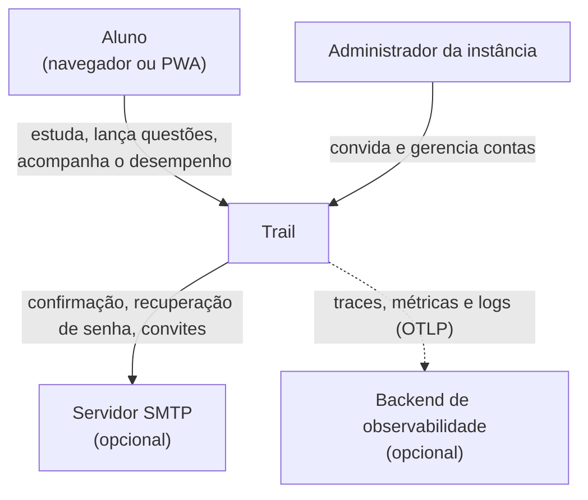
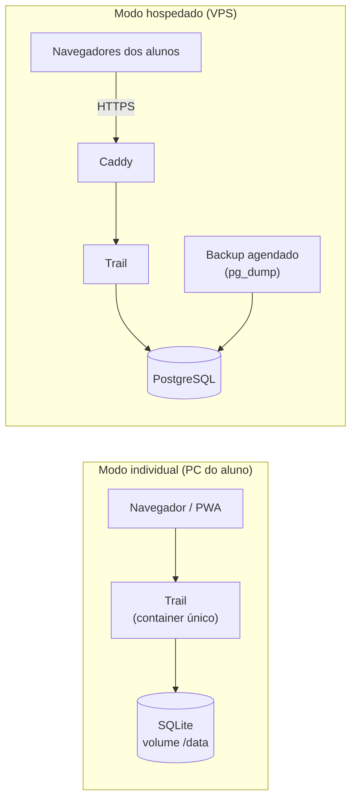
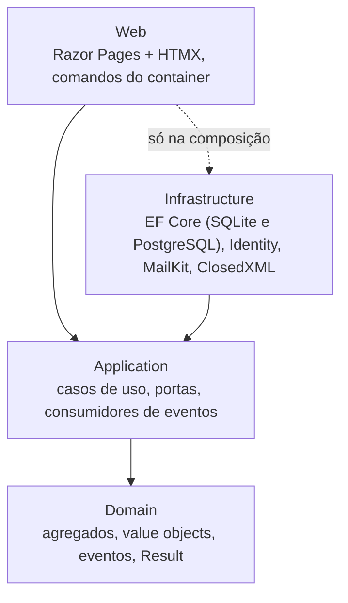
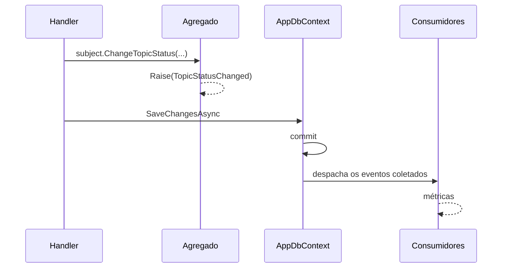
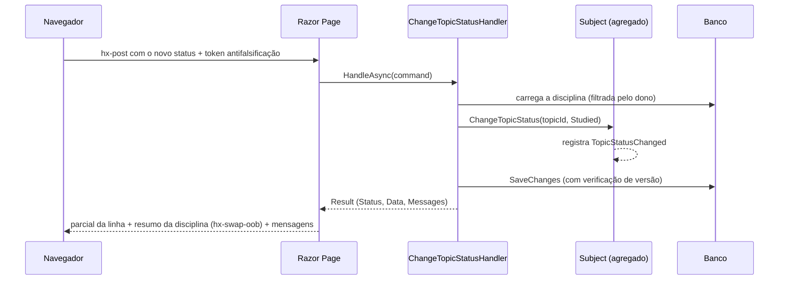

# 3. Arquitetura

> As decisões aceitas indicam o número da ADR. O estilo arquitetural está na
> [ADR 0011](adr/0011-estilo-arquitetural.md), o DDD tático na
> [ADR 0014](adr/0014-ddd-tatico.md), o resultado padrão na
> [ADR 0015](adr/0015-resultado-padrao.md) e a observabilidade na
> [ADR 0016](adr/0016-observabilidade.md). Os itens marcados como **proposta** aguardam
> aprovação.

## 3.1 Abordagem

**Clean Architecture com fatias verticais, DDD tático e módulos por pasta, num único
processo.** Os padrões são reconhecidos. A proporção vem da forma como são aplicados.

O sistema terá dezenas de usuários por instância, um mantenedor e dados que representam
anos de estudo. A complexidade vai para onde está o risco (os dados e os cálculos) e fica
fora de onde ele não existe (escala e distribuição).

### Padrões adotados

| Padrão | Referência | Onde aparece |
|---|---|---|
| Clean Architecture | Robert C. Martin | Quatro projetos, com as dependências apontando para o `Domain` ([3.5](#35-camadas-módulos-e-padrões-internos)) |
| Vertical Slice | Jimmy Bogard | Casos de uso organizados por funcionalidade dentro da `Application` |
| Monólito modular | — | Sete módulos como pastas em cada camada, com fronteiras verificadas por testes |
| DDD tático | Eric Evans, Vaughn Vernon | Agregados, value objects, IDs tipados e eventos de domínio ([2.2](02-dominio-e-regras.md#modelo-tático-ddd)) |
| Notification / Result | Martin Fowler | Retorno padrão dos casos de uso ([ADR 0015](adr/0015-resultado-padrao.md)) |
| Ports & Adapters | Alistair Cockburn | Portas na `Application`, adaptadores na `Infrastructure` ([3.6](#36-pontos-de-variação)) |

### Regras práticas

1. **Decidir cedo só o que é caro de mudar:** modelo de dados, agregados, formato do
   backup e fronteiras dos módulos. O resto espera até haver informação.
2. **Toda abstração aponta a mudança provável que absorve** ([3.6](#36-pontos-de-variação)).
   Se não há mudança provável, não há abstração.
3. **As regras de arquitetura que importam são verificadas pelo compilador ou por testes**
   ([3.15](#315-verificações-automáticas-da-arquitetura)), não só documentadas.

## 3.2 Características de arquitetura

### Prioridades

| # | Característica | Por quê | Como é atendida |
|---|---|---|---|
| 1 | **Integridade e portabilidade dos dados** | São anos de registro de estudo, e perdê-los é inaceitável | Invariantes nos agregados e restrições no banco, concorrência otimista, backup restaurável entre bancos, cópia antes de cada migração |
| 2 | **Corretude dos cálculos** | É o valor central do sistema | Domínio puro, testes de regressão dos erros da planilha e testes baseados em propriedades |
| 3 | **Simplicidade de operação** | Quem instala pode não ser técnico | 1 container, padrões seguros, configuração validada na inicialização com mensagens claras, atualização com 1 comando |

Também são importantes, mas sem exigir estrutura própria: observabilidade
([3.16](#316-observabilidade-e-operação)), segurança no modo hospedado, usabilidade no
celular e facilidade de evolução.

### Não são objetivos

Deixar isso explícito é o que permite manter a solução simples.

| Característica | Por que não |
|---|---|
| Escalabilidade horizontal | Dezenas de usuários por instância: uma instância basta |
| Alta disponibilidade | Alguns minutos fora do ar durante uma atualização são aceitáveis |
| Elasticidade | A carga é baixa e previsível |
| Latência extrema | Páginas geradas no servidor com pouco dado já ficam bem abaixo da meta |

## 3.3 Subdomínios e onde investir

| Subdomínio | Tipo | Investimento |
|---|---|---|
| Prática (questões, período de desempenho, histórico, simulados) | **Central** | Modelo rico, maior cobertura de testes, testes baseados em propriedades |
| Planejamento (planos, disciplinas, árvore de tópicos, status) | Suporte | Agregado com as invariantes da árvore |
| Tempo de estudo | Suporte | Regras de sessão no domínio e relógio controlado nos testes |
| TAF | Suporte | Cadastro simples |
| Intercâmbio (importação, backup) | Suporte, de alto risco | Pipeline explícito, formatos versionados, um teste por versão |
| Contas, e-mail, gráficos, layout | Genérico | Só soluções prontas: ASP.NET Core Identity, MailKit, Chart.js, Tailwind CSS e daisyUI |

## 3.4 Contexto e containers

### Contexto (C4, nível 1)



### Containers (C4, nível 2)



A mesma imagem atende aos dois modos. O que muda é só a configuração (variáveis de
ambiente).

## 3.5 Camadas, módulos e padrões internos

Decidido na [ADR 0011](adr/0011-estilo-arquitetural.md).

### Camadas (C4, nível 3)



| Projeto | Contém | Depende de |
|---|---|---|
| `Domain` | Agregados, value objects, IDs tipados, eventos de domínio, `Result`, regras de pontuação | Só do .NET |
| `Application` | Casos de uso por módulo, portas e consumidores de eventos | `Domain` e o pacote base do EF Core |
| `Infrastructure` | `AppDbContext` e as migrações de cada banco, Identity, MailKit, ClosedXML, despacho de eventos, backup agendado | `Application` |
| `Web` | Razor Pages, parciais HTMX, ponto único de saída do `Result`, comandos do container, `.resx`, `wwwroot` | `Application`, e a `Infrastructure` só para registrar os serviços |

### Módulos

| Módulo | `Domain` | `Application` | `Web` | Responsabilidade |
|---|---|---|---|---|
| Planning | ✔ | ✔ | ✔ | Planos, blocos, disciplinas, tópicos, status, anotações |
| Practice | ✔ | ✔ | ✔ | Lançamentos, período de desempenho, histórico, simulados |
| StudyTime | ✔ | ✔ | ✔ | Cronômetro, pomodoro, sessões manuais |
| Fitness | ✔ | ✔ | ✔ | TAF |
| Dashboard | — | ✔ (só consultas) | ✔ | Compõe Planning, Practice e StudyTime |
| Interchange | — | ✔ | ✔ | Importação do `.xlsx`, backup e restauração |
| Accounts | ✔ (`UserSettings`) | ✔ | ✔ | Contas, convites, administração, preferências |

**Contas:** o usuário do Identity fica na `Infrastructure`. A `Application`
fala com ele pela porta `IIdentityService`, e as preferências (fuso, pomodoro) ficam no
agregado `UserSettings`, no `Domain`. Assim o `Domain` não conhece o Identity.

### Estrutura

```text
trail/
├─ src/
│  ├─ Trail.Domain/
│  │  ├─ Common/                  AggregateRoot, IDomainEvent, Result, Message
│  │  ├─ Planning/                StudyPlan, Subject, Topic, TopicNote, TopicCode, eventos
│  │  ├─ Practice/                QuestionEntry, QuestionCount, MockExam, regras de pontuação
│  │  └─ StudyTime/  Fitness/  Accounts/
│  ├─ Trail.Application/
│  │  ├─ Abstractions/            IAppDbContext, ICurrentUser, IIdentityService, IEmailSender, ISpreadsheetReader
│  │  ├─ Practice/
│  │  │  ├─ RecordQuestions/      RecordQuestionsCommand, RecordQuestionsHandler
│  │  │  └─ GetPerformance/       GetPerformanceQuery, GetPerformanceHandler, PerformanceView
│  │  ├─ Planning/  StudyTime/  Fitness/  Dashboard/  Interchange/  Accounts/
│  │  └─ Telemetry/               consumidores de eventos que geram as métricas
│  ├─ Trail.Infrastructure/
│  │  ├─ Persistence/             AppDbContext, mapeamentos, interceptor de eventos
│  │  │  ├─ Sqlite/               contexto derivado e migrações
│  │  │  └─ PostgreSql/           contexto derivado e migrações
│  │  └─ Identity/  Email/  Spreadsheets/  Backups/
│  └─ Trail.Web/
│     ├─ Pages/                   Planning/ Practice/ StudyTime/ Fitness/ Dashboard/ Interchange/ Accounts/
│     ├─ Results/                 ponto único de saída do Result
│     ├─ Cli/                     comandos do container
│     ├─ Resources/               textos da interface (.resx, pt-BR)
│     ├─ Styles/                  app.css (entrada do Tailwind), bundle e tema do daisyUI
│     └─ wwwroot/                 CSS gerado, HTMX, Chart.js, ícones, manifest, service worker
├─ tests/
│  ├─ Trail.Domain.Tests/
│  ├─ Trail.Application.Tests/   casos de uso contra banco real, nos dois bancos
│  ├─ Trail.Web.Tests/           HTTP, HTMX e isolamento, nos dois bancos
│  ├─ Trail.Architecture.Tests/
│  └─ Trail.E2E.Tests/           Playwright
├─ deploy/                        compose.sqlite.yml, compose.postgres.yml, compose.dev.yml, Caddyfile
├─ docs/
├─ Dockerfile
├─ Directory.Build.props
├─ Directory.Packages.props
└─ Trail.slnx
```

### Regras de dependência

Garantidas pelo compilador, pelas referências entre projetos:

1. O `Domain` não referencia nenhum projeto nem pacote.
2. A `Application` referencia só o `Domain` e pacotes de abstração (EF Core base e
   `Microsoft.Extensions.*.Abstractions`).
3. A `Infrastructure` referencia a `Application`.
4. A `Web` referencia a `Application` e a `Infrastructure`.

Verificadas por testes, onde o compilador não alcança:

5. A `Web` usa tipos da `Infrastructure` só na composição (`Program.cs`).
6. As páginas não usam o `IAppDbContext`: todo acesso a dados passa por um caso de uso.
7. Um agregado referencia outro só por ID tipado.
8. Um módulo da `Application` não usa tipos internos de outro. As exceções são
   `Dashboard`, `Interchange` e `Telemetry`, que leem vários módulos por definição.
9. Só a `Infrastructure` usa os provedores do EF Core, o Identity, o MailKit e o
   ClosedXML. Sem esse teste, as dependências transitivas chegariam à `Web`.
10. Os handlers são `sealed`, terminam em `Handler` e têm um único método público,
    `HandleAsync`, que devolve `Result` ou `Result<T>`.
11. As entidades não têm setters públicos, e os eventos de domínio são `sealed record`.

### Casos de uso

- Cada caso de uso é um **comando** (altera estado) ou uma **consulta** (só lê), com o
  seu handler, na pasta do caso de uso.
- **Comando:** o handler carrega o agregado pelo `IAppDbContext` (já filtrado pelo dono),
  chama o método do agregado, grava com um único `SaveChanges` e devolve um `Result`.
- **Consulta:** projeta direto para um modelo de leitura (ex.: `PerformanceView`), com
  `AsNoTracking`.
- **Validação:** as regras ficam no handler e no domínio e acumulam mensagens (padrão
  Notification). Erros de conversão da entrada (ex.: texto num campo numérico) viram
  mensagens no mesmo formato.
- **A página** monta o comando, chama o handler e entrega o `Result` ao ponto único de
  saída. Os comandos do container e as tarefas agendadas chamam os mesmos handlers.

### Resultado padrão

Decidido na [ADR 0015](adr/0015-resultado-padrao.md). Todo caso de uso devolve o mesmo
envelope, e só o `Data` varia:

```text
Result<T>
├─ Status     Ok | Invalid | NotFound | Conflict | Forbidden
├─ Data       T, só quando Ok
└─ Messages   [ { Code, Severity, Target? } ]
```

As mensagens levam códigos, não textos. A `Web` traduz o código pelo `.resx` e converte o
`Status` em resposta HTTP num único lugar ([3.9](#39-interação-com-htmx)).

### Eventos de domínio

Decidido na [ADR 0014](adr/0014-ddd-tatico.md).



A lista de eventos e os consumidores estão em
[2.2](02-dominio-e-regras.md#modelo-tático-ddd).

## 3.6 Pontos de variação

As portas ficam na `Application`, e os adaptadores, na `Infrastructure`.

| O que tende a mudar | Como fica isolado |
|---|---|
| Regras de pontuação (bancas novas) | `IScoringRule` no `Domain`, uma implementação por regra |
| Formatos de entrada (`.xlsx` hoje, texto do edital depois) | Porta de leitura e um adaptador por formato. Pipeline: leitor do formato → modelo neutro → validação → prévia → gravação |
| Formato do backup | `formatVersion`, com conversores de uma versão para a seguinte, testados com um arquivo de cada versão |
| Banco de dados | `IAppDbContext`, um provedor por banco na `Infrastructure` e as regras de portabilidade ([3.10](#310-dados-dois-bancos-integridade-e-concorrência)) |
| Envio de e-mail | Porta `IEmailSender`: MailKit quando há SMTP, links manuais quando não há |
| Relógio | `TimeProvider`, nativo do .NET, para os testes controlarem o tempo |
| Usuário atual | Porta `ICurrentUser`: vem da requisição na `Web` e do sistema nos comandos e tarefas |
| Destino da telemetria | OTLP configurável. Nenhum fornecedor aparece no código |

O que é estável não ganha abstração:

- **Sem repositórios:** o `IAppDbContext` expõe as raízes de agregado direto.
- **Sem interface para os handlers:** a página depende da classe concreta do caso de uso.
- **A árvore de tópicos não tem camada intermediária.**

## 3.7 O que deliberadamente não fazemos

| Padrão | Por que não aqui |
|---|---|
| Microsserviços | Um mantenedor e um domínio pequeno. Só traria rede, implantação e consistência distribuídas |
| CQRS com modelos ou bancos separados | As consultas projetam direto, mas o modelo e o banco são um só |
| Event sourcing | Os eventos de domínio notificam, não são a fonte do estado. Os lançamentos já guardam o histórico necessário |
| MediatR, ou interface genérica com decorators | Cada página chama o seu caso de uso direto. O que seria transversal tem lugar fixo: a transação no `SaveChanges`, a telemetria na instrumentação automática e no ponto único de saída |
| Repositórios (genéricos ou por agregado) | O `IAppDbContext` expõe só as raízes, e o EF Core já é repositório e unit of work |
| Outbox e mensageria | Os eventos são consumidos no mesmo processo, e os consumidores da 1.0 toleram a perda de um evento |
| Biblioteca de `Result` | Um tipo pequeno mantém o `Domain` dependente só do .NET |
| AutoMapper | O mapeamento explícito é curto e verificado pelo compilador |
| Projetos separados por módulo | Seriam cerca de 28 projetos. Os módulos são pastas em cada camada, e o gatilho para separar está em [3.17](#317-gatilhos-de-evolução) |
| Fila ou cache distribuído | O volume é baixo. As tarefas em segundo plano usam `BackgroundService` |
| SPA | Ver a [ADR 0002](adr/0002-stack-aspnetcore-razor-htmx.md) |

## 3.8 Stack

| Camada | Tecnologia | Situação |
|---|---|---|
| Runtime | .NET 10 (LTS, suporte até nov/2028) | Aceita ([0002](adr/0002-stack-aspnetcore-razor-htmx.md)) |
| Web | ASP.NET Core Razor Pages + HTMX 4 | Aceita ([0002](adr/0002-stack-aspnetcore-razor-htmx.md)) |
| Interface | Tailwind CSS 4 + daisyUI 5 (build pelo executável standalone, sem Node) e Chart.js, servidos pelo app | Aceita ([0013](adr/0013-frontend-tailwind-daisyui.md)) |
| Ícones | Lucide, em sprite SVG | Aceita ([0013](adr/0013-frontend-tailwind-daisyui.md)) |
| Textos da interface | Arquivos `.resx` (pt-BR) acessados por `IStringLocalizer` | Aceita ([0007](adr/0007-idiomas.md)) |
| Dados | EF Core 10, SQLite e PostgreSQL | Aceita ([0003](adr/0003-sqlite-e-postgresql.md)) |
| Contas | ASP.NET Core Identity, com e-mail via MailKit | Aceita ([0012](adr/0012-autenticacao-identity.md)) |
| Planilhas | ClosedXML | Proposta, confirmada na Fase 6 |
| Markdown | Markdig, com HTML desabilitado | Proposta, confirmada na Fase 2 |
| Observabilidade | OpenTelemetry (traces, métricas e logs) e Aspire Dashboard no desenvolvimento | Aceita ([0016](adr/0016-observabilidade.md)) |
| Testes | xUnit v3, CsCheck, Testcontainers, Playwright, axe e ArchUnitNET | Aceita ([Fase 0](fases/fase-0-fundacao.md)) |
| Imagem | .NET chiseled `extra`, usuário não root | Aceita ([Fase 0](fases/fase-0-fundacao.md)) |
| HTTPS no modo hospedado | Caddy | Aceita ([Fase 0](fases/fase-0-fundacao.md)) |
| E-mail em desenvolvimento | Mailpit | Aceita ([Fase 0](fases/fase-0-fundacao.md)) |

Todas as bibliotecas têm licença compatível com AGPL-3.0 (MIT, BSD ou Apache-2.0).

## 3.9 Interação com HTMX

Exemplo: mudar o status de um tópico.



Convenções:

- **Mesma rota, duas respostas:** se a requisição tem o cabeçalho
  `HX-Request-Type: partial`, a página devolve só o trecho (parcial). Sem ele, devolve a
  página inteira. Assim os formulários continuam funcionando sem JavaScript, e os links
  reforçados e a restauração do histórico recebem a página inteira. Respostas que forem
  para cache levam `Vary: HX-Request-Type`.
- **Ponto único de saída:** toda página responde pelo mesmo método, que converte o
  `Result` em status HTTP, parcial e mensagens (tabela na
  [ADR 0015](adr/0015-resultado-padrao.md)). O HTMX 4 troca o conteúdo em todas as
  respostas, exceto 204 e 304.
- **Antifalsificação:** o token vai em `hx-headers:inherited` no `<body>`, no cabeçalho
  `X-CSRF-TOKEN`, e o Razor Pages valida por padrão.
- **CSP estrita:** o projeto não usa `hx-on:*`, valores `js:` nem filtros de gatilho, os
  únicos recursos do HTMX 4 que avaliam código. Assim a CSP dispensa `'unsafe-eval'`. A
  extensão `hx-csp`, com nonce por requisição, entra na Fase 1
  ([ADR 0013](adr/0013-frontend-tailwind-daisyui.md)).
- **Componentes só em CSS (daisyUI):** nada precisa ser reinicializado depois das trocas.
  Modais e o menu lateral do celular usam o `<dialog>` nativo
  ([ADR 0013](adr/0013-frontend-tailwind-daisyui.md)).
- **Rotas em pt-BR,** porque aparecem para o usuário (`/planos/{id}/simulados`). Os nomes
  no código continuam em inglês.

### Cronômetro e pomodoro

- **O servidor é a fonte da verdade:** guarda o `StartedAt`, e a página só exibe o tempo
  decorrido. Recarregar a página, trocar de aparelho ou bloquear o celular não perde a
  contagem.
- **Limite honesto do alerta:** o aviso de fim do pomodoro depende da página aberta. Em
  segundo plano, o navegador pode atrasá-lo em até cerca de 1 minuto. No iOS, com o app
  fechado, não há alerta, porque isso exigiria notificações push. O tempo registrado não
  é afetado.

## 3.10 Dados: dois bancos, integridade e concorrência

### Dois bancos

Decidido na [ADR 0003](adr/0003-sqlite-e-postgresql.md).

- **Configuração:** `Database__Provider` = `Sqlite` ou `PostgreSql`, mais
  `ConnectionStrings__Default`.
- **Migrações:** um `AppDbContext` com o modelo e dois contextos derivados
  (`SqliteAppDbContext` e `PostgreSqlAppDbContext`), que existem só para separar as
  migrações de cada banco. É a abordagem documentada pelo EF Core para múltiplos
  provedores.
- **Aplicação das migrações:** automática na inicialização. No SQLite, o app faz antes
  uma cópia do banco.
- **Cuidados de portabilidade:**
  - **Datas:** `DateOnly` para dias e `DateTime` em UTC para instantes. Evitar
    `DateTimeOffset`, que o SQLite não compara nem ordena no banco.
  - **Números:** contagens são inteiras, percentuais são calculados no `Domain`, e os
    pontos do TAF são somados em memória. O SQLite não compara nem ordena `decimal` no
    banco.
  - **Busca:** o `LIKE` do SQLite só ignora maiúsculas em ASCII, e o PostgreSQL
    diferencia acentos. A solução é a coluna `SearchText`, normalizada (sem acento, em
    minúsculas) e preenchida pela aplicação.
  - **IDs tipados e value objects:** conversores e tipos complexos do EF Core, iguais nos
    dois bancos.
  - **Concorrência no SQLite:** modo WAL.

### Integridade

- **Duas camadas:** as invariantes ficam nos agregados, e o banco repete as essenciais
  como restrições (ex.: `CHECK (Correct + Wrong <= Total)`), chaves estrangeiras e
  índices únicos.
- **Uma transação por caso de uso:** um único `SaveChanges`.

### Concorrência

- As raízes de agregado têm um campo `Version`, controlado pela aplicação, que funciona
  igual nos dois bancos.
- Um conflito entre aparelhos nunca vira sobrescrita silenciosa (regra em
  [2.2](02-dominio-e-regras.md#regras-de-negócio-e-onde-são-garantidas)):
  - uma mudança de status é reaplicada automaticamente, porque não depende do estado
    anterior;
  - uma edição de texto mostra o conflito (`Conflict`) sem perder o que foi digitado.

## 3.11 Contas, e-mail e isolamento

Os modos foram decididos na [ADR 0004](adr/0004-modos-de-implantacao.md). A
autenticação foi decidida na [ADR 0012](adr/0012-autenticacao-identity.md).

### Contas

- **Autenticação:** ASP.NET Core Identity, com cookie `HttpOnly`, `Secure` e
  `SameSite=Lax`.
- **Primeiro acesso:** a primeira conta criada vira administradora.
- **Cadastro**, por `Registration__Mode`:
  - `Closed`: padrão no modo individual.
  - `InviteOnly`: padrão no modo hospedado.
  - `Open`.
- **Admin:** listar usuários, desativar contas, convidar e reenviar e-mails.

### E-mail

- Confirmação de conta, recuperação de senha e convites são enviados por e-mail.
- **SMTP** configurável por `Email__Smtp__*`, com um botão "enviar e-mail de teste" no
  admin.
- **Sem SMTP:** o admin gera os links de confirmação, recuperação e convite
  para entregar manualmente, e um comando no container redefine a senha do admin.
- A recuperação de senha não revela se o e-mail existe.
- Os tokens do Identity têm validade curta.
- **Falha no envio:** é registrada no log e na métrica de e-mails, e mostrada na tela,
  com opção de reenviar.

### Isolamento

- Toda raiz de agregado tem `OwnerId`, e um filtro global do EF Core restringe tudo ao
  usuário atual.
- Dado de outro usuário responde 404, nunca 403, para não revelar que existe.
- Um teste de integração percorre **todas** as rotas com IDs de outro usuário e exige 404.
- **Chaves do Data Protection** persistidas em `/data/keys`. Sem isso, cada reinício do
  container desloga todo mundo e invalida os links de e-mail.

### LGPD

"Exportar meus dados" (o próprio backup) e "excluir minha conta" (apaga tudo em
cascata).

## 3.12 Implantação

### Imagem

- Dockerfile multi-stage: compila com a imagem do SDK e roda em
  `mcr.microsoft.com/dotnet/aspnet:10.0-noble-chiseled-extra`. A variante `extra` inclui
  ICU e tzdata, necessários para o formato pt-BR e para o fuso de cada usuário.
- O estágio de build roda na arquitetura da máquina de build (`--platform=$BUILDPLATFORM`)
  e gera o CSS uma vez só, com o executável do Tailwind. O CSS é o mesmo para amd64 e
  arm64.
- A imagem chiseled não tem shell e roda como o usuário não root `app`. Por isso:
  - O diretório `/data` é criado na imagem já pertencendo ao `app`. Sem isso, o volume
    nasce como root e o app não consegue gravar.
  - O health check do Docker usa o próprio app (`Trail.Web --healthcheck`), porque a
    imagem não tem `curl`.
- Endpoints `/health/live` e `/health/ready` (este último verifica o banco).
- Publicada como `ghcr.io/vitorparras/trail:<versão>`, para amd64 e arm64.

### Modo individual

```yaml
# deploy/compose.sqlite.yml (ilustrativo)
services:
  app:
    image: ghcr.io/vitorparras/trail:1
    ports:
      - "8080:8080"
    environment:
      Database__Provider: Sqlite
      ConnectionStrings__Default: "Data Source=/data/trail.db"
      Registration__Mode: Closed
    volumes:
      - trail-data:/data   # banco, chaves e backups
    restart: unless-stopped
volumes:
  trail-data:
```

### Modo hospedado

`deploy/compose.postgres.yml`, com quatro serviços:

- `caddy`: HTTPS automático.
- `app`: com `ForwardedHeaders` habilitado, para saber que a requisição original era HTTPS.
- `postgres`.
- `backup`: `pg_dump` diário, com retenção configurável.

### Desenvolvimento

`deploy/compose.dev.yml` sobe:

- PostgreSQL;
- Mailpit, uma caixa de e-mail local para ver as mensagens enviadas;
- Aspire Dashboard, para ver os traces, as métricas e os logs.

### Backup operacional

| Banco | Como |
|---|---|
| SQLite | Tarefa agendada no app executa `VACUUM INTO` diariamente em `/data/backups`, com retenção configurável. Também roda antes de cada migração. |
| PostgreSQL | Serviço `backup` com `pg_dump` diário. |

O backup por arquivo da aplicação ([2.5](02-dominio-e-regras.md#25-backup-e-restauração))
é independente desses e serve ao usuário final.

## 3.13 PWA

- `manifest.webmanifest` com ícones próprios (nunca brasões de órgãos).
- **Service worker:** guarda em cache os arquivos estáticos (versionados) e uma página
  "sem conexão". As páginas com dados vêm sempre da rede. O uso offline completo é
  candidato para depois da 1.0.
- **Exige HTTPS** (exceto em `localhost`). Pelo celular, em `http://192.168.x.x`, o
  sistema funciona como site, mas **não instala** como PWA. O guia de instalação vai
  documentar duas saídas para o modo individual:
  - Tailscale (`tailscale serve`, com certificado).
  - Cloudflare Tunnel.

  No modo hospedado, o Caddy emite o certificado.

## 3.14 Segurança

| Ameaça | Controle |
|---|---|
| Acesso aos dados de outro usuário (IDOR) | `OwnerId` em toda raiz de agregado, filtro global por dono e teste de acesso cruzado em todas as rotas |
| CSRF | Antifalsificação nativa do Razor Pages, com o token enviado pelo HTMX no cabeçalho |
| XSS | O Razor codifica a saída. Markdown com HTML desabilitado. CSP sem `unsafe-inline` e sem `unsafe-eval` |
| Força bruta no login | Bloqueio de conta do Identity + rate limiting nativo do ASP.NET Core |
| Descoberta de contas pelo e-mail | Respostas iguais na recuperação de senha e no cadastro |
| Links de e-mail interceptados ou reaproveitados | Tokens de uso único e com validade curta |
| Upload malicioso (`.xlsx` e backup `.zip`) | Limite de tamanho, verificação do tamanho descompactado, validação do manifest e do formato |
| Roubo de sessão | Cookie `HttpOnly`, `Secure` e `SameSite=Lax`. HTTPS com HSTS no modo hospedado |
| Vazamento de dados pela telemetria | Nenhum dado pessoal em logs, spans ou métricas. O usuário aparece só pelo ID |
| Dependências vulneráveis | Dependabot com alertas e correções automáticas, auditoria do NuGet como erro no restore do CI, lock files, Actions fixadas por SHA e CodeQL |
| Segredos expostos | Só em variáveis de ambiente, com `.env.example` no repositório e `.env` no `.gitignore` |
| Container comprometido | Imagem chiseled, usuário não root, só `/data` com escrita |

## 3.15 Verificações automáticas da arquitetura

São as "fitness functions": verificações que impedem a arquitetura de se degradar sem que
ninguém perceba.

| O que garante | Verificação | Quando roda |
|---|---|---|
| Direção das dependências entre camadas (regras 1 a 4 de [3.5](#35-camadas-módulos-e-padrões-internos)) | Referências entre projetos | Toda compilação |
| Composição, módulos, agregados, bibliotecas e convenções (regras 5 a 11) | Testes ArchUnitNET | Todo PR |
| Eventos com consumidor | Todo tipo de evento de domínio tem ao menos um consumidor próprio registrado | Todo PR |
| Ponto único de saída | Um teste por `Status` do `Result`, verificando o código HTTP e o parcial | Todo PR |
| Telemetria | O caso de uso marca o span com o resultado, e os eventos geram as métricas (coletor em memória) | Todo PR |
| Isolamento entre usuários | Varredura de todas as rotas com IDs de outro usuário | Todo PR, nos dois bancos |
| Portabilidade | Suítes da `Application` e da `Web` em SQLite e PostgreSQL | Todo PR |
| Migrações em dia | `dotnet ef migrations has-pending-model-changes` nos dois contextos | Todo PR |
| Compatibilidade do backup | Restauração de um arquivo de exemplo de cada `formatVersion` | Todo PR |
| Corretude dos cálculos | Testes baseados em propriedades (ex.: o desempenho Cebraspe fica sempre entre −100 e 100; o período só inclui lançamentos com data dentro dele) | Todo PR |
| Orçamento de desempenho | Plano com 1.000 tópicos e 10.000 lançamentos respondendo em menos de 300 ms | Diário, fora do PR, para não gerar falso alarme |
| Acessibilidade | axe nas páginas principais | Todo PR |

## 3.16 Observabilidade e operação

Decidido na [ADR 0016](adr/0016-observabilidade.md).

### Sinais

| Sinal | Origem | Exemplos |
|---|---|---|
| Traces | Automáticos (ASP.NET Core, EF Core, HttpClient) e spans próprios nas operações longas | Requisição → caso de uso → consultas SQL. Importação, backup, restauração, envio de e-mail |
| Métricas | Runtime do .NET, ponto único de saída e consumidores de eventos | Resultados por caso de uso e `Status`, questões registradas, minutos estudados, importações, e-mails enviados e com falha |
| Logs | `ILogger` em JSON, com o `traceId` em toda linha | Eventos de domínio despachados, falhas com o código da mensagem |

### Regras

- **Exportação por OTLP:** só quando `OTEL_EXPORTER_OTLP_ENDPOINT` está definido. Sem a
  variável, os logs continuam em JSON no console.
- **Código de rastreio:** as mensagens de erro mostram o `traceId`, para o usuário
  informar e o admin localizar o problema.
- **Privacidade:** nenhum dado pessoal em logs, spans ou métricas. O usuário aparece só
  pelo ID, e nunca como dimensão de métrica (o que também evita explosão de
  cardinalidade).
- **Onde ver:** Aspire Dashboard no desenvolvimento. No modo hospedado, qualquer backend
  OTLP, com um exemplo no guia de instalação (escolhido na Fase 7).

### Operação

- **Health checks** em `/health/live` e `/health/ready`.
- **Configuração validada na inicialização** (`ValidateOnStart`): um erro de
  configuração impede o app de subir e mostra uma mensagem clara, em vez de falhar no
  meio do uso.
- **Tarefas agendadas** com `BackgroundService` (ex.: o backup diário do SQLite).

## 3.17 Gatilhos de evolução

Cada simplificação acima vale enquanto o contexto não mudar. Estes são os sinais que
levam a revisá-la:

| Se acontecer… | Reavaliar… |
|---|---|
| For preciso um segundo cliente (app nativo, API pública) | Endpoints HTTP que chamam os mesmos casos de uso. O envelope do `Result` vira o JSON da resposta |
| Um consumidor de evento precisar gravar dados ou chamar um serviço externo com garantia | Despacho dentro da transação, ou outbox |
| Surgir uma integração externa (ex.: plataforma de questões) | Criar um módulo próprio, com camada anticorrupção |
| Um caso de uso precisar de comportamento transversal que o ponto de saída não cobre (ex.: auditoria obrigatória) | Interface comum para os handlers, com decorators |
| A instância hospedada tiver centenas de usuários ativos ou lentidão medida | Índices e consultas primeiro, depois cache. O SQLite deixa de ser opção para esse modo |
| Um módulo crescer a ponto de atrapalhar a navegação ou o build | Extrair o módulo para projetos próprios |
| O uso offline completo for validado | Escrever uma nova ADR: isso muda a premissa da ADR 0002 para essa parte |
