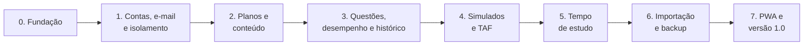

# 5. Roteiro

## Como cada fase funciona

Aceito pelo autor.

1. **Detalhar:** a fase é quebrada em tarefas, e o autor aprova antes de começar.
2. **Implementar,** com os testes junto.
3. **Validar:** uma branch por fase, com um commit por tarefa, e um único PR, com o CI
   verde, aprovado pelo autor na apresentação.
4. **Parar e apresentar:**
   - o que foi feito;
   - como validar, com os comandos exatos no PowerShell;
   - as decisões tomadas e os riscos.
5. **Avançar** para a próxima fase só com aprovação.

Cada fase entrega as suas funcionalidades **completas**: não há versão reduzida para
completar depois ([1.5](01-visao-e-escopo.md#15-escopo-da-versão-10)). Ideias novas que
surgirem no caminho vão para o backlog pós-1.0.

## Visão geral

O autor pode abandonar a planilha ao fim da **Fase 6**.

---

### Fase 0 — Fundação

**Objetivo:** deixar o repositório pronto, com o ciclo build → teste → imagem funcionando
nos dois bancos e as regras de arquitetura já verificadas.

**Detalhamento:** [tarefas da Fase 0](fases/fase-0-fundacao.md).

**Depende de:** ADRs [0011](adr/0011-estilo-arquitetural.md),
[0013](adr/0013-frontend-tailwind-daisyui.md), [0014](adr/0014-ddd-tatico.md),
[0015](adr/0015-resultado-padrao.md) e [0016](adr/0016-observabilidade.md).

**Entregas:**

- `git init`, `.gitignore` (incluindo `*.xlsx`), `LICENSE` (AGPL-3.0) e README inicial.
- `Trail.slnx` com os projetos `Domain`, `Application`, `Infrastructure`, `Web` e os
  de testes. `Directory.Build.props`, `Directory.Packages.props` e `.editorconfig`.
- Camadas e pastas dos módulos ([3.5](03-arquitetura.md#35-camadas-módulos-e-padrões-internos))
  e os primeiros testes de arquitetura.
- Blocos de base:
  - `Result`, mensagens e o ponto único de saída na `Web`;
  - `AggregateRoot`, IDs tipados, coleta e despacho de eventos de domínio;
  - `IAppDbContext` e `ICurrentUser`.
- Escolha do banco por configuração, com uma migração inicial em cada um.
- OpenTelemetry (traces, métricas e logs), com o Aspire Dashboard no `compose.dev.yml`.
- Localização com `.resx` (pt-BR).
- Tailwind CSS 4 + daisyUI 5, com o build do CSS integrado ao `dotnet build` e ao
  Dockerfile. HTMX e Chart.js servidos pelo app. Layout base com tema claro e escuro.
- Configuração validada na inicialização.
- `Dockerfile`, `compose.sqlite.yml`, `compose.postgres.yml` e `compose.dev.yml` (com
  Mailpit e Aspire Dashboard), com health checks.
- CI: formatação, build, testes de unidade, de casos de uso e de arquitetura, migrações
  pendentes, matriz SQLite/PostgreSQL e build da imagem.

**Pronto quando:**

- Os dois arquivos compose sobem e respondem em `/health/ready`.
- Uma requisição de exemplo aparece no Aspire Dashboard, com o trace da página até o
  banco.
- O CI fica verde num PR.
- Um teste de arquitetura falha de propósito quando o `Domain` usa um tipo do EF Core ou
  quando uma página usa o `IAppDbContext`.

### Fase 1 — Contas, e-mail e isolamento

**Detalhamento:** [tarefas da Fase 1](fases/fase-1-contas-email-isolamento.md).

**Entregas:**

- Cadastro com confirmação por e-mail, login, logout, troca e recuperação de senha.
- A primeira conta vira admin. Modos de cadastro e convites por e-mail.
- Links manuais quando não há SMTP, e comando para redefinir a senha do admin.
- Envio de e-mail de teste no admin.
- Chaves do Data Protection persistidas.
- Layout responsivo com tema claro e escuro.
- Filtro global por dono.
- Rate limiting no login, cabeçalhos de segurança e CSP sem `'unsafe-inline'` nem
  `'unsafe-eval'`, com a extensão `hx-csp` do HTMX e nonce por requisição (middleware e
  tag helper que marca os elementos com `hx-*`).
- Rodapé com o link "Código-fonte" (AGPL).
- Fuso horário e preferências do usuário.

**Pronto quando:**

- Um teste automatizado prova, nos dois bancos, que um usuário não acessa dados de outro.
- Os fluxos de e-mail funcionam com o Mailpit e também sem SMTP.
- Reiniciar o container não desloga ninguém.

### Fase 2 — Planos e conteúdo

**Entregas:**

- Plano de estudo: nome, regra de pontuação, período de desempenho padrão, faixas de
  desempenho e data da prova.
- Blocos, disciplinas e tópicos com subtópicos, com reordenação.
- Exclusão em cascata, com uma confirmação que mostra o que será apagado.
- Status com cor e texto.
- Anotações em Markdown.
- Filtros por status e disciplina, e busca sem acento.
- Concorrência otimista na edição.

**Pronto quando:** dá para montar à mão uma disciplina da planilha e mudar status pelo
celular.

### Fase 3 — Questões, desempenho e histórico

**Entregas:**

- Lançamento de questões por tópico, com validações, edição e exclusão.
- Desempenho por tópico (somando os subtópicos), disciplina, bloco e plano, conforme a
  regra e o período.
- Seletor de período no painel, sempre com o volume de questões.
- Faixas de cor configuráveis.
- Painel com um gráfico por disciplina e a tabela equivalente.
- Histórico: evolução semanal do desempenho e do volume, e lista de lançamentos.

**Pronto quando:**

- Os erros E1 a E5 da planilha têm testes que documentam o comportamento corrigido.
- Os testes de propriedade do período passam.

### Fase 4 — Simulados e TAF

**Entregas:**

- **Simulados:** cadastro, nota tradicional, nota Cebraspe, mediana de todos e gráfico de
  evolução.
- **TAF**, opcional por plano: provas configuráveis (no plano da PF: barra, salto,
  natação e corrida), resultados, pontos, total, comentário e gráfico de evolução.

**Pronto quando:** as abas Simulados e Simulado TAF podem ser abandonadas.

### Fase 5 — Tempo de estudo

**Entregas:**

- Cronômetro e pomodoro por disciplina ou tópico, com o servidor como fonte da verdade.
- Lançamento manual de sessões.
- Tratamento de sessão esquecida aberta.
- Horas por tópico, disciplina, dia e semana, no fuso do usuário, também no painel.

**Pronto quando:**

- Recarregar a página ou trocar de aparelho não perde a contagem.
- Os testes com relógio controlado cobrem o pomodoro e a virada do dia.

### Fase 6 — Importação e backup

**Entregas:**

- Importação do `.xlsx`, com prévia, relatório de avisos e a data das questões importadas.
- Exportar e restaurar backup (`.zip`), de um plano ou de todos.
- Backup operacional: `VACUUM INTO` e `pg_dump` agendados.
- Exclusão de conta.

**Pronto quando:**

- A planilha real do autor importa sem perda.
- Um backup feito no SQLite restaura no PostgreSQL, com teste automatizado.

**A partir daqui, a planilha pode ser abandonada.**

### Fase 7 — PWA e versão 1.0

**Entregas:**

- Manifest, ícones e service worker.
- Auditoria de acessibilidade (axe) e de responsividade.
- Guia de observabilidade para o modo hospedado, com o backend de exemplo escolhido.
- Guias de instalação: modo individual, modo hospedado com HTTPS e SMTP, e acesso pelo
  celular.
- release-please e imagem multi-arquitetura no GHCR.
- README com capturas de tela, e arquivos de comunidade.

**Pronto quando:**

- A v1.0.0 está publicada.
- Um aluno consegue instalar seguindo só o README.

---

## Depois da 1.0: uma funcionalidade por vez

Cada funcionalidade só entra depois que o autor valida a utilidade dela.

| Funcionalidade | Situação |
|---|---|
| Revisões espaçadas | A validar |
| Metas e ciclo de estudos | A validar |
| Colar o conteúdo do edital como texto e gerar a árvore | A validar |
| Modelos de conteúdo compartilháveis entre alunos | A validar |
| Pontos do TAF calculados pela tabela do edital | A validar |
| Uso offline completo | A validar (exige nova ADR, ver [3.17](03-arquitetura.md#317-gatilhos-de-evolução)) |
| Demo pública com dados fictícios | A validar |
| 2FA, passkeys ou login com Google/GitHub | A validar |

## Riscos

| Risco | Mitigação |
|---|---|
| Comportamento diferente entre SQLite e PostgreSQL | Testes de integração nos dois bancos em todo PR, e as regras de portabilidade da [seção 3.10](03-arquitetura.md#310-dados-dois-bancos-integridade-e-concorrência) |
| Planilhas dos alunos alteradas (colunas movidas, abas renomeadas) | O importador localiza os cabeçalhos pelo texto, e a prévia mostra os avisos |
| E-mails caindo no spam ou SMTP mal configurado | Botão de e-mail de teste, guia de SPF/DKIM e links manuais como alternativa |
| Alerta do pomodoro atrasado com o celular bloqueado | O tempo é registrado pelo servidor, e a limitação do alerta é documentada ([3.9](03-arquitetura.md#39-interação-com-htmx)) |
| PWA não instala no celular sem HTTPS | Guia com Tailscale e Cloudflare Tunnel |
| Perda de dados numa atualização | Cópia automática do SQLite antes de migrar, e notas de versão |
| Escopo crescer antes da 1.0 | Nada novo fora do escopo definido. As ideias vão para o backlog |
| Obrigações da LGPD no modo hospedado | Dados mínimos, exportação e exclusão de conta, e aviso de privacidade |
