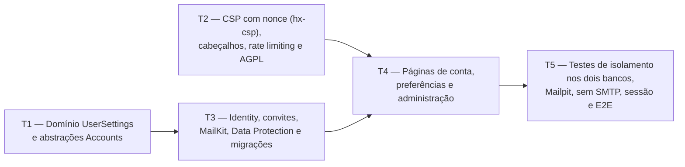

# Fase 1 — Contas, e-mail e isolamento: detalhamento

> **Situação:** em implementação na branch `phase/1-accounts-email-isolation` (empilhada
> sobre `phase/0-foundation`).

## Objetivo

Entregar o controle completo de acesso, envio de e-mail (com SMTP via MailKit e modo manual
sem SMTP), preferências do usuário (`UserSettings`), administração de contas e convites,
persistência das chaves do Data Protection, cabeçalhos de segurança com Content Security
Policy (CSP) estrita baseada em nonce (`hx-csp`), rate limiting no login e comprovação
automatizada do isolamento entre usuários nos dois bancos.

## Depende de

- [Fase 0 — Fundação](fase-0-fundacao.md)
- [ADR 0004 — Modos de implantação](../adr/0004-modos-de-implantacao.md)
- [ADR 0012 — Autenticação completa com ASP.NET Core Identity e e-mail](../adr/0012-autenticacao-identity.md)
- [ADR 0014 — DDD tático](../adr/0014-ddd-tatico.md)
- [ADR 0015 — Resultado padrão](../adr/0015-resultado-padrao.md)

## Decisões da fase

| # | Tema | Decisão |
|---|---|---|
| D1 | Separação do Identity | Os tipos do ASP.NET Core Identity (`ApplicationUser`, `IdentityRole<Guid>`) ficam restritos a `Trail.Infrastructure`, conforme a regra 9 da [seção 3.5](../03-arquitetura.md#35-camadas-módulos-e-padrões-internos). Os casos de uso em `Trail.Application/Accounts` operam por meio de portas (`IAccountIdentityGateway`, `IEmailSender`) e retornam `Result` / `Result<T>` |
| D2 | Primeiro acesso e modos de cadastro | A primeira conta criada no banco recebe automaticamente privilégio de administradora (`IsAdmin = true`) e pode ser cadastrada mesmo quando `Registration__Mode` é `Closed` ou `InviteOnly`. Nos cadastros seguintes, `Closed` bloqueia novos registros, `InviteOnly` exige token de convite válido e `Open` permite cadastro aberto |
| D3 | Operação com e sem SMTP | Quando `Email__Smtp__Host` está configurado, os e-mails de confirmação, recuperação de senha, convite e teste são enviados via MailKit com span OpenTelemetry e métricas (`trail.emails.sent` e `trail.emails.failed`). Sem SMTP, a primeira conta administradora é confirmada no ato do cadastro, o painel admin gera links manuais de confirmação, recuperação e convite, e o container aceita `--reset-admin-password` |
| D4 | Persistência de sessão (Data Protection) | As chaves do ASP.NET Core Data Protection são persistidas em `/data/keys` (configurável por `DataProtection__KeysPath`), garantindo que reiniciar o container não invalide cookies de sessão nem tokens de e-mail |
| D5 | CSP sem `'unsafe-inline'` nem `'unsafe-eval'` | Middleware gera nonce criptográfico por requisição para `<script>` e `<style>`, expõe o nonce na configuração do HTMX (`inlineScriptNonce` / `inlineStyleNonce` e extensão `hx-csp`), e um TagHelper aplica o nonce aos elementos necessários |
| D6 | Rodapé AGPL configurável | O link "Código-fonte" do rodapé lê `Repository__SourceCodeUrl` (padrão `https://github.com/vitorparras/trail`), facilitando o cumprimento da AGPL-3.0 em forks |

## Tarefas e ondas de execução

### T1 — Domínio `UserSettings` e casos de uso de contas (`Domain` e `Application`)

- Agregado `UserSettings` em `Trail.Domain/Accounts/`:
  - Raiz `AggregateRoot<UserId>` implementando `IOwnedAggregate` (`OwnerId == Id`).
  - Campos: `TimeZoneId` (padrão `America/Sao_Paulo`, validado contra `TimeZoneInfo`),
    `PomodoroFocusMinutes` (padrão `25`, faixa `1..180`) e `PomodoroBreakMinutes` (padrão
    `5`, faixa `1..60`).
- Abstrações e casos de uso (`*Handler`) em `Trail.Application/Accounts/`:
  - Cadastro, confirmação de e-mail, reenvio de confirmação, login, logout, troca de senha,
    solicitação e redefinição de senha (sem revelar se o e-mail existe), atualização de
    `UserSettings`.
  - Administração: listagem de usuários, ativação/desativação de conta, criação de convite,
    geração de links manuais (confirmação, redefinição e convite) e envio de e-mail de
    teste.
- Métricas de e-mail em `ApplicationMetrics` (`trail.emails.sent` e `trail.emails.failed`).
- Testes de unidade em `Trail.Domain.Tests` e `Trail.Application.Tests`.

**Pronto quando:** cobertura de pelo menos 90% nos novos tipos do `Domain` e da
`Application`, com todas as regras de arquitetura passando.

### T2 — Segurança Web: CSP com nonce (`hx-csp`), cabeçalhos, rate limiting e rodapé AGPL

- Middleware de cabeçalhos de segurança (`X-Content-Type-Options: nosniff`,
  `X-Frame-Options: DENY`, `Referrer-Policy: strict-origin-when-cross-origin`,
  `Permissions-Policy`) e CSP sem `'unsafe-inline'` nem `'unsafe-eval'`.
- Nonce por requisição (`ICspNonceService`) + TagHelper para `<script>`, `<style>` e
  elementos com `hx-*`, integrado ao HTMX (`hx-csp` / `inlineScriptNonce` e
  `inlineStyleNonce`).
- Rate limiting nativo do ASP.NET Core nos endpoints de autenticação (`/Account/Login` e
  `/Account/ForgotPassword`).
- Configuração `RepositoryOptions` (`Repository__SourceCodeUrl`) ligada ao link
  "Código-fonte" do rodapé.
- Testes de integração em `Trail.Web.Tests` validando cabeçalhos, CSP sem
  `unsafe-inline`/`unsafe-eval`, nonce nos scripts e bloqueio por rate limit (HTTP 429).

**Pronto quando:** todas as respostas HTML trazem CSP com nonce sem `unsafe-inline` nem
`unsafe-eval`, o HTMX funciona sob CSP restrita e o rate limiting bloqueia rajadas no login.

### T3 — Persistência Identity, convites, MailKit, Data Protection e comando CLI

- `ApplicationUser` e `AccountInvitation` em `Trail.Infrastructure/Identity/`, integrados ao
  `AppDbContext` e `UserSettingsConfiguration`.
- Migrações `AddAccountsAndIdentity` nos contextos `SqliteAppDbContext` e
  `PostgreSqlAppDbContext`.
- Configuração `RegistrationOptions` (`Registration__Mode`: `Closed`, `InviteOnly`, `Open`)
  e `EmailOptions` (`Email__Smtp__*`), validadas na inicialização (`ValidateOnStart`).
- Implementação de `MailKitEmailSender` com span OpenTelemetry, métricas de sucesso/falha e
  tratamento de erro sem derrubar o fluxo.
- Persistência das chaves do Data Protection em `/data/keys` (`DataProtection__KeysPath`).
- `HttpCurrentUser` lendo claims do cookie (`ClaimTypes.NameIdentifier` e role/claim de
  admin), com validação do selo de segurança e do status ativo (`IsActive`) no cookie.
- Comando CLI `--reset-admin-password <nova-senha>` em `Trail.Web/Cli/` para redefinir a
  senha do administrador quando não há SMTP.

**Pronto quando:** as migrações sobem do zero em SQLite e PostgreSQL sem pendências, e o
envio de e-mail (Mailpit) e o comando `--reset-admin-password` funcionam nos testes.

### T4 — Páginas de conta, preferências e administração (Razor Pages + HTMX)

- Páginas em `src/Trail.Web/Pages/Account/`:
  - `Login`, `Register`, `Logout`, `ConfirmEmail`, `ResendConfirmation`, `ForgotPassword`,
    `ResetPassword`, `AcceptInvite` e `Settings` (fuso horário, tempos do pomodoro e troca
    de senha).
- Páginas em `src/Trail.Web/Pages/Admin/` (restritas a administradores):
  - `Users`: listagem de contas, ativar/desativar, criar convite, reenviar e-mails, gerar
    links manuais (quando sem SMTP ou sob demanda) e botão "Enviar e-mail de teste".
- Atualização do layout (`_Layout.cshtml`) com navegação autenticada, link para
  Preferências, link para Administração (quando admin) e botão de sair.
- Todos os textos em pt-BR no `SharedResource.resx`.

**Pronto quando:** todos os fluxos de tela passam pelo ponto único de saída (`ResultResponder`)
e funcionam com e sem HTMX.

### T5 — Testes de isolamento entre usuários, Mailpit, sem SMTP, persistência de sessão e E2E

- Teste automatizado de isolamento entre usuários (`UserIsolationTests`) nos dois bancos
  (SQLite e PostgreSQL): garante que o filtro global por `OwnerId` isola os dados de cada
  usuário e que acessar ou alterar recursos com o contexto de outro usuário nunca vaza dados
  (retorna 404 para recursos de outro usuário).
- Testes de integração dos fluxos completos de e-mail com container Mailpit (confirmação,
  recuperação de senha, convite e e-mail de teste) e no modo sem SMTP (links manuais e
  `--reset-admin-password`).
- Teste de persistência de sessão provando que um cookie emitido antes de recriar o host
  continua autenticado graças às chaves em `/data/keys`.
- Testes ponta a ponta (Playwright + Axe) em `Trail.E2E.Tests` cobrindo cadastro do primeiro
  usuário (admin), login, preferências, administração e zero violações WCAG 2.1 AA no axe
  em desktop e celular, nos temas claro e escuro.

**Pronto quando:**
- O teste automatizado prova, nos dois bancos, que um usuário não acessa dados de outro.
- Os fluxos de e-mail funcionam com o Mailpit e também sem SMTP.
- Reiniciar o container não desloga ninguém.
- O CI fica verde no PR da fase.
