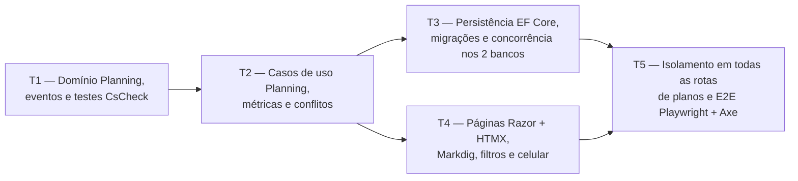

# Fase 2 — Planos e conteúdo: detalhamento

> **Situação:** concluída e aguardando a revisão do autor no
> [PR #3](https://github.com/vitorparras/trail/pull/3), empilhado sobre o PR #2 (Fase 1).

## Objetivo

Entregar o módulo `Planning` completo: cadastro e configuração de planos de estudo
(`StudyPlan`), blocos (`Section`), sumário (`SubjectPlacement`), disciplinas (`Subject`),
árvore de tópicos e subtópicos (`Topic`) com numeração de edital (`TopicCode`), status com
cor e texto (`TopicStatus`), anotações em Markdown seguro (`TopicNote` com Markdig sem HTML
bruto), filtros por status e disciplina, busca normalizada sem acento (`SearchText`),
exclusão em cascata com prévia de impacto e controle de concorrência otimista (`Version`).

## Depende de

- [Fase 1 — Contas, e-mail e isolamento](fase-1-contas-email-isolamento.md)
- [ADR 0002 — Stack ASP.NET Core Razor Pages + HTMX](../adr/0002-stack-aspnetcore-razor-htmx.md)
- [ADR 0003 — SQLite e PostgreSQL](../adr/0003-sqlite-e-postgresql.md)
- [ADR 0010 — Período de desempenho](../adr/0010-periodo-de-desempenho.md)
- [ADR 0013 — Frontend Tailwind CSS + daisyUI](../adr/0013-frontend-tailwind-daisyui.md)
- [ADR 0014 — DDD tático](../adr/0014-ddd-tatico.md)
- [ADR 0015 — Resultado padrão](../adr/0015-resultado-padrao.md)
- [ADR 0016 — Observabilidade](../adr/0016-observabilidade.md)

## Decisões da fase

| # | Tema | Decisão |
|---|---|---|
| D1 | Fronteiras dos agregados | Conforme a [seção 2.2](../02-dominio-e-regras.md#modelo-tático-ddd), `StudyPlan` guarda os blocos (`Section`) e o sumário (`SubjectPlacement`), `Subject` guarda a árvore de `Topic` da disciplina (garantindo pai na mesma disciplina, ausência de ciclos e código único) e `TopicNote` é uma raiz de agregado própria para não carregar texto longo junto com a árvore nem gerar conflito com mudanças rápidas de status |
| D2 | Numeração do edital (`TopicCode`) | Value object imutável com segmentos inteiros (`IReadOnlyList<int>`), derivação do código do pai, ordenação numérica natural (`4.10` depois de `4.9`) e parser com a expressão `^\s*(\d+(?:\.\d+)*)\.?\s+(.+)$` |
| D3 | Busca sem acento (`SearchText`) | Toda entidade pesquisável (`Topic`) mantém `SearchText` normalizado (minúsculas, sem acentos via decomposição Unicode `FormD`), permitindo busca idêntica e indexada em SQLite e PostgreSQL |
| D4 | Concorrência otimista diferenciada | Edições de texto e estrutura verificam `Version` e devolvem `ResultStatus.Conflict` preservando o texto digitado pelo usuário na tela; mudanças de `TopicStatus` reaplicam automaticamente a alteração sobre a versão mais recente caso ocorra conflito concorrente |
| D5 | Exclusão em cascata com prévia | Antes de excluir um plano, disciplina ou tópico, uma consulta de impacto (`GetDeletionImpactHandler`) informa as contagens exatas de itens que serão removidos; a confirmação executa a exclusão em cascata no banco |
| D6 | Markdown seguro | As anotações (`TopicNote`) são convertidas para HTML com `Markdig` usando `.DisableHtml()` no pipeline, impedindo a injeção de HTML bruto ou scripts |

## Tarefas e ondas de execução

### T1 — Domínio `Planning`: agregados, value objects, eventos e testes de propriedade (`Domain`)

- IDs tipados em `Trail.Domain/Planning/`: `StudyPlanId`, `SectionId`, `SubjectId`,
  `TopicId`, `TopicNoteId` e `FitnessTestEventId` (`readonly record struct` implementando
  `ITypedId<TSelf>`).
- Value objects e enumerações:
  - `ScoringRule` (`Cebraspe`, `Standard`, `None`), `TopicStatus` (`ToStudy`, `Studying`,
    `Studied`, `Reviewing`), `StudyPlanOrigin` (`Manual`, `Import`, `Restore`) e
    `PerformancePeriodKind` (`All`, `LastDays`, `DateRange`).
  - `PerformancePeriod` (`All`, `LastDays(int days)` com `days > 0`,
    `DateRange(DateOnly startDate, DateOnly endDate)` com `startDate <= endDate`).
  - `PerformanceBands` (`LowThreshold`, `HighThreshold`, crescentes e dentro da faixa da
    regra de pontuação).
  - `TopicCode` (segmentos numéricos, código do pai, comparação numérica `4.10 > 4.9` e
    parser `^\s*(\d+(?:\.\d+)*)\.?\s+(.+)$`).
  - `TextNormalizer` (normalização sem acento e em minúsculas para `SearchText`).
- Eventos de domínio (`sealed record` implementando `IDomainEvent`):
  - `StudyPlanCreated(StudyPlanId StudyPlanId, UserId OwnerId, StudyPlanOrigin Origin)`
  - `TopicStatusChanged(SubjectId SubjectId, TopicId TopicId, TopicStatus PreviousStatus, TopicStatus NewStatus)`
- Agregados (`AggregateRoot<TId>`):
  - `StudyPlan` com `Section` e `SubjectPlacement` (`Outline`), reordenação de blocos e
    disciplinas, mudança de bloco e exclusão de bloco deixando suas disciplinas sem bloco.
  - `Subject` com árvore de `Topic`, validação de pai na mesma disciplina, prevenção de
    ciclos, unicidade de `TopicCode` na disciplina, reordenação entre irmãos e mudança de
    status levantando `TopicStatusChanged`.
  - `TopicNote` com `TopicId` e `Markdown`.
- Testes de unidade e de propriedade (`CsCheck`) em `Trail.Domain.Tests/Planning/`.

**Pronto quando:** cobertura ≥ 90% em `Trail.Domain`, testes de propriedade do `TopicCode`,
`PerformancePeriod`, `PerformanceBands` e invariantes da árvore passando, e zero violações
em `Trail.Architecture.Tests`.

### T2 — Casos de uso `Planning`, consumidores de métricas e resolução de conflitos (`Application`)

- Consumidores de eventos de domínio em `Trail.Application/Telemetry/`:
  - `StudyPlanCreatedMetricsConsumer` (`trail.plans.created` com tag `origin`).
  - `TopicStatusChangedMetricsConsumer` (`trail.topics.status_changes` com tags `from` e
    `to`).
- Porta `IPlanningStore` e handlers (`public sealed *Handler` com único método público
  `HandleAsync`) em `Trail.Application/Planning/`:
  - Planos: `CreateStudyPlanHandler`, `UpdateStudyPlanHandler`, `DeleteStudyPlanHandler`,
    `GetStudyPlanHandler`, `ListStudyPlansHandler`.
  - Blocos: `AddSectionHandler`, `UpdateSectionHandler`, `ReorderSectionsHandler`,
    `DeleteSectionHandler`.
  - Disciplinas: `CreateSubjectHandler` (cria `Subject` e registra no `Outline` do
    `StudyPlan`), `UpdateSubjectHandler`, `MoveSubjectHandler`, `ReorderSubjectsHandler`,
    `DeleteSubjectHandler`, `GetSubjectTopicsHandler`.
  - Tópicos e anotações: `AddTopicHandler`, `UpdateTopicHandler`, `MoveTopicHandler`,
    `ReorderTopicsHandler`, `ChangeTopicStatusHandler` (com reaplicação automática em caso
    de conflito de versão), `DeleteTopicHandler`, `GetTopicNoteHandler`,
    `SaveTopicNoteHandler`.
  - Prévia de exclusão em cascata e busca/filtros: `GetDeletionImpactHandler` (retorna
    contagens do que será excluído) e `SearchPlanTopicsHandler` (filtro por `SubjectId`,
    `TopicStatus` e busca sem acento em `SearchText`).
- Testes em `Trail.Application.Tests/Planning/`.

**Pronto quando:** cobertura ≥ 90% em `Trail.Application`, todos os eventos com consumidores
registrados e testados em `ApplicationTelemetryTests`, e `Trail.Architecture.Tests` verde.

### T3 — Persistência EF Core, migrações nos dois bancos e testes de concorrência/cascata (`Infrastructure`)

- Mapeamentos do EF Core em `AppDbContext` para `StudyPlan`, `Section`, `SubjectPlacement`,
  `Subject`, `Topic` (índice em `SearchText` e índice único em `(SubjectId, Code)` quando
  `Code` não é nulo) e `TopicNote`, com chaves estrangeiras em cascata e filtro global por
  `OwnerId`.
- Implementação `EfPlanningStore` em `Trail.Infrastructure/Persistence/`.
- Migrações `AddStudyPlansAndContent` em `SqliteAppDbContext` e `PostgreSqlAppDbContext`.
- Testes de persistência nos dois bancos (`PlanningPersistenceTests` em SQLite e PostgreSQL)
  verificando:
  - concorrência otimista retornando `Conflict` na edição de texto quando `Version` diverge;
  - reaplicação automática de `ChangeTopicStatusHandler` sob concorrência;
  - exclusão em cascata de plano, disciplina e tópico com subtópicos e anotações;
  - busca sem acento (`SearchText`) idêntica em SQLite e PostgreSQL.

**Pronto quando:** `PendingModelChangesTests` e `PlanningPersistenceTests` passam em SQLite
e PostgreSQL.

### T4 — Interface Web: páginas de planos, árvore de tópicos, Markdown e filtros (`Web`)

- Pacote `Markdig` integrado em `Trail.Web` com `.DisableHtml()` para renderização segura
  de `TopicNote`.
- Rotas e Razor Pages + parciais HTMX em `src/Trail.Web/Pages/Plans/` (`/planos` e
  sub-rotas):
  - Listagem, criação e edição de planos de estudo (regra de pontuação, período padrão,
    faixas de desempenho e data da prova).
  - Gestão de blocos e disciplinas com reordenação e movimentação entre blocos.
  - Árvore de tópicos e subtópicos com numeração, badge de status com cor + texto (incluindo
    "Revisando" com destaque próprio, corrigindo E6), seletor rápido de status otimizado
    para toque no celular, reordenação e edição com aviso de conflito (`Conflict`) que
    preserva o texto digitado.
  - Gaveta/modal `<dialog>` para anotações em Markdown com edição e visualização renderizada.
  - Barra de filtros por status e disciplina e busca sem acento via HTMX.
  - Modal `<dialog>` de confirmação de exclusão em cascata exibindo as contagens do que será
    apagado.
- Link "Planos" na barra de navegação (`_Layout.cshtml`) e todas as traduções em
  `SharedResource.resx`.

**Pronto quando:** todas as páginas e parciais passam por `ResultResponder`, funcionam com e
sem HTMX, respeitam a CSP com nonce e nunca renderizam HTML bruto do Markdown.

### T5 — Isolamento entre usuários nas rotas de planos e testes E2E Playwright + Axe (`Web.Tests` e `E2E.Tests`)

- Extensão de `UserIsolationTests` (SQLite e PostgreSQL) cobrindo todas as rotas de planos,
  blocos, disciplinas, tópicos e anotações com IDs de outro usuário, exigindo resposta 404
  (nunca 403 nem 200).
- Testes ponta a ponta em `tests/Trail.E2E.Tests/PlansE2ETests.cs` (Playwright + Axe):
  - Criar plano, criar bloco e disciplina da planilha, cadastrar tópicos e subtópicos com
    código, editar anotação em Markdown, filtrar/buscar sem acento e alterar status em
    viewport de celular (`390x844`) e desktop (`1280x800`).
  - Zero violações WCAG 2.1 AA no axe nos temas claro e escuro.

**Pronto quando:**
- Dá para montar à mão uma disciplina da planilha e mudar status pelo celular.
- Os testes de isolamento e E2E passam nos dois bancos e no container Docker.
- O CI fica 100% verde no PR da fase.

## Resultado

- Todas as tarefas (T1 a T5) foram implementadas e aprovadas por revisores independentes.
  A T5 passou por quatro rodadas de revisão até a aprovação.
- Na T5, além dos testes, a revisão corrigiu:
  - handlers criados só para o teste, que foram removidos;
  - a validação dos formulários, que agora mostra os erros ao lado do campo, com e sem HTMX;
  - o login, agora exigido nas páginas de planos (o navegador vai para o login e o HTMX
    navega a página inteira);
  - o contêiner duplicado da árvore de tópicos depois da troca de status;
  - um teste de telemetria instável.
- O build da imagem Docker passou a usar o `.editorconfig` do repositório, como o build
  local e o do CI.
- Verificação no último commit da fase:
  - CI com os 9 checks verdes;
  - testes em SQLite e PostgreSQL: Domain 221, Architecture 71, Application 340, Web 250;
  - cobertura do `Domain` em 95,3% e da `Application` em 98,3%;
  - E2E em 7 de 7 testes, nos tamanhos de celular e desktop, sem violações do axe.

## Pendências para o autor

> **Resolvidas na [Onda 0](onda-0-base-compartilhada.md):** a 1 pela P2 e a 2 pela P3 (W0-T8),
> a 3 pelos erros de formulário compartilhados (W0-T10) e a 4 pela confirmação com prévia
> na exclusão de disciplina e de tópico (W0-T9). As outras correções que a onda fez nesta
> fase estão em [Correções no comportamento das Fases 1 e 2](onda-0-base-compartilhada.md#correções-no-comportamento-das-fases-1-e-2).

1. **Convites no modo `Closed`:** a tela de administração oferece convites, mas o
   convidado é recusado, porque o modo `Closed` bloqueia novos cadastros (decisão D2 da
   Fase 1). As opções são esconder ou avisar sobre os convites nesse modo, ou deixar um
   convite válido criar a conta mesmo com o cadastro fechado.
2. **Login no app inteiro:** as páginas de planos exigem login pela convenção da pasta
   `/Plans`. As páginas de Preferências e Administração ainda respondem 403 a quem não
   está autenticado, em vez de levar ao login. A alternativa é uma política única para o
   app, liberando só as páginas públicas.
3. **Para o futuro:** se algum formulário passar a ser enviado por HTMX, a lista de erros
   precisa de `role="alert"` ou de foco no primeiro campo inválido (WCAG 4.1.3).
4. **Falha encontrada depois do merge:** só a exclusão do plano mostra a confirmação com
   o que será apagado. Disciplinas e tópicos são excluídos direto, sem confirmação, o que
   descumpre a regra aprovada. A correção está na
   [Onda 0, W0-T9](onda-0-base-compartilhada.md).
