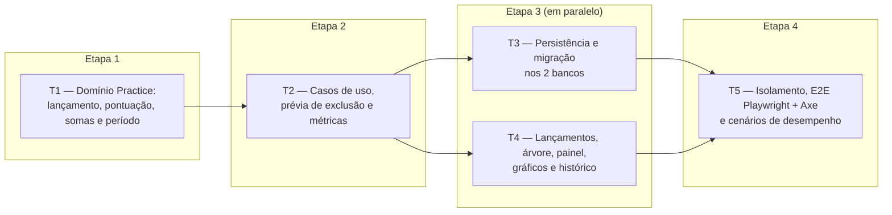

# Fase 3 — Questões, desempenho e histórico: detalhamento

> **Situação:** proposta, aguardando aprovação do autor. Desenvolvida na Onda A, em paralelo
> com as Fases 4 e 5 e a parte de PWA da Fase 7 (7a).

## Objetivo

Entregar a parte central do módulo `Practice`
([3.3](../03-arquitetura.md#33-subdomínios-e-onde-investir)):

- lançamentos de questões por tópico (`QuestionEntry`), com validação, correção e exclusão;
- desempenho por tópico (somando os subtópicos), disciplina, bloco e plano, pela regra do
  plano e pelo período escolhido ([ADR 0010](../adr/0010-periodo-de-desempenho.md)), sempre
  com o volume de questões, e faixas de cor configuráveis, sempre com texto;
- o bloco de desempenho no painel, com o seletor de período, um gráfico por disciplina e a
  tabela equivalente;
- o histórico: evolução semanal do desempenho e do volume, e a lista de lançamentos;
- testes de regressão dos erros da planilha
  ([1.2](../01-visao-e-escopo.md#12-o-que-a-análise-da-planilha-encontrou)).

## Depende de

- [Fase 2 — Planos e conteúdo](fase-2-planos-e-conteudo.md): planos, disciplinas, árvore de
  tópicos, `PerformancePeriod` e `PerformanceBands`.
- [Onda 0 — Base compartilhada](onda-0-base-compartilhada.md), da qual esta fase usa:

  | Peça | Uso na Fase 3 |
  |---|---|
  | W0-T1 | `QuestionEntryConfiguration` em `Persistence/Configurations/Practice/`, sem editar o `AppDbContext` |
  | W0-T2 | Linhas nos métodos `AddPracticeApplication`, `AddPracticeInfrastructure` e `AddPracticeWeb`, que a Onda 0 cria vazios e já chama. `QuestionMetrics`, o bloco do painel, o link do plano e os contribuintes da prévia de exclusão e da atividade do plano entram pela descoberta por convenção. Nenhum ponto de composição é editado, nem o `Program.cs` |
  | W0-T3 | `PracticeResource` e `Resources/PracticeResource.resx`, com os códigos `practice.*` traduzidos pelo registro de prefixos do `ResultResponder`; `Pages/Practice/_ViewImports.cshtml`; `UiText` do E2E por módulo |
  | W0-T4 | `<chart>` nos gráficos do painel e do histórico, com a tabela equivalente (necessidades na T4) |
  | W0-T5 | `IDashboardBlock`, `DashboardContext` (o plano do painel, pela Onda 0, P4), `IPlanActivityContributor` (a atividade mais recente de cada plano, que escolhe o plano padrão) e a varredura de isolamento do painel |
  | W0-T6 | `QuestionCount` e o auxiliar de mapeamento (colunas `Total`, `Correct` e `Wrong`, `CHECK` com nomes entre aspas) |
  | W0-T7 | Migração local `AddQuestionEntries`, gerada de novo na integração |
  | W0-T8 | Login exigido em `Pages/Practice`, registrado pela Onda 0 em qualquer resposta da Onda 0, P3 |
  | W0-T9 | `IUserCalendar` (só o `Today`), `CalendarWeek`, `FakeTimeProvider`, `DeletionScope` com `IDeletionImpactContributor` (confirmação com contagens também na exclusão de disciplina e de tópico), e `IPlanLinkContributor` |
  | W0-T10 | `_FormErrors` e `FormErrorList` em `Pages/Shared`, com `role="alert"` e foco no primeiro campo inválido |
  | W0-T11 | Fixture do E2E com um usuário novo por teste e o service worker bloqueado |
  | W0-T12 | Harness de desempenho e `.github/workflows/performance.yml`: esta fase só acrescenta cenários |
  | W0-T13 | Os ícones da seção [Ícones](#ícones), no sprite |

- Respostas do autor na Onda 0: P1 (peças comuns), P3 (login no app inteiro), P4 (qual plano
  o painel mostra), P5 (fluxo de integração) e P7, item (c) (E4 na Fase 4).
- Dentro da Onda A:
  - **Fase 4:** mesmo módulo `Practice`, sem dependência de código. As duas fases só
    acrescentam linhas nos arquivos comuns da Onda 0 ([Fronteiras](#fronteiras-com-outras-fases)).
  - **Fase 5:** sem dependência de código. O atalho e as horas na árvore da disciplina
    (pergunta 9 da Fase 5, opção C) dependem do merge das duas fases.
  - **Critério "E1 a E5" do roteiro:** fecha com o merge da Fase 4, se a Onda 0, P7(c) for
    aceita.
  - **Fase 7a:** nenhuma. O E2E roda com o service worker bloqueado (W0-T11).
- ADRs [0009](../adr/0009-questoes-como-lancamentos.md),
  [0010](../adr/0010-periodo-de-desempenho.md), [0011](../adr/0011-estilo-arquitetural.md),
  [0013](../adr/0013-frontend-tailwind-daisyui.md), [0014](../adr/0014-ddd-tatico.md),
  [0015](../adr/0015-resultado-padrao.md) e [0016](../adr/0016-observabilidade.md).

## Decisões da fase

| # | Tema | Decisão |
|---|---|---|
| D1 | Agregado `QuestionEntry` | Raiz com `TopicId`, `Date` (`DateOnly`, o dia escolhido), `QuestionCount` e `CreatedAt` (UTC, do `TimeProvider`). `Record` e `Correct` recebem o "hoje" do usuário e recusam data futura (`practice.entry.date_in_future`). `Delete` levanta o evento antes da remoção. A `Date` nunca é convertida: trocar o fuso não move lançamentos |
| D2 | Estrutura do plano lida pela Prática | A `Application.Practice` não usa tipos da `Application.Planning` (regra 8 da [3.5](../03-arquitetura.md#35-camadas-módulos-e-padrões-internos)). A porta `IQuestionEntryStore` devolve modelos de leitura da Prática (regra, faixas, período padrão, blocos, disciplinas e árvore), que a `Infrastructure` lê de `StudyPlan` e `Subject`, com o filtro por dono. Tipos do `Domain.Planning` (IDs, `ScoringRule`, `PerformancePeriod`, `PerformanceBands`) podem ser usados |
| D3 | Somas no banco, cálculo no domínio | O banco só soma inteiros (total, certas e erradas, agrupados por tópico ou por data, filtrados pelo período), igual nos dois bancos. A soma dos subtópicos, os totais por disciplina, bloco e plano e o percentual ficam no `Domain` (`PerformanceRollup` e `IScoringRule`), sem `decimal` nem função de data no SQL ([3.10](../03-arquitetura.md#310-dados-dois-bancos-integridade-e-concorrência)). As semanas são montadas em memória a partir das somas por data |
| D4 | `Score`, arredondamento e faixas | `IScoringRule` com `CebraspeScoringRule` ((C − E) / T × 100) e `StandardScoringRule` (C / T × 100) ([3.6](../03-arquitetura.md#36-pontos-de-variação)). `Score` guarda a regra e o valor exato. T = 0 não gera `Score` ("—"), e zero aparece como "0,0%". A tela mostra uma casa decimal (`AwayFromZero`), e a faixa é decidida pelo valor exibido, para a cor nunca contradizer o número. `PerformanceBands.Classify` devolve `PerformanceBand` (`Low`, `Medium`, `High`), sempre com cor e texto |
| D5 | "Hoje" e semana | O "hoje" vem do `IUserCalendar` (W0-T9), no fuso de `UserSettings.TimeZoneId`. A Fase 3 trabalha só com `DateOnly` e usa só o `Today`: a conversão de instantes é do `StudyCalendar` da Fase 5. "Últimos N dias" vai de hoje − (N − 1) até hoje. As semanas vão de segunda a domingo (`CalendarWeek`, W0-T9), pela `Date` |
| D6 | Plano "sem pontuação" | Lançar, corrigir e excluir devolvem `Invalid` com `practice.plan.scoring_disabled`. As consultas devolvem `ScoringEnabled = false`, e as telas escondem campos, lançamentos, desempenho e o link "Histórico", sem apagar nada. Voltar para outra regra mostra tudo de novo, recalculado na leitura |
| D7 | Concorrência | Corrigir e excluir enviam a `Version` exibida. Se ela mudou, o resultado é `Conflict`, e o formulário mantém o que foi digitado, como na edição de texto ([3.10](../03-arquitetura.md#310-dados-dois-bancos-integridade-e-concorrência)). Lançar cria um agregado novo e não tem conflito |
| D8 | Exclusão em cascata | Chave estrangeira `TopicId` → `Topics` em cascata: excluir tópico, disciplina ou plano apaga os lançamentos pelo banco, sem eventos (exceção da [2.2](../02-dominio-e-regras.md#modelo-tático-ddd)). Na prévia, um `IDeletionImpactContributor` (W0-T9) conta os lançamentos dos tópicos do `DeletionScope` e devolve o código `practice.deletion.question_entries`, com os textos nas chaves `.one` e `.other` do `PracticeResource.resx`. Vale para a exclusão de plano, disciplina e tópico |
| D9 | Arquivos próprios no módulo `Practice` | Uma pasta por caso de uso, como na 3.5 (`Practice/RecordQuestions/`, `Practice/GetPerformance/`), porta própria, `QuestionEntryId.cs` em arquivo próprio e store com `Set<QuestionEntry>()`, sem `DbSet` novo no `AppDbContext`. As páginas ficam em `Pages/Practice/`, fora de `MockExams/` (Fase 4). A Fase 2 mantém a estrutura atual |
| D10 | Métricas | Classe `QuestionMetrics` sobre o `Meter` da `ApplicationMetrics`, sem editar esse arquivo e descoberta pela convenção da W0-T2: `trail.questions.recorded` (tag `outcome`: `correct`, `wrong` e `blank`, somando as quantidades), `trail.question_entries.corrected` e `trail.question_entries.deleted`. Sem usuário como dimensão ([ADR 0016](../adr/0016-observabilidade.md)) |
| D11 | Lista de lançamentos | 20 por vez, dos mais recentes para os mais antigos, paginada pela chave (`Date`, `CreatedAt`, `Id`): "carregar mais" por HTMX e link para a próxima página sem JavaScript. Um lançamento novo no meio não repete nem pula itens |
| D12 | Origem dos lançamentos importados e restaurados | Fica para a Fase 6, dona da importação e da restauração. A Fase 3 entrega o `QuestionsRecorded` sem origem. A Fase 6 decide se acrescenta a origem ao evento, como no `StudyPlanCreated`, ou se a carga de dados não levanta o evento |
| D13 | Estatísticas na árvore da disciplina | Um view component da Prática (`TopicQuestionStatsViewComponent`), chamado por uma linha nova dentro do laço de `Pages/Plans/_TopicTree.cshtml`, a única edição da Fase 3 nas páginas do `Planning`. A primeira chamada da requisição faz uma só consulta (`GetSubjectQuestionStats`), com as somas de todos os tópicos da disciplina, guardada num serviço com escopo da requisição; as outras linhas só leem. A árvore usa o período padrão do plano, porque é redesenhada pelos handlers do `Planning`, que não levam o período. Todo handler fica em `Pages/Practice`, inclusive o lançamento feito pela árvore, que devolve o parcial `_TopicTree` atualizado, lido pela consulta do `Planning` (`GetSubjectTopicsHandler`) |

## Tarefas e etapas de execução

- Na T1, o agregado `QuestionEntry` e o cálculo (`Score`, regras, `PerformanceRollup` e
  período) são independentes e podem ser feitos em paralelo.
- A T3 pode começar o mapeamento e a migração logo depois da T1. O store espera a porta da
  T2.
- A T4 começa com dublês da porta e passa para o banco real quando a T3 termina.

### T1 — Domínio `Practice`: lançamento, pontuação, somas e período (`Domain`)

- `QuestionEntryId` e o agregado `QuestionEntry` (D1), com `Record`, `Correct` (sem evento
  quando nada muda) e `Delete`.
- Eventos de domínio (`sealed record` implementando `IDomainEvent`):
  - `QuestionsRecorded(QuestionEntryId QuestionEntryId, TopicId TopicId, QuestionCount Count)`
  - `QuestionEntryCorrected(QuestionEntryId QuestionEntryId, TopicId TopicId, QuestionCount PreviousCount, QuestionCount NewCount)`
  - `QuestionEntryDeleted(QuestionEntryId QuestionEntryId, TopicId TopicId, QuestionCount Count)`
- Cálculo, em `Trail.Domain/Practice/`:
  - `QuestionTally`: soma de contagens, que aceita zero, com `+` e os brancos derivados;
  - `IScoringRule`, `CebraspeScoringRule`, `StandardScoringRule` e
    `ScoringRules.For(ScoringRule)` (`None` não tem regra), e `Score` (D4);
  - `PerformanceRollup`: recebe a árvore (tópico, pai e disciplina), o bloco de cada
    disciplina e as somas por tópico, e devolve as somas de cada tópico com os subtópicos,
    de cada disciplina, de cada bloco (com o grupo "sem bloco") e do plano.
- No `Domain.Planning`: `PerformancePeriod.GetBounds(DateOnly today)` (datas do filtro no
  banco, coerentes com `Includes`), `PerformanceBands.Classify` e o enum `PerformanceBand`.
- Testes em `Trail.Domain.Tests/Practice/`:
  - unidade de cada invariante e de cada código de mensagem;
  - regressão em `SpreadsheetRegressionTests` (classe `partial`), um caso nomeado por erro:
    E1 (0 certas e 10 erradas dão −100,0%), E2 (2 questões a 100% e 200 a 0% pesam pelo
    volume) e E3 (tópicos que se anulam mostram 0,0% na disciplina). Se a Onda 0, P7(c)
    for aceita, a Fase 4 acrescenta o E4 num arquivo `partial` próprio, ao lado deste;
  - propriedades (CsCheck) do período: `Includes` e `GetBounds` concordam; "últimos N dias"
    tem exatamente N dias, inclui hoje e nunca o futuro; N está contido em N + 1; o
    intervalo livre inclui as duas pontas; dentro + fora do período = todos;
  - propriedades do cálculo: Cebraspe entre −100 e 100 e tradicional entre 0 e 100; soma das
    partes = total (tópico = próprios + subtópicos, plano = Σ disciplinas = Σ blocos); cada
    data cai em uma só semana de `CalendarWeek`; a faixa não diminui quando o valor aumenta.

**Pronto quando:** cobertura ≥ 90% no `Domain` e de 100% no agregado, nas regras de
pontuação, no `Score`, no `PerformanceRollup` e no `PerformancePeriod`, regressões e
propriedades passando, e `Trail.Architecture.Tests` verde (a regra de evento com consumidor
fecha na T2).

### T2 — Casos de uso `Practice`, prévia de exclusão e métricas (`Application`)

- Porta `IQuestionEntryStore` em `Trail.Application/Practice/` (contexto de um tópico,
  estrutura do plano, somas por tópico e por data num intervalo, contagem por tópicos,
  último `CreatedAt` por plano, página de lançamentos e gravação com verificação de
  versão), com o
  `FallbackQuestionEntryStore` registrado em `AddPracticeApplication`, como nas outras
  portas. O "hoje" vem do `IUserCalendar` (D5).
- Comandos (`public sealed *Handler` com único `HandleAsync`, uma pasta por caso de uso):
  - `RecordQuestions/`: `RecordQuestionsCommand(TopicId TopicId, DateOnly Date, int Total, int Correct, int Wrong)`;
    tópico de outro usuário dá `NotFound`, plano sem pontuação dá `Invalid`, e as
    validações se acumulam, com `Target` em cada campo;
  - `CorrectQuestionEntry/` e `DeleteQuestionEntry/`, com `ExpectedVersion` (D7).
- Consultas (`AsNoTracking`, projeção direta):
  - `GetPerformance/`: `GetPerformanceQuery(StudyPlanId PlanId, PerformancePeriod? Period, SubjectId? SubjectId)`;
    sem período, usa o padrão do plano. O `PerformanceView` traz a regra, as faixas, o
    período aplicado e o volume e o `Score` do plano, de cada bloco, de cada disciplina e
    de cada tópico (com subtópicos), na ordem do sumário e da árvore;
  - `GetSubjectQuestionStats/`: somas e `Score` de todos os tópicos de uma disciplina no
    período padrão do plano, numa só consulta (D13);
  - `GetTopicQuestions/`: desempenho e volume do tópico no período e uma página de
    lançamentos (D11);
  - `GetQuestionEntry/`: dados do formulário de correção, com a `Version`;
  - `GetWeeklyHistory/`: semanas do plano ou de uma disciplina, com volume e `Score`,
    incluindo as semanas sem questões ("—"), na janela da P4.
- Contribuintes das peças da Onda 0, pela porta:
  - `QuestionEntryDeletionImpactContributor` em `Practice/DeletionImpact/` (D8);
  - `QuestionEntryPlanActivityContributor` em `Practice/PlanActivity/`
    (`IPlanActivityContributor`, W0-T5): o `CreatedAt` mais recente dos lançamentos de cada
    plano do usuário, para o plano padrão do painel.
- Consumidores em `Trail.Application/Telemetry/`: `QuestionsRecordedMetricsConsumer`,
  `QuestionEntryCorrectedMetricsConsumer` e `QuestionEntryDeletedMetricsConsumer` (D10).
- Testes em `Trail.Application.Tests/Practice/`, nos dois bancos, com `FakeTimeProvider`:
  - cada caminho do `Result` de cada handler;
  - virada do dia: às 23h30 em São Paulo (02h30 UTC do dia seguinte), hoje é aceito e
    amanhã é recusado;
  - trocar a regra recalcula todo o histórico, e mover um subtópico muda a soma do pai;
  - a prévia conta os lançamentos do tópico com subtópicos, da disciplina e do plano;
  - a atividade do plano é o `CreatedAt` do último lançamento (não a `Date` escolhida), um
    plano sem lançamentos não aparece, e os lançamentos de outro usuário não contam;
  - E5 em `Practice/SpreadsheetRegressionTests.cs`: os rótulos da série de cada disciplina
    são os tópicos (código e título), nunca o nome da disciplina;
  - `Trail.Application.Tests/Telemetry/QuestionTelemetryTests.cs`: cada evento gera a sua
    métrica (coletor em memória).

**Pronto quando:** cobertura ≥ 90% na `Application`, todo evento com consumidor registrado e
testado, e `Trail.Architecture.Tests` verde, incluindo a regra 8 para o `Practice`.

### T3 — Persistência e migração (`Infrastructure`)

- `QuestionEntryConfiguration` (W0-T1): tabela `QuestionEntries`, `QuestionCount` pelo
  auxiliar de mapeamento da W0-T6 (colunas `Total`, `Correct` e `Wrong` e o `CHECK` da
  [2.2](../02-dominio-e-regras.md#invariantes)), chave estrangeira em cascata para
  `Topics` (D8) e índices em `(TopicId, Date)` e `(OwnerId, Date)`. `Version`, filtro por
  dono e conversores vêm das convenções existentes.
- `EfQuestionEntryStore` (somas com `GROUP BY` sobre inteiros, D3), registrado em
  `AddPracticeInfrastructure`.
- Migração local `AddQuestionEntries` em `SqliteAppDbContext` e `PostgreSqlAppDbContext`,
  100% gerada (W0-T7).
- `QuestionEntryPersistenceTests` nos dois bancos: o `CHECK` recusa uma linha inválida
  gravada por SQL direto; excluir tópico com subtópicos, disciplina ou plano apaga os
  lançamentos; `Version` divergente dá `Conflict`; somas por tópico e por data idênticas
  em SQLite e PostgreSQL, inclusive nas pontas do período; o último `CreatedAt` por plano
  idêntico nos dois bancos; a paginação por chave não repete nem pula itens; lançamentos de
  outro usuário nunca entram nas somas nem nas contagens.

**Pronto quando:** `PendingModelChangesTests` e `QuestionEntryPersistenceTests` passam em
SQLite e PostgreSQL.

### T4 — Interface Web: lançamentos, árvore, painel, gráficos e histórico (`Web`)

- Páginas em `src/Trail.Web/Pages/Practice/` (namespace `Trail.Web.Pages.Practice`):
  - `/planos/{planId}/topicos/{topicId}/questoes`: desempenho e volume do tópico, seletor
    de período (P8), lançamento (data padrão: hoje no fuso do usuário) e lista com correção
    e exclusão em `<dialog>` (D11 e P6);
  - `/planos/{planId}/historico`: evolução semanal do plano, com filtro por disciplina
    (P4);
  - `/planos/{planId}/painel/desempenho`: o endpoint HTMX do bloco do painel.
- Bloco de desempenho (`IDashboardBlock`, W0-T5), que recebe o `DashboardContext`:
  - seletor de período (Todas, últimos 7, 15, 30 e 90 dias, e intervalo livre), por `GET`
    para o painel sem JavaScript e, com HTMX, trocando só o bloco pelo endpoint acima, que
    responde com `HX-Push-Url` para a URL do painel (P8);
  - volume sempre visível ("42 questões nos últimos 15 dias" ou "nenhuma questão nos
    últimos 15 dias"), com singular e plural pelo `.resx`;
  - tabela do plano, dos blocos e das disciplinas com volume, desempenho e faixa (cor e
    texto), com a legenda das faixas do plano;
  - um gráfico por disciplina, com um rótulo por tópico (E5) e a tabela equivalente (P3).
- Árvore da disciplina (D13): questões, certas, erradas e desempenho de cada tópico, somando
  os subtópicos, e o botão de lançamento (P7), que sem JavaScript é um link para a página do
  tópico. Depois do lançamento, a árvore é redesenhada e aparece o toast.
- Link "Histórico" na página do plano, por um `IPlanLinkContributor` (W0-T9), escondido quando
  a regra é "sem pontuação".
- Plano sem pontuação: sem campos de questões e com um aviso no lugar do bloco (D6).
- Formulários enviados por HTMX com `_FormErrors` e `FormErrorList` (W0-T10), sem versão
  própria. Números no formato pt-BR ("42,9%").
- Necessidades do `<chart>` (W0-T4):
  - painel: barras horizontais dentro de um `
` fechado (P3), eixo de −100 a 100
    (Cebraspe) ou de 0 a 100 (tradicional), valores em % no formato pt-BR, tópico sem
    questões como lacuna, e redesenho depois da troca do bloco pelo HTMX;
  - histórico: dois gráficos com os mesmos rótulos (semanas), barras do volume e linha do
    desempenho, com lacunas nas semanas sem questões (P4);
  - a tabela equivalente gerada do mesmo modelo. Nenhuma série tracejada.
- Testes em `Trail.Web.Tests/Practice/`, com os auxiliares de nome iniciado por `Question`
  (`QuestionPagesTestHelper`, `TestQuestionEntryStore`, `FailingQuestionEntryStore`), para
  não colidir com os da Fase 4 na mesma pasta:
  - cada `Status` pelo `ResultResponder`, com e sem HTMX, e nenhum código `practice.*` sem
    tradução no HTML;
  - CSP com nonce;
  - E5 no HTML: rótulos do `<chart>` e linhas da tabela são tópicos;
  - a árvore de uma disciplina com 200 tópicos faz uma só consulta de estatísticas;
  - o link "Histórico" aparece só com pontuação.

**Pronto quando:** todas as páginas, os parciais e o bloco passam pelo `ResultResponder`,
funcionam com e sem HTMX, e o gráfico é redesenhado depois da troca de período.

### T5 — Isolamento, E2E Playwright + Axe e cenários de desempenho (`Web.Tests` e `E2E.Tests`)

- Varredura de isolamento nos dois bancos, em `UserIsolationTests.Questions.cs` (arquivo
  `partial` de `UserIsolationTests`) e `QuestionIsolationSweep.cs`, os dois em
  `tests/Trail.Web.Tests/Accounts/`, ao lado dos originais, sem editar os arquivos da
  Fase 2:
  - todos os handlers de `Trail.Web.Pages.Practice`, com IDs de outro usuário (tópico,
    lançamento, plano, disciplina no filtro e combinações com o próprio plano), exigindo
    404, nunca 403 nem 200;
  - os lançamentos da vítima não mudam, e nenhum título ou total dela aparece no painel,
    na árvore, no histórico ou nas páginas do atacante;
  - teste de reflexão próprio: um handler novo em `Trail.Web.Pages.Practice` sem caso na
    varredura faz o teste falhar. O namespace é comparado por igualdade, como no teste da
    Fase 2, e as páginas de `Trail.Web.Pages.Practice.MockExams` ficam na varredura da
    Fase 4. O painel em si fica na varredura da W0-T5.
- `tests/Trail.E2E.Tests/QuestionsE2ETests.cs`, com o usuário novo de cada teste (W0-T11),
  seguindo o fluxo 2 da [4.1](../04-qualidade-e-entrega.md#41-estratégia-de-testes):
  - lançar num subtópico e ver o tópico pai, a disciplina, o painel e o histórico
    atualizados;
  - lançar com data de 20 dias atrás e alternar entre "últimos 15 dias" e "Todas", com o
    volume mudando e o gráfico redesenhado depois da troca do HTMX;
  - data futura recusada, com a mensagem anunciada ao leitor de tela; corrigir e excluir;
  - em `390x844` e `1280x800`, nos temas claro e escuro, com zero violações WCAG 2.1 AA no
    axe e o diálogo de lançamento operado só pelo teclado.
- Cenários no harness de desempenho (W0-T12), com 10.000 lançamentos nos 1.000 tópicos do
  harness: painel, página da disciplina, página do tópico e histórico, cada um abaixo de
  300 ms no servidor ([3.15](../03-arquitetura.md#315-verificações-automáticas-da-arquitetura)).
  O cenário da página do plano, da Onda 0, passa a rodar com esses lançamentos.

**Pronto quando:**
- Os erros E1, E2, E3 e E5 têm testes nomeados que documentam o comportamento corrigido. O
  E4 segue a Onda 0, P7(c).
- Os testes de propriedade do período passam.
- Os testes de isolamento passam nos dois bancos, e o E2E passa contra o container SQLite.
- O CI fica 100% verde no PR da fase.

## Fronteiras com outras fases

### Fase 4 — Simulados e TAF (mesmo módulo `Practice`)

A divisão é a mesma do [detalhamento da Fase 4](fase-4-simulados-e-taf.md#fronteiras-com-as-fases-3-e-5).

| Camada | A Fase 3 cria ou altera | A Fase 3 não toca |
|---|---|---|
| `Domain` | `Practice/` (lançamento, ID, eventos, `QuestionTally`, regras, `Score`, `PerformanceRollup`); `PerformancePeriod.cs` e `PerformanceBands.cs` no `Planning` | `Practice/MockExam*.cs`; `StudyPlan.cs`; `QuestionCount` e `CalendarWeek` (Onda 0, só consome) |
| `Application` | As pastas de caso de uso dos lançamentos em `Practice/`, a porta `IQuestionEntryStore` e os contribuintes da prévia e da atividade do plano; arquivos novos em `Telemetry/`; linhas em `AddPracticeApplication` | As pastas e a porta dos simulados; `Planning/`; `Abstractions/`; `ApplicationMetrics.cs` |
| `Infrastructure` | `Configurations/Practice/QuestionEntryConfiguration.cs`, `EfQuestionEntryStore` e linhas em `AddPracticeInfrastructure` | `MockExamConfiguration`, `EfMockExamStore`, `AppDbContext`, `EfPlanningStore`, `StudyPlanConfiguration`, migrações e snapshots existentes |
| `Web` | `Pages/Practice/` (fora de `MockExams/`), o bloco de desempenho, o link "Histórico", o view component da árvore, chaves no `PracticeResource.resx`, linhas em `AddPracticeWeb` e uma linha em `Pages/Plans/_TopicTree.cshtml` | `Pages/Practice/MockExams/`, `Pages/Practice/_ViewImports.cshtml`, a página do painel, `Details.cshtml`, `Subject.cshtml`, `Pages/Shared/` e `SharedResource.resx` |
| Testes | Só arquivos novos, incluindo um arquivo `partial` de `UserIsolationTests` e a `SpreadsheetRegressionTests`, que a Fase 4 completa com o E4 | `UserIsolationTests.cs`, `PlanningIsolationSweep.cs`, a varredura da Fase 4, `ApplicationTelemetryTests.cs`, `PlansE2ETests.cs`, `DockerAppFixture` e `UiText` |

Arquivos comuns com a Fase 4, todos criados pela Onda 0: os métodos `AddPractice*` e o
`PracticeResource.resx`. As duas fases só acrescentam linhas, e as chaves desta fase começam
por `practice.entry.`, `practice.plan.`, `practice.deletion.`, `Question` ou `Performance`.
O conflito é só de texto e se resolve no rebase da integração (Onda 0, P5).

`IScoringRule` calcula o desempenho percentual dos lançamentos. A nota Cebraspe do simulado
(pontos líquidos, C − E) é da Fase 4.

### Fase 5 — Tempo de estudo

- O bloco de horas é da Fase 5, e o de desempenho, da Fase 3. Nenhuma edita o bloco da outra.
- As duas usam as peças da W0-T9. A Fase 3 usa só o `Today` e o `CalendarWeek`; a conversão
  de instantes é do `StudyCalendar` da Fase 5.
- A Fase 3 é a única que altera a árvore da disciplina durante a Onda A, com uma linha. O
  botão "Estudar" e a coluna de horas da Fase 5 ficam para a tarefa da integração (pergunta 9
  da Fase 5), que pode seguir o mesmo modelo de view component (D13).

### Fase 6 — Importação e backup

- A importação cria os lançamentos pelo mesmo `QuestionEntry.Record`, com a data escolhida
  na prévia (padrão: o dia da importação, no fuso do usuário) e a mesma recusa de data
  futura.
- Os campos de `QuestionEntry` seguem exatamente a [2.2](../02-dominio-e-regras.md#22-modelo),
  para o backup levá-los sem conversão. O formato do backup é da Fase 6.
- A origem dos lançamentos importados e restaurados é decidida na Fase 6 (D12).

## Ícones

A Onda 0 acrescenta estes ícones do Lucide ao sprite (W0-T13). Todos são decorativos
(`aria-hidden`) e aparecem sempre ao lado de um texto.

| Ícone | Onde |
|---|---|
| `plus` | Botão "Lançar questões", na árvore da disciplina e na página do tópico |
| `pencil` | Corrigir um lançamento |
| `trash` | Excluir um lançamento |
| `rotate-ccw-clock` | Link "Histórico" na página do plano |
| `chart-bar` | Título do bloco de desempenho no painel |
| `info` | Aviso de plano "sem pontuação", no lugar do bloco e dos campos |

## Perguntas para o autor

A numeração original foi mantida para as referências cruzadas: a P2 (qual plano o painel
mostra) e a P9 (peças comuns) passaram para a Onda 0 (P4 e P1), a P5 virou a D11 e a P10
virou a D12.

### P1 — Valores padrão e nomes das faixas de desempenho

A [2.3](../02-dominio-e-regras.md#faixas-de-desempenho) deixou os padrões para esta fase, e
o código já usa 50 e 70 (`PerformanceBands`). As opções B e C alteram o `StudyPlan.cs` e os
formulários de criação e edição do plano, fora da fronteira desta fase e no arquivo que a
Fase 4 altera na Onda A. Com B ou C, a mudança entra na integração, depois do merge da
Fase 4.

| Opção | Descrição | Prós | Contras |
|---|---|---|---|
| A (recomendada) | 50 e 70 nas duas regras, com "Baixo", "Médio" e "Alto" | É o exemplo da 2.3 e o padrão atual do código; nada muda fora da fase | No Cebraspe, 70% líquido exige cerca de 85% de acertos sem brancos, e "Alto" fica difícil até o aluno ajustar |
| B | Padrão por regra: tradicional 50 e 70; Cebraspe 20 e 50 | Exigência parecida nas duas regras (cerca de 60% e 75% de acertos) | Trocar a regra do plano precisa trocar as faixas; altera o `StudyPlan.cs` e os formulários do plano |
| C | Sem padrão: o aluno escolhe ao criar o plano | Nada arbitrário | Um passo a mais para começar; altera o `StudyPlan.cs` e os formulários do plano |

### P3 — Gráficos por disciplina no painel

A aba Desempenho da planilha tem um gráfico por disciplina (23 no plano de exemplo), todos
abertos, e o painel precisa caber no celular.

| Opção | Descrição | Prós | Contras |
|---|---|---|---|
| A (recomendada) | Um cartão recolhido (`
`) por disciplina, com desempenho, volume e faixa no título. Aberto, barras horizontais com os tópicos de 1º nível (somando os subtópicos) e a tabela equivalente | Painel curto no celular, rótulos longos legíveis e nenhuma questão contada duas vezes | Um toque a mais para ver o gráfico |
| B | Todos os gráficos abertos, com os tópicos de todos os níveis, como na aba Desempenho | Igual à planilha | 23 gráficos seguidos, e o pai e os subtópicos contam as mesmas questões na mesma série |
| C | Um seletor de disciplina, com um gráfico por vez | Leve | Sem visão geral para comparar disciplinas |

### P4 — Janela e gráfico do histórico semanal

O histórico mostra a evolução semanal do desempenho e do volume, no plano e por disciplina
([2.3](../02-dominio-e-regras.md#histórico)). Falta definir quantas semanas aparecem e como
desenhar duas medidas de escalas diferentes.

| Opção | Descrição | Prós | Contras |
|---|---|---|---|
| A (recomendada) | Últimas 12 semanas, com opções de 26, 52 e todas, em dois gráficos com as mesmas semanas: barras do volume e linha do desempenho | Sempre semanas inteiras, sem gráfico de dois eixos, difícil de ler | Um seletor diferente do de período |
| B | Seguir o seletor de período | Um seletor só | As semanas das pontas ficam incompletas e parecem quedas de volume |
| C | Sempre todas as semanas | Simples | O gráfico fica comprimido depois de alguns meses |

### P6 — A correção pode trocar o tópico do lançamento?

A correção de um lançamento muda a data e as contagens. A dúvida é se ela também pode
mudar o tópico, o que mexe nas somas de dois tópicos de uma vez.

| Opção | Descrição | Prós | Contras |
|---|---|---|---|
| A (recomendada) | Não. Para trocar o tópico, exclui e lança de novo | Cada correção altera um só tópico, e o lançamento fica no tópico em que foi feito | Dois passos para corrigir um tópico errado |
| B | Sim, para outro tópico do mesmo plano | Um passo | A correção altera dois tópicos e precisa validar o plano dos dois |

### P7 — Onde o aluno lança as questões

Na planilha, o aluno digita os totais na linha do tópico, na aba da disciplina. Em qualquer
opção, a árvore da disciplina mostra as somas de cada tópico (D13).

| Opção | Descrição | Prós | Contras |
|---|---|---|---|
| A (recomendada) | Um botão "Lançar questões" em cada tópico da árvore, que abre um `<dialog>` com a data de hoje, e o mesmo formulário na página do tópico | Lança sem sair da árvore, como na planilha | Mais um botão por linha |
| B | Só na página do tópico; a árvore mostra as somas e um link | Árvore mais limpa | Uma navegação a mais por lançamento |
| C | Um formulário rápido no painel, com busca de tópico | Lança de qualquer lugar | Mais chance de errar o tópico, e o bloco do painel fica mais pesado |

### P8 — Alcance e memória do seletor de período

A [ADR 0010](../adr/0010-periodo-de-desempenho.md) pede o seletor no painel, com o período
padrão do plano. Em qualquer opção, a árvore da disciplina usa o período padrão do plano
(D13).

| Opção | Descrição | Prós | Contras |
|---|---|---|---|
| A (recomendada) | Período na URL (`?periodo=`), com o mesmo seletor no bloco do painel e na página do tópico, e o período padrão do plano quando a URL não traz nenhum. Os links do painel levam o período | Link salvável e sem estado escondido | A escolha some ao abrir um link sem o parâmetro |
| B | Seletor só no painel; as outras páginas usam o padrão do plano | Menos interface | O painel e a página do tópico podem mostrar períodos diferentes |
| C | Lembrar a última escolha por usuário | Não precisa escolher de novo | Campo novo nas preferências (módulo `Accounts`, fora da fronteira desta fase, com migração), e o período padrão do plano perde o sentido |
