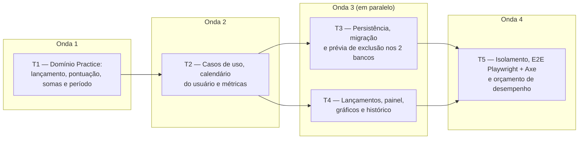

# Fase 3 — Questões, desempenho e histórico: detalhamento

> **Situação:** proposta, aguardando aprovação do autor.
>
> Desenvolvida na Onda A, em paralelo com as Fases 4 e 5 e a parte de PWA da Fase 7, sobre a
> [Onda 0 — Base compartilhada](onda-0-base-compartilhada.md).

## Objetivo

Entregar a parte central do módulo `Practice`
([3.3](../03-arquitetura.md#33-subdomínios-e-onde-investir)):

- lançamentos de questões por tópico (`QuestionEntry`), com validação, correção e exclusão;
- desempenho por tópico (somando os subtópicos), disciplina, bloco e plano, pela regra do
  plano e pelo período escolhido ([ADR 0010](../adr/0010-periodo-de-desempenho.md)), sempre
  com o volume de questões, e faixas de cor configuráveis, sempre com texto;
- o bloco de desempenho no painel, com o seletor de período, um gráfico por disciplina e a
  tabela equivalente;
- o histórico: evolução semanal do desempenho e do volume, e a lista de lançamentos;
- testes de regressão dos erros da planilha
  ([1.2](../01-visao-e-escopo.md#12-o-que-a-análise-da-planilha-encontrou)).

## Depende de

- [Fase 2 — Planos e conteúdo](fase-2-planos-e-conteudo.md)
- [Onda 0 — Base compartilhada](onda-0-base-compartilhada.md), da qual esta fase usa:

  | Peça | Uso na Fase 3 |
  |---|---|
  | W0-T1 | `QuestionEntryConfiguration` em `Persistence/Configurations/Practice/`, sem editar o `AppDbContext` |
  | W0-T2 | Store e calendário do usuário registrados no registro do módulo `Practice`, com uma linha no ponto de composição |
  | W0-T3 | Textos e códigos de mensagem no `.resx` do módulo `Practice` (classe marcadora do módulo), nada no `SharedResource.resx` |
  | W0-T4 | `<chart>` nos gráficos por disciplina e do histórico, sempre com a tabela equivalente |
  | W0-T5 | Bloco de desempenho registrado pela Prática, sem editar a página do painel |
  | W0-T6 | `QuestionCount` em cada lançamento, com as invariantes e o tipo complexo já prontos |
  | W0-T7 | Migração local `AddQuestionEntries` nos dois contextos, gerada de novo pelo orquestrador na integração |
  | W0-T8 | Login exigido nas páginas da Prática, pela regra escolhida pelo autor |

- ADRs [0009](../adr/0009-questoes-como-lancamentos.md),
  [0010](../adr/0010-periodo-de-desempenho.md), [0011](../adr/0011-estilo-arquitetural.md),
  [0013](../adr/0013-frontend-tailwind-daisyui.md), [0014](../adr/0014-ddd-tatico.md),
  [0015](../adr/0015-resultado-padrao.md) e [0016](../adr/0016-observabilidade.md).

## Decisões da fase

| # | Tema | Decisão |
|---|---|---|
| D1 | Agregado `QuestionEntry` | Raiz com `TopicId`, `Date` (`DateOnly`, o dia escolhido), `QuestionCount` e `CreatedAt` (UTC, do `TimeProvider`). `Record` e `Correct` recebem o "hoje" do usuário e recusam data futura (`practice.entry.date_in_future`). `Delete` levanta o evento antes da remoção. A `Date` nunca é convertida: trocar o fuso não move lançamentos |
| D2 | Estrutura do plano lida pela Prática | A `Application.Practice` não usa tipos da `Application.Planning` (regra 8 da [3.5](../03-arquitetura.md#35-camadas-módulos-e-padrões-internos)). A porta `IQuestionEntryStore` devolve modelos de leitura da Prática (regra, faixas, período padrão, blocos, disciplinas e árvore), que a `Infrastructure` lê sempre a partir de `StudyPlan` e `Subject`, com o filtro por dono. Tipos do `Domain.Planning` (IDs, `ScoringRule`, `PerformancePeriod`, `PerformanceBands`) podem ser usados |
| D3 | Somas no banco, cálculo no domínio | O banco só soma inteiros (total, certas e erradas, agrupados por tópico ou por data, filtrados pelo período), igual nos dois bancos. A soma dos subtópicos, os totais por disciplina, bloco e plano e o percentual ficam no `Domain` (`PerformanceRollup` e `IScoringRule`), sem `decimal` nem função de data no SQL ([3.10](../03-arquitetura.md#310-dados-dois-bancos-integridade-e-concorrência)). As semanas são montadas em memória a partir das somas por data |
| D4 | `Score`, arredondamento e faixas | `IScoringRule` com `CebraspeScoringRule` ((C − E) / T × 100) e `StandardScoringRule` (C / T × 100) ([3.6](../03-arquitetura.md#36-pontos-de-variação)). `Score` guarda a regra e o valor exato. T = 0 não gera `Score` ("—"), e zero aparece como "0,0%". A tela mostra uma casa decimal (`AwayFromZero`), e a faixa é decidida pelo valor exibido, para a cor nunca contradizer o número. `PerformanceBands.Classify` devolve `PerformanceBand` (`Low`, `Medium`, `High`), sempre com cor e texto |
| D5 | "Hoje" e semana no fuso do usuário | A porta `IUserCalendar` dá o dia de hoje e o `TimeZoneInfo` do `UserSettings.TimeZoneId`, pelo `TimeProvider` (a Fase 5 usa o fuso para converter instantes). "Últimos N dias" vai de hoje − (N − 1) até hoje. As semanas vão de segunda a domingo (`CalendarWeek`), pela `Date`. Onde essas peças nascem está na P9 |
| D6 | Plano "sem pontuação" | Lançar, corrigir e excluir devolvem `Invalid` com `practice.plan.scoring_disabled`. As consultas devolvem `ScoringEnabled = false`, e as telas escondem campos, lançamentos e desempenho, sem apagar nada. Voltar para outra regra mostra tudo de novo, recalculado na leitura |
| D7 | Concorrência | Corrigir e excluir enviam a `Version` exibida. Se ela mudou, o resultado é `Conflict`, e o formulário mantém o que foi digitado, como na edição de texto ([3.10](../03-arquitetura.md#310-dados-dois-bancos-integridade-e-concorrência)). Lançar cria um agregado novo e não tem conflito |
| D8 | Exclusão em cascata | Chave estrangeira `TopicId` → `Topics` em cascata: excluir tópico, disciplina ou plano apaga os lançamentos pelo banco, sem eventos (exceção da [2.2](../02-dominio-e-regras.md#modelo-tático-ddd)). A prévia de exclusão mostra quantos lançamentos serão apagados (P9) |
| D9 | Arquivos próprios no módulo `Practice` | Pastas por caso de uso, como na 3.5 (`Practice/RecordQuestions/`, `Practice/GetPerformance/`), porta própria, `QuestionEntryId.cs` em arquivo próprio e store com `Set<QuestionEntry>()`, sem `DbSet` novo no `AppDbContext`. Assim a Fase 4 trabalha no mesmo módulo sem editar os mesmos arquivos. A Fase 2 mantém a estrutura atual |
| D10 | Métricas | Classe `QuestionMetrics` sobre o `Meter` da `ApplicationMetrics`, sem editar esse arquivo, como fazem as Fases 4 e 5: `trail.questions.recorded` (tag `outcome`: `correct`, `wrong` e `blank`, somando as quantidades), `trail.question_entries.corrected` e `trail.question_entries.deleted`. Sem usuário como dimensão ([ADR 0016](../adr/0016-observabilidade.md)) |

## Tarefas e ondas de execução

- Na T1, o agregado `QuestionEntry` e o cálculo (`Score`, regras, `PerformanceRollup` e
  período) são independentes e podem ser feitos em paralelo.
- A T3 pode começar o mapeamento e a migração logo depois da T1. O store espera a porta da
  T2.
- A T4 começa com dublês da porta e passa para o banco real quando a T3 termina.

### T1 — Domínio `Practice`: lançamento, pontuação, somas e período (`Domain`)

- `QuestionEntryId` e o agregado `QuestionEntry` (D1), com `Record`, `Correct` (sem evento
  quando nada muda) e `Delete`.
- Eventos de domínio (`sealed record` implementando `IDomainEvent`):
  - `QuestionsRecorded(QuestionEntryId QuestionEntryId, TopicId TopicId, QuestionCount Count)`
  - `QuestionEntryCorrected(QuestionEntryId QuestionEntryId, TopicId TopicId, QuestionCount PreviousCount, QuestionCount NewCount)`
  - `QuestionEntryDeleted(QuestionEntryId QuestionEntryId, TopicId TopicId, QuestionCount Count)`
- Cálculo, em `Trail.Domain/Practice/`:
  - `QuestionTally`: soma de contagens, que aceita zero, com `+` e os brancos derivados;
  - `IScoringRule`, `CebraspeScoringRule`, `StandardScoringRule` e
    `ScoringRules.For(ScoringRule)` (`None` não tem regra), e `Score` (D4);
  - `PerformanceRollup`: recebe a árvore (tópico, pai e disciplina), o bloco de cada
    disciplina e as somas por tópico, e devolve as somas de cada tópico com os subtópicos,
    de cada disciplina, de cada bloco (com o grupo "sem bloco") e do plano.
- No `Domain.Planning`: `PerformancePeriod.GetBounds(DateOnly today)` (datas do filtro no
  banco, coerentes com `Includes`), `PerformanceBands.Classify` e o enum `PerformanceBand`.
- `CalendarWeek` (segunda a domingo), no lugar definido na P9.
- Testes em `Trail.Domain.Tests/Practice/`:
  - unidade de cada invariante e de cada código de mensagem;
  - regressão em `SpreadsheetRegressionTests`, um caso nomeado por erro: E1 (0 certas e 10
    erradas dão −100,0%), E2 (2 questões a 100% e 200 a 0% pesam pelo volume) e E3
    (tópicos que se anulam mostram 0,0% na disciplina);
  - propriedades (CsCheck) do período: `Includes` e `GetBounds` concordam; "últimos N dias"
    tem exatamente N dias, inclui hoje e nunca o futuro; N está contido em N + 1; o
    intervalo livre inclui as duas pontas; dentro + fora do período = todos;
  - propriedades do cálculo: Cebraspe entre −100 e 100 e tradicional entre 0 e 100; soma das
    partes = total (tópico = próprios + subtópicos, plano = Σ disciplinas = Σ blocos); cada
    data cai em uma só semana; a faixa não diminui quando o valor aumenta.

**Pronto quando:** cobertura ≥ 90% no `Domain` e de 100% no agregado, nas regras de
pontuação, no `Score`, no `PerformanceRollup` e no `PerformancePeriod`, regressões e
propriedades passando, e `Trail.Architecture.Tests` verde (a regra de evento com consumidor
fecha na T2).

### T2 — Casos de uso `Practice`, calendário do usuário e métricas (`Application`)

- Portas: `IQuestionEntryStore` em `Trail.Application/Practice/` (contexto de um tópico,
  estrutura do plano, somas por tópico e por data num intervalo, página de lançamentos e
  gravação com verificação de versão), com a implementação de fallback como nas outras
  portas, e `IUserCalendar` (D5). Se a P9 ficar com a opção B, o fuso vem do
  `IQuestionEntryStore`, e o dia e a semana são calculados no `Domain/Practice`.
- Comandos (`public sealed *Handler` com único `HandleAsync`, uma pasta por caso de uso):
  - `RecordQuestions/`: `RecordQuestionsCommand(TopicId TopicId, DateOnly Date, int Total, int Correct, int Wrong)`;
    tópico de outro usuário dá `NotFound`, plano sem pontuação dá `Invalid`, e as
    validações se acumulam, com `Target` em cada campo;
  - `CorrectQuestionEntry/` e `DeleteQuestionEntry/`, com `ExpectedVersion` (D7).
- Consultas (`AsNoTracking`, projeção direta):
  - `GetPerformance/`: `GetPerformanceQuery(StudyPlanId PlanId, PerformancePeriod? Period, SubjectId? SubjectId)`;
    sem período, usa o padrão do plano. O `PerformanceView` traz a regra, as faixas, o
    período aplicado e o volume e o `Score` do plano, de cada bloco, de cada disciplina e
    de cada tópico (com subtópicos), na ordem do sumário e da árvore;
  - `GetTopicQuestions/`: desempenho e volume do tópico no período e uma página de
    lançamentos, dos mais recentes para os mais antigos (P5);
  - `GetQuestionEntry/`: dados do formulário de correção, com a `Version`;
  - `GetWeeklyHistory/`: semanas do plano ou de uma disciplina, com volume e `Score`,
    incluindo as semanas sem questões ("—"), na janela da P4.
- Consumidores em `Trail.Application/Telemetry/`: `QuestionsRecordedMetricsConsumer`,
  `QuestionEntryCorrectedMetricsConsumer` e `QuestionEntryDeletedMetricsConsumer` (D10).
- Testes em `Trail.Application.Tests/Practice/`, nos dois bancos, com `FakeTimeProvider`:
  - cada caminho do `Result` de cada handler;
  - virada do dia: às 23h30 em São Paulo (02h30 UTC do dia seguinte), hoje é aceito e
    amanhã é recusado;
  - trocar a regra recalcula todo o histórico, e mover um subtópico muda a soma do pai;
  - E5: os rótulos da série de cada disciplina são os tópicos (código e título), nunca o
    nome da disciplina;
  - `PracticeTelemetryTests`: cada evento gera a sua métrica (coletor em memória).

**Pronto quando:** cobertura ≥ 90% na `Application`, todo evento com consumidor registrado e
testado, e `Trail.Architecture.Tests` verde, incluindo a regra 8 para o `Practice`.

### T3 — Persistência, migração e prévia de exclusão (`Infrastructure`)

- `QuestionEntryConfiguration` (W0-T1): tabela `QuestionEntries`, `QuestionCount` como tipo
  complexo nas colunas `Total`, `Correct` e `Wrong`,
  `CHECK (Total > 0 AND Correct >= 0 AND Wrong >= 0 AND Correct + Wrong <= Total)`, chave
  estrangeira em cascata para `Topics` (D8) e índices em `(TopicId, Date)` e
  `(OwnerId, Date)`. `Version`, filtro por dono e conversores vêm das convenções existentes.
- `EfQuestionEntryStore` (somas com `GROUP BY` sobre inteiros, D3) e a implementação de
  `IUserCalendar`, registrados no módulo (W0-T2).
- Prévia de exclusão com o número de lançamentos de tópico, disciplina e plano (P9).
- Migração local `AddQuestionEntries` em `SqliteAppDbContext` e `PostgreSqlAppDbContext`
  (W0-T7).
- `QuestionEntryPersistenceTests` nos dois bancos: o `CHECK` recusa uma linha inválida
  gravada por SQL direto; excluir tópico com subtópicos, disciplina ou plano apaga os
  lançamentos; `Version` divergente dá `Conflict`; somas por tópico e por data idênticas
  em SQLite e PostgreSQL, inclusive nas pontas do período; lançamentos de outro usuário
  nunca entram nas somas.

**Pronto quando:** `PendingModelChangesTests` e `QuestionEntryPersistenceTests` passam em
SQLite e PostgreSQL.

### T4 — Interface Web: lançamentos, painel, gráficos e histórico (`Web`)

- Páginas em `src/Trail.Web/Pages/Practice/` (namespace `Trail.Web.Pages.Practice`; os
  simulados ficam em `Practice/MockExams/`, da Fase 4):
  - `/planos/{planId}/topicos/{topicId}/questoes`: desempenho e volume do tópico,
    lançamento (data padrão: hoje no fuso do usuário) e lista com correção e exclusão em
    `<dialog>` (P5 e P6);
  - `/planos/{planId}/historico`: evolução semanal do plano, com filtro por disciplina
    (P4).
- Bloco de desempenho do painel (view component registrado pela Prática, W0-T5):
  - seletor de plano (P2) e de período (Todas, últimos 7, 15, 30 e 90 dias, e intervalo
    livre), por `GET` sem JavaScript e, com HTMX, trocando só o bloco, com `hx-push-url`
    (P8);
  - volume sempre visível ("42 questões nos últimos 15 dias" ou "nenhuma questão nos
    últimos 15 dias"), com singular e plural pelo `.resx`;
  - tabela do plano, dos blocos e das disciplinas com volume, desempenho e faixa (cor e
    texto), com a legenda das faixas do plano;
  - um gráfico por disciplina, com um rótulo por tópico (E5) e a tabela equivalente (P3).
- Página da disciplina (Fase 2): questões, certas, erradas e desempenho de cada tópico,
  somando os subtópicos, e o botão de lançamento (P7), num parcial próprio chamado por uma
  linha da árvore. Depois do lançamento, a árvore é atualizada e aparece o toast.
- Plano sem pontuação: sem campos de questões e com um aviso no lugar do bloco (D6).
- Formulários enviados por HTMX mostram os erros junto do campo e numa lista com
  `role="alert"` (pendência 3 da Fase 2, WCAG 4.1.3). Números no formato pt-BR ("42,9%").
- Testes em `Trail.Web.Tests/Practice/`: cada `Status` pelo `ResultResponder`, com e sem
  HTMX; CSP com nonce; E5 no HTML (rótulos do `<chart>` e linhas da tabela são tópicos).

**Pronto quando:** todas as páginas, os parciais e o bloco passam pelo `ResultResponder`,
funcionam com e sem HTMX, e o gráfico é redesenhado depois da troca de período.

### T5 — Isolamento, E2E Playwright + Axe e orçamento de desempenho (`Web.Tests` e `E2E.Tests`)

- Varredura de isolamento nos dois bancos, num arquivo `partial` próprio de
  `UserIsolationTests` e num `PracticeIsolationSweep`, sem editar os arquivos da Fase 2:
  - todos os handlers de `Trail.Web.Pages.Practice` e do bloco do painel, com IDs de outro
    usuário (tópico, lançamento, plano, disciplina no filtro e combinações com o próprio
    plano), exigindo 404, nunca 403 nem 200;
  - os lançamentos da vítima não mudam, e nenhum título ou total dela aparece no painel,
    no histórico ou nas páginas do atacante;
  - teste de reflexão próprio: um handler novo em `Trail.Web.Pages.Practice` sem caso na
    varredura faz o teste falhar. O namespace é comparado por igualdade, como no teste da
    Fase 2, para que as páginas de `Trail.Web.Pages.Practice.MockExams` fiquem na varredura
    da Fase 4.
- `tests/Trail.E2E.Tests/PracticeE2ETests.cs`, seguindo o fluxo 2 da
  [4.1](../04-qualidade-e-entrega.md#41-estratégia-de-testes):
  - lançar num subtópico e ver o tópico pai, a disciplina, o painel e o histórico
    atualizados;
  - lançar com data de 20 dias atrás e alternar entre "últimos 15 dias" e "Todas", com o
    volume mudando e o gráfico redesenhado depois da troca do HTMX;
  - data futura recusada, com a mensagem anunciada ao leitor de tela; corrigir e excluir;
  - em `390x844` e `1280x800`, nos temas claro e escuro, com zero violações WCAG 2.1 AA no
    axe e o diálogo de lançamento operado só pelo teclado.
- Orçamento de desempenho
  ([3.15](../03-arquitetura.md#315-verificações-automáticas-da-arquitetura)): plano com
  1.000 tópicos e 10.000 lançamentos, painel e página da disciplina abaixo de 300 ms no
  servidor, num workflow diário próprio, fora do PR.

**Pronto quando:**
- Os erros E1, E2, E3 e E5 têm testes nomeados que documentam o comportamento corrigido. O
  E4 é testado pela Fase 4 (`E4_MockExamMedian_UsesEveryMockExam`), dona dos simulados, e o
  critério "E1 a E5" do roteiro fecha na integração da Onda A.
- Os testes de propriedade do período passam.
- Os testes de isolamento e E2E passam nos dois bancos e no container Docker.
- O CI fica 100% verde no PR da fase.

## Fronteiras com outras fases

### Fase 4 — Simulados e TAF (mesmo módulo `Practice`)

A divisão é a mesma do [detalhamento da Fase 4](fase-4-simulados-e-taf.md#fronteiras-com-as-fases-3-e-5).

| Camada | A Fase 3 cria ou altera | A Fase 3 não toca |
|---|---|---|
| `Domain` | `Practice/` (lançamento, ID, eventos, `QuestionTally`, regras, `Score`, `PerformanceRollup`); `PerformancePeriod` e `PerformanceBands` no `Planning` | `Practice/MockExam*.cs`, as notas e a mediana dos simulados; `QuestionCount` (W0-T6, só consome) |
| `Application` | As pastas de caso de uso dos lançamentos em `Practice/` e a porta `IQuestionEntryStore`; arquivos novos em `Telemetry/` | As pastas de caso de uso dos simulados e a porta `IMockExamStore`; `Planning/`; `ApplicationMetrics.cs` |
| `Infrastructure` | `Configurations/Practice/QuestionEntryConfiguration.cs`, `EfQuestionEntryStore` e o calendário do usuário | `MockExamConfiguration`, `EfMockExamStore`, `AppDbContext`, `EfPlanningStore`, migrações e snapshots existentes |
| `Web` | `Pages/Practice/` (fora de `MockExams/`), o bloco de desempenho e o parcial da árvore da disciplina | `Pages/Practice/MockExams/`, o bloco de simulados, a página do painel e o `SharedResource.resx` |
| Testes | Só arquivos novos, incluindo um arquivo `partial` de `UserIsolationTests` | `UserIsolationTests.cs`, `PlanningIsolationSweep.cs`, a varredura da Fase 4, `ApplicationTelemetryTests.cs` e `PlansE2ETests.cs` |

Arquivos comuns do módulo `Practice`: a classe marcadora com o `.resx` (W0-T3) e o
`AddPracticeInfrastructure` (W0-T2). Quem integrar primeiro cria, e a outra fase só
acrescenta linhas, juntadas pelo orquestrador. Os demais pontos de composição
(`AddApplication` e o registro de blocos do painel) recebem uma linha de cada fase.

`IScoringRule` calcula o desempenho percentual dos lançamentos. A nota Cebraspe do simulado
(pontos líquidos, C − E) é da Fase 4.

### Fase 5 — Tempo de estudo

- O bloco de horas é da Fase 5, e o de desempenho, da Fase 3. Nenhuma edita o bloco da outra.
- As duas usam as mesmas peças comuns: `IUserCalendar` (o "hoje" e o `TimeZoneInfo` do
  usuário), `CalendarWeek`, `FakeTimeProvider` e os pontos de extensão da prévia de exclusão
  e dos links do plano. O [detalhamento da Fase 5](fase-5-tempo-de-estudo.md) faz a mesma
  pergunta na pergunta 10, com a mesma recomendação da P9.
- A Fase 3 é a única que altera a árvore da disciplina durante a Onda A. O botão e a coluna
  de horas da Fase 5 ficam para uma tarefa curta da integração (pergunta 9 da Fase 5), e o
  parcial próprio da Fase 3 deixa essa tarefa simples.

### Fase 6 — Importação e backup

- A importação cria os lançamentos pelo mesmo `QuestionEntry.Record`, com a data escolhida
  na prévia (padrão: o dia da importação, no fuso do usuário) e a mesma recusa de data
  futura.
- Os campos de `QuestionEntry` seguem exatamente a [2.2](../02-dominio-e-regras.md#22-modelo),
  para o backup levá-los sem conversão. O formato do backup é da Fase 6.
- A origem do lançamento no evento depende da P10.

## Perguntas para o autor

### P1 — Valores padrão e nomes das faixas de desempenho

A [2.3](../02-dominio-e-regras.md#faixas-de-desempenho) deixou os padrões para esta fase.

- **A) 50 e 70 nas duas regras, com "Baixo", "Médio" e "Alto" (recomendado).** Prós: é o
  exemplo da 2.3 e o padrão atual do código. Contras: no Cebraspe, 70% líquido exige cerca
  de 85% de acertos sem brancos, e "Alto" fica difícil até o aluno ajustar.
- **B) Por regra: tradicional 50 e 70; Cebraspe 20 e 50.** Prós: exigência parecida nas
  duas regras (cerca de 60% e 75% de acertos). Contras: trocar a regra do plano precisa
  trocar as faixas.
- **C) Sem padrão: o aluno escolhe ao criar o plano.** Prós: nada arbitrário. Contras: um
  passo a mais para começar.

### P2 — Qual plano o painel mostra

- **A) Seletor de plano no bloco, guardado na URL (`?plano=`), com padrão no plano do
  lançamento mais recente (recomendado).** Prós: serve para um ou vários planos sem mudar o
  modelo. Contras: um seletor a mais.
- **B) Um bloco por plano, empilhados.** Prós: tudo à vista. Contras: painel longo no
  celular e mais lento com vários planos.
- **C) Plano "principal" marcado pelo aluno.** Prós: escolha explícita. Contras: campo novo
  no `StudyPlan`.

### P3 — Gráficos por disciplina no painel

- **A) Um cartão recolhido por disciplina, com desempenho, volume e faixa no título. Ao
  abrir, barras horizontais com os tópicos de 1º nível (somando os subtópicos) e a tabela
  equivalente (recomendado).** Prós: painel curto no celular, rótulos longos legíveis e
  nenhuma questão contada duas vezes. Contras: um toque a mais para ver o gráfico.
- **B) Todos os gráficos abertos, com os tópicos de todos os níveis, como na aba
  Desempenho.** Prós: igual à planilha. Contras: 23 gráficos seguidos, e o pai e os
  subtópicos contam as mesmas questões na mesma série.
- **C) Um seletor de disciplina, com um gráfico por vez.** Prós: leve. Contras: sem visão
  geral para comparar disciplinas.

### P4 — Janela e gráfico do histórico semanal

- **A) Últimas 12 semanas, com opções de 26, 52 e todas, em dois gráficos com as mesmas
  semanas: barras do volume e linha do desempenho (recomendado).** Prós: sempre semanas
  inteiras e sem gráfico de dois eixos, difícil de ler. Contras: um seletor diferente do de
  período.
- **B) Seguir o seletor de período.** Prós: um seletor só. Contras: as semanas das pontas
  ficam incompletas e parecem quedas de volume.
- **C) Sempre todas as semanas.** Prós: simples. Contras: o gráfico fica comprimido depois
  de alguns meses.

### P5 — Paginação da lista de lançamentos do tópico

- **A) 20 por vez, com "carregar mais" por HTMX e link para a próxima página sem
  JavaScript, paginando pela data (recomendado).** Prós: rápida no celular e estável quando
  alguém lança no meio. Contras: não pula para uma página específica.
- **B) Paginação numerada.** Prós: vai direto a uma página. Contras: os itens mudam de
  página a cada lançamento e os números são ruins de tocar no celular.

### P6 — A correção pode trocar o tópico do lançamento?

- **A) Não: corrige data e contagens. Para trocar o tópico, exclui e lança de novo
  (recomendado).** Prós: segue a ADR 0009, e cada lançamento fica ligado a um só tópico.
  Contras: dois passos para corrigir um tópico errado.
- **B) Sim, para outro tópico do mesmo plano.** Prós: um passo. Contras: a correção altera
  dois tópicos e precisa validar o plano dos dois.

### P7 — Onde o aluno lança as questões

- **A) Um botão "Lançar questões" em cada tópico da árvore da disciplina, abrindo um
  `<dialog>` com a data de hoje, e o mesmo formulário na página do tópico
  (recomendado).** Prós: lança sem sair da árvore, como na planilha. Contras: mais um botão
  por linha.
- **B) Só na página do tópico.** Prós: árvore mais limpa. Contras: uma navegação a mais por
  lançamento.
- **C) Um formulário rápido no painel, com busca de tópico.** Prós: lança de qualquer
  lugar. Contras: mais chance de errar o tópico.

### P8 — Alcance e memória do seletor de período

- **A) Período na URL (`?periodo=`), com o mesmo seletor no painel, na disciplina e no
  tópico, e o período do plano como padrão (recomendado).** Prós: link salvável e sem
  estado escondido. Contras: a escolha some ao abrir outro link.
- **B) Seletor só no painel; as outras páginas usam o padrão do plano.** Prós: menos
  interface. Contras: o painel e a disciplina podem mostrar períodos diferentes.
- **C) Lembrar a última escolha por usuário.** Prós: não escolhe de novo. Contras: campo
  novo nas preferências, e o período do plano perde o sentido.

### P9 — Peças comuns que a Onda 0 não cobre

As Fases 3, 4 e 5 precisam do "hoje" no fuso do usuário, e as Fases 3 e 5 também da semana
de segunda a domingo. As três acrescentam contagens à prévia de exclusão (hoje com campos
fixos do `Planning`), e as Fases 3 e 4 acrescentam links na página do plano. É a mesma
questão da pergunta 7 da Fase 4 e da pergunta 10 da Fase 5, com a mesma recomendação.

- **A) Uma tarefa nova na Onda 0, com o calendário do usuário (`IUserCalendar` e
  `CalendarWeek`) num só lugar e pontos de extensão para a prévia de exclusão e para os
  links do plano, no padrão dos blocos do painel (recomendado).** Prós: uma única regra de
  "hoje" e de semana no sistema, e nenhuma fase edita o `Planning` nem os arquivos das
  outras. Contras: a Onda 0 cresce um pouco.
- **B) Só os pontos de extensão na Onda 0. Cada módulo lê o fuso pela própria porta e
  calcula o dia e a semana no próprio domínio.**
  Prós: a Onda 0 fica menor, e os módulos não dependem uns dos outros. Contras: duas
  implementações do "hoje" e da semana que precisam concordar, cada uma com os seus testes.
- **C) Nada na Onda 0. A Fase 3 cria a porta `IDeletionImpactContributor` e refatora a
  prévia, e as Fases 4 e 5 só registram os seus contribuintes; cada módulo tem o seu
  calendário.** Prós: a Onda 0 não muda, e as três fases já combinaram essa saída. Contras:
  as Fases 4 e 5 dependem de uma parte da Fase 3 na integração, e os links do plano ainda
  exigem uma linha de cada fase em `Details.cshtml`.

### P10 — Origem dos lançamentos importados e restaurados

- **A) `QuestionsRecorded` leva a origem (`Manual`, `Import` ou `Restore`), e a métrica
  ganha a tag `origin`, como no `StudyPlanCreated` (recomendado).** Prós: a métrica separa o
  uso real da carga de dados. Contras: um campo a mais no evento.
- **B) Importação e restauração não levantam o evento.** Prós: a métrica conta só o uso
  real. Contras: dois caminhos de criação do lançamento.
- **C) Sem distinção.** Prós: nada a fazer. Contras: uma importação aparece como milhares de
  questões resolvidas num dia.
