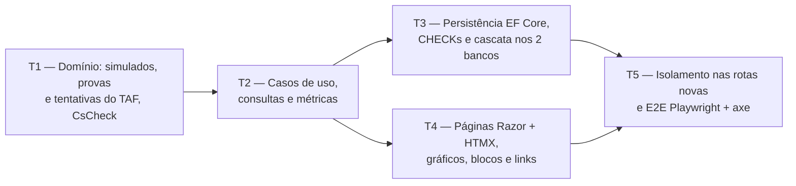

# Fase 4 — Simulados e TAF: detalhamento

> **Situação:** aprovada pelo autor em 18/10/2026, com todas as opções recomendadas. Desenvolvida na Onda A, em paralelo
> com as Fases 3 e 5 e a parte de PWA da Fase 7 (7a).

## Objetivo

Substituir as abas **Simulados** e **Simulado TAF** da planilha:

- **Simulados** (módulo `Practice`, só a parte de `MockExam`): cadastro, edição e exclusão,
  nota tradicional (C / T × 100), nota Cebraspe (C − E), mediana de **todos** os simulados do
  plano (corrige E4), gráfico de evolução por data, simulados sem data ordenados pelo número
  e total de questões sugerido pelo plano (`DefaultMockExamQuestions`).
- **TAF** (módulo `Fitness`), opcional por plano (`FitnessTestEnabled`): provas configuráveis
  (`FitnessTestEvent`, dentro do `StudyPlan`), com o resultado guardado como inteiro na menor
  unidade; tentativas (`FitnessTestAttempt`) com resultados parciais, no máximo um resultado
  por prova, pontos digitados, total igual à soma dos pontos, comentário e gráfico de
  evolução.
- Blocos "Simulados" e "TAF" no painel, links na página do plano, contagens na prévia de
  exclusão do plano e métricas de `MockExamRecorded` e `FitnessTestAttemptRecorded`.

## Depende de

- [Fase 2 — Planos e conteúdo](fase-2-planos-e-conteudo.md): o `StudyPlan` já tem
  `DefaultMockExamQuestions`, `FitnessTestEnabled` e o `FitnessTestEventId`, o formulário do
  plano já edita os dois campos, e a `StudyPlanDetailView` já traz o `FitnessTestEnabled`.
- [Onda 0 — Base compartilhada](onda-0-base-compartilhada.md), da qual esta fase usa:

  | Peça | Uso na Fase 4 |
  |---|---|
  | W0-T1 | Configurações por entidade em `Configurations/Practice/`, `Configurations/Planning/` e `Configurations/Fitness/`. A coleção de provas entra na `StudyPlanConfiguration` criada pela W0-T1 (D11) ([3.10](../03-arquitetura.md#dois-bancos)) |
  | W0-T2 | Preenche `AddPracticeApplication`, `AddPracticeInfrastructure`, `AddFitnessApplication` e `AddFitnessInfrastructure`, sem editar nenhum ponto de composição. Métricas, blocos do painel, links do plano e contribuintes da prévia são descobertos por convenção ([3.5](../03-arquitetura.md#pontos-de-extensão)) |
  | W0-T3 | Códigos `practice.` e textos dos simulados no `PracticeResource`; códigos `fitness.` e textos do TAF no `FitnessResource`, escolhidos pelo `MessageResourceRegistry`. Os `_ViewImports.cshtml` de `Pages/Practice` e `Pages/Fitness` já injetam o `PracticeLocalizer` e o `FitnessLocalizer`, e o `UiText` do E2E lê os dois `.resx` (`UiResource.Practice` e `UiResource.Fitness`) ([3.5](../03-arquitetura.md#textos-e-mensagens)) |
  | W0-T4 | `<chart>` com série tracejada (`Dashed = true` na mediana), dois gráficos com os mesmos rótulos, lacunas, eixo simétrico (`ChartAxis.Symmetric`) e formatos pt-BR, sempre com a tabela equivalente, nas regras de cor da [3.9](../03-arquitetura.md#gráficos): no TAF, o total e uma série por prova, sem limite de provas. Sem `Error` para série neutra, restam cinco `ChartColor`: acima de cinco séries, as cores se repetem, e a legenda e a tabela equivalente distinguem as séries (a cor nunca é a única informação) |
  | W0-T5 | Dois `IDashboardBlock` que recebem o `DashboardContext`, com o plano escolhido pela regra da Onda 0, P4. Nenhum `IPlanActivityContributor`: simulados e tentativas só têm `DateOnly`, sem instante no modelo aprovado |
  | W0-T6 | `QuestionCount` e `HasQuestionCount` (colunas `Total`, `Correct` e `Wrong`, com o `CHECK` entre aspas), chamado depois das outras propriedades ([3.10](../03-arquitetura.md#contagem-de-questões)) |
  | W0-T7 | Migração local `AddMockExamsAndFitnessTest`, gerada de novo na integração ([4.3](../04-qualidade-e-entrega.md#43-fluxo-de-trabalho-no-git)) |
  | W0-T8 | Login exigido pela `FallbackPolicy` (Onda 0, P3): as páginas de `Pages/Practice` e `Pages/Fitness` nascem protegidas, e o `AnonymousAccessTests` as classifica como privadas pelas pastas `/Practice/` e `/Fitness/`. Esta fase não edita o `Program.cs` nem o teste ([3.11](../03-arquitetura.md#login-no-app-inteiro)) |
  | W0-T9 | `IUserCalendar` (o `Today` que recusa datas futuras), `FakeTimeProvider`, `IDeletionImpactContributor` com `DeletionScope` e `DeletionImpactItem`, e `IPlanLinkContributor` com `PlanLink` e os ícones `PlanLinkIcon.ClipboardCheck` e `PlanLinkIcon.Dumbbell` |
  | W0-T10 | `FormErrors`, `FormErrorList` e `Pages/Shared/_FormErrors.cshtml`, com `role="alert"` e foco no primeiro campo inválido, o `FieldTargetMap`, o `asp-error-span` e o `[BindingErrorPartial]` nos handlers HTMX ([3.9](../03-arquitetura.md#formulários-e-erros)) |
  | W0-T11 | Fixture do E2E com um usuário novo por teste e o service worker bloqueado ([4.1](../04-qualidade-e-entrega.md#41-estratégia-de-testes)) |
  | W0-T12 | Harness de desempenho (`PerformanceFixture`), ao qual esta fase acrescenta uma classe de cenários ([4.1](../04-qualidade-e-entrega.md#41-estratégia-de-testes)) |
  | W0-T13 | Os ícones da seção [Ícones](#ícones), já no sprite |

- Respostas do autor na Onda 0: P1 (peças comuns), P3 (login no app inteiro), P4 (qual plano
  o painel mostra), P5 (fluxo de integração), P6 (eventos de correção e exclusão) e P7, itens
  (a) (simulado sem coluna de brancos), (b) (número único no plano), (c) (E4 na Fase 4) e
  (e) (tentativas vazias excluídas com a prova).
- Dentro da Onda A:
  - **Fase 3:** mesmo módulo `Practice`, sem dependência de código. As duas fases só
    acrescentam linhas no `AddPracticeApplication`, no `AddPracticeInfrastructure` e no
    `PracticeResource.resx`. As chaves desta fase começam por `practice.mock_exam.`,
    `practice.deletion.mock_exams` ou `MockExam`, e nenhuma coincide com as da Fase 3. O
    rebase da segunda fase a entrar mantém as duas listas (Onda 0, P5).
  - **Critério "E1 a E5" do roteiro:** o E4 fica aqui, num arquivo `partial` da
    `SpreadsheetRegressionTests` da Fase 3 (Onda 0, P7(c)), e o critério fecha quando as duas
    fases estiverem na `main`.
  - **Fase 5:** nenhuma.
  - **Fase 7a:** nenhuma. O E2E roda com o service worker bloqueado (W0-T11).
- ADRs [0001](../adr/0001-escopo-generico.md), [0003](../adr/0003-sqlite-e-postgresql.md),
  [0011](../adr/0011-estilo-arquitetural.md), [0013](../adr/0013-frontend-tailwind-daisyui.md),
  [0014](../adr/0014-ddd-tatico.md), [0015](../adr/0015-resultado-padrao.md) e
  [0016](../adr/0016-observabilidade.md).

## Decisões da fase

| # | Tema | Decisão |
|---|---|---|
| D1 | Fronteiras dos agregados | Conforme a [seção 2.2](../02-dominio-e-regras.md#modelo-tático-ddd): `MockExam` é raiz própria no `Practice`; `FitnessTestEvent` é entidade do `StudyPlan`; `FitnessTestAttempt` é raiz no `Fitness` e contém os `FitnessTestResult`. Os casos de uso das provas ficam no módulo `Fitness` da `Application` e alteram o `StudyPlan` pelos métodos do agregado, sem tocar na pasta `Planning` da `Application` (a regra 8 de [3.5](../03-arquitetura.md#regras-de-dependência) proíbe tipos de outro módulo da `Application`, não os do `Domain`). Os métodos novos do `StudyPlan` usam códigos `fitness.`, para a tradução ficar no `FitnessResource` |
| D2 | Simulado e `QuestionCount` | O simulado usa o `QuestionCount` da W0-T6. O formulário pede total, certas e erradas, e os brancos são derivados (B = T − C − E), sem coluna própria (Onda 0, P7(a)): o `CHECK` do auxiliar da W0-T6 garante brancos ≥ 0. O número é positivo, único no plano (Onda 0, P7(b)) e sugerido como o próximo. A data e o nome são opcionais. O total vem preenchido com o `DefaultMockExamQuestions` do plano, e mudar esse padrão não altera os simulados já gravados. Na planilha, a coluna C (branco) é digitada, sem fórmula nem conferência com B − D − E |
| D3 | Notas e mediana | Calculadas no `Domain`, na leitura, sem gravar nada: tradicional = C / T × 100 (de 0 a 100) e Cebraspe = C − E (de −T a T, em pontos líquidos, como na planilha). As duas notas aparecem sempre ([2.3](../02-dominio-e-regras.md#simulados)). A mediana de cada nota usa todos os simulados cadastrados do plano: com quantidade par, é a média dos dois do meio; sem simulados, mostra "—". Na planilha, `H3 = MEDIAN(F3:F12)` e `I3 = MEDIAN(G3:G12)` deixam de fora os simulados 11 e 12 (linhas 13 e 14, o E4). Além disso, as colunas F e G têm fórmula nas 12 linhas, e o total (B) já vem preenchido com 120: um simulado ainda não feito dá nota 0 numa célula com fórmula, que o `MEDIAN` conta (ele só ignora células vazias). Aqui só entram simulados cadastrados |
| D4 | Ordem dos simulados | Os com data seguem a data e, no empate, o número. Os sem data seguem o número ([2.2](../02-dominio-e-regras.md#regras-de-negócio-e-onde-são-garantidas)). A posição de um grupo em relação ao outro é a P1. A mesma ordem vale para a lista, o gráfico e a tabela equivalente |
| D5 | Medidas do TAF | O `Measurement` guarda um inteiro ≥ 0 na menor unidade. As unidades (`FitnessTestUnit`) são `Repetitions`, `Centimeters` e `Milliseconds`. A pessoa digita e lê na unidade natural: repetições como inteiro ("12"); centímetros como metros com vírgula ("2,35" → 235); milissegundos como segundos ("45,8" → 45.800) ou minutos e segundos ("12:30" → 750.000). A exibição segue a mesma forma ("2,35 m", "45,80 s", "12:30,00"). A conversão fica no `Domain`, com teste de ida e volta |
| D6 | Unidade da prova | O nome e a ordem da prova mudam a qualquer momento. A unidade só muda enquanto a prova não tem resultados, porque os valores gravados seriam lidos em outra unidade. O caso de uso confere a contagem de resultados |
| D7 | Pontos do TAF | Digitados, como na planilha ([2.3](../02-dominio-e-regras.md#taf)), e obrigatórios em cada resultado. No `Domain`, são `decimal` de 0 a 1.000 com até 2 casas. No banco, são gravados como inteiro em centésimos (mesmo princípio da menor unidade), o que permite o mesmo `CHECK ("Points" >= 0)` nos dois bancos. O total é somado em memória ([3.10](../03-arquitetura.md#310-dados-dois-bancos-integridade-e-concorrência)) |
| D8 | TAF desativado no plano | Desativar esconde as páginas, o link e o bloco do TAF, e recusa comandos novos (`fitness.disabled`), sem apagar nada. Reativar mostra tudo de novo. É a mesma lógica do plano "sem pontuação" com os lançamentos ([2.2](../02-dominio-e-regras.md#regras-de-negócio-e-onde-são-garantidas)) |
| D9 | Datas | A tentativa do TAF tem data obrigatória, e a data do simulado é opcional. Nenhuma das duas pode ser futura no fuso do usuário: o caso de uso lê o `Today` do `IUserCalendar` (W0-T9) e o passa ao agregado, que recusa com `practice.mock_exam.date_in_future` ou `fitness.attempt.date_in_future` |
| D10 | Concorrência | Simulado e tentativa têm `Version`: uma edição concorrente devolve `Conflict` e preserva o que foi digitado (D4 da Fase 2). As operações nas provas conferem a `Version` do plano, que o interceptor existente incrementa quando uma entidade filha muda, como nos blocos. O número de simulado duplicado numa corrida entre aparelhos esbarra no índice único e também vira `Conflict` |
| D11 | Provas na persistência do plano | As entidades entram por configurações próprias (W0-T1), e os stores usam `Set<T>()`, sem `DbSet` novo no `AppDbContext`. A coleção de provas é configurada na `StudyPlanConfiguration` criada pela W0-T1, pelo campo `_fitnessTestEvents`, como `_sections`, e sem `AutoInclude`: o `EfFitnessStore` carrega as provas com `Include` explícito, e o `EfPlanningStore` continua sem carregá-las. Nenhum caso de uso do `Planning` lê ou altera as provas, e um teste garante que gravar o plano pelo `Planning` não as apaga |
| D12 | Painel em dois blocos | Um bloco "Simulados", do `Practice`, e um bloco "TAF", do `Fitness`, que só aparece com o TAF ativo. Assim cada consulta fica no próprio módulo, e o endpoint HTMX de cada bloco fica na pasta de páginas do módulo, coberto pela varredura dele (W0-T5). Os dois usam o plano do `DashboardContext` |
| D13 | Métricas | Classes `MockExamMetrics` e `FitnessTestMetrics` em `Trail.Application/Telemetry/`, criadas sobre o `Meter` da `ApplicationMetrics` sem editar esse arquivo e descobertas por convenção (W0-T2). `MockExamRecorded` gera `trail.mock_exams.recorded`, e `FitnessTestAttemptRecorded` gera `trail.fitness_test_attempts.recorded`, com a tag `complete` (todas as provas do plano ou só parte). Editar e excluir não geram eventos novos (Onda 0, P6). Nenhum dado pessoal nem ID entra como dimensão |

## Fronteiras com as Fases 3 e 5

A Fase 3 também trabalha no módulo `Practice` (lançamentos e desempenho), e a Fase 5 no
`StudyTime`. A divisão abaixo é a mesma da seção "Fronteiras com outras fases" do
[detalhamento da Fase 3](fase-3-questoes-desempenho-historico.md#fronteiras-com-outras-fases).

| Camada | A Fase 4 cria ou altera | A Fase 4 não toca |
|---|---|---|
| `Domain` | `Practice/MockExam*.cs` (raiz, ID, notas, resumo e evento); `Fitness/` inteiro; `Planning/FitnessTestEvent.cs`, `Planning/FitnessTestUnit.cs` e a coleção de provas no `StudyPlan.cs` | `QuestionEntry`, `IScoringRule`, `Score` e eventos de questões (Fase 3); `QuestionCount` (W0-T6, só consome); `StudyTime/` (Fase 5) |
| `Application` | As pastas de caso de uso dos simulados em `Practice/`, a porta `IMockExamStore` e o `MockExamDeletionImpactContributor`; `Fitness/`; `MockExamMetrics`, `FitnessTestMetrics` e os consumidores em `Telemetry/`; linhas em `AddPracticeApplication` e `AddFitnessApplication` | As pastas e a porta dos lançamentos (Fase 3); `Planning/`; `Dashboard/`; `ApplicationMetrics.cs`; `AddApplication` |
| `Infrastructure` | `Configurations/Practice/MockExamConfiguration.cs`, `Configurations/Planning/FitnessTestEventConfiguration.cs`, a coleção de provas na `Configurations/Planning/StudyPlanConfiguration.cs`, `Configurations/Fitness/`, `EfMockExamStore`, `EfFitnessStore` e linhas em `AddPracticeInfrastructure` e `AddFitnessInfrastructure` | `AppDbContext`, `EfPlanningStore`, `QuestionEntryConfiguration`, `AddInfrastructure`, migrações e snapshots existentes |
| `Web` | `Pages/Practice/MockExams/` e `Pages/Fitness/` (páginas, bloco do painel e link do plano de cada módulo) e chaves no `PracticeResource.resx` e no `FitnessResource.resx` | `Program.cs`, `SharedResource.resx`, `_Layout.cshtml`, `_Navigation.cshtml`, os `_ViewImports.cshtml` da W0-T3, a página do painel, `Pages/Plans/` e as páginas da Fase 3 |
| Testes | Só arquivos novos, incluindo arquivos `partial` de `UserIsolationTests` e de `SpreadsheetRegressionTests` | `UserIsolationTests.cs`, `PlanningIsolationSweep.cs`, os arquivos da Fase 3 (inclusive os da raiz de `Trail.Web.Tests/Practice/`), `ApplicationTelemetryTests.cs`, a varredura do painel, `PlansE2ETests.cs` e a fixture E2E |

O `StudyPlan.cs` e a `StudyPlanConfiguration` são alterados só por esta fase na Onda A.

## Tarefas e etapas de execução

Em cada tarefa, simulados e TAF são independentes e podem ser feitos em paralelo.

### T1 — Domínio: simulados, provas e tentativas do TAF, eventos e testes de propriedade (`Domain`)

- IDs tipados (`readonly record struct` com `ITypedId<TSelf>`): `MockExamId` em
  `Trail.Domain/Practice/MockExamId.cs` e `FitnessTestAttemptId` em `Trail.Domain/Fitness/`.
  O `FitnessTestEventId` já existe.
- Simulados, em `Trail.Domain/Practice/`:
  - `MockExam` (raiz): `Create` e `Update` com `StudyPlanId`, `Number` (> 0), `Date?`,
    `Name` (opcional, até 200), `QuestionCount`, `Notes` (até 2.000) e o `Today`, que recusa
    data futura (D9). A criação levanta `MockExamRecorded`.
  - `MockExamScores`: `Traditional` e `Cebraspe`, a partir do `QuestionCount` (D3).
  - `MockExamSummary`: a ordem (D4) e a mediana de cada nota (D3).
- TAF:
  - `FitnessTestUnit` e `FitnessTestEvent` em `Trail.Domain/Planning/`. A prova tem `Name`
    (até 100, único no plano sem diferenciar maiúsculas), `Unit` e `Order`.
  - `StudyPlan`: coleção `FitnessTestEvents` (campo `_fitnessTestEvents`) e os métodos
    `AddFitnessTestEvent`, `RenameFitnessTestEvent`, `ChangeFitnessTestEventUnit`,
    `ReorderFitnessTestEvents` e `RemoveFitnessTestEvent`, no padrão dos blocos, com códigos
    `fitness.` (D1).
  - `Measurement`, em `Trail.Domain/Fitness/`: valor inteiro ≥ 0 e unidade, com a conversão
    de e para o texto digitado (D5).
  - `FitnessTestAttempt` (raiz) com `FitnessTestResult` (`EventId`, `Value`, `Points`):
    `Record` e `Update` recebem as provas do plano e o `Today` (D9) e garantem pelo menos um
    resultado, no máximo um por prova, prova do próprio plano, valor válido na unidade da
    prova e pontos conforme D7. `TotalPoints` é a soma dos pontos. O comentário vai até
    1.000 caracteres.
- Eventos de domínio (`sealed record`):
  - `MockExamRecorded(MockExamId MockExamId, StudyPlanId StudyPlanId)`
  - `FitnessTestAttemptRecorded(FitnessTestAttemptId AttemptId, StudyPlanId StudyPlanId, bool Complete)`
- Testes em `Trail.Domain.Tests/Practice/MockExams/`, `Trail.Domain.Tests/Fitness/` e
  `Trail.Domain.Tests/Planning/StudyPlanFitnessTestEventTests.cs`:
  - propriedades (`CsCheck`): nota tradicional entre 0 e 100; nota Cebraspe entre −T e T;
    mediana entre o menor e o maior valor, independente da ordem e igual a um dos valores
    quando a quantidade é ímpar; total do TAF igual à soma, independente da ordem; ida e
    volta texto ↔ `Measurement` em cada unidade;
  - regressão `E4_MockExamMedian_UsesEveryMockExam`, em
    `Trail.Domain.Tests/Practice/SpreadsheetRegressionTests.MockExams.cs` (`partial` da
    classe da Fase 3): com 12 simulados, o 11º e o 12º mudam a mediana, e simulados não
    cadastrados não entram como zero.

**Pronto quando:** cobertura ≥ 90% em `Trail.Domain` (100% nas notas, na mediana e no
`Measurement`), testes de propriedade e o teste E4 passando, e zero violações em
`Trail.Architecture.Tests`.

### T2 — Casos de uso, consultas e consumidores de métricas (`Application`)

- Uma pasta por caso de uso, como na [3.5](../03-arquitetura.md#estrutura) e na Fase 3
  (`Practice/CreateMockExam/`, `Practice/ListMockExams/`, `Fitness/RecordFitnessTestAttempt/`
  etc.).
- Simulados, em `Trail.Application/Practice/`, com a porta `IMockExamStore` (contexto do plano:
  nome e `DefaultMockExamQuestions`; simulados do plano; contagem por plano) e o
  `FallbackMockExamStore`, registrado no `AddPracticeApplication`:
  - `GetNewMockExamDefaultsHandler` (próximo número e total padrão do plano),
    `CreateMockExamHandler`, `GetMockExamHandler`, `UpdateMockExamHandler` e
    `DeleteMockExamHandler`.
  - `ListMockExamsHandler`, que devolve a `MockExamListView`: linhas na ordem D4 com brancos e
    as duas notas, quantidade, medianas e as séries dos gráficos.
  - `GetMockExamSummaryHandler` (bloco do painel): último simulado com as duas notas,
    medianas e quantidade.
- TAF, em `Trail.Application/Fitness/`, com a porta `IFitnessStore` (plano do dono com as
  provas, tentativas, contagem de resultados por prova e contagens por plano) e o
  `FallbackFitnessStore`, registrado no `AddFitnessApplication`:
  - Provas: `AddFitnessTestEventHandler`, `UpdateFitnessTestEventHandler` (D6),
    `ReorderFitnessTestEventsHandler`, `GetFitnessTestEventDeletionImpactHandler` (resultados
    e tentativas afetados) e `DeleteFitnessTestEventHandler` (P4).
  - Tentativas: `RecordFitnessTestAttemptHandler`, `GetFitnessTestAttemptHandler`,
    `UpdateFitnessTestAttemptHandler` e `DeleteFitnessTestAttemptHandler`.
  - `GetFitnessTestOverviewHandler`: provas, tentativas por data com os resultados
    formatados, total por tentativa, melhor total e as séries do gráfico.
  - `GetFitnessSummaryHandler` (bloco do painel): total da última tentativa e melhor total.
  - Plano com TAF desativado: as consultas informam `Enabled = false`, e os comandos devolvem
    `Invalid` com `fitness.disabled` (D8).
- Contribuintes da prévia de exclusão do plano (`IDeletionImpactContributor`, W0-T9),
  descobertos pela convenção da W0-T2 e contando pelas portas:
  `MockExamDeletionImpactContributor` em `Practice/DeletionImpact/`, ao lado do da Fase 3, e
  `FitnessDeletionImpactContributor` em `Fitness/DeletionImpact/`. Respondem só ao
  `DeletionScope` de plano (`Kind == DeletionTargetKind.StudyPlan`), porque disciplinas e
  tópicos não têm simulados nem tentativas, com os itens
  `DeletionImpactItem.Create("practice.deletion.mock_exams", count)` e
  `DeletionImpactItem.Create("fitness.deletion.attempts", count)`, traduzidos pelas chaves
  `<Code>.one` e `<Code>.other` no `.resx` do prefixo, que o teste de tradução exige. As
  chaves seguem a regra confirmada na
  [P10](onda-0-base-compartilhada.md#p10--regra-do-plural-nos-textos-com-quantidade) e na
  [P11](onda-0-base-compartilhada.md#p11--formato-dos-itens-da-prévia-de-exclusão) da
  Onda 0.
- Datas futuras recusadas com o `IUserCalendar` (D9).
- Consumidores e contadores de métricas (D13).
- Testes em `Trail.Application.Tests/Practice/MockExams/` e `Trail.Application.Tests/Fitness/`,
  com `FakeTimeProvider` (virada do dia no fuso do usuário: hoje aceito, amanhã recusado), e
  `MockExamTelemetryTests` e `FitnessTelemetryTests` em `Trail.Application.Tests/Telemetry/`.

**Pronto quando:** cobertura ≥ 90% em `Trail.Application`, os dois eventos com consumidores
registrados e testados com o coletor em memória, e `Trail.Architecture.Tests` verde,
incluindo o isolamento entre `Practice`, `Fitness` e `Planning`.

### T3 — Persistência EF Core, migração nos dois bancos e testes de integridade (`Infrastructure`)

- Configurações por entidade (W0-T1), com os nomes de coluna entre aspas nos `CHECK`, como no
  auxiliar da W0-T6:
  - `MockExamConfiguration`: tabela `MockExams`,
    `builder.HasQuestionCount(x => x.Count, "CK_MockExams_Count")` (W0-T6, colunas e
    `CHECK` da contagem), chamado depois das outras propriedades, FK para `StudyPlans` em
    cascata, índice único `(StudyPlanId, Number)`, índice `(StudyPlanId, Date)` e
    `CHECK ("Number" > 0)`. As consultas calculam os brancos como `Total - Correct - Wrong`,
    porque o `Blank` não é traduzido ([3.10](../03-arquitetura.md#contagem-de-questões)), e
    a revisão confere na migração gerada as três colunas sem prefixo e o `CHECK`.
  - `StudyPlanConfiguration` (da W0-T1): a coleção de provas pelo campo `_fitnessTestEvents`,
    sem `AutoInclude` (D11).
  - `FitnessTestEventConfiguration`: tabela `FitnessTestEvents` e FK para `StudyPlans` em
    cascata.
  - `FitnessTestAttemptConfiguration`: tabelas `FitnessTestAttempts` e `FitnessTestResults`.
    A chave `(AttemptId, EventId)` garante um resultado por prova também no banco. As FKs
    para a tentativa e para a prova são em cascata. `CHECK ("Value" >= 0)` e
    `CHECK ("Points" >= 0)`, com `Points` em centésimos (D7).
- `EfMockExamStore` e `EfFitnessStore` em `Trail.Infrastructure/Persistence/`, com `Set<T>()`.
  O `EfFitnessStore` carrega o plano com `Include` das provas. A violação do índice único do
  número vira `Conflict`. Registro no `AddPracticeInfrastructure` e no
  `AddFitnessInfrastructure`.
- Migração local `AddMockExamsAndFitnessTest` em `SqliteAppDbContext` e
  `PostgreSqlAppDbContext`, gerada de novo na integração (W0-T7).
- `MockExamPersistenceTests` e `FitnessPersistenceTests` em SQLite e PostgreSQL, verificando:
  - os `CHECK` recusam dados inválidos gravados direto por SQL;
  - o número de simulado repetido vira `Conflict`;
  - a cascata: excluir o plano apaga simulados, provas, tentativas e resultados; excluir uma
    prova apaga os resultados dela, e as tentativas que ficariam vazias seguem a P4;
  - gravar o plano pelo `EfPlanningStore`, sem as provas carregadas, não apaga nem altera as
    provas (D11);
  - as contagens da prévia de exclusão do plano feitas pelos stores;
  - a concorrência otimista por `Version` no simulado, na tentativa e nas provas do plano;
  - a ordem dos simulados com e sem data, idêntica nos dois bancos;
  - os pontos com casas decimais voltam do banco sem perda.

**Pronto quando:** `PendingModelChangesTests` e os testes de persistência passam em SQLite e
PostgreSQL, sem mudança no `AppDbContext` nem no `EfPlanningStore`, e a única mudança na
`StudyPlanConfiguration` é a coleção de provas, sem `AutoInclude`.

### T4 — Interface Web: simulados, TAF, gráficos, blocos e links (`Web`)

- Razor Pages + parciais HTMX em `src/Trail.Web/Pages/Practice/MockExams/` (namespace
  `Trail.Web.Pages.Practice.MockExams`) e `src/Trail.Web/Pages/Fitness/`, com as rotas:
  - `/planos/{planId}/simulados`: resumo (quantidade e as duas medianas), gráficos, lista e
    formulário de novo simulado;
  - `/planos/{planId}/simulados/{mockExamId}/editar`;
  - `/planos/{planId}/taf`: tentativas, totais e gráfico;
  - `/planos/{planId}/taf/provas`: incluir, renomear, trocar a unidade (D6), reordenar e
    excluir com prévia;
  - `/planos/{planId}/taf/tentativas/nova` e `/planos/{planId}/taf/tentativas/{attemptId}/editar`;
  - `/planos/{planId}/painel/simulados` e `/planos/{planId}/painel/taf`: os endpoints HTMX dos
    blocos do painel, cada um na pasta do seu módulo.
- Simulados:
  - Formulário com número e total já sugeridos, data, nome, certas, erradas e observações.
    Os brancos e as notas aparecem na resposta.
  - No desktop, uma tabela com todas as colunas da planilha. No celular, uma linha compacta
    (número, data e as duas notas) com os detalhes num `
`.
- TAF:
  - O formulário da tentativa tem uma linha por prova, na ordem do plano, com o resultado na
    unidade da prova e os pontos. Uma linha em branco significa prova não feita. As linhas
    são uma lista de registros (prova, resultado e pontos), com índices contíguos, para um
    valor inválido não apagar as linhas seguintes no 422
    ([3.9](../03-arquitetura.md#formulários-e-erros)).
  - Os campos usam o `inputmode` adequado: `numeric` para repetições, `decimal` para metros e
    pontos, e texto com `pattern` para tempo.
  - Plano com TAF desativado: aviso com link para editar o plano.
- Gráficos com o `<chart>` da W0-T4, conforme a P2 e a P3: notas em "%" e em pontos, mediana
  tracejada, eixo da nota Cebraspe simétrico (−T a T), lacunas nas tentativas parciais e
  tabela equivalente gerada do mesmo modelo.
- Exclusões com `<dialog>`: confirmação simples para simulado e tentativa, e prévia com
  contagens para a prova.
- Links do plano (`IPlanLinkContributor`, W0-T9): `MockExamPlanLinkContributor` ("Simulados",
  sempre visível, conforme a P6) e `FitnessPlanLinkContributor` ("TAF", só com o
  `FitnessTestEnabled` da `StudyPlanDetailView`).
- Blocos do painel (`IDashboardBlock`, D12), que recebem o `DashboardContext`:
  `MockExamsDashboardBlock`, com um convite para registrar o primeiro simulado quando não há
  dados, e `FitnessDashboardBlock`, só com o TAF ativo.
- Textos no `PracticeResource.resx` e no `FitnessResource.resx` (W0-T3). Os formulários
  enviados por HTMX usam o `_FormErrors` de `Pages/Shared` (W0-T10), com o
  `FieldTargetMap` dos campos, o `asp-error-span` e o `[BindingErrorPartial]` no handler,
  e o estado de que o 422 precisa (plano, provas do plano) vem da rota ou de um método que
  sempre roda ([3.9](../03-arquitetura.md#formulários-e-erros)).
- Testes HTTP em `Trail.Web.Tests/Practice/MockExams/` e `Trail.Web.Tests/Fitness/`, com os
  auxiliares `MockExamTestData` e `FitnessTestData`, sem nomes em comum com os da Fase 3:
  cada `Status` pelo `ResultResponder`, com e sem HTMX; CSP com nonce; links e blocos
  ausentes com o TAF desativado; e as contagens desta fase na prévia de exclusão do plano.

**Pronto quando:** todas as páginas e parciais passam pelo `ResultResponder`, funcionam com e
sem HTMX e respeitam a CSP com nonce; todo gráfico tem a tabela equivalente; nenhuma nota ou
resultado depende só de cor; e a prévia de exclusão do plano mostra os simulados e as
tentativas do TAF que serão apagados.

### T5 — Isolamento entre usuários nas rotas novas e testes E2E Playwright + axe (`Web.Tests` e `E2E.Tests`)

- Isolamento, em arquivos novos: `UserIsolationTests.MockExams.cs` e
  `UserIsolationTests.Fitness.cs` (`partial` de `UserIsolationTests`, ao lado do original),
  `MockExamIsolationSweep.cs` e `FitnessIsolationSweep.cs`:
  - Varredura de **todos** os handlers novos, em SQLite e PostgreSQL, com IDs de outro
    usuário, exigindo 404 (nunca 403 nem 200), sem vazar nome, observações, comentário ou
    nome de prova da vítima, sem alterar os dados dela e sem criar linhas além das semeadas.
  - Casos misturados: plano próprio com simulado alheio; tentativa própria com uma prova
    alheia nos resultados; prova alheia pelo plano próprio; prévia de exclusão de prova
    alheia; formulários de edição; parciais dos gráficos; e endpoints dos blocos com o plano
    da vítima.
  - Testes por reflexão `MockExamIsolationSweep_CoversEveryPageHandler` e
    `FitnessIsolationSweep_CoversEveryPageHandler`, que falham se algum handler de
    `Trail.Web.Pages.Practice.MockExams` ou de `Trail.Web.Pages.Fitness` ficar fora da
    varredura. O namespace é comparado por igualdade, como no `Planning`, para que a
    varredura da Fase 3 (`Trail.Web.Pages.Practice`) e a desta fase não cubram as páginas
    uma da outra. As varreduras declaram
    `[IsolationSweep("Trail.Web.Pages.Practice.MockExams")]` e
    `[IsolationSweep("Trail.Web.Pages.Fitness")]`, e a verificação da Onda 0 de que todo
    namespace de páginas tem varredura (`PageNamespaceIsolationTests`) passa com os dois
    namespaces novos ([3.11](../03-arquitetura.md#isolamento)).
- E2E em `tests/Trail.E2E.Tests/MockExamsAndFitnessE2ETests.cs`, contra o container SQLite,
  com a fixture da Onda 0 sem mudanças (um usuário por teste, pelo `CreateUserAsync` e o
  `CreatePageAsync(user, width, height)`), em `390x844` e `1280x800`, nos temas claro e escuro,
  com zero violações WCAG 2.1 AA no axe (fluxo 6 da
  [4.1](../04-qualidade-e-entrega.md#41-estratégia-de-testes)):
  - Simulados: cadastrar três (um sem data), conferir brancos, notas, medianas, gráficos e
    tabela equivalente, editar um, excluir outro e ver a mediana recalculada.
  - TAF: ativar no plano, cadastrar Barra (repetições), Salto (centímetros), Natação
    (milissegundos) e Corrida (centímetros), registrar uma tentativa parcial e uma completa,
    conferir totais e gráfico, e excluir uma prova vendo a prévia.
  - Painel: os blocos mostram o último simulado e o último total do TAF.
  - Navegação só por teclado no registro de simulado e de tentativa.
- Cenários no harness de desempenho (W0-T12), numa classe nova em
  `Trail.Web.Tests/Performance/` com `[PerformanceTest]` e
  `[Collection(PerformanceCollections.Sequential)]`, e uma fixture derivada de
  `PerformanceFixture` que semeia 500 simulados e 500 tentativas de quatro provas pelo
  `SeedAsync`: `/planos/{planId}/simulados` e `/planos/{planId}/taf` dentro do
  `PerformanceBudget.Default` (p95 abaixo de 300 ms no servidor).

**Pronto quando:**
- As abas "Simulados" e "Simulado TAF" da planilha podem ser abandonadas: tudo o que elas
  registram (número, total, brancos, certas, erradas, as duas notas e a mediana; provas,
  resultados, pontos, total e comentário) é registrado e consultado no app, inclusive pelo
  celular, com a mediana de todos (E4) e os gráficos de evolução.
- Os testes de isolamento passam nos dois bancos, e os E2E passam contra o container SQLite.
- O CI fica 100% verde no PR da fase.

## Ícones

A Onda 0 acrescenta estes ícones do Lucide ao sprite (W0-T13). Todos são decorativos
(`aria-hidden`) e aparecem sempre ao lado de um texto.

| Ícone | Onde |
|---|---|
| `plus` | Novo simulado, nova tentativa e nova prova |
| `pencil` | Editar simulado, tentativa e prova |
| `trash` | Excluir simulado, tentativa e prova |
| `info` | Aviso de TAF desativado e convite do bloco sem simulados |
| `clipboard-check` | Link e bloco "Simulados" |
| `dumbbell` | Link e bloco "TAF" |

## Perguntas para o autor

> **Respondidas pelo autor em 18/10/2026:** todas as opções recomendadas foram aceitas.

A numeração original foi mantida. A pergunta 7 (peças comuns) passou para a
[Onda 0](onda-0-base-compartilhada.md) (P1), onde também estão as outras perguntas
transversais que afetam esta fase (P3 a P7).

### P1 — Posição dos simulados sem data

Vale para a lista, o gráfico e a tabela (D4).

| Opção | Descrição | Prós | Contras |
|---|---|---|---|
| A (recomendada) | Antes dos que têm data, pelo número | Na prática, são os antigos ou os importados da planilha, que não tem coluna de data | Um simulado novo lançado sem data aparece no começo |
| B | Depois dos que têm data, pelo número | O mais recente costuma ficar no fim | Os importados apareceriam como os mais recentes |
| C | Tudo pelo número, com a data só como rótulo | Uma regra só | O gráfico deixa de ser "por data", como pede a [seção 2.3](../02-dominio-e-regras.md#simulados) |

### P2 — Gráfico de evolução dos simulados

As notas têm escalas diferentes: 0 a 100% e −T a T pontos.

| Opção | Descrição | Prós | Contras |
|---|---|---|---|
| A (recomendada) | Dois gráficos de linha com os mesmos rótulos, um por nota, com a mediana como linha tracejada | Cada nota na própria escala, leitura clara no celular, sem plugin novo do Chart.js | Ocupa mais altura |
| B | Um gráfico com dois eixos verticais | Compacto | Dois eixos confundem a leitura e ficam apertados em 390 px |
| C | Um gráfico com a nota Cebraspe convertida em % ((C − E) / T × 100) | Uma escala só | Muda o indicador aprovado, que é em pontos líquidos |

### P3 — Gráfico de evolução do TAF

Os resultados têm unidades diferentes.

| Opção | Descrição | Prós | Contras |
|---|---|---|---|
| A (recomendada) | Total de pontos e uma linha de pontos por prova, num só eixo | Tudo em pontos, e mostra qual prova evolui | Tentativas parciais deixam lacunas nas linhas |
| B | Só o total de pontos | O mais simples | Não mostra a evolução de cada prova |
| C | Um gráfico por prova, com o resultado na unidade dela | Mostra o tempo e a distância reais | Quatro gráficos e mais rolagem no celular |

### P4 — Excluir uma prova com resultados

A cascata aprovada apaga os resultados da prova, e uma tentativa que só tinha essa prova
ficaria sem nenhum resultado.

| Opção | Descrição | Prós | Contras |
|---|---|---|---|
| A (recomendada) | Excluir também essas tentativas, informadas na prévia | Mantém a regra "toda tentativa tem ao menos um resultado" e segue a cascata aprovada | Altera o `StudyPlan` e várias tentativas no mesmo `SaveChanges`, uma exceção nova à regra "um agregado por transação" (Onda 0, P7(e)); o comentário dessas tentativas se perde, o que a prévia avisa |
| B | Manter a tentativa vazia, com o comentário e total 0 | Não perde o comentário nem cria exceção | Uma tentativa sem resultado distorce o gráfico e enfraquece a regra |
| C | Bloquear a exclusão enquanto houver essas tentativas | Nada se perde sem querer | Contraria a política de cascata aprovada e obriga a editar tentativa por tentativa |

### P5 — Provas pré-cadastradas ao ativar o TAF

| Opção | Descrição | Prós | Contras |
|---|---|---|---|
| A (recomendada) | Nenhuma: a pessoa cadastra as provas, e a importação da Fase 6 traz as da planilha | Segue o escopo genérico (ADR 0001), sem vínculo com órgãos ([1.7](../01-visao-e-escopo.md#17-fora-de-escopo)) | Quatro cadastros rápidos para quem começa do zero |
| B | Sugestões genéricas ao cadastrar (ex.: barra fixa, impulsão horizontal, natação 50 m, corrida 12 min), já com a unidade | Agiliza para qualquer concurso | Uma lista a manter e a traduzir |
| C | Modelo "PF" com as quatro provas da planilha | Um clique para o autor | Cita um órgão público, o que o escopo exclui |

### P6 — Simulados num plano "sem pontuação"

| Opção | Descrição | Prós | Contras |
|---|---|---|---|
| A (recomendada) | Continuam disponíveis | O simulado é uma prova completa e não depende dos lançamentos; a regra "sem pontuação" esconde só os campos de questões | Um plano sem pontuação mostra notas nos simulados |
| B | Ficam escondidos, como os lançamentos | O plano fica coerente | Quem estuda sem pontuar os tópicos perde os simulados |
