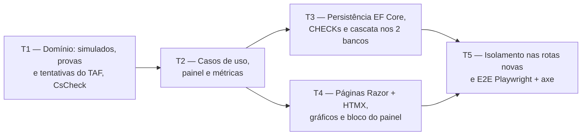

# Fase 4 — Simulados e TAF: detalhamento

> **Situação:** proposta, aguardando aprovação do autor.
>
> Desenvolvida na Onda A, em paralelo com as Fases 3 e 5 e a parte de PWA da Fase 7, sobre a
> [Onda 0 — Base compartilhada](onda-0-base-compartilhada.md).

## Objetivo

Substituir as abas **Simulados** e **Simulado TAF** da planilha:

- **Simulados** (módulo `Practice`, só a parte de `MockExam`): cadastro, edição e exclusão,
  nota tradicional (C / T × 100), nota Cebraspe (C − E), mediana de **todos** os simulados do
  plano (corrige E4), gráfico de evolução por data, simulados sem data ordenados pelo número
  e total de questões sugerido pelo plano (`DefaultMockExamQuestions`).
- **TAF** (módulo `Fitness`), opcional por plano (`FitnessTestEnabled`): provas configuráveis
  (`FitnessTestEvent`, dentro do `StudyPlan`), com o resultado guardado como inteiro na menor
  unidade; tentativas (`FitnessTestAttempt`) com resultados parciais, no máximo um resultado
  por prova, pontos digitados, total igual à soma dos pontos, comentário e gráfico de
  evolução.
- Bloco "Simulados e TAF" no painel e consumidores de métricas para `MockExamRecorded` e
  `FitnessTestAttemptRecorded`.

## Depende de

- [Onda 0 — Base compartilhada](onda-0-base-compartilhada.md), da qual esta fase usa:
  - W0-T1: uma `IEntityTypeConfiguration<T>` por entidade, sem editar o `AppDbContext`;
  - W0-T2: registro de serviços por módulo, com uma linha no ponto de composição;
  - W0-T3: `.resx` por módulo, em vez do `SharedResource.resx`;
  - W0-T4: tag helper `<chart>` com a tabela equivalente;
  - W0-T5: painel montado por blocos;
  - W0-T6: `QuestionCount` compartilhado com a Fase 3;
  - W0-T7: migração local, gerada de novo pelo orquestrador na integração.
- [Fase 2 — Planos e conteúdo](fase-2-planos-e-conteudo.md): o `StudyPlan` já tem
  `DefaultMockExamQuestions`, `FitnessTestEnabled` e o `FitnessTestEventId`, e o formulário do
  plano já edita os dois campos.
- [ADR 0001 — Escopo genérico](../adr/0001-escopo-generico.md)
- [ADR 0003 — SQLite e PostgreSQL](../adr/0003-sqlite-e-postgresql.md)
- [ADR 0011 — Estilo arquitetural](../adr/0011-estilo-arquitetural.md)
- [ADR 0013 — Frontend Tailwind CSS + daisyUI](../adr/0013-frontend-tailwind-daisyui.md)
- [ADR 0014 — DDD tático](../adr/0014-ddd-tatico.md)
- [ADR 0015 — Resultado padrão](../adr/0015-resultado-padrao.md)
- [ADR 0016 — Observabilidade](../adr/0016-observabilidade.md)

## Decisões da fase

| # | Tema | Decisão |
|---|---|---|
| D1 | Fronteiras dos agregados | Conforme a [seção 2.2](../02-dominio-e-regras.md#modelo-tático-ddd): `MockExam` é raiz própria no `Practice`; `FitnessTestEvent` é entidade do `StudyPlan`; `FitnessTestAttempt` é raiz no `Fitness` e contém os `FitnessTestResult`. Os casos de uso das provas ficam no módulo `Fitness` da `Application`: alteram o `StudyPlan` pelos métodos do agregado, sem tocar na pasta `Planning` da `Application` (a regra 8 de [3.5](../03-arquitetura.md#regras-de-dependência) proíbe tipos de outro módulo da `Application`, não os do `Domain`) |
| D2 | Simulado e `QuestionCount` | O simulado usa o `QuestionCount` da W0-T6. O formulário pede total, certas e erradas, e os brancos são derivados (B = T − C − E), sem coluna própria. O `CHECK (Correct + Wrong <= Total)` garante `Blank + Correct + Wrong = Total` com brancos ≥ 0. O número é positivo, único no plano e sugerido como o próximo. A data e o nome são opcionais. O total vem preenchido com o `DefaultMockExamQuestions` do plano, e mudar esse padrão não altera os simulados já gravados |
| D3 | Notas e mediana | Calculadas no `Domain`, na leitura, sem gravar nada: tradicional = C / T × 100 (de 0 a 100) e Cebraspe = C − E (de −T a T, em pontos líquidos, como na planilha). As duas notas aparecem sempre ([2.3](../02-dominio-e-regras.md#simulados)). A mediana é calculada para cada nota sobre todos os simulados cadastrados do plano: com quantidade par, é a média dos dois do meio; sem simulados, mostra "—". Na planilha, além de ignorar os simulados 11 e 12 (E4), `MEDIAN(F3:F12)` contava as linhas ainda vazias como nota 0. Aqui só entram simulados cadastrados |
| D4 | Ordem dos simulados | Os com data seguem a data e, no empate, o número. Os sem data seguem o número ([2.2](../02-dominio-e-regras.md#regras-de-negócio-e-onde-são-garantidas)). A posição de um grupo em relação ao outro é a pergunta 1. A mesma ordem vale para a lista, o gráfico e a tabela equivalente |
| D5 | Medidas do TAF | O `Measurement` guarda um inteiro ≥ 0 na menor unidade. As unidades (`FitnessTestUnit`) são `Repetitions`, `Centimeters` e `Milliseconds`. A pessoa digita e lê na unidade natural: repetições como inteiro ("12"); centímetros como metros com vírgula ("2,35" → 235); milissegundos como segundos ("45,8" → 45.800) ou minutos e segundos ("12:30" → 750.000). A exibição segue a mesma forma ("2,35 m", "45,80 s", "12:30,00"). A conversão fica no `Domain`, com teste de ida e volta |
| D6 | Unidade da prova | O nome e a ordem da prova mudam a qualquer momento. A unidade só muda enquanto a prova não tem resultados, porque os valores gravados seriam lidos em outra unidade. O caso de uso confere a contagem de resultados |
| D7 | Pontos do TAF | Digitados, como na planilha ([2.3](../02-dominio-e-regras.md#taf)), e obrigatórios em cada resultado. No `Domain`, são `decimal` de 0 a 1.000 com até 2 casas. No banco, são gravados como inteiro em centésimos (mesmo princípio da menor unidade), o que permite o `CHECK (Points >= 0)` igual nos dois bancos. O total é somado em memória ([3.10](../03-arquitetura.md#310-dados-dois-bancos-integridade-e-concorrência)) |
| D8 | TAF desativado no plano | Desativar esconde as páginas do TAF e o trecho do painel, e recusa comandos novos (`fitness.disabled`), sem apagar nada. Reativar mostra tudo de novo. É a mesma lógica do plano "sem pontuação" com os lançamentos ([2.2](../02-dominio-e-regras.md#regras-de-negócio-e-onde-são-garantidas)) |
| D9 | Datas | A tentativa do TAF tem data obrigatória, e a data do simulado é opcional. Nenhuma das duas pode ser futura no fuso do usuário, como os lançamentos de questões. O "hoje" vem do calendário do usuário: o `IUserCalendar` comum às Fases 3, 4 e 5, ou o calendário de cada módulo, conforme a resposta à pergunta 7 |
| D10 | Concorrência | Simulado e tentativa têm `Version`: uma edição concorrente devolve `Conflict` e preserva o que foi digitado (D4 da Fase 2). As operações nas provas conferem a `Version` do plano, como as dos blocos. O número de simulado duplicado numa corrida entre aparelhos esbarra no índice único e também vira `Conflict` |
| D11 | Persistência sem arquivos comuns | As entidades entram pelas configurações por entidade (W0-T1). Os stores usam `Set<T>()`, sem `DbSet` novo no `AppDbContext`. O filtro por dono, a `Version` e os conversores de ID já são aplicados a toda raiz pelo `AppDbContext`. A coleção de provas do `StudyPlan` é configurada (campo e `AutoInclude`) na `FitnessTestEventConfiguration`, para que o `EfPlanningStore` e a `StudyPlanConfiguration` continuem intocados |
| D12 | Textos | O TAF usa o `.resx` do módulo `Fitness`, e os simulados, o `.resx` do módulo `Practice`, o mesmo da Fase 3 (W0-T3: uma classe marcadora por módulo). Quem integrar primeiro cria a classe marcadora e o arquivo, e a outra fase só acrescenta chaves, juntadas pelo orquestrador, como combinado no detalhamento da Fase 3 |
| D13 | Métricas | Os consumidores ficam em `Trail.Application/Telemetry/`: `MockExamRecorded` gera `trail.mock_exams.recorded`, e `FitnessTestAttemptRecorded` gera `trail.fitness_test.attempts`, com a tag `complete` (todas as provas do plano ou só parte). Os contadores ficam em classes próprias (`MockExamMetrics` e `FitnessTestMetrics`), criadas sobre o `Meter` da `ApplicationMetrics`, sem editar esse arquivo. Nenhum dado pessoal nem ID entra como dimensão |

## Fronteiras com as Fases 3 e 5

A Fase 3 também trabalha no módulo `Practice` (lançamentos e desempenho), e a Fase 5 no
`StudyTime`. A divisão abaixo é a mesma da seção "Fronteiras com outras fases" do
[detalhamento da Fase 3](fase-3-questoes-desempenho-historico.md).

| Camada | A Fase 4 cria ou altera | A Fase 4 não toca |
|---|---|---|
| `Domain` | `Practice/MockExam*.cs` (raiz, ID, notas, resumo e evento); `Fitness/` inteiro; `Planning/FitnessTestEvent.cs`, `Planning/FitnessTestUnit.cs` e a coleção de provas no `StudyPlan.cs` | `QuestionEntry`, `IScoringRule`, `Score` e eventos de questões (Fase 3); `QuestionCount` (W0-T6, só consome); `StudyTime/` (Fase 5) |
| `Application` | As pastas de caso de uso de simulado em `Practice/` e a porta `IMockExamStore`; `Fitness/`; `Dashboard/MockExamsAndFitness/`; arquivos novos em `Telemetry/` | As pastas e a porta dos lançamentos (`IQuestionEntryStore`, Fase 3); `Planning/`; `ApplicationMetrics.cs` |
| `Infrastructure` | `Configurations/Practice/MockExamConfiguration.cs`, `Configurations/Planning/FitnessTestEventConfiguration.cs`, `Configurations/Fitness/`, `EfMockExamStore`, `EfFitnessStore` e `AddFitnessInfrastructure` | `AppDbContext`, `EfPlanningStore`, `StudyPlanConfiguration`, `QuestionEntryConfiguration`, migrações e snapshots existentes |
| `Web` | `Pages/Practice/MockExams/`, `Pages/Fitness/`, o bloco do painel e o `.resx` do `Fitness` | `SharedResource.resx`, `_Layout.cshtml`, a página do painel e as páginas de lançamentos e histórico (Fase 3) |
| Testes | Só arquivos novos, incluindo um arquivo `partial` de `UserIsolationTests` | `UserIsolationTests.cs`, `PlanningIsolationSweep.cs`, a varredura da Fase 3, `ApplicationTelemetryTests.cs` e `PlansE2ETests.cs` |

Pontos de contato que não dá para evitar, todos pequenos e declarados:

- Uma linha em cada ponto de composição: `AddApplication`, `AddInfrastructure` e o registro de
  blocos do painel (W0-T2 e W0-T5).
- Arquivos comuns do módulo `Practice`, combinados com a Fase 3: a classe marcadora e o
  `.resx` (D12) e o `AddPracticeInfrastructure`. Quem integrar primeiro cria, e a outra fase
  só acrescenta linhas.
- `StudyPlan.cs`: nenhuma outra fase da Onda A altera esse agregado.
- Os links "Simulados" e "TAF" na página do plano, e as contagens de simulados e de
  tentativas na prévia de exclusão do plano, que pertencem ao `Planning`. A Fase 3 precisa
  do mesmo para os lançamentos (pergunta 7).
- `Program.cs`: só se a W0-T8 mantiver a exigência de login por pasta, uma linha
  `AuthorizeFolder` por pasta nova.

## Tarefas e ondas de execução

Em cada tarefa, simulados e TAF são independentes e podem ser feitos por dois agentes em
paralelo.

### T1 — Domínio: simulados, provas e tentativas do TAF, eventos e testes de propriedade (`Domain`)

- IDs tipados (`readonly record struct` com `ITypedId<TSelf>`): `MockExamId` em
  `Trail.Domain/Practice/MockExamId.cs` e `FitnessTestAttemptId` em `Trail.Domain/Fitness/`.
  O `FitnessTestEventId` já existe.
- Simulados, em `Trail.Domain/Practice/`:
  - `MockExam` (raiz): `Create` e `Update` com `StudyPlanId`, `Number` (> 0), `Date?`, `Name`
    (opcional, até 200), `QuestionCount` e `Notes` (até 2.000). A criação levanta
    `MockExamRecorded`.
  - `MockExamScores`: `Traditional` e `Cebraspe`, a partir do `QuestionCount` (D3).
  - `MockExamSummary`: a ordem (D4) e a mediana de cada nota (D3).
- TAF:
  - `FitnessTestUnit` e `FitnessTestEvent` em `Trail.Domain/Planning/`. A prova tem `Name`
    (até 100, único no plano sem diferenciar maiúsculas), `Unit` e `Order`.
  - `StudyPlan`: coleção `FitnessTestEvents` e os métodos `AddFitnessTestEvent`,
    `RenameFitnessTestEvent`, `ChangeFitnessTestEventUnit`, `ReorderFitnessTestEvents` e
    `RemoveFitnessTestEvent`, no padrão dos blocos.
  - `Measurement`, em `Trail.Domain/Fitness/`: valor inteiro ≥ 0 e unidade, com a conversão
    de e para o texto digitado (D5).
  - `FitnessTestAttempt` (raiz) com `FitnessTestResult` (`EventId`, `Value`, `Points`):
    `Record` e `Update` recebem as provas do plano e garantem pelo menos um resultado, no
    máximo um por prova, prova do próprio plano, valor válido na unidade da prova e pontos
    conforme D7. `TotalPoints` é a soma dos pontos. O comentário vai até 1.000 caracteres.
- Eventos de domínio (`sealed record`):
  - `MockExamRecorded(MockExamId MockExamId, StudyPlanId StudyPlanId)`
  - `FitnessTestAttemptRecorded(FitnessTestAttemptId AttemptId, StudyPlanId StudyPlanId, bool Complete)`
- Testes em `Trail.Domain.Tests/Practice/MockExams/`, `Trail.Domain.Tests/Fitness/` e
  `Trail.Domain.Tests/Planning/StudyPlanFitnessTestEventTests.cs`:
  - propriedades (`CsCheck`): nota tradicional entre 0 e 100; nota Cebraspe entre −T e T;
    mediana entre o menor e o maior valor, independente da ordem e igual a um dos valores
    quando a quantidade é ímpar; total do TAF igual à soma, independente da ordem; ida e
    volta texto ↔ `Measurement` em cada unidade;
  - regressão nomeada `E4_MockExamMedian_UsesEveryMockExam`: com 12 simulados, o 11º e o 12º
    mudam a mediana, e simulados não cadastrados não entram como zero. O roteiro pede o E4 na
    Fase 3, mas o teste fica aqui, com o dono do `MockExam`, como o detalhamento da Fase 3
    registra.

**Pronto quando:** cobertura ≥ 90% em `Trail.Domain` (100% nas notas, na mediana e no
`Measurement`), testes de propriedade e o teste E4 passando, e zero violações em
`Trail.Architecture.Tests`.

### T2 — Casos de uso, consultas do painel e consumidores de métricas (`Application`)

- Uma pasta por caso de uso, como na [3.5](../03-arquitetura.md#estrutura) e na Fase 3
  (`Practice/CreateMockExam/`, `Practice/ListMockExams/`, `Fitness/RecordFitnessTestAttempt/`
  etc.).
- Simulados, em `Trail.Application/Practice/`, com a porta `IMockExamStore` (contexto do plano:
  nome e `DefaultMockExamQuestions`; simulados do plano) e o `FallbackMockExamStore`:
  - `GetNewMockExamDefaultsHandler` (próximo número e total padrão do plano),
    `CreateMockExamHandler`, `GetMockExamHandler`, `UpdateMockExamHandler` e
    `DeleteMockExamHandler`.
  - `ListMockExamsHandler`, que devolve a `MockExamListView`: linhas na ordem D4 com brancos e
    as duas notas, quantidade, medianas e as séries do gráfico.
- TAF, em `Trail.Application/Fitness/`, com a porta `IFitnessStore` (plano do dono com as
  provas, tentativas e contagem de resultados por prova) e o `FallbackFitnessStore`:
  - Provas: `AddFitnessTestEventHandler`, `UpdateFitnessTestEventHandler` (D6),
    `ReorderFitnessTestEventsHandler`, `GetFitnessTestEventDeletionImpactHandler` (resultados
    e tentativas afetados) e `DeleteFitnessTestEventHandler` (pergunta 4).
  - Tentativas: `RecordFitnessTestAttemptHandler`, `GetFitnessTestAttemptHandler`,
    `UpdateFitnessTestAttemptHandler` e `DeleteFitnessTestAttemptHandler`.
  - `GetFitnessTestOverviewHandler`: provas, tentativas por data com os resultados
    formatados, total por tentativa, melhor total e as séries do gráfico.
  - Plano com TAF desativado: as consultas informam `Enabled = false`, e os comandos devolvem
    `Invalid` (D8).
- Painel: `GetMockExamsAndFitnessSummaryHandler`, em
  `Trail.Application/Dashboard/MockExamsAndFitness/` (o `Dashboard` pode ler vários
  módulos): último simulado com as duas notas, medianas e quantidade; se o TAF estiver
  ativo, total da última tentativa e o melhor total.
- Consumidores e contadores de métricas (D13).
- Datas futuras recusadas pelo calendário do usuário (D9), com `FakeTimeProvider` nos testes.
- Registro do `FallbackFitnessStore` e das classes de métricas num arquivo próprio do
  `Fitness`, com uma linha no `AddApplication`. O do `FallbackMockExamStore` segue o arquivo
  comum do `Practice` (quem integrar primeiro cria).
- Testes em `Trail.Application.Tests/Practice/MockExams/`, `Trail.Application.Tests/Fitness/`
  e `Trail.Application.Tests/Telemetry/MockExamAndFitnessTelemetryTests.cs`.

**Pronto quando:** cobertura ≥ 90% em `Trail.Application`, os dois eventos com consumidores
registrados e testados com o coletor em memória, e `Trail.Architecture.Tests` verde,
incluindo o isolamento entre `Practice`, `Fitness` e `Planning`.

### T3 — Persistência EF Core, migração nos dois bancos e testes de integridade (`Infrastructure`)

- Configurações por entidade (W0-T1):
  - `MockExamConfiguration`: tabela `MockExams`, `QuestionCount` como tipo complexo (W0-T6),
    FK para `StudyPlans` em cascata, índice único `(StudyPlanId, Number)`, índice
    `(StudyPlanId, Date)` e os `CHECK` `Number > 0`, `Total > 0`, `Correct >= 0`,
    `Wrong >= 0` e `Correct + Wrong <= Total`.
  - `FitnessTestEventConfiguration`: tabela `FitnessTestEvents`, FK para `StudyPlans` em
    cascata e a navegação do `StudyPlan` (D11).
  - `FitnessTestAttemptConfiguration`: tabelas `FitnessTestAttempts` e `FitnessTestResults`.
    A chave `(AttemptId, EventId)` garante um resultado por prova também no banco. As FKs para
    a tentativa e para a prova são em cascata. `CHECK (Value >= 0)` e `CHECK (Points >= 0)`,
    com `Points` em centésimos (D7).
- `EfMockExamStore` e `EfFitnessStore` em `Trail.Infrastructure/Persistence/`, com
  `Set<T>()`. A violação do índice único do número vira `Conflict`.
- Registro no `AddPracticeInfrastructure`, comum com a Fase 3, e no `AddFitnessInfrastructure`
  (W0-T2).
- Migração local `AddMockExamsAndFitnessTest` em `SqliteAppDbContext` e
  `PostgreSqlAppDbContext`, descartada e gerada de novo pelo orquestrador na integração
  (W0-T7).
- `MockExamPersistenceTests` e `FitnessPersistenceTests` em SQLite e PostgreSQL, verificando:
  - os `CHECK` recusam dados inválidos gravados direto por SQL;
  - o número de simulado repetido vira `Conflict`;
  - a cascata: excluir o plano apaga simulados, provas, tentativas e resultados; excluir uma
    prova apaga os resultados dela, e as tentativas que ficariam vazias seguem a pergunta 4;
  - a concorrência otimista por `Version` no simulado e na tentativa;
  - a ordem dos simulados com e sem data, idêntica nos dois bancos;
  - os pontos com casas decimais voltam do banco sem perda.

**Pronto quando:** `PendingModelChangesTests` e os testes de persistência passam em SQLite e
PostgreSQL, sem nenhuma mudança no `AppDbContext`, no `EfPlanningStore` e na
`StudyPlanConfiguration`.

### T4 — Interface Web: simulados, TAF, gráficos e bloco do painel (`Web`)

- Razor Pages + parciais HTMX em `src/Trail.Web/Pages/Practice/MockExams/` e
  `src/Trail.Web/Pages/Fitness/`, com as rotas:
  - `/planos/{planId}/simulados`: resumo (quantidade e as duas medianas), gráfico, lista e
    formulário de novo simulado;
  - `/planos/{planId}/simulados/{mockExamId}/editar`;
  - `/planos/{planId}/taf`: tentativas, totais e gráfico;
  - `/planos/{planId}/taf/provas`: incluir, renomear, trocar a unidade (D6), reordenar e
    excluir com prévia;
  - `/planos/{planId}/taf/tentativas/nova` e `/planos/{planId}/taf/tentativas/{attemptId}/editar`.
- Simulados:
  - Formulário com número e total já sugeridos, data, nome, certas, erradas e observações.
    Os brancos e as notas aparecem na resposta.
  - No desktop, uma tabela com todas as colunas da planilha. No celular, uma linha compacta
    (número, data e as duas notas) com os detalhes num `
`.
- TAF:
  - O formulário da tentativa tem uma linha por prova, na ordem do plano, com o resultado na
    unidade da prova e os pontos. Uma linha em branco significa prova não feita.
  - Os campos usam o `inputmode` adequado: `numeric` para repetições, `decimal` para metros e
    pontos, e texto com `pattern` para tempo.
  - Plano com TAF desativado: aviso com link para editar o plano.
- Gráficos com o `<chart>` da W0-T4 e a tabela equivalente, conforme as perguntas 2 e 3.
- Exclusões com `<dialog>`: confirmação simples para simulado e tentativa, e prévia com
  contagens para a prova.
- Links "Simulados" e "TAF" (este só com o TAF ativo) na página do plano (pergunta 7).
- Bloco "Simulados e TAF" do painel (view component da W0-T5), com um convite para registrar o
  primeiro simulado quando não há dados.
- Textos nos `.resx` dos módulos `Practice` e `Fitness` (D12). Os formulários enviados por HTMX mostram a lista de erros
  com `role="alert"` e põem o foco no primeiro campo inválido (pendência 3 da Fase 2).
- O login é exigido conforme a decisão da W0-T8.

**Pronto quando:** todas as páginas e parciais passam pelo `ResultResponder`, funcionam com e
sem HTMX e respeitam a CSP com nonce; todo gráfico tem a tabela equivalente; e nenhuma nota ou
resultado depende só de cor.

### T5 — Isolamento entre usuários nas rotas novas e testes E2E Playwright + axe (`Web.Tests` e `E2E.Tests`)

- Isolamento, em arquivos novos (`UserIsolationTests.MockExamsAndFitness.cs`, como `partial`
  de `UserIsolationTests`, mais `MockExamIsolationSweep.cs` e `FitnessIsolationSweep.cs`):
  - Varredura de **todos** os handlers novos, em SQLite e PostgreSQL, com IDs de outro
    usuário, exigindo 404 (nunca 403 nem 200), sem vazar nome, observações, comentário ou
    nome de prova da vítima, sem alterar os dados dela e sem criar linhas além das semeadas.
  - Casos misturados: plano próprio com simulado alheio; tentativa própria com uma prova
    alheia nos resultados; prova alheia pelo plano próprio; prévia de exclusão de prova
    alheia; formulários de edição; e parciais do gráfico.
  - Teste por reflexão `MockExamsAndFitnessIsolationSweep_CoversEveryPageHandler`, que falha
    se algum handler das páginas em `Trail.Web.Pages.Practice.MockExams` ou
    `Trail.Web.Pages.Fitness` ficar fora da varredura. Como no teste do `Planning`, o
    namespace é comparado por igualdade, para que a varredura da Fase 3
    (`Trail.Web.Pages.Practice`) e a desta fase não cobrem as páginas uma da outra.
  - O bloco do painel do atacante nunca mostra dados da vítima.
- E2E em `tests/Trail.E2E.Tests/MockExamsAndFitnessE2ETests.cs`, em `390x844` e `1280x800`,
  nos temas claro e escuro, com zero violações WCAG 2.1 AA no axe:
  - Simulados: cadastrar três (um sem data), conferir brancos, notas, medianas, gráfico e
    tabela equivalente, editar um, excluir outro e ver a mediana recalculada.
  - TAF: ativar no plano, cadastrar Barra (repetições), Salto (centímetros), Natação
    (milissegundos) e Corrida (centímetros), registrar uma tentativa parcial e uma completa,
    conferir totais e gráfico, e excluir uma prova vendo a prévia.
  - Painel: o bloco mostra o último simulado e o último total do TAF.
  - Navegação só por teclado no registro de simulado e de tentativa.

**Pronto quando:**
- As abas "Simulados" e "Simulado TAF" da planilha podem ser abandonadas: tudo o que elas
  registram (número, total, brancos, certas, erradas, as duas notas e a mediana; provas,
  resultados, pontos, total e comentário) é registrado e consultado no app, inclusive pelo
  celular, com a mediana de todos (E4) e os gráficos de evolução.
- A prévia de exclusão do plano mostra também quantos simulados e tentativas do TAF serão
  apagados.
- Os testes de isolamento e E2E passam nos dois bancos e no container Docker.
- O CI fica 100% verde no PR da fase.

## Perguntas para o autor

1. **Posição dos simulados sem data** (na lista, no gráfico e na tabela):
   - **(a) Antes dos que têm data, pelo número (recomendado).** Prós: na prática, são os
     antigos ou os importados da planilha, que não tem coluna de data. Contras: um simulado
     novo lançado sem data aparece no começo.
   - **(b) Depois dos que têm data, pelo número.** Prós: o mais recente costuma ficar no fim.
     Contras: os importados apareceriam como os mais recentes.
   - **(c) Tudo pelo número, com a data só como rótulo.** Prós: uma regra só. Contras: o
     gráfico deixa de ser "por data", como pede a [seção 2.3](../02-dominio-e-regras.md#simulados).
2. **Gráfico de evolução dos simulados:** as notas têm escalas diferentes (0 a 100% e −T a T
   pontos).
   - **(a) Dois gráficos de linha, um por nota, com a mediana como linha tracejada
     (recomendado).** Prós: cada nota na própria escala, leitura clara no celular, sem
     plugin novo do Chart.js. Contras: ocupa mais altura.
   - **(b) Um gráfico com dois eixos verticais.** Prós: compacto. Contras: dois eixos confundem
     a leitura e ficam apertados em 390 px.
   - **(c) Um gráfico com a nota Cebraspe convertida em % ((C − E) / T × 100).** Prós: uma
     escala só. Contras: muda o indicador aprovado, que é em pontos líquidos.
3. **Gráfico de evolução do TAF:** os resultados têm unidades diferentes.
   - **(a) Total de pontos e uma linha de pontos por prova, num só eixo (recomendado).** Prós:
     tudo em pontos, mostra qual prova evolui. Contras: tentativas parciais deixam lacunas nas
     linhas.
   - **(b) Só o total de pontos.** Prós: o mais simples. Contras: não mostra a evolução de cada
     prova.
   - **(c) Um gráfico por prova, com o resultado na unidade dela.** Prós: mostra o tempo e a
     distância reais. Contras: quatro gráficos e mais rolagem no celular.
4. **Excluir uma prova com resultados:** a cascata aprovada apaga os resultados dela, e uma
   tentativa que só tinha essa prova ficaria sem nenhum resultado.
   - **(a) Excluir também essas tentativas, informadas na prévia (recomendado).** Prós: mantém
     a regra "toda tentativa tem ao menos um resultado" e segue a cascata aprovada. Contras: o
     comentário dessas tentativas se perde, o que a prévia avisa.
   - **(b) Manter a tentativa vazia, com o comentário e total 0.** Prós: não perde o
     comentário. Contras: uma tentativa sem resultado distorce o gráfico e enfraquece a regra.
   - **(c) Bloquear a exclusão enquanto houver essas tentativas.** Prós: nada se perde sem
     querer. Contras: contraria a política de cascata aprovada e obriga a editar tentativa por
     tentativa.
5. **Provas pré-cadastradas ao ativar o TAF:**
   - **(a) Nenhuma: a pessoa cadastra as provas, e a importação da Fase 6 traz as da planilha
     (recomendado).** Prós: segue o escopo genérico (ADR 0001) e nenhum vínculo com órgãos
     ([1.7](../01-visao-e-escopo.md#17-fora-de-escopo)). Contras: quatro cadastros rápidos
     para quem começa do zero.
   - **(b) Sugestões genéricas ao cadastrar (ex.: barra fixa, impulsão horizontal, natação
     50 m, corrida 12 min), já com a unidade.** Prós: agiliza para qualquer concurso. Contras:
     uma lista a manter e a traduzir.
   - **(c) Modelo "PF" com as quatro provas da planilha.** Prós: um clique para o autor.
     Contras: cita um órgão público, o que o escopo exclui.
6. **Simulados num plano "sem pontuação":**
   - **(a) Continuam disponíveis (recomendado).** Prós: o simulado é uma prova completa, não
     depende dos lançamentos, e a regra "sem pontuação" esconde só os campos de questões.
     Contras: um plano sem pontuação mostra notas nos simulados.
   - **(b) Ficam escondidos, como os lançamentos.** Prós: o plano fica coerente. Contras:
     quem estuda sem pontuar os tópicos perde os simulados.
7. **Peças comuns que a Onda 0 não cobre.** É a mesma pergunta da P9 da Fase 3, com as mesmas
   opções, e uma resposta vale para as duas fases. A Fase 4 precisa de três peças:
   - o "hoje" no fuso do usuário, para recusar datas futuras (D9), com o `FakeTimeProvider`
     nos testes;
   - a prévia de exclusão do plano com as contagens de outros módulos (porta
     `IDeletionImpactContributor` em `Application/Abstractions`, fora dos módulos isolados
     pela regra 8), porque hoje a `DeletionImpactView` tem campos fixos do `Planning`;
   - os links da página do plano para as páginas de cada módulo ("Simulados" e "TAF").

   As opções:
   - **(a) Uma tarefa nova na Onda 0, com o calendário do usuário (`IUserCalendar`) num só
     lugar e pontos de extensão para a prévia de exclusão e para os links do plano, no padrão
     dos blocos do painel (recomendado).** Prós: uma única regra de "hoje" no sistema, e
     nenhuma fase edita o `Planning` nem os arquivos das outras. Contras: a Onda 0 cresce um
     pouco.
   - **(b) Só os pontos de extensão na Onda 0, e cada módulo calcula o "hoje" pelo próprio
     calendário (proposta da Fase 5).** Prós: a Onda 0 fica menor, e os módulos não dependem
     uns dos outros. Contras: o `Practice` e o `Fitness` ganham mais implementações do
     "hoje", que precisam concordar, cada uma com os seus testes.
   - **(c) Nada na Onda 0: a Fase 3 cria o `IDeletionImpactContributor` e refatora a prévia,
     as Fases 4 e 5 só registram os seus contribuintes, e cada módulo tem o seu
     calendário.** Prós: a Onda 0 não muda, e as três fases já combinaram essa saída.
     Contras: a Fase 4 depende de uma parte da Fase 3 na integração, e os links do plano
     exigem uma linha de cada fase em `Plans/Details.cshtml`.
