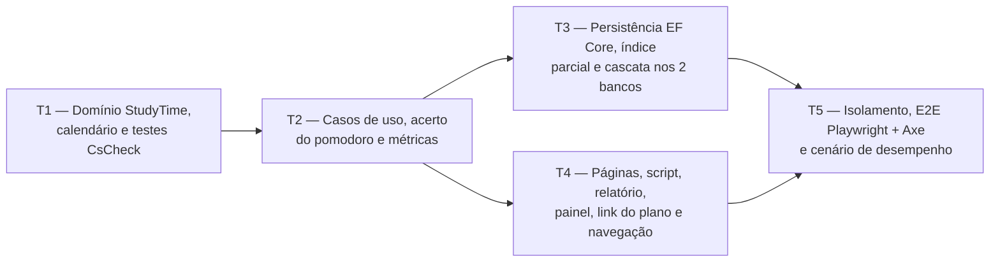

# Fase 5 — Tempo de estudo: detalhamento

> **Situação:** proposta, aguardando aprovação do autor. Desenvolvida na Onda A, em paralelo
> com as Fases 3 e 4 e a parte de PWA da Fase 7 (7a), sobre a
> [Onda 0 — Base compartilhada](onda-0-base-compartilhada.md).

## Objetivo

Entregar o módulo `StudyTime` completo: cronômetro e pomodoro por disciplina ou tópico, com
o servidor como fonte da verdade (`StudySession` com `StartedAt` e duração planejada),
lançamento manual, correção e exclusão de sessões, tratamento da sessão esquecida aberta,
bloqueio de sobreposição, fim automático do pomodoro, horas por tópico, disciplina, dia e
semana no fuso do usuário, o bloco de horas no painel, o link "Horas" na página do plano, as
métricas dos eventos `StudySessionStarted` e `StudySessionEnded`, e o script do cronômetro
com o aviso de fim do bloco, dentro da CSP estrita.

## Depende de

- [Fase 2 — Planos e conteúdo](fase-2-planos-e-conteudo.md): disciplinas, tópicos e a
  prévia de exclusão.
- Preferências da [Fase 1](fase-1-contas-email-isolamento.md): `UserSettings.TimeZoneId`,
  `PomodoroFocusMinutes` e `PomodoroBreakMinutes`.
- [Onda 0 — Base compartilhada](onda-0-base-compartilhada.md), da qual esta fase usa:

  | Peça | Uso na Fase 5 |
  |---|---|
  | W0-T1 | `StudySessionConfiguration` em `Persistence/Configurations/StudyTime/`, sem editar o `AppDbContext` |
  | W0-T2 | Preenche `AddStudyTimeApplication`, `AddStudyTimeInfrastructure` e `AddStudyTimeWeb`, já criados e chamados. `StudyTimeMetrics`, o bloco do painel, o link do plano e os contribuintes da exclusão e da atividade do plano são descobertos pela convenção. Nenhum ponto de composição é editado |
  | W0-T3 | `StudyTimeResource`, `StudyTimeResource.resx` e `Pages/StudyTime/_ViewImports.cshtml`, já criados. Os códigos `studytime.*` são traduzidos pelo registro de prefixos do `ResultResponder`, e o `UiText` do E2E lê o `.resx` do módulo. A fase só acrescenta chaves |
  | W0-T4 | `<chart>`: barras verticais de horas por dia e por semana, valores em horas no formato pt-BR e a tabela equivalente gerada do mesmo modelo |
  | W0-T5 | `IDashboardBlock`, `DashboardContext` e `IPlanActivityContributor` (D16) |
  | W0-T7 | Migração local `AddStudyTime` nos dois contextos, gerada de novo na integração |
  | W0-T8 | Login exigido em `Pages/StudyTime` pela regra da Onda 0, P3. A Onda 0 registra a pasta `/StudyTime`, e a fase não edita o `Program.cs` |
  | W0-T9 | `IUserCalendar`, `CalendarWeek`, `FakeTimeProvider`, `DeletionScope` com `IDeletionImpactContributor` (confirmação com a lista de contagens na exclusão de plano, disciplina e tópico), e `IPlanLinkContributor` |
  | W0-T10 | `_FormErrors` e `FormErrorList` em `Pages/Shared`, com `role="alert"` e foco no primeiro campo inválido |
  | W0-T11 | Fixture de E2E com usuário novo por teste, service workers bloqueados e um auxiliar que abre outro contexto autenticado como o mesmo usuário (segundo aparelho) |
  | W0-T12 | Harness de desempenho e `performance.yml`. A fase só acrescenta um cenário |
  | W0-T13 | Ícones da seção [Ícones](#ícones) no sprite |

- Respostas do autor na Onda 0: P1 (peças comuns), P3 (login no app inteiro), P4 (qual plano
  o painel mostra), P5 (fluxo de integração), P6 (eventos de correção e exclusão) e P7(d)
  (acerto do pomodoro numa gravação própria).
- Dentro da Onda A:
  - **7a — service worker:** a P1 decide essa dependência. Com B ou C, a notificação no
    Android e no iOS com o app instalado só existe por
    `ServiceWorkerRegistration.showNotification`, e o clique nela precisa de um
    `notificationclick` no `sw.template.js`, arquivo da 7a. A 7a já traz esse
    `notificationclick` mínimo (D11 da 7a: foca uma aba aberta do app ou abre `/`), então
    não sobra tarefa para a integração. A Fase 5 não espera a 7a: sem service worker
    registrado, usa a `Notification` do desktop. Com a P1 = A, não há dependência.
  - **Fase 3 — árvore da disciplina:** a coluna de horas e o botão "Estudar" na árvore
    dependem da Fase 3 já integrada (P9).
- [ADR 0003 — SQLite e PostgreSQL](../adr/0003-sqlite-e-postgresql.md)
- [ADR 0011 — Estilo arquitetural](../adr/0011-estilo-arquitetural.md)
- [ADR 0013 — Frontend Tailwind CSS + daisyUI](../adr/0013-frontend-tailwind-daisyui.md)
- [ADR 0014 — DDD tático](../adr/0014-ddd-tatico.md)
- [ADR 0015 — Resultado padrão](../adr/0015-resultado-padrao.md)
- [ADR 0016 — Observabilidade](../adr/0016-observabilidade.md)

## Fronteiras com as Fases 3, 4 e 7a

A divisão segue os detalhamentos da [Fase 3](fase-3-questoes-desempenho-historico.md), da
[Fase 4](fase-4-simulados-e-taf.md) e da [7a](fase-7a-pwa.md).

| Camada | A Fase 5 cria ou altera | A Fase 5 não toca |
|---|---|---|
| `Domain` | `StudyTime/` inteiro | `Practice/`, `Fitness/`, `Planning/` e `Common/` (inclusive o `CalendarWeek` da Onda 0) |
| `Application` | `StudyTime/` (uma pasta por caso de uso) e arquivos novos em `Telemetry/` (`StudyTimeMetrics` e consumidores) | `Practice/`, `Fitness/`, `Planning/`, `Abstractions/`, `Dashboard/`, `ApplicationMetrics.cs` e `DependencyInjection.cs` |
| `Infrastructure` | `Configurations/StudyTime/`, `EfStudyTimeStore` e o corpo de `AddStudyTimeInfrastructure` | `AppDbContext`, `DependencyInjection.cs`, `EfPlanningStore`, as configurações das outras fases, as migrações e os snapshots existentes |
| `Web` | `Pages/StudyTime/` (páginas, parciais, bloco do painel com o seu endpoint, link do plano e item de navegação), as chaves do `StudyTimeResource.resx`, `wwwroot/js/study-timer.js`, o corpo de `AddStudyTimeWeb` e uma linha em `_Navigation.cshtml` | `Program.cs`, `_Layout.cshtml`, a página do painel, `Pages/Plans/` (inclusive a árvore de tópicos), `SharedResource.resx`, `ResultResponder`, `sw.template.js` e as páginas das outras fases |
| Testes | Só arquivos novos: pastas `StudyTime/`, `Telemetry/StudyTimeTelemetryTests.cs`, `Accounts/UserIsolationTests.StudyTime.cs` (`partial`), `StudyTimeIsolationSweep.cs`, `StudyTimeE2ETests.cs` e o cenário no harness de desempenho | `UserIsolationTests.cs`, `PlanningIsolationSweep.cs`, as varreduras das Fases 3 e 4, `ApplicationTelemetryTests.cs`, `TrailWebApplicationFactory.cs`, a fixture de E2E e `PlansE2ETests.cs` |

Arquivos comuns que a fase altera:

| Arquivo | Mudança da Fase 5 | Na integração |
|---|---|---|
| `Pages/Shared/_Navigation.cshtml` | Uma linha: o view component do item "Tempo de estudo", dentro do bloco de usuário autenticado | Sem conflito: é a única fase da Onda A que altera esse arquivo |
| Migrações | `AddStudyTime` local, nos dois contextos | Descartada e gerada de novo pela integração, na ordem da Onda 0, P5 (W0-T7) |

## Decisões da fase

| # | Tema | Decisão |
|---|---|---|
| D1 | Agregado e intervalo | `StudySession` guarda `SubjectId`, `TopicId?`, `Mode` (`Stopwatch`, `Pomodoro`, `Manual`), `Notes` e o value object `SessionInterval` (`StartedAt`, `EndedAt?`, `PlannedDuration?`), que garante fim depois do início, no máximo 24 h e, no pomodoro, fim até o fim planejado. Os instantes são UTC truncados ao segundo, para o valor gravado ser idêntico no SQLite e no PostgreSQL (que guarda microssegundos) |
| D2 | Servidor como fonte da verdade | A página recebe `StartedAt`, o fim planejado e o instante do servidor em atributos `data-*`. O script só calcula a exibição (relógio do aparelho + desvio em relação ao servidor − `StartedAt`). Nada é gravado a cada segundo: recarregar, trocar de aparelho ou bloquear o celular não muda o tempo registrado |
| D3 | Fim automático do pomodoro, sem tarefa em segundo plano | Na leitura, um pomodoro aberto e vencido conta como encerrado no fim planejado (`min(agora, StartedAt + PlannedDuration)`). A gravação desse fim (o "acerto") acontece no `POST` que o script faz ao zerar o bloco ou no próximo comando do usuário, numa gravação própria, antes da operação pedida. É uma exceção à gravação única por caso de uso ([3.5](../03-arquitetura.md#35-camadas-módulos-e-padrões-internos) e [3.10](../03-arquitetura.md#310-dados-dois-bancos-integridade-e-concorrência)), levada ao autor na Onda 0, P7(d). Consultas nunca gravam. O acerto é idempotente, inclusive com dois aparelhos ao mesmo tempo |
| D4 | Uma sessão aberta e sem sobreposição | Índice único parcial em `OwnerId` onde `EndedAt` é nulo: a violação vira `Conflict` ("já há uma sessão em andamento"), com a sessão atual na resposta. A sobreposição é verificada no caso de uso, com intervalos semiabertos (encostar não é sobrepor). A sessão aberta ocupa de `StartedAt` em diante, porque nenhuma sessão termina no futuro. Encerrar uma sessão já encerrada devolve `Ok` com uma mensagem informativa |
| D5 | Fuso, dia e semana | O fuso, o "hoje" e o instante atual vêm de um único `UserCalendarSnapshot` do `IUserCalendar` (W0-T9), e a semana de segunda a domingo vem do `CalendarWeek` (`Domain/Common`), os mesmos das Fases 3 e 4. Só a conversão entre instante e dia local fica nesta fase, em `StudyCalendar` (`Domain/StudyTime`): o dia de uma sessão é a data local do `StartedAt`, então a sessão que atravessa a meia-noite conta inteira no dia em que começou ([2.3](../02-dominio-e-regras.md#23-regras-de-cálculo)). O dia em UTC começa na primeira hora local válida, o que cobre fusos em que a meia-noite deixa de existir na troca de horário. Na digitação, um horário inexistente é recusado e um horário repetido usa a primeira ocorrência |
| D6 | Totais calculados na leitura | A consulta traz só `SubjectId`, `TopicId`, `StartedAt`, `EndedAt` e `PlannedDuration` do intervalo UTC pedido (índice `OwnerId, StartedAt`) e soma em segundos na memória, como os pontos do TAF ([3.10](../03-arquitetura.md#310-dados-dois-bancos-integridade-e-concorrência)). Não há coluna de duração: somar diferenças de datas não é portável no SQLite. A sessão em andamento entra nos totais quando termina |
| D7 | Totais por tópico | O tópico soma o tempo dos subtópicos, como o desempenho ([2.2](../02-dominio-e-regras.md#regras-de-negócio-e-onde-são-garantidas)). O tempo lançado só na disciplina aparece na linha "Sem tópico", e a ordem segue o sumário do plano |
| D8 | Sessão esquecida | Um cronômetro aberto além do limite da P7 abre, em `/tempo`, um `<dialog>` com "Encerrar agora", "Encerrar em…" (data e hora locais, entre o início e `min(agora, início + 24 h)`) e "Continuar". Passadas 24 h, restam "Encerrar em…" e "Descartar". O bloco do painel e o selo da navegação avisam e levam até lá. O pomodoro nunca fica esquecido, porque termina sozinho |
| D9 | Lançamento manual | Data, hora de início e hora de fim, no fuso do usuário. Um fim menor que o início é no dia seguinte, com aviso no formulário; fim igual ao início é recusado. A sessão não pode terminar no futuro, passar de 24 h nem sobrepor outra. Ela levanta `StudySessionStarted` e `StudySessionEnded` com o modo `Manual`, para as contagens de iniciadas e encerradas baterem |
| D10 | Preferências do pomodoro | A duração do bloco é copiada de `PomodoroFocusMinutes` para `PlannedDuration` ao iniciar: mudar a preferência não altera um bloco em andamento. O módulo lê `UserSettings` pela própria porta (`IStudyTimeStore`), porque um módulo da `Application` não usa tipos de outro (regra 8 de [3.5](../03-arquitetura.md#regras-de-dependência)) |
| D11 | Script do cronômetro | `wwwroot/js/study-timer.js`, externo, sem `eval`, sem `hx-on:*` e sem atributo `style` (a barra do pomodoro é um `<progress>`). Os textos vêm de atributos `data-*` traduzidos pelo `.resx`. O script dispara eventos próprios (`trail-pomodoro-due`, `trail-timer-refresh`) que o HTMX escuta por `hx-trigger`, reinicia depois de `htmx:after:swap` e consulta o servidor ao voltar à aba (`visibilitychange`, `pageshow`) e a cada 60 s |
| D12 | Métricas | Classe própria `StudyTimeMetrics` em `Telemetry/`, sobre o `Meter` da `ApplicationMetrics` sem editar esse arquivo e descoberta pela convenção da W0-T2: `trail.study_sessions.started` (tag `mode`) e `trail.study_sessions.minutes` (unidade `min`, tags `mode` e `end_kind`). O usuário nunca vira dimensão |
| D13 | Exclusão em cascata | Chaves estrangeiras de `StudySession` para `Subject` e `Topic`, com cascata ([2.2](../02-dominio-e-regras.md#regras-de-negócio-e-onde-são-garantidas)). O `StudySessionDeletionImpactContributor` recebe o `DeletionScope` já resolvido pelo `Planning` e devolve um item (`studytime.deletion.sessions`, quantidade), com os textos nas chaves `studytime.deletion.sessions.one` e `studytime.deletion.sessions.other` do `StudyTimeResource.resx`. Conta as sessões cuja disciplina está em `SubjectIds` ou cujo tópico está em `TopicIds` |
| D14 | Correção e exclusão sem eventos novos | Uma sessão encerrada pode ser corrigida (disciplina, tópico, início, fim e anotação) e excluída, e a sessão em andamento pode ser descartada, sem eventos novos, conforme a Onda 0, P6. Essas operações aparecem na métrica `trail.usecase.results`, que o `ResultResponder` já registra por caso de uso e status. A correção envia a `Version` exibida e, se ela mudou, devolve `Conflict` sem perder o que foi digitado (D4 da Fase 2) |
| D15 | Organização do módulo | Uma pasta por caso de uso, como nas Fases 3 e 4 e na [3.5](../03-arquitetura.md#35-camadas-módulos-e-padrões-internos) (`StudyTime/StartStudySession/`, `StudyTime/GetStudyHoursReport/` etc.), com a porta e o fallback na raiz do módulo. O store usa `Set<StudySession>()`, sem `DbSet` novo no `AppDbContext` |
| D16 | Bloco de horas e plano do painel | O bloco mostra o plano do `DashboardContext`, como os blocos das Fases 3 e 4: hoje, a semana atual e os últimos 7 dias somam só as sessões das disciplinas desse plano. Motivo: o painel inteiro fala do plano escolhido no seletor, e horas por disciplina só têm sentido dentro de um plano. O total de todos os planos fica em `/tempo/horas` sem filtro de plano. A sessão em andamento aparece sempre, com o nome do plano, porque é um estado do usuário e não do plano. Para o plano padrão do painel, o `StudySessionPlanActivityContributor` (`IPlanActivityContributor`) informa, por plano, o `StartedAt` da sessão mais recente |

## Ícones

Ícones Lucide que a Onda 0 acrescenta ao sprite (W0-T13) para esta fase, sempre ao lado de
um texto visível (o `<icon>` já sai com `aria-hidden`):

| Ícone | Uso |
|---|---|
| `play` | "Cronômetro", "Pomodoro", "Próximo bloco" e "Continuar" |
| `square` | "Encerrar" |
| `skip-forward` | "Pular pausa" (P4) |
| `bell` | "Avisar por notificação" (P1) |
| `volume-2` e `volume-x` | Botão "Som", ligado e desligado (P2) |
| `plus` | "Lançar sessão" |
| `pencil` e `trash-2` | Corrigir e excluir sessão |

O item "Tempo de estudo" da navegação não tem ícone, como o item "Planos".

## Tarefas e etapas de execução

A T4 começa com dublês da porta e passa para o banco real quando a T3 termina.

### T1 — Domínio `StudyTime`: agregado, intervalo, calendário, eventos e testes de propriedade (`Domain`)

- Em `Trail.Domain/StudyTime/`:
  - `StudySessionId` (`readonly record struct` implementando `ITypedId<TSelf>`),
    `StudySessionMode` e `StudySessionEndKind` (`Stopped`, `Completed`, `SetByUser`,
    `Recorded`).
  - `SessionInterval`: `Open(startedAt, plannedDuration?)`, `Closed(startedAt, endedAt)`,
    `EffectiveEnd(now)`, `DurationAt(now)`, `Overlaps(other)` e `MaxDuration` (24 h).
  - `StudySession` (`AggregateRoot<StudySessionId>`):
    - criação: `StartStopwatch`, `StartPomodoro(focus)` e `Record(startedAt, endedAt, notes, now)`;
    - encerramento: `Stop(now)`, `CompleteIfDue(now)` e `EndAt(endedAt, now)`;
    - `Correct(subjectId, topicId, startedAt, endedAt, notes, now)`, só em sessão encerrada
      e sem evento (D14);
    - leitura: `IsOpen`, `IsDue(now)`, `IsForgotten(now)` e `LatestAllowedEnd(now)`.
  - `StudyCalendar`, criado com o `TimeZoneInfo` do usuário: `LocalDateOf(utc)`,
    `DayStartUtc(date)`, `RangeUtc(from, to)` e `ToUtc(date, time)` (D5). A semana vem do
    `CalendarWeek`.
- Eventos de domínio (`sealed record` implementando `IDomainEvent`):
  - `StudySessionStarted(StudySessionId SessionId, StudySessionMode Mode)`
  - `StudySessionEnded(StudySessionId SessionId, StudySessionMode Mode, TimeSpan Duration, StudySessionEndKind EndKind)`
- Testes em `Trail.Domain.Tests/StudyTime/`:
  - unidade: limite de 24 h, pomodoro que não passa do planejado, encerramento idempotente,
    fim no futuro recusado, correção recusada em sessão aberta e sessão esquecida antes e
    depois de 24 h;
  - fusos: `America/Sao_Paulo` em 2026 (sem horário de verão), `America/New_York` em
    08/03/2026 (dia de 23 h, 02:30 inexistente) e em 01/11/2026 (dia de 25 h, 01:30
    repetido), e `America/Sao_Paulo` em 04/11/2018 (dia em que a meia-noite não existiu);
  - propriedades (CsCheck), com fusos sorteados: toda sessão cai em exatamente um dia, o
    do `StartedAt` local; a soma dos dias é a soma das durações; a semana é a soma dos seus
    sete dias; `Overlaps` é simétrico e bate com a comparação ponto a ponto; nenhum
    intervalo válido passa de 24 h.

**Pronto quando:** cobertura ≥ 90% em `Trail.Domain`, testes de propriedade do intervalo e
do calendário passando, e zero violações em `Trail.Architecture.Tests`.

### T2 — Casos de uso `StudyTime`, acerto do pomodoro e métricas (`Application`)

- Porta `IStudyTimeStore` em `Trail.Application/StudyTime/`, com `FallbackStudyTimeStore`
  registrado em `AddStudyTimeApplication`:
  - sessões: `GetByIdAsync`, `GetOpenAsync`, `GetLastEndedPomodoroAsync`, `AddAsync`,
    `RemoveAsync`, `HasOverlapAsync(startedAt, endedAt, except?)`,
    `ListSlicesAsync(fromUtc, toUtc, planId?)`, `CountSessionsAsync(DeletionScope)` e
    `GetLatestStartByPlanAsync` (o `StartedAt` mais recente de cada plano do usuário);
  - leitura do que pertence a outros módulos: `FindTargetAsync(subjectId, topicId?)` (o
    tópico é procurado dentro da disciplina já filtrada pelo dono), `ListTargetsAsync`,
    `ListOutlineAsync(planId?)` e `GetPomodoroPreferencesAsync` (com os padrões de
    `UserSettings` quando não há registro);
  - `SaveChangesAsync`, que devolve `Saved`, `Conflict` (versão) ou `OpenSessionExists`
    (índice parcial).
- O fuso, o "hoje" e o instante atual vêm do `IUserCalendar` (D5). Nenhum handler lê o
  relógio por outro caminho.
- `PomodoroSettlement` (interno do módulo): carrega a sessão aberta, aplica
  `CompleteIfDue` e grava. É chamado no início de todo comando (D3).
- Uma pasta por caso de uso (D15), com handlers `public sealed *Handler` e único método
  público `HandleAsync`:
  - comandos: `StartStudySession/`, `StopStudySession/`, `CompleteDuePomodoro/`,
    `EndStudySessionAt/` (sessão esquecida), `RecordStudySession/`, `CorrectStudySession/`
    e `DeleteStudySession/` (também descarta a sessão em andamento);
  - consultas: `GetStudyTimer/` (sessão aberta, fim planejado, instante do servidor, pausa
    em curso, blocos e total de hoje), `ListSessionTargets/` (planos, disciplinas e tópicos
    dos seletores), `ListStudySessions/`, `GetStudySession/`, `GetStudyHoursReport/` (plano
    opcional e intervalo de datas: por dia, por semana, por disciplina e por tópico),
    `GetStudyTimeSummary/` (bloco do painel, D16) e `GetOpenStudySession/` (selo da
    navegação);
  - contribuintes descobertos pela convenção da W0-T2: `StudySessionDeletionImpactContributor`
    (`IDeletionImpactContributor`, D13) e `StudySessionPlanActivityContributor`
    (`IPlanActivityContributor`, D16).
- Mensagens com códigos `studytime.*`, por exemplo `studytime.session.already_open`,
  `studytime.session.overlap`, `studytime.session.too_long`,
  `studytime.session.ends_in_future`, `studytime.time.nonexistent` e
  `studytime.topic.not_found`. O teste da W0-T3 exige a tradução de cada código no
  `StudyTimeResource.resx`.
- Em `Trail.Application/Telemetry/`: `StudyTimeMetrics`,
  `StudySessionStartedMetricsConsumer` e `StudySessionEndedMetricsConsumer` (D12).
- Testes em `Trail.Application.Tests/StudyTime/`, em SQLite e PostgreSQL, com
  `FakeTimeProvider`:
  - pomodoro: aberto aos 24:59; vencido aos 25:00 na leitura; gravado pelo acerto ou pelo
    próximo comando; novo bloco iniciado logo depois de um vencido;
  - virada do dia: cronômetro das 23:50 às 00:20 no fuso do usuário conta 30 min no dia do
    início, e uma sessão de domingo para segunda conta na semana anterior;
  - sessão esquecida aberta há 30 h: "encerrar agora" recusado e "encerrar em" até 24 h
    aceito;
  - sobreposição (inclusive na correção), sessão aberta única, encerramento duplicado e
    concorrente, e correção com `Version` divergente;
  - contagem do contribuinte da exclusão para plano, disciplina e subárvore de tópico;
  - contribuinte de atividade: o `StartedAt` mais recente de cada plano, inclusive o de uma
    sessão aberta, só dos planos do próprio usuário, e nenhum item para plano sem sessões;
  - métricas em `Trail.Application.Tests/Telemetry/StudyTimeTelemetryTests.cs`.

**Pronto quando:** cobertura ≥ 90% em `Trail.Application`, todos os eventos com consumidores
registrados e testados, e `Trail.Architecture.Tests` verde, incluindo a regra de módulos
para `StudyTime`.

### T3 — Persistência EF Core, índice parcial e cascata nos dois bancos (`Infrastructure`)

- `StudySessionConfiguration` em `Persistence/Configurations/StudyTime/` (W0-T1):
  - tabela `StudySessions`, com as colunas `StartedAt`, `EndedAt`,
    `PlannedDurationSeconds` (o `TimeSpan` vira inteiro, igual nos dois bancos), `Mode` e
    `Notes` (até 2.000 caracteres);
  - índices: `(OwnerId, StartedAt)`, `SubjectId`, `TopicId` e o único parcial em
    `OwnerId` com o filtro `"EndedAt" IS NULL`;
  - `CHECK` de `"EndedAt" > "StartedAt"` e de `PlannedDurationSeconds` preenchido só no
    pomodoro, com os nomes de coluna entre aspas, como no auxiliar da W0-T6, para o
    PostgreSQL. O limite de 24 h fica no domínio, porque a aritmética de datas não é
    portável;
  - chaves estrangeiras com cascata para `Subjects` e `Topics`, filtro global por dono e
    `Version` pela convenção existente.
- `EfStudyTimeStore`, registrado em `AddStudyTimeInfrastructure`. A violação do índice
  parcial é reconhecida pelo código do provedor (SQLite 2067, PostgreSQL 23505).
- Migração local `AddStudyTime` em `SqliteAppDbContext` e `PostgreSqlAppDbContext` (W0-T7).
- `StudyTimePersistenceTests` em SQLite e PostgreSQL:
  - dois contextos iniciando sessão ao mesmo tempo: um grava, o outro recebe `Conflict`;
  - a sessão aberta de um usuário não impede a de outro;
  - excluir plano, disciplina ou tópico apaga as sessões, e a contagem do contribuinte
    bate com o que foi apagado;
  - os `CHECK` recusam linhas inválidas gravadas por SQL direto;
  - consultas por intervalo UTC com resultados idênticos nos dois bancos.

**Pronto quando:** `PendingModelChangesTests` e `StudyTimePersistenceTests` passam em SQLite
e PostgreSQL, sem mudança no `AppDbContext`.

### T4 — Interface Web: cronômetro, sessões, horas, painel, link do plano e navegação (`Web`)

- Razor Pages e parciais HTMX em `src/Trail.Web/Pages/StudyTime/` (namespace
  `Trail.Web.Pages.StudyTime`), todas pelo `ResultResponder`:
  - `/tempo`: seletores encadeados de plano, disciplina e tópico (`hx-get` recarrega as
    opções), botões "Cronômetro" e "Pomodoro (25 min)" com a duração da preferência, o
    painel do cronômetro, a pausa (P4), as sessões de hoje e o `<dialog>` da sessão
    esquecida. Aceita `?disciplina=` e `?topico=` para chegar com a seleção pronta.
  - `/tempo/sessoes`: lista por período, lançamento manual, correção e exclusão. Os erros
    usam o `_FormErrors` comum (W0-T10), junto de cada campo e numa lista anunciada.
  - `/tempo/horas`: plano (`?plano=`; sem ele, todos os planos) e período (esta semana,
    semana anterior, últimos 30 dias, tudo ou intervalo), total, horas por dia (até 31
    dias) ou por semana, e tabela por disciplina com os tópicos em `
`. Os gráficos
    usam o `<chart>` (W0-T4), sempre com a tabela equivalente.
- Painel do cronômetro:
  - o tempo tem `role="timer"`, que não é lido a cada segundo; início, fim e fim do bloco
    são anunciados por uma região `role="status"`;
  - no pomodoro, um `<progress>` e o tempo restante no título da aba;
  - ações acessíveis pelo teclado, com área de toque de 44 px;
  - respostas com `Cache-Control: no-store`.
- `wwwroot/js/study-timer.js` (D11):
  - calcula o desvio entre o relógio do aparelho e o do servidor a cada resposta;
  - no fim do bloco: aviso visual, anúncio, som (P2), vibração onde existir, o evento que
    dispara o `POST` do acerto e, se o aluno ativou, a notificação (P1): por
    `registration.showNotification` quando há service worker registrado, sem dados na
    notificação, e pela `Notification` no desktop sem service worker;
  - se o servidor responder que o bloco ainda não acabou (relógio do aparelho adiantado), a
    exibição volta ao tempo do servidor.
- Bloco `StudyHoursDashboardBlock` (`IDashboardBlock`, W0-T5) em `Pages/StudyTime/`, com o
  endpoint HTMX `/planos/{planId}/painel/horas` na mesma pasta, no padrão do bloco da Fase 3:
  recebe o `DashboardContext` e mostra as horas de hoje, da semana atual e dos últimos 7
  dias do plano escolhido (gráfico e tabela), e a sessão em andamento (D16), com links para
  `/tempo` e `/tempo/horas?plano={planId}`. Sem script: a sessão em andamento aparece com o
  horário de início.
- Link "Horas" na página do plano por um `IPlanLinkContributor` (W0-T9), sempre visível,
  para `/tempo/horas?plano={planId}`.
- Item "Tempo de estudo" na navegação: view component em `Pages/StudyTime/`, incluído por
  uma linha em `_Navigation.cshtml`, com o texto do `StudyTimeResource` e o selo "em
  andamento" (texto, não só cor) quando há sessão aberta. Como o `_Layout.cshtml` renderiza
  o `_Navigation` duas vezes (barra lateral e menu do celular), a consulta
  `GetOpenStudySession` roda uma vez por requisição, guardada num serviço com escopo de
  requisição registrado em `AddStudyTimeWeb`.
- Textos e mensagens no `StudyTimeResource.resx`. As horas são exibidas conforme a P5.
- Testes HTTP em `Trail.Web.Tests/StudyTime/`, com `FakeTimeProvider` trocado por
  `ConfigureTestServices`, sem editar a fábrica compartilhada:
  - o pomodoro termina sozinho: depois de 25 min, a página mostra o bloco concluído e as horas
    contam 25 min;
  - virada do dia e fuso `America/New_York` no relatório;
  - sessão esquecida, com e sem HTMX;
  - o bloco do painel segue o `?plano=` e mostra a sessão em andamento de outro plano;
  - sem `?plano=`, o painel abre no plano da sessão mais recente quando ela é a atividade
    mais nova do usuário;
  - o link "Horas" aparece na página do plano, e a confirmação de exclusão de plano,
    disciplina e tópico mostra as sessões, com as chaves `.one` e `.other`;
  - o selo da navegação consulta o store uma vez por página;
  - cada `Status` pelo `ResultResponder`, e nenhum `<script>` inline nem atributo `style`
    nas páginas do módulo.

**Pronto quando:** as páginas funcionam com e sem HTMX, respeitam a CSP com nonce e
exibem sempre o tempo calculado a partir do `StartedAt` gravado; o bloco, o link do plano e
a prévia de exclusão funcionam sem editar a página do painel nem as páginas de
`Pages/Plans`.

### T5 — Isolamento, E2E Playwright + Axe e cenário de desempenho (`Web.Tests` e `E2E.Tests`)

- Isolamento em SQLite e PostgreSQL, em `tests/Trail.Web.Tests/Accounts/UserIsolationTests.StudyTime.cs`
  (`partial` de `UserIsolationTests`, no mesmo namespace, reusando os auxiliares de
  cadastro e login sem editar o arquivo original) e em `StudyTimeIsolationSweep.cs`:
  - todos os handlers de `Pages/StudyTime`, inclusive o endpoint do bloco do painel, com
    IDs de sessão, disciplina, tópico e plano de outro usuário (também no `?plano=`)
    respondem 404 (nunca 403 nem 200), sem expor nomes nem alterar dados;
  - incluídos o tópico alheio numa disciplina própria, e o painel e o selo da navegação,
    que mostram só os dados do próprio usuário;
  - a sessão aberta da vítima continua aberta depois da varredura;
  - teste de reflexão `StudyTimeIsolationSweep_CoversEveryStudyTimePageHandler`, com o
    namespace `Trail.Web.Pages.StudyTime` comparado por igualdade, como nas Fases 3 e 4, e
    a lista de handlers sem identificador também verificada por reflexão. Ele atende o
    teste da W0-T5 que exige uma varredura por namespace de páginas.
- `tests/Trail.E2E.Tests/StudyTimeE2ETests.cs`, em `390x844` e `1280x800`, com a fixture da
  W0-T11 sem alterá-la. Cada teste tem um usuário novo, então a regra "uma sessão aberta por
  usuário" não depende da ordem das suítes das outras fases:
  - cronômetro: iniciar, recarregar (o mesmo `StartedAt`), abrir um segundo contexto
    autenticado como o mesmo usuário (outro aparelho, pelo auxiliar da W0-T11), encerrar por
    ele e ver o primeiro
    atualizar ao avançar 60 s com a API de relógio do Playwright;
  - pomodoro, o fluxo 3 de [4.1](../04-qualidade-e-entrega.md#41-estratégia-de-testes):
    iniciar num tópico, avançar o relógio 25 min, ver o aviso e a pausa, e a sessão nas
    horas da disciplina e do tópico, conforme a P8. A notificação é conferida com a
    permissão concedida no contexto e a `Notification` trocada por um registro
    (`AddInitScriptAsync`), porque a fixture bloqueia service workers;
  - sessão esquecida: o diálogo aparece e encerra num horário informado (P8);
  - lançamento manual de 07/03/2026 23:30 até 00:40, que conta 1 h 10 min no sábado e
    nada no domingo, com o navegador em `America/New_York` e o usuário em
    `America/Sao_Paulo`, para provar que vale o fuso do usuário;
  - início e fim de sessão só pelo teclado;
  - zero violações WCAG 2.1 AA no axe, nos temas claro e escuro, em `/tempo` (parado, em
    andamento, em pausa e com o diálogo aberto), `/tempo/sessoes` (com erros),
    `/tempo/horas` e no painel com o bloco de horas.
- Cenário no harness de desempenho da Onda 0 (W0-T12): 10.000 sessões no plano de 1.000
  tópicos; `/tempo/horas` com o período "tudo" e o bloco do painel abaixo de 300 ms no
  servidor.

**Pronto quando:**
- Recarregar a página ou trocar de aparelho não perde a contagem.
- Os testes com relógio controlado cobrem o pomodoro e a virada do dia (`TimeProvider` no
  .NET e API de relógio do Playwright no E2E).
- Os testes de isolamento passam em SQLite e PostgreSQL, e os E2E passam contra o container
  SQLite (os fluxos da P8, no host indicado pela resposta).
- O CI fica 100% verde no PR da fase.

## Riscos

- **Aviso em segundo plano:** o limite honesto de
  [3.9](../03-arquitetura.md#cronômetro-e-pomodoro) continua valendo. O tempo gravado não
  depende do aviso.
- **Sobreposição simultânea:** dois lançamentos do mesmo usuário enviados no mesmo instante,
  de dois aparelhos, podem passar pela verificação do caso de uso. É raro e afeta só o
  próprio usuário. A restrição de exclusão do PostgreSQL resolveria, mas não existe no
  SQLite. A sessão aberta não tem esse risco, porque o índice parcial a protege.
- **Métrica de minutos:** é um contador operacional e não diminui quando uma sessão é
  corrigida ou excluída. Os relatórios do aluno vêm sempre do banco.

## Perguntas para o autor

As perguntas sobre os eventos de correção e exclusão (antiga 6) e sobre as peças comuns
(antiga 10) passaram para a Onda 0 (P6 e P1). A numeração das demais foi mantida, porque
outros detalhamentos citam a P9.

### P1 — Notificação do navegador no fim do bloco

O aviso dentro da página funciona sempre. A notificação aparece com a aba em segundo plano,
mas exige permissão. Esta pergunta decide a dependência com a 7a: com B ou C, o clique na
notificação usa o `notificationclick` mínimo que a 7a já traz no `sw.template.js` (D11 da
7a); com A, não há dependência.

| Opção | Descrição | Prós | Contras |
|---|---|---|---|
| A | Só o aviso na página (visual, anúncio e título da aba) | Nenhuma permissão e nenhuma dependência da 7a | Com a aba em segundo plano, o aviso pode passar despercebido |
| B (recomendada) | Notificação opcional: um botão "Avisar por notificação" pede a permissão só quando clicado. Usa o service worker da 7a quando registrado (necessário no Android e no iOS com o app instalado) e a `Notification` no desktop | Aviso fora da aba sem incomodar quem não quer | O comportamento varia por navegador, e o clique na notificação depende da 7a |
| C | Pedir a permissão ao iniciar o primeiro pomodoro | Mais gente com o aviso ativo | Pedido sem contexto, que os navegadores desestimulam e muita gente recusa de vez |

### P2 — Som no fim do bloco

O aviso de fim do bloco pode ter som, sujeito às regras de reprodução automática dos
navegadores.

| Opção | Descrição | Prós | Contras |
|---|---|---|---|
| A (recomendada) | Bipe curto gerado pela Web Audio API, ligado por padrão, com um botão "Som" lembrado no aparelho (`localStorage`) | Sem arquivo nem licença | Depois de recarregar, o navegador só libera o som após um toque na página (o próprio botão serve para isso) |
| B | Arquivo de áudio servido pelo app | Som mais agradável | Arquivo de terceiros a licenciar e a mesma restrição de reprodução automática |
| C | Sem som | Nada a manter | Aviso fraco para quem não olha a tela |

### P3 — Tela do cronômetro no celular

No celular, o cronômetro é a tela que fica aberta durante o estudo.

| Opção | Descrição | Prós | Contras |
|---|---|---|---|
| A (recomendada) | Página única: tempo grande no topo, seletores e sessões de hoje abaixo, e as ações ("Encerrar", "Próximo bloco") fixas no rodapé | Tudo ao alcance do polegar, sem tela extra | A navegação do app continua visível durante o foco |
| B | A, mais um "modo foco" em tela cheia, com a opção de manter a tela ligada (Wake Lock) | O celular não apaga, e o aviso não atrasa | Mais bateria, mais um estado para testar, e o Wake Lock não existe em todos os navegadores |
| C | Um cronômetro compacto fixo em todas as páginas | Tempo sempre à vista | Mexe no `_Layout.cshtml`, que a 7a também altera |

### P4 — Pausas do pomodoro

A [2.3](../02-dominio-e-regras.md#tempo-de-estudo) diz que as pausas não contam nas horas,
mas não diz se são registradas.

| Opção | Descrição | Prós | Contras |
|---|---|---|---|
| A (recomendada) | Não registrar: a pausa é derivada do último bloco encerrado (`EndedAt` + `PomodoroBreakMinutes`) e aparece como contagem regressiva, com "Próximo bloco" e "Pular pausa". O próximo bloco só começa com um toque | A pausa também resiste a recarregar e trocar de aparelho, sem tabela nova, e não conta nas horas | Não há histórico de pausas |
| B | Registrar as pausas como sessões de outro modo | Histórico do ciclo | Um modo a excluir de todos os totais e do índice de sessão aberta, sem uso nos relatórios |
| C | Sem pausa na tela | Mais simples | O pomodoro fica pela metade |

### P5 — Arredondamento das horas exibidas

Os totais são somados em segundos (D6). A dúvida é só a forma de exibir.

| Opção | Descrição | Prós | Contras |
|---|---|---|---|
| A (recomendada) | "2 h 05 min", com os minutos truncados; os totais são somados em segundos antes de formatar; os gráficos usam horas com uma casa decimal | Leitura natural, e um total nunca é arredondado para cima | A soma das linhas pode diferir do total em alguns minutos |
| B | Horas decimais em tudo ("2,1 h") | Fácil de comparar | "0,1 h" é pouco intuitivo |
| C | Formato de relógio ("02:05") | Compacto | Confunde com o horário do dia |

### P7 — Quando uma sessão é considerada esquecida

A [2.3](../02-dominio-e-regras.md#tempo-de-estudo) manda perguntar o que fazer com a sessão
esquecida aberta, sem definir a partir de quando ela é considerada esquecida.

| Opção | Descrição | Prós | Contras |
|---|---|---|---|
| A (recomendada) | Cronômetro aberto há mais de 4 h. Acima disso, "Encerrar" sempre pergunta o horário, e o diálogo aparece uma vez por sessão em cada aparelho | Pergunta cedo, enquanto o aluno ainda lembra o horário | Quem estuda mais de 4 h seguidas responde "Continuar" uma vez |
| B | Só depois de 24 h, quando "Encerrar agora" fica impossível | Nunca interrompe | Um cronômetro esquecido de ontem à tarde até hoje de manhã seria encerrado "agora", com horas a mais, se o aluno não reparar |
| C | Limite configurável nas preferências | Cada um ajusta | Mexe no `UserSettings` e na tela de Preferências (módulo `Accounts`, fora da fronteira desta fase), com uma migração a mais |

### P8 — Relógio do servidor no E2E do pomodoro

A API de relógio do Playwright controla só o navegador; o servidor no container usa o relógio
real. Avançar 25 min no navegador mostra o aviso, mas não encerra o bloco no servidor, e o
fluxo 3 da [4.1](../04-qualidade-e-entrega.md#41-estratégia-de-testes) não fecha só com ela.
Cada opção muda um texto aprovado, por isso a escolha é do autor: **a C muda o item 6 da
[4.4](../04-qualidade-e-entrega.md#44-integração-contínua-github-actions)** (E2E contra a
imagem Docker gerada), e **a A muda o fluxo 3 da 4.1** (o fluxo deixa de ser percorrido
inteiro no navegador). A B muda só a forma de avançar o relógio no fluxo 3.

| Opção | Descrição | Prós | Contras |
|---|---|---|---|
| A | Dividir: no E2E contra o container, o relógio do Playwright cobre a exibição, o aviso e a volta ao tempo do servidor; o fim no servidor e as horas ficam nos testes HTTP com `FakeTimeProvider` | A infraestrutura de testes não muda | Nenhum teste percorre o fluxo inteiro no navegador; a 4.1 precisa ser reescrita |
| B | No E2E contra o container, um pomodoro de 1 min (o mínimo das preferências) com espera real | Fluxo inteiro contra a imagem | Cerca de 1 min a mais por tamanho de tela, e a sessão esquecida (horas abertas) continua sem E2E |
| C (recomendada) | Um segundo host só para o pomodoro e a sessão esquecida: o app no processo do teste, com Kestrel (`WebApplicationFactory.UseKestrel`) e `FakeTimeProvider`, avançando juntos os relógios do navegador e do servidor. O resto do E2E continua contra o container SQLite. A W0-T11 acrescenta ao projeto de E2E o `FakeTimeProvider`, o `Microsoft.AspNetCore.Mvc.Testing`, a referência ao `Trail.Web` e o lock file, e a Fase 5 cria só a fixture desse host, num arquivo novo | Cumpre o fluxo 3 como aprovado, rápido e determinístico, e cobre a sessão esquecida | Dois tipos de host no projeto de E2E, esses dois fluxos não rodam contra a imagem, e a 4.4 precisa registrar a exceção |

### P9 — Horas e atalho na árvore de tópicos

O link "Horas" da página do plano já entra pelo `IPlanLinkContributor`. A dúvida é o botão
"Estudar" e a coluna de horas em cada tópico, na árvore que só a Fase 3 altera durante a
Onda A.

| Opção | Descrição | Prós | Contras |
|---|---|---|---|
| A | Não entram: as horas ficam em `/tempo/horas` e no painel, e o atalho vai para o backlog | Nenhuma mudança fora do módulo | Escolher o tópico pelos seletores é mais lento no celular |
| B | Entram agora | Entrega mais integrada | Conflito certo com a Fase 3 na árvore |
| C (recomendada) | Entram numa tarefa curta no fim do PR da Fase 5, depois que a Fase 3 estiver na `main` (ordem da Onda 0, P5): um view component do `StudyTime` chamado por uma linha em `_TopicTree.cshtml`, no modelo da D13 da Fase 3 (uma consulta por requisição), com o botão usando a preseleção `?disciplina=&topico=` que esta fase já entrega | O atalho chega na 1.0 sem conflito no paralelo | Depende da Fase 3 integrada antes, e acrescenta uma segunda linha de outro módulo em `_TopicTree.cshtml` |
