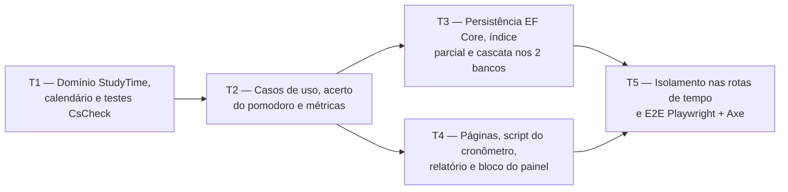

# Fase 5 — Tempo de estudo: detalhamento

> **Situação:** proposta, aguardando aprovação do autor.

## Objetivo

Entregar o módulo `StudyTime` completo: cronômetro e pomodoro por disciplina ou tópico, com
o servidor como fonte da verdade (`StudySession` com `StartedAt` e duração planejada),
lançamento manual de sessões, tratamento da sessão esquecida aberta, bloqueio de
sobreposição, fim automático do pomodoro, horas por tópico, disciplina, dia e semana no fuso
do usuário, o bloco de horas no painel, as métricas dos eventos `StudySessionStarted` e
`StudySessionEnded`, e o script do cronômetro com o aviso de fim do bloco, dentro da CSP
estrita.

## Depende de

- [Fase 2 — Planos e conteúdo](fase-2-planos-e-conteudo.md): disciplinas e tópicos.
- [Onda 0 — Base compartilhada](onda-0-base-compartilhada.md): configuração do EF Core por
  entidade (W0-T1), registro por módulo (W0-T2), `.resx` por módulo (W0-T3), `<chart>`
  (W0-T4), painel por blocos (W0-T5), migrações em paralelo (W0-T7) e login nas páginas
  (W0-T8). Também as peças comuns da pergunta 10, se entrarem na Onda 0.
- Preferências da [Fase 1](fase-1-contas-email-isolamento.md): `UserSettings.TimeZoneId`,
  `PomodoroFocusMinutes` e `PomodoroBreakMinutes`.
- [ADR 0003 — SQLite e PostgreSQL](../adr/0003-sqlite-e-postgresql.md)
- [ADR 0011 — Estilo arquitetural](../adr/0011-estilo-arquitetural.md)
- [ADR 0013 — Frontend Tailwind CSS + daisyUI](../adr/0013-frontend-tailwind-daisyui.md)
- [ADR 0014 — DDD tático](../adr/0014-ddd-tatico.md)
- [ADR 0015 — Resultado padrão](../adr/0015-resultado-padrao.md)
- [ADR 0016 — Observabilidade](../adr/0016-observabilidade.md)

## Execução em paralelo com as Fases 3 e 4

A Fase 5 roda na Onda A ao mesmo tempo que as Fases 3 e 4 e o PWA da Fase 7.

A divisão segue as fronteiras declaradas nos detalhamentos da
[Fase 3](fase-3-questoes-desempenho-historico.md#fase-5--tempo-de-estudo) e da
[Fase 4](fase-4-simulados-e-taf.md#fronteiras-com-as-fases-3-e-5).

| Camada | A Fase 5 cria ou altera | A Fase 5 não toca |
|---|---|---|
| `Domain` | `StudyTime/` inteiro | `Practice/`, `Fitness/` e `Planning/` |
| `Application` | `StudyTime/` e arquivos novos em `Telemetry/` (`StudyTimeMetrics` e consumidores) | `Practice/`, `Fitness/`, `Planning/` e `ApplicationMetrics.cs` |
| `Infrastructure` | `Configurations/StudyTime/`, `EfStudyTimeStore` e `AddStudyTimeInfrastructure` | `AppDbContext`, `EfPlanningStore`, as configurações das outras fases, migrações e snapshots existentes |
| `Web` | `Pages/StudyTime/`, o bloco de horas do painel, o `.resx` do módulo e `study-timer.js` | As páginas do `Planning` (incluindo a árvore de tópicos), `SharedResource.resx`, `_Layout.cshtml` e a página do painel |
| Testes | Só arquivos novos, incluindo um arquivo `partial` de `UserIsolationTests` | `UserIsolationTests.cs`, `PlanningIsolationSweep.cs`, as varreduras das Fases 3 e 4, `ApplicationTelemetryTests.cs`, `TrailWebApplicationFactory.cs` e `PlansE2ETests.cs` |

Pontos de contato com arquivos comuns, cada um com uma linha ou um registro:

| Ponto | Mudança da Fase 5 | Na integração |
|---|---|---|
| `AddApplication` | Uma chamada a `AddStudyTimeApplication()` | Uma linha de cada fase |
| `AddInfrastructure` (W0-T2) | Uma chamada a `AddStudyTimeInfrastructure()` | Uma linha de cada fase |
| Registro de blocos do painel (W0-T5) | O bloco de horas | Uma linha de cada fase |
| `Pages/Shared/_Navigation.cshtml` | Um item "Tempo de estudo" | Conflito de uma linha |
| `Program.cs` | `AuthorizeFolder("/StudyTime")`, só se a W0-T8 mantiver a convenção por pasta | Uma linha de cada fase |
| Peças comuns da pergunta 10 | `IUserCalendar`, `FakeTimeProvider`, contribuinte da prévia de exclusão e link na página do plano | Conforme a resposta |
| Migrações | `AddStudyTime` local, nos dois bancos | Descartada e gerada de novo pelo orquestrador (W0-T7) |

## Decisões da fase

| # | Tema | Decisão |
|---|---|---|
| D1 | Agregado e intervalo | `StudySession` guarda `SubjectId`, `TopicId?`, `Mode` (`Stopwatch`, `Pomodoro`, `Manual`), `Notes` e o value object `SessionInterval` (`StartedAt`, `EndedAt?`, `PlannedDuration?`), que garante fim depois do início, no máximo 24 h e, no pomodoro, fim até o fim planejado. Os instantes são UTC truncados ao segundo, para o valor gravado ser idêntico no SQLite e no PostgreSQL (que guarda microssegundos) |
| D2 | Servidor como fonte da verdade | A página recebe `StartedAt`, o fim planejado e o instante do servidor em atributos `data-*`. O script só calcula a exibição (relógio do aparelho + desvio em relação ao servidor − `StartedAt`). Nada é gravado a cada segundo: recarregar, trocar de aparelho ou bloquear o celular não muda o tempo registrado |
| D3 | Fim automático do pomodoro, sem tarefa em segundo plano | Na leitura, um pomodoro aberto e vencido conta como encerrado no fim planejado (`min(agora, StartedAt + PlannedDuration)`). A gravação desse fim (o "acerto") acontece no `POST` que o script faz ao zerar o bloco ou no próximo comando do usuário, numa gravação própria, antes da operação pedida. Consultas nunca gravam. O acerto é idempotente, inclusive com dois aparelhos ao mesmo tempo |
| D4 | Uma sessão aberta e sem sobreposição | Índice único parcial em `OwnerId` onde `EndedAt` é nulo: a violação vira `Conflict` ("já há uma sessão em andamento"), com a sessão atual na resposta. A sobreposição é verificada no caso de uso, com intervalos semiabertos (encostar não é sobrepor). A sessão aberta ocupa de `StartedAt` em diante, porque nenhuma sessão termina no futuro. Encerrar uma sessão já encerrada devolve `Ok` com uma mensagem informativa |
| D5 | Fuso, dia e semana | O "hoje" no fuso do usuário e a semana de segunda a domingo vêm das peças comuns `IUserCalendar` e `CalendarWeek`, as mesmas das Fases 3 e 4 (pergunta 10). O que envolve instantes fica em `StudyCalendar` (`Domain/StudyTime`): o dia de uma sessão é a data local do `StartedAt`, então a sessão que atravessa a meia-noite conta inteira no dia em que começou ([2.3](../02-dominio-e-regras.md#23-regras-de-cálculo)). O dia em UTC começa na primeira hora local válida, o que cobre fusos em que a meia-noite deixa de existir na troca de horário. Na digitação, um horário inexistente é recusado e um horário repetido usa a primeira ocorrência |
| D6 | Totais calculados na leitura | A consulta traz só `SubjectId`, `TopicId`, `StartedAt`, `EndedAt` e `PlannedDuration` do intervalo UTC pedido (índice `OwnerId, StartedAt`) e soma em segundos na memória, como os pontos do TAF ([3.10](../03-arquitetura.md#310-dados-dois-bancos-integridade-e-concorrência)). Não há coluna de duração: somar diferenças de datas não é portável no SQLite. A sessão em andamento entra nos totais quando termina |
| D7 | Totais por tópico | O tópico soma o tempo dos subtópicos, como o desempenho ([2.2](../02-dominio-e-regras.md#regras-de-negócio-e-onde-são-garantidas)). O tempo lançado só na disciplina aparece na linha "Sem tópico", e a ordem segue o sumário do plano |
| D8 | Sessão esquecida | Um cronômetro aberto além do limite da pergunta 7 abre, em `/tempo`, um `<dialog>` com "Encerrar agora", "Encerrar em…" (data e hora locais, entre o início e `min(agora, início + 24 h)`) e "Continuar". Passadas 24 h, restam "Encerrar em…" e "Descartar". O bloco do painel e o selo da navegação avisam e levam até lá. O pomodoro nunca fica esquecido, porque termina sozinho |
| D9 | Lançamento manual | Data, hora de início e hora de fim, no fuso do usuário. Um fim menor que o início é no dia seguinte, com aviso no formulário; fim igual ao início é recusado. A sessão não pode terminar no futuro, passar de 24 h nem sobrepor outra. Ela levanta `StudySessionStarted` e `StudySessionEnded` com o modo `Manual`, para as contagens de iniciadas e encerradas baterem |
| D10 | Preferências do pomodoro | A duração do bloco é copiada de `PomodoroFocusMinutes` para `PlannedDuration` ao iniciar: mudar a preferência não altera um bloco em andamento. O módulo lê `UserSettings` pela própria porta (`IStudyTimeStore`), porque um módulo da `Application` não usa tipos de outro (regra 8 de [3.5](../03-arquitetura.md#regras-de-dependência)) |
| D11 | Script do cronômetro | `wwwroot/js/study-timer.js`, externo, sem `eval`, sem `hx-on:*` e sem atributo `style` (a barra do pomodoro é um `<progress>`). Os textos vêm de atributos `data-*` traduzidos pelo `.resx`. O script dispara eventos próprios (`trail-pomodoro-due`, `trail-timer-refresh`) que o HTMX escuta por `hx-trigger`, reinicia depois de `htmx:after:swap` e consulta o servidor ao voltar à aba (`visibilitychange`, `pageshow`) e a cada 60 s |
| D12 | Métricas | Classe própria `StudyTimeMetrics`, criada sobre o `Meter` da `ApplicationMetrics` sem editar esse arquivo, como nas Fases 3 e 4: `trail.study_sessions.started` (tag `mode`) e `trail.study_sessions.minutes` (unidade `min`, tags `mode` e `end_kind`). O usuário nunca vira dimensão |
| D13 | Exclusão em cascata | Chaves estrangeiras de `StudySession` para `Subject` e `Topic`, com cascata ([2.2](../02-dominio-e-regras.md#regras-de-negócio-e-onde-são-garantidas)). A prévia de exclusão do `Planning` passa a mostrar as sessões que serão apagadas, por um `IDeletionImpactContributor` (porta em `Application/Abstractions`, pergunta 10) que o `StudyTime` implementa, sem editar o handler da prévia nem usar tipos de `Application.Planning` |

## Tarefas e ondas de execução

### T1 — Domínio `StudyTime`: agregado, intervalo, calendário, eventos e testes de propriedade (`Domain`)

- Em `Trail.Domain/StudyTime/`:
  - `StudySessionId` (`readonly record struct` implementando `ITypedId<TSelf>`),
    `StudySessionMode` e `StudySessionEndKind` (`Stopped`, `Completed`, `SetByUser`,
    `Recorded`).
  - `SessionInterval`: `Open(startedAt, plannedDuration?)`, `Closed(startedAt, endedAt)`,
    `EffectiveEnd(now)`, `DurationAt(now)`, `Overlaps(other)` e `MaxDuration` (24 h).
  - `StudySession` (`AggregateRoot<StudySessionId>`):
    - criação: `StartStopwatch`, `StartPomodoro(focus)` e `Record(startedAt, endedAt, notes, now)`;
    - encerramento: `Stop(now)`, `CompleteIfDue(now)` e `EndAt(endedAt, now)`;
    - `Correct(...)` e `Delete()`, conforme a pergunta 6;
    - leitura: `IsOpen`, `IsDue(now)`, `IsForgotten(now)` e `LatestAllowedEnd(now)`.
  - `StudyCalendar`, criado com o `TimeZoneInfo` do usuário: `LocalDateOf(utc)`,
    `DayStartUtc(date)`, `RangeUtc(from, to)` e `ToUtc(date, time)` (D5). A semana vem de
    `CalendarWeek`.
- Eventos de domínio (`sealed record` implementando `IDomainEvent`):
  - `StudySessionStarted(StudySessionId SessionId, StudySessionMode Mode)`
  - `StudySessionEnded(StudySessionId SessionId, StudySessionMode Mode, TimeSpan Duration, StudySessionEndKind EndKind)`
  - `StudySessionCorrected` e `StudySessionDeleted`, só se a pergunta 6 for respondida com A.
- Testes em `Trail.Domain.Tests/StudyTime/`:
  - unidade: limite de 24 h, pomodoro que não passa do planejado, encerramento idempotente,
    fim no futuro recusado e sessão esquecida antes e depois de 24 h;
  - fusos: `America/Sao_Paulo` em 2026 (sem horário de verão), `America/New_York` em
    08/03/2026 (dia de 23 h, 02:30 inexistente) e em 01/11/2026 (dia de 25 h, 01:30
    repetido), e `America/Sao_Paulo` em 04/11/2018 (dia em que a meia-noite não existiu);
  - propriedades (CsCheck), com fusos sorteados: toda sessão cai em exatamente um dia, o
    do `StartedAt` local; a soma dos dias é a soma das durações; a semana é a soma dos seus
    sete dias; `Overlaps` é simétrico e bate com a comparação ponto a ponto; nenhum
    intervalo válido passa de 24 h.

**Pronto quando:** cobertura ≥ 90% em `Trail.Domain`, testes de propriedade do intervalo e
do calendário passando, e zero violações em `Trail.Architecture.Tests`.

### T2 — Casos de uso `StudyTime`, acerto do pomodoro e métricas (`Application`)

- Porta `IStudyTimeStore` em `Trail.Application/StudyTime/`, com `FallbackStudyTimeStore`
  (o padrão dos outros módulos), registrada por `AddStudyTimeApplication`:
  - sessões: `GetByIdAsync`, `GetOpenAsync`, `GetLastEndedPomodoroAsync`, `AddAsync`,
    `RemoveAsync`, `HasOverlapAsync(startedAt, endedAt, except?)` e
    `ListSlicesAsync(fromUtc, toUtc, planId?)`;
  - leitura do que pertence a outros módulos: `FindTargetAsync(subjectId, topicId?)` (o
    tópico é procurado dentro da disciplina já filtrada pelo dono), `ListTargetsAsync`,
    `ListOutlineAsync(planId?)` e `GetPomodoroPreferencesAsync` (com os padrões de
    `UserSettings` quando não há registro);
  - `SaveChangesAsync`, que devolve `Saved`, `Conflict` (versão) ou `OpenSessionExists`
    (índice parcial).
- O fuso e o "hoje" vêm do `IUserCalendar` (pergunta 10), que precisa expor também o
  `TimeZoneInfo` do usuário, para converter instantes.
- `PomodoroSettlement` (interno do módulo): carrega a sessão aberta, aplica
  `CompleteIfDue` e grava. É chamado no início de todo comando (D3).
- Handlers (`public sealed *Handler` com único método público `HandleAsync`, `TimeProvider`
  injetado):
  - comandos: `StartStudySessionHandler`, `StopStudySessionHandler`,
    `CompleteDuePomodoroHandler`, `EndStudySessionAtHandler` (sessão esquecida),
    `RecordStudySessionHandler`, `DeleteStudySessionHandler` (também descarta a sessão em
    andamento) e `CorrectStudySessionHandler` (pergunta 6);
  - consultas: `GetStudyTimerHandler` (sessão aberta, fim planejado, instante do servidor,
    pausa em curso, blocos e total de hoje), `ListSessionTargetsHandler` (planos,
    disciplinas e tópicos dos seletores), `ListStudySessionsHandler`,
    `GetStudySessionHandler`, `GetStudyHoursReportHandler` (plano opcional e intervalo de
    datas: por dia, por semana, por disciplina e por tópico) e
    `GetStudyTimeSummaryHandler` (bloco do painel).
- Mensagens com códigos `studytime.*`, por exemplo `studytime.session.already_open`,
  `studytime.session.overlap`, `studytime.session.too_long`,
  `studytime.session.ends_in_future`, `studytime.time.nonexistent` e
  `studytime.topic.not_found`.
- Em `Trail.Application/Telemetry/`: `StudyTimeMetrics`,
  `StudySessionStartedMetricsConsumer` e `StudySessionEndedMetricsConsumer` (D12).
- Testes em `Trail.Application.Tests/StudyTime/`, com `FakeTimeProvider`:
  - pomodoro: aberto aos 24:59; vencido aos 25:00 na leitura; gravado pelo acerto ou pelo
    próximo comando; novo bloco iniciado logo depois de um vencido;
  - virada do dia: cronômetro das 23:50 às 00:20 no fuso do usuário conta 30 min no dia do
    início, e uma sessão de domingo para segunda conta na semana anterior;
  - sessão esquecida aberta há 30 h: "encerrar agora" recusado e "encerrar em" até 24 h
    aceito;
  - sobreposição, sessão aberta única e encerramento duplicado e concorrente;
  - métricas em `Trail.Application.Tests/Telemetry/StudyTimeTelemetryTests.cs`.

**Pronto quando:** cobertura ≥ 90% em `Trail.Application`, todos os eventos com consumidores
registrados e testados, e `Trail.Architecture.Tests` verde, incluindo a regra de módulos
para `StudyTime`.

### T3 — Persistência EF Core, índice parcial e cascata nos dois bancos (`Infrastructure`)

- `StudySessionConfiguration` em `Persistence/Configurations/StudyTime/` (W0-T1):
  - tabela `StudySessions`, com as colunas `StartedAt`, `EndedAt`,
    `PlannedDurationSeconds` (o `TimeSpan` vira inteiro, igual nos dois bancos), `Mode` e
    `Notes` (até 2.000 caracteres);
  - índices: `(OwnerId, StartedAt)`, `SubjectId`, `TopicId` e o único parcial em
    `OwnerId` com o filtro `"EndedAt" IS NULL`;
  - `CHECK` de `EndedAt > StartedAt` e de `PlannedDurationSeconds` só no pomodoro. O limite
    de 24 h fica no domínio, porque a aritmética de datas não é portável;
  - chaves estrangeiras com cascata para `Subjects` e `Topics`, filtro global por dono e
    `Version` pela convenção existente.
- `EfStudyTimeStore` e `AddStudyTimeInfrastructure` (W0-T2). A violação do índice parcial é
  reconhecida pelo código do provedor (SQLite 2067, PostgreSQL 23505).
- `StudySessionDeletionImpactContributor` (`IDeletionImpactContributor`), com a contagem de
  sessões do plano, da disciplina ou da subárvore do tópico (D13).
- Migração local `AddStudyTime` em `SqliteAppDbContext` e `PostgreSqlAppDbContext` (W0-T7).
- `StudyTimePersistenceTests` em SQLite e PostgreSQL:
  - dois contextos iniciando sessão ao mesmo tempo: um grava, o outro recebe `Conflict`;
  - a sessão aberta de um usuário não impede a de outro;
  - excluir plano, disciplina ou tópico apaga as sessões, e a prévia mostra a contagem;
  - consultas por intervalo UTC com resultados idênticos nos dois bancos.
- Relatório com 10.000 sessões em menos de 300 ms, acrescentado ao teste diário de orçamento
  de desempenho.

**Pronto quando:** `PendingModelChangesTests` e `StudyTimePersistenceTests` passam em SQLite
e PostgreSQL.

### T4 — Interface Web: cronômetro, sessões, horas, painel e script (`Web`)

- Rotas e Razor Pages + parciais HTMX em `src/Trail.Web/Pages/StudyTime/`, todas pelo
  `ResultResponder`:
  - `/tempo`: seletores encadeados de plano, disciplina e tópico (`hx-get` recarrega as
    opções), botões "Cronômetro" e "Pomodoro (25 min)" com a duração da preferência, o
    painel do cronômetro, a pausa (pergunta 4), as sessões de hoje e o `<dialog>` da sessão
    esquecida. Aceita `?disciplina=` e `?topico=` para chegar com a seleção pronta.
  - `/tempo/sessoes`: lista por período, lançamento manual com os erros junto de cada
    campo, e correção e exclusão (pergunta 6).
  - `/tempo/horas`: plano e período (esta semana, semana anterior, últimos 30 dias, tudo ou
    intervalo), total, horas por dia (até 31 dias) ou por semana, e tabela por disciplina
    com os tópicos em `
`. Os gráficos usam o `<chart>` (W0-T4), sempre com a tabela
    equivalente.
- Painel do cronômetro:
  - o tempo tem `role="timer"`, que não é lido a cada segundo; início, fim e fim do bloco
    são anunciados por uma região `role="status"`;
  - no pomodoro, um `<progress>` e o tempo restante no título da aba;
  - ações acessíveis pelo teclado, com área de toque de 44 px;
  - respostas com `Cache-Control: no-store`.
- `wwwroot/js/study-timer.js` (D11):
  - calcula o desvio entre o relógio do aparelho e o do servidor a cada resposta;
  - no fim do bloco: aviso visual, anúncio, som e notificação conforme as perguntas 1 e 2,
    vibração onde existir, e o evento que dispara o `POST` do acerto;
  - se o servidor responder que o bloco ainda não acabou (relógio do aparelho adiantado), a
    exibição volta ao tempo do servidor.
- Bloco `StudyHoursDashboardBlock` registrado no painel (W0-T5): horas de hoje, da semana
  atual e dos últimos 7 dias (gráfico e tabela) e a sessão em andamento, com link para
  `/tempo`.
- Item "Tempo de estudo" na navegação, com o selo "em andamento" quando há sessão aberta (view
  component que consulta pelo índice parcial).
- Classe marcadora `StudyTimeResource` e o `.resx` do módulo (W0-T3). As horas são exibidas
  conforme a pergunta 5.
- Testes HTTP em `Trail.Web.Tests/StudyTime/`, com `FakeTimeProvider` trocado por
  `ConfigureTestServices`, sem editar a fábrica compartilhada:
  - o pomodoro termina sozinho: depois de 25 min, a página mostra o bloco concluído e as horas
    contam 25 min;
  - virada do dia e fuso `America/New_York` no relatório;
  - sessão esquecida, com e sem HTMX;
  - cada `Status` pelo `ResultResponder`, e nenhum `<script>` inline nem atributo `style`
    nas páginas do módulo.

**Pronto quando:** as páginas funcionam com e sem HTMX, respeitam a CSP com nonce e
exibem sempre o tempo calculado a partir do `StartedAt` gravado.

### T5 — Isolamento nas rotas de tempo e testes E2E Playwright + Axe (`Web.Tests` e `E2E.Tests`)

- `UserIsolationTests.StudyTime.cs` (arquivo `partial` de `UserIsolationTests`, que reusa os
  auxiliares de cadastro e login sem editar o arquivo original) e `StudyTimeIsolationSweep.cs`,
  nos dois bancos:
  - todos os handlers de `Pages/StudyTime` com IDs de sessão, disciplina, tópico e plano de
    outro usuário respondem 404 (nunca 403 nem 200), sem expor nomes nem alterar dados;
  - incluídos o tópico alheio numa disciplina própria, e o painel e o selo da navegação,
    que mostram só os dados do próprio usuário;
  - a sessão aberta da vítima continua aberta depois da varredura;
  - teste de reflexão `StudyTimeIsolationSweep_CoversEveryStudyTimePageHandler`, com o
    namespace `Trail.Web.Pages.StudyTime` comparado por igualdade, como nas Fases 3 e 4, e
    a lista de handlers sem identificador também verificada por reflexão.
- Testes ponta a ponta em `tests/Trail.E2E.Tests/StudyTimeE2ETests.cs`, em `390x844` e
  `1280x800`:
  - cronômetro: iniciar, recarregar (o mesmo `StartedAt`), abrir um segundo contexto do
    mesmo usuário (outro aparelho), encerrar por ele e ver o primeiro atualizar ao avançar
    60 s com a API de relógio do Playwright;
  - pomodoro, o fluxo 3 de [4.1](../04-qualidade-e-entrega.md#41-estratégia-de-testes):
    iniciar num tópico, avançar o relógio 25 min, ver o aviso e a pausa, e a sessão nas
    horas da disciplina e do tópico (pergunta 8);
  - sessão esquecida: o diálogo aparece e encerra num horário informado (pergunta 8);
  - lançamento manual de 07/03/2026 23:30 até 00:40, que conta 1 h 10 min no sábado e
    nada no domingo, com o navegador em `America/New_York` para provar que vale o fuso do
    usuário;
  - início e fim de sessão só pelo teclado;
  - zero violações WCAG 2.1 AA no axe, nos temas claro e escuro, em `/tempo` (parado, em
    andamento, em pausa e com o diálogo aberto), `/tempo/sessoes` (com erros),
    `/tempo/horas` e no painel com o bloco de horas.

**Pronto quando:**
- Recarregar a página ou trocar de aparelho não perde a contagem.
- Os testes com relógio controlado cobrem o pomodoro e a virada do dia (`TimeProvider` no
  .NET e API de relógio do Playwright no E2E).
- Os testes de isolamento passam nos dois bancos, e os E2E passam contra a imagem Docker
  (e no host em processo, se a pergunta 8 for respondida com C).
- O CI fica 100% verde no PR da fase.

## Riscos

- **Aviso em segundo plano:** o limite honesto de
  [3.9](../03-arquitetura.md#cronômetro-e-pomodoro) continua valendo. O tempo gravado não
  depende do aviso.
- **Sobreposição simultânea:** dois lançamentos do mesmo usuário enviados no mesmo instante,
  de dois aparelhos, podem passar pela verificação do caso de uso. É raro e afeta só o
  próprio usuário. A restrição de exclusão do PostgreSQL resolveria, mas não existe no
  SQLite. A sessão aberta não tem esse risco, porque o índice parcial a protege.
- **Métrica de minutos:** é um contador operacional e não diminui quando uma sessão é
  corrigida ou excluída. Os relatórios do aluno vêm sempre do banco.

## Perguntas para o autor

1. **Notificação do navegador no fim do bloco.** O aviso dentro da página funciona sempre. A
   notificação aparece com a aba em segundo plano, mas exige permissão.
   - A) Só o aviso na página (visual, anúncio e título da aba). Prós: nenhuma permissão.
     Contras: com a aba em segundo plano, o aviso pode passar despercebido.
   - B) Notificação opcional: um botão "Avisar por notificação" pede a permissão só quando
     clicado. Usa o service worker da Fase 7 quando ele existir (necessário no Android e no
     iOS com o app instalado) e a `Notification` no desktop. **(recomendado)** Prós: aviso
     fora da aba sem incomodar quem não quer. Contras: o comportamento varia por navegador.
   - C) Pedir a permissão ao iniciar o primeiro pomodoro. Prós: mais gente com o aviso
     ativo. Contras: pedido sem contexto, que os navegadores desestimulam e muita gente
     recusa de vez.
2. **Som no fim do bloco.**
   - A) Bipe curto gerado pela Web Audio API, ligado por padrão, com um botão "Som" lembrado
     no aparelho (`localStorage`). **(recomendado)** Prós: sem arquivo nem licença.
     Contras: depois de recarregar, o navegador só libera o som após um toque na página (o
     próprio botão serve para isso).
   - B) Arquivo de áudio servido pelo app. Prós: som mais agradável. Contras: arquivo de
     terceiros a licenciar e a mesma restrição de reprodução automática.
   - C) Sem som. Prós: nada a manter. Contras: aviso fraco para quem não olha a tela.
3. **Tela do cronômetro no celular.**
   - A) Página única: tempo grande no topo, seletores e sessões de hoje abaixo, e as ações
     ("Encerrar", "Próximo bloco") fixas no rodapé. **(recomendado)** Prós: tudo ao alcance
     do polegar, sem tela extra. Contras: a navegação do app continua visível durante o
     foco.
   - B) A, mais um "modo foco" em tela cheia, com a opção de manter a tela ligada (Wake
     Lock). Prós: o celular não apaga, e o aviso não atrasa. Contras: mais bateria, mais um
     estado para testar, e o Wake Lock não existe em todos os navegadores.
   - C) Um cronômetro compacto fixo em todas as páginas. Prós: tempo sempre à vista.
     Contras: mexe no layout comum, em conflito com as outras fases.
4. **Pausas do pomodoro.**
   - A) Não registrar: a pausa é derivada do último bloco encerrado (`EndedAt` +
     `PomodoroBreakMinutes`) e aparece como contagem regressiva, com "Próximo bloco" e "Pular
     pausa". O próximo bloco só começa com um toque. **(recomendado)** Prós: a pausa também
     resiste a recarregar e trocar de aparelho, sem tabela nova, e não conta nas horas.
     Contras: não há histórico de pausas.
   - B) Registrar as pausas como sessões de outro modo. Prós: histórico do ciclo. Contras:
     um modo a excluir de todos os totais e do índice de sessão aberta, sem uso nos
     relatórios.
   - C) Sem pausa na tela. Prós: mais simples. Contras: o pomodoro fica pela metade.
5. **Arredondamento das horas exibidas.**
   - A) "2 h 05 min", com os minutos truncados; os totais são somados em segundos antes de
     formatar; os gráficos usam horas com uma casa decimal. **(recomendado)** Prós: leitura
     natural, e um total nunca é arredondado para cima. Contras: a soma das linhas pode
     diferir do total em alguns minutos.
   - B) Horas decimais em tudo ("2,1 h"). Prós: fácil de comparar. Contras: "0,1 h" é pouco
     intuitivo.
   - C) Formato de relógio ("02:05"). Prós: compacto. Contras: confunde com o horário do dia.
6. **Correção e exclusão de sessões.** O modelo aprovado tem só `StudySessionStarted` e
   `StudySessionEnded`. Em qualquer opção, a sessão em andamento pode ser descartada.
   - A) Corrigir (disciplina, tópico, início, fim e anotação) e excluir sessões encerradas,
     com os eventos novos `StudySessionCorrected` e `StudySessionDeleted` e as métricas
     deles, como nos lançamentos de questões. **(recomendado)** Prós: o aluno conserta um
     esquecimento sem perder o resto, e o modelo fica simétrico ao da Fase 3. Contras: dois
     eventos a acrescentar na seção 2.2.
   - B) Corrigir e excluir sem eventos novos. Prós: o modelo aprovado não muda. Contras: as
     alterações ficam invisíveis na telemetria.
   - C) Só excluir e lançar de novo. Prós: menos código. Contras: corrigir um horário vira
     duas operações.
7. **Quando uma sessão é considerada esquecida.**
   - A) Cronômetro aberto há mais de 4 h. Acima disso, "Encerrar" sempre pergunta o
     horário, e o diálogo aparece uma vez por sessão em cada aparelho. **(recomendado)**
     Prós: pergunta cedo, enquanto o aluno ainda lembra o horário. Contras: quem estuda mais
     de 4 h seguidas responde "Continuar" uma vez.
   - B) Só depois de 24 h, quando "Encerrar agora" fica impossível. Prós: nunca interrompe.
     Contras: um cronômetro esquecido de ontem à tarde até hoje de manhã seria encerrado
     "agora", com horas a mais, se o aluno não reparar.
   - C) Limite configurável nas preferências. Prós: cada um ajusta. Contras: mexe no
     `UserSettings` e na tela de Preferências (módulo `Accounts`, fora da fronteira desta
     fase), com uma migração a mais.
8. **Relógio do servidor no E2E do pomodoro.** A API de relógio do Playwright controla só o
   navegador; o servidor no container usa o relógio real. Avançar 25 min no navegador mostra
   o aviso, mas não encerra o bloco no servidor, e o fluxo 3 de 4.1 não fecha só com ela.
   - A) Dividir: no E2E contra o Docker, o relógio do Playwright cobre a exibição, o aviso e
     a volta ao tempo do servidor; o fim no servidor e as horas ficam nos testes HTTP com
     `FakeTimeProvider`. Prós: a infraestrutura de testes não muda. Contras: nenhum teste
     percorre o fluxo inteiro no navegador.
   - B) No E2E contra o Docker, um pomodoro de 1 min (o mínimo das preferências) com espera
     real. Prós: fluxo inteiro contra a imagem. Contras: cerca de 1 min a mais por tamanho
     de tela, e a sessão esquecida (horas abertas) continua sem E2E.
   - C) Um segundo host só para o pomodoro e a sessão esquecida: o app no processo do teste,
     com Kestrel (`WebApplicationFactory.UseKestrel`) e `FakeTimeProvider`,
     avançando juntos os relógios do navegador e do servidor. O resto do E2E continua
     contra a imagem Docker. **(recomendado)** Prós: cumpre o fluxo 3 como aprovado, rápido
     e determinístico, e cobre a sessão esquecida. Contras: dois tipos de host no projeto
     de E2E, e esses dois fluxos não rodam contra a imagem.
9. **Horas e atalho na árvore de tópicos.** O link "Horas" da página do plano entra pelo
   registro de links da pergunta 10. A dúvida é o botão "Estudar" e a coluna de horas em
   cada tópico, na árvore que a Fase 3 também altera.
   - A) Não entram: as horas ficam em `/tempo/horas` e no painel, e o atalho vai para o
     backlog. Prós: nenhuma mudança fora do módulo. Contras: escolher o tópico pelos
     seletores é mais lento no celular.
   - B) Entram agora. Prós: entrega mais integrada. Contras: conflito certo com a Fase 3 no
     parcial da árvore.
   - C) Entram numa tarefa curta da integração da Onda A, depois do merge das Fases 3 e 5,
     usando a preseleção `?disciplina=&topico=` que esta fase já entrega.
     **(recomendado)** Prós: o atalho chega na 1.0 sem conflito no paralelo. Contras: uma
     tarefa a mais na integração.
10. **Peças comuns que a Onda 0 não cobre.** É a mesma pergunta da P9 da Fase 3 e da pergunta
    7 da Fase 4. Esta fase usa as quatro peças: o `IUserCalendar` (que precisa expor também o
    `TimeZoneInfo`, para converter instantes) com o `CalendarWeek`, o `FakeTimeProvider`, o
    `IDeletionImpactContributor` e o registro de links da página do plano.
    - A) Acrescentar as peças à Onda 0. **(recomendado)** Prós: nenhuma fase edita o
      `Planning` nem os arquivos das outras, e a regra 8 continua valendo. Contras: a Onda 0
      cresce um pouco.
    - B) A Fase 3 cria as peças, e as Fases 4 e 5 se adaptam na integração. Prós: a Onda 0
      não muda. Contras: a Fase 5 trabalha com cópias provisórias e tem retrabalho.
    - C) Cada fase edita os arquivos do `Planning`, e o orquestrador resolve os conflitos.
      Prós: nenhuma tarefa nova. Contras: conflitos certos em `GetDeletionImpactHandler`,
      `DeletionImpactView` e `Details.cshtml`.
