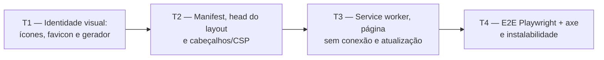

# Fase 7a — PWA: detalhamento

> **Situação:** proposta, aguardando aprovação do autor. Primeira parte da
> [Fase 7](../05-roteiro.md#fase-7--pwa-e-versão-10), desenvolvida na Onda A em paralelo com
> as Fases 3, 4 e 5. O restante da Fase 7 é a [7b](#fica-para-a-7b).

## Objetivo

Tornar o Trail instalável como PWA, sem mudar nenhuma funcionalidade de dados: `manifest`
com ícones próprios, service worker que guarda só os arquivos estáticos versionados e uma
página "sem conexão" localizada, compatíveis com a CSP estrita com nonce. As páginas com
dados e as respostas do HTMX **nunca** vêm do cache. O uso offline completo continua fora
da 1.0 ([ADR 0005](../adr/0005-web-responsiva-pwa.md)).

## Depende de

- [Fase 2 — Planos e conteúdo](fase-2-planos-e-conteudo.md) (concluída e na `main`)
- [Onda 0 — Base compartilhada](onda-0-base-compartilhada.md): `.resx` por módulo (W0-T3) e
  a decisão sobre o login no app inteiro (W0-T8)
- [ADR 0005 — Web responsiva + PWA](../adr/0005-web-responsiva-pwa.md)
- [ADR 0013 — Frontend Tailwind CSS + daisyUI](../adr/0013-frontend-tailwind-daisyui.md)
- [Arquitetura 3.12 (implantação), 3.13 (PWA) e 3.14 (segurança)](../03-arquitetura.md)

## Decisões da fase

| # | Tema | Decisão |
|---|---|---|
| D1 | Onde fica o service worker | Endpoint `GET /sw.js` na raiz (escopo `/`), gerado pelo app, e não um arquivo de `wwwroot`. O endpoint injeta a versão e a lista de pré-cache com as URLs já com impressão digital (fingerprint) dos arquivos estáticos. Resposta com `Cache-Control: no-cache` e tipo `text/javascript` |
| D2 | Manifest | Endpoint `GET /manifest.webmanifest` (tipo `application/manifest+json`), montado a partir de uma classe de configuração `PwaManifest` e de textos do `.resx` (descrição e atalhos). Cores e nomes ficam num único lugar |
| D3 | Estratégia de cache | Pré-cache só do mínimo para exibir a página "sem conexão" (CSS, `theme.js`, `offline.js`, ícone). Os demais arquivos estáticos do próprio site (`/css`, `/js`, `/lib`, `/icons`) usam *cache-first* em tempo de execução. Navegações usam rede primeiro e, se a rede falhar, devolvem a página "sem conexão" |
| D4 | O que nunca vai para o cache | Qualquer coisa que não seja `GET` do mesmo domínio, requisições com o cabeçalho `HX-Request`, documentos HTML (exceto a página "sem conexão" guardada no `install`), respostas diferentes de 200 e rotas fora da lista de prefixos estáticos. A lista é de permissão (*allowlist*), não de bloqueio |
| D5 | Versão do cache | O nome do cache é `trail-static-<versão>`, com `<versão>` = hash SHA-256 (8 primeiros caracteres) do corpo do `sw.js` gerado. Qualquer mudança de build ou de arquivo estático muda os bytes do worker e dispara a atualização. Ao ativar, os caches `trail-static-*` antigos são apagados |
| D6 | CSP | Acrescentar `worker-src 'self'` e `manifest-src 'self'` (hoje só `default-src` e `script-src` cobrem isso, por herança). Nada de `'unsafe-inline'`, `'unsafe-eval'` nem nonce no worker. O registro fica num script externo (`/js/pwa.js`) |
| D7 | Página "sem conexão" | `Pages/Offline.cshtml`, anônima, sem o layout principal (sem navegação, sem usuário, sem token antifalsificação, sem script inline), com os textos em `.resx`. É a mesma para todos os usuários, por isso é seguro guardá-la no cache |
| D8 | Ícones próprios | Fonte única em SVG no repositório e PNGs gerados por um aplicativo de arquivo único (`dotnet run eng/pwa/generate-icons.cs`) e **versionados**. O teste confere dimensões e a lista de arquivos, não o hash do PNG (a codificação pode variar entre plataformas). Nunca brasões ou logos de órgãos |
| D9 | Lighthouse | Não entra no CI. A partir da versão 12 o Lighthouse removeu a categoria PWA (confirmar na T4). A instalabilidade é verificada pelo Chromium via CDP (`Page.getInstallabilityErrors` e `Page.getAppManifest`) no Playwright, que já roda no CI |
| D10 | Autenticação | Manifest, `sw.js`, `/offline` e ícones são públicos (`AllowAnonymous` explícito), para continuarem funcionando seja qual for a decisão da W0-T8 sobre a política de login |

## Fronteiras com as Fases 3, 4 e 5

A 7a mexe só no que está abaixo. Tudo o mais pertence às outras fases em paralelo.

| Pode alterar | Não pode alterar |
|---|---|
| `Pages/Shared/_Layout.cshtml`: **uma** linha no `<head>` (`<partial name="_PwaHead" />`) e **uma** antes dos scripts do fim do `<body>` (`<partial name="_PwaUpdateToast" />`). O restante vive nos parciais novos | `_Navigation.cshtml`, `Pages/Plans/*` e as páginas das Fases 3, 4 e 5 |
| `SecurityHeadersMiddleware.cs`: só a string da CSP | Os demais cabeçalhos, o middleware de nonce e `RateLimitingExtensions` |
| `Program.cs`: duas linhas (`AddPwa()` e `MapPwaEndpoints()`), com o código em `Trail.Web/Pwa/` | Qualquer outro registro, migrações, `AppDbContext`, `Infrastructure` |
| `wwwroot/js/pwa.js`, `wwwroot/js/offline.js`, `wwwroot/icons/*`, `Pages/Offline.cshtml`, `Pages/Shared/_Pwa*.cshtml` | `theme.js`, `dialogs.js`, `toasts.js`, `htmx-integration.js` |
| Textos novos no `.resx` do módulo (`PwaResource.resx`, conforme a W0-T3) | `SharedResource.resx` (evita conflito com as outras fases) |
| `eng/pwa/*` (gerador de ícones) | `eng/frontend.props` e `eng/frontend.targets` |

Quando a integração juntar as branches, os únicos pontos de conflito esperados são as
duas linhas do `Program.cs` e as duas do layout, todas triviais de resolver. A 7a não cria
migração.

## Tarefas e ondas de execução



### T1 — Identidade visual: ícones, favicon e gerador reproduzível (`Web`, `eng`)

- Fonte em `src/Trail.Web/Assets/pwa/icon.svg` (marca própria, sem brasões) e uma variante
  para o ícone mascarável, com a arte dentro da zona segura de 80%.
- `eng/pwa/generate-icons.cs`: aplicativo de arquivo único do .NET 10 (`#:package` com
  versões fixadas) que lê o SVG e grava em `src/Trail.Web/wwwroot/icons/`:
  - `icon-192.png` e `icon-512.png` (propósito `any`);
  - `icon-maskable-512.png` (propósito `maskable`);
  - `apple-touch-icon.png` (180x180, sem transparência);
  - `favicon-32.png` e `favicon.svg`.
- Os PNGs são versionados. A geração é manual, documentada no cabeçalho do script e no
  `CONTRIBUTING`/guia da 7b. O `#:package` não é visto pelo Dependabot, e isso fica
  registrado no script.
- Teste em `Trail.Web.Tests/Pwa/PwaIconsTests.cs`: todos os arquivos existem, as dimensões
  batem com o nome, o PNG de 180 não tem canal alfa e o SVG de origem não contém `<image>`
  nem texto externo.

**Pronto quando:** `dotnet run eng/pwa/generate-icons.cs` regenera os arquivos sem erro no
Windows e no Linux, e os testes de ícones passam.

### T2 — Manifest, `<head>` do layout e cabeçalhos de segurança (`Web`)

- `Trail.Web/Pwa/PwaManifest.cs` e `PwaEndpoints.MapPwaEndpoints()`:
  - `GET /manifest.webmanifest` com `id` (`/`), `name`, `short_name`, `description`
    (do `.resx`), `lang` (`pt-BR`), `dir`, `start_url` (`/`), `scope` (`/`), `display`
    (`standalone`), `orientation` (`any`), `theme_color`, `background_color`, `categories`,
    `icons` (192, 512 `any`, 512 `maskable`) e `shortcuts` (ver Pergunta 5).
  - `Cache-Control: public, max-age=3600`. Sem dado de usuário.
- Parcial `Pages/Shared/_PwaHead.cshtml`, incluída no `<head>`:
  - `<link rel="manifest">`, `<link rel="icon">` (SVG e PNG de 32), `<link rel="apple-touch-icon">`;
  - duas tags `<meta name="theme-color">` com `media="(prefers-color-scheme: light|dark)"`,
    pois o manifest só aceita uma cor;
  - `<meta name="apple-mobile-web-app-title">`;
  - `<script src="~/js/pwa.js" defer>` (o registro, na T3).
- `SecurityHeadersMiddleware`: acrescentar `worker-src 'self'; manifest-src 'self'` à CSP.
- As cores do manifest e das metas vêm de `PwaManifest`. Um teste converte os tokens OKLCH
  de `Styles/app.css` (`--color-base-100` dos dois temas) para sRGB e confere que os
  valores em hexadecimal estão a até ΔE 2 deles, para o tema e o manifest não divergirem.
- Testes de integração em `Trail.Web.Tests/Pwa/`:
  - manifest: 200 anônimo, tipo `application/manifest+json`, campos obrigatórios, cores
    hexadecimais válidas, ícones com 192 e 512 e um `maskable`, e cada ícone listado
    responde 200 com `image/png`;
  - layout: o HTML de `/` traz o `link rel="manifest"`, as duas metas de tema, o
    `apple-touch-icon` e o `pwa.js`;
  - CSP: contém `worker-src 'self'` e `manifest-src 'self'` e continua sem
    `unsafe-inline` e `unsafe-eval` (ajustar o teste de cabeçalhos existente).

**Pronto quando:** manifest, ícones e cabeçalhos passam nos testes, e o `axe` da página
inicial continua sem violações.

### T3 — Service worker, página "sem conexão", registro e fluxo de atualização (`Web`)

- `Trail.Web/Pwa/ServiceWorkerEndpoint.cs` e o modelo do `sw.js`
  (`Pwa/sw.template.js`, recurso embutido): substitui `__VERSION__` e `__PRECACHE__`.
  - A lista de pré-cache usa as URLs com fingerprint pelo mesmo mecanismo que os tag
    helpers de `~/`. A T3 começa com um *spike* curto para confirmar como obter a
    `ResourceAssetCollection` nas Razor Pages com `MapStaticAssets`. Se não houver
    caminho limpo, a alternativa é ler `Trail.Web.staticwebassets.endpoints.json`.
  - Eventos:
    - `install`: abre `trail-static-<versão>`, faz `addAll` do pré-cache e da `/offline`.
      Não chama `skipWaiting` sozinho (ver Pergunta 4).
    - `activate`: apaga os caches `trail-static-*` de outras versões e chama
      `clients.claim()` só se a atualização foi aprovada.
    - `fetch`: aplica D3 e D4. Fora da lista de permissão, o worker nem chama
      `respondWith`, e a requisição segue direto para a rede.
    - `message` (`SKIP_WAITING`): ativa o worker em espera.
  - Resposta de fallback: `/offline` guardada no cache, com status 503 e
    `Cache-Control: no-store`.
- `Pages/Offline.cshtml` (+ `OfflineModel`, `[AllowAnonymous]`): título, explicação e o
  botão "Tentar de novo" (`<button data-reload>`), com `theme.js`, o CSS e `offline.js`
  (recarrega ao clicar e quando o evento `online` dispara). Sem inline, sem layout. Os
  textos vêm do `PwaResource.resx`.
- `wwwroot/js/pwa.js`: registra `/sw.js` (`scope: '/'`, `updateViaCache: 'none'`) depois do
  `load`; ignora navegadores sem suporte e o contexto inseguro; detecta `waiting` e exibe o
  aviso de atualização (parcial `_PwaUpdateToast.cshtml` com um `<template>` localizado,
  no mesmo padrão do `toast-unexpected-error`); ao confirmar, envia `SKIP_WAITING` e
  recarrega em `controllerchange`.
- Testes de integração:
  - `sw.js`: 200 anônimo, `text/javascript`, `Cache-Control: no-cache`, versão estável entre
    duas requisições e diferente quando a lista de pré-cache muda, e todas as URLs do
    pré-cache respondem 200;
  - `/offline`: 200 anônimo, sem `__RequestVerificationToken`, sem `<script>` inline e sem
    nome de usuário, e todas as chaves usadas existem no `PwaResource.resx`.

**Pronto quando:** o worker registra no `localhost`, a página "sem conexão" aparece sem
rede, e nenhuma resposta HTML autenticada ou do HTMX entra no cache (provado na T4).

### T4 — Testes ponta a ponta e verificação de instalabilidade (`E2E.Tests`)

Em `tests/Trail.E2E.Tests/PwaE2ETests.cs`, no Chromium do Playwright (já usado na fixture
Docker). O `localhost` é contexto seguro; a fixture confirma `isSecureContext` e, se o
hostname do container não for `localhost`, inicia o Chromium com
`--unsafely-treat-insecure-origin-as-secure`.

1. **Registro:** o worker chega a `activated` e controla a página depois de recarregar.
2. **Instalabilidade:** via `NewCDPSessionAsync`, `Page.getInstallabilityErrors` volta
   vazio e `Page.getAppManifest` não traz erros nem avisos.
3. **Sem conexão:** autentica, abre `/planos`, liga `SetOfflineAsync(true)`, navega para
   uma rota de dados e vê a página "sem conexão" localizada, depois volta online e
   "Tentar de novo" mostra a página real.
4. **Nada sensível no cache:** depois de navegar por páginas autenticadas e por trocas do
   HTMX, `caches.keys()` só tem `trail-static-<versão>` e nenhuma entrada é documento HTML
   além de `/offline`, nem tem `Set-Cookie` ou token antifalsificação.
5. **HTMX passa direto:** offline, a ação HTMX cai no tratamento de erro existente (toast
   `toast-unexpected-error`), sem resposta do worker.
6. **Acessibilidade:** `axe` na `/offline` nos temas claro e escuro, em `390x844` e
   `1280x800`, sem violações WCAG 2.1 AA.
7. **Atualização:** com `page.RouteAsync("**/sw.js", ...)` troca a versão do worker, chama
   `registration.update()`, vê o aviso, confirma e confere o recarregamento com o novo
   cache e a remoção do antigo. A interceptação de requisições de service worker ainda é
   instável no Playwright. Se não funcionar, este fluxo vira roteiro manual (abaixo) e o
   risco fica registrado no PR.

**Pronto quando:**
- Os testes de PWA passam no container Docker, em SQLite e no CI.
- O CI fica 100% verde no PR da fase.

## Como validar (PowerShell)

```powershell
dotnet build Trail.slnx
dotnet test tests/Trail.Web.Tests --filter "FullyQualifiedName~Pwa"
dotnet test tests/Trail.E2E.Tests --filter "FullyQualifiedName~PwaE2ETests"
docker compose -f compose.sqlite.yml up -d --build
curl.exe -sI http://localhost:8080/sw.js
curl.exe -s http://localhost:8080/manifest.webmanifest
```

No Chrome, em `http://localhost:8080`: DevTools, aba Application, seções Manifest ("Installability" sem erros) e Service workers (estado `activated`), depois marcar "Offline" e recarregar uma página de dados para ver a tela "sem conexão".

## O que o autor faz para instalar no celular

O PWA exige HTTPS, exceto em `localhost`. Em `http://192.168.x.x` o Trail funciona como
site, mas o navegador **não oferece a instalação**.

1. Publicar o Trail com HTTPS: `tailscale serve` (modo individual, com certificado),
   Cloudflare Tunnel, ou o Caddy do modo hospedado.
2. Android (Chrome): abrir o endereço HTTPS, menu "Instalar app".
3. iPhone (Safari): botão Compartilhar, "Adicionar à Tela de Início".
4. Conferir que o ícone, o nome e a barra de status seguem o tema.

Os passos completos, com capturas, ficam no guia da 7b.

## Perguntas para o autor

**1. Origem e desenho do ícone**

| Opção | Prós | Contras |
|---|---|---|
| A. Marca geométrica minimalista criada por mim (trilha estilizada na cor primária) (recomendado) | Rápida, 100% própria e sem risco de direitos; SVG simples e reproduzível | Visual genérico, sem a sua cara |
| B. Você fornece um SVG | Identidade que você escolheu | Depende de você; precisa cumprir a zona segura do mascarável |
| C. Letra "T" sobre fundo na cor primária | Mais simples ainda e legível em tamanho pequeno | Parece placeholder |

**2. Nome e cores no manifest**

| Opção | Prós | Contras |
|---|---|---|
| A. `name` "Trail — acompanhamento de estudos", `short_name` "Trail"; `theme_color`/`background_color` = fundo do cabeçalho (`base-100`) no claro e nas metas `media` para o escuro (recomendado) | Descritivo na instalação, nome curto sob o ícone, combina com o cabeçalho | `base-100` é quase branco e o ícone precisa de contraste próprio |
| B. `name` e `short_name` "Trail"; `theme_color` = cor primária | Barra do sistema colorida, identidade forte | A cor primária clara não casa com o cabeçalho branco e vira uma faixa verde-azulada no topo |
| C. `name` "Trail", cores neutras fixas | Zero manutenção | Não acompanha o tema escuro nem o claro |

**3. Botão "Instalar"**

| Opção | Prós | Contras |
|---|---|---|
| A. Sem botão; só o que o navegador oferece (recomendado) | Sem mexer em páginas das outras fases, sem código para o `beforeinstallprompt` (só Chromium); o iOS nunca teria o botão de qualquer forma | Menos descobrível; depende do guia |
| B. Botão discreto no rodapé do layout, só quando o navegador dispara o evento | Mais descobrível no Android e no desktop | Mais código e mais um ponto de conflito no layout; iOS continua sem |
| C. Botão na tela de Preferências | Fica em um lugar natural | Mexe numa página da Fase 1 e não aparece para quem não abre as preferências |

**4. Aviso de atualização do app**

| Opção | Prós | Contras |
|---|---|---|
| A. Aviso (toast) "Nova versão disponível", com botão "Atualizar" (recomendado) | Sem surpresa: o usuário não perde um formulário em edição; reaproveita o padrão de toasts | Um pouco mais de código e de texto |
| B. Atualização silenciosa (`skipWaiting` + `claim`) | Zero interação | Recarregar no meio de uma edição pode perder texto; o HTML aberto pode pedir arquivos do build antigo |
| C. Sem aviso: o worker novo ativa quando todas as abas fecham | Mais simples e padrão do navegador | No celular, o app instalado quase nunca fecha de verdade, e a atualização demora |

**5. Atalhos do manifest (menu ao segurar o ícone no Android)**

| Opção | Prós | Contras |
|---|---|---|
| A. Só "Planos" agora; a 7b revisa depois que as Fases 3 a 5 entrarem (recomendado) | Funciona hoje e não depende de rotas ainda inexistentes | Poucos atalhos até a 7b |
| B. Nenhum atalho | Menos manutenção | Perde um ganho barato de uso no celular |
| C. Planos, Questões, Simulados e Tempo | Completo | Rotas das fases paralelas ainda não existem; acopla a 7a às outras três |

## Fica para a 7b

- Auditoria final de acessibilidade (axe em todas as telas) e de responsividade.
- Guias de instalação (modo individual, modo hospedado com HTTPS e SMTP, acesso pelo
  celular, com capturas) e guia de observabilidade.
- release-please e imagem multi-arquitetura no GHCR.
- README com capturas de tela e arquivos de comunidade.
- Revisão dos atalhos do manifest e publicação da v1.0.0.
