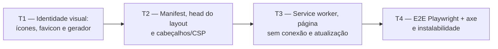

# Fase 7a — PWA: detalhamento

> **Situação:** aprovada pelo autor em 18/10/2026, com todas as opções recomendadas. Desenvolvida na Onda A, em paralelo
> com as Fases 3, 4 e 5. Primeira parte da [Fase 7](../05-roteiro.md#fase-7--pwa-e-versão-10);
> o restante é a [7b](#fica-para-a-7b).

## Objetivo

Tornar o Trail instalável como PWA, sem mudar nenhuma funcionalidade de dados: `manifest`
com ícones próprios, service worker que guarda só os arquivos estáticos versionados e uma
página "sem conexão" localizada, compatíveis com a CSP estrita com nonce. As páginas com
dados e as respostas do HTMX **nunca** vêm do cache. O uso offline completo continua fora
da 1.0 ([ADR 0005](../adr/0005-web-responsiva-pwa.md)).

## Depende de

- [Fase 2 — Planos e conteúdo](fase-2-planos-e-conteudo.md) (concluída e na `main`)
- [Onda 0 — Base compartilhada](onda-0-base-compartilhada.md): `PwaResource` e o prefixo
  `pwa.` (registro de recursos), `AddPwaWeb` já chamado no `Program.cs`, fixture do E2E com
  service workers bloqueados por padrão e `UiText` por módulo, e a decisão sobre o login no
  app inteiro
- [ADR 0005 — Web responsiva + PWA](../adr/0005-web-responsiva-pwa.md)
- [ADR 0013 — Frontend Tailwind CSS + daisyUI](../adr/0013-frontend-tailwind-daisyui.md)
- [Arquitetura 3.12 (implantação), 3.13 (PWA) e 3.14 (segurança)](../03-arquitetura.md)

## Decisões da fase

| # | Tema | Decisão |
|---|---|---|
| D1 | Onde fica o service worker | Razor Page `Pages/ServiceWorker.cshtml` com `@page "/sw.js"` (escopo `/`), e não um arquivo de `wwwroot`. O `OnGet` obtém a `ResourceAssetCollection` dos metadados do endpoint, como o `IconTagHelper`, e preenche o modelo `Pwa/sw.template.js` (recurso embutido) com a versão e as URLs com impressão digital (fingerprint). Isso dispensa o *spike* e a leitura do `staticwebassets.endpoints.json`. Resposta `text/javascript` com `Cache-Control: no-cache` |
| D2 | Manifest | Razor Page `Pages/Manifest.cshtml` com `@page "/manifest.webmanifest"`, resposta `application/manifest+json` montada a partir de `PwaManifest` (opções registradas em `AddPwaWeb`) e de textos do `PwaResource` (descrição e atalhos). Cores e nomes ficam num único lugar. Sem endpoint mínimo, logo sem tocar no `Program.cs` |
| D3 | Estratégia de cache | Pré-cache só do mínimo para exibir a página "sem conexão" (CSS, `theme.js`, `offline.js`, ícone) e da própria `/offline`. O `fetch` tem dois ramos separados. **Navegação** (`request.mode === 'navigate'`): rede primeiro; se falhar, devolve a `/offline`; a resposta nunca é gravada. **Subrecurso**: *cache-first* somente se a URL for uma das URLs com fingerprint embutidas no worker |
| D4 | O que nunca vai para o cache | Tudo o que não for `GET` do mesmo domínio, requisições com `HX-Request`, respostas diferentes de 200 e qualquer URL fora da lista de fingerprints. A lista é de permissão (*allowlist*): o que ela não cobre nem passa pelo `respondWith`. Como só entram URLs com fingerprint (imutáveis), não há prefixo de pasta a manter, e D3 e D4 não se contradizem: o único HTML guardado é a `/offline`, no `install` |
| D5 | Versão do cache | `trail-static-<versão>`, com `<versão>` = SHA-256 (8 primeiros caracteres) de **todas** as URLs com fingerprint de `MapStaticAssets` mais o hash do modelo do worker. Qualquer arquivo estático novo ou alterado muda a versão e dispara a atualização. Ao ativar, os caches `trail-static-*` antigos são apagados |
| D6 | CSP | Acrescentar `worker-src 'self'` e `manifest-src 'self'`. Nada de `'unsafe-inline'`, `'unsafe-eval'` nem nonce no worker. O registro fica num script externo (`/js/pwa.js`) |
| D7 | Página "sem conexão" | `Pages/Offline.cshtml`, anônima, sem o layout principal (sem navegação, sem usuário, sem token antifalsificação, sem script inline), com os textos em `PwaResource`. É a mesma para todos os usuários, por isso é seguro guardá-la no cache |
| D8 | Ícones próprios | Fonte única em SVG no repositório e PNGs gerados por uma ferramenta em `eng/PwaIcons` (projeto fora do `Trail.slnx`) que rasteriza o SVG com o Playwright, com a versão em `Directory.Packages.props` (o Dependabot enxerga). PNGs **versionados**. O teste confere dimensões e lista de arquivos, não o hash do PNG. O procedimento fica em `docs/guias/icones-pwa.md`, não em comentário de script. Nunca brasões ou logos de órgãos |
| D9 | Lighthouse | Não entra no CI: o Lighthouse 12 removeu a categoria PWA. A instalabilidade é verificada pelo Chromium via CDP (`Page.getInstallabilityErrors` e `Page.getAppManifest`) no Playwright, que já roda no CI |
| D10 | Autenticação | Manifest, `sw.js`, `/offline` e ícones são públicos (`[AllowAnonymous]` explícito), para continuarem funcionando seja qual for a decisão da Onda 0 sobre o login |
| D11 | Notificações da Fase 5 | O worker traz um `notificationclick` mínimo: fecha a notificação e foca uma aba aberta do app ou abre `/`. Sem `push` e sem dados na notificação. Assim a opção B da pergunta de notificação do navegador da Fase 5 (P1) não depende de trabalho extra na integração; a Fase 5 só chama `registration.showNotification` |
| D12 | Cores com tema manual | As metas `theme-color` com `media` seguem a preferência do sistema, não a escolha manual de tema. O `pwa.js` observa `data-theme` em `<html>` e, quando há tema fixado, ativa só a meta correspondente (`media="all"` na do tema e `media="not all"` na outra). O `theme.js` não é alterado |

## Ícones

A 7a não usa ícones do sprite Lucide: a página "sem conexão" e o aviso de atualização só
têm texto. Nada a acrescentar ao sprite da Onda 0.

## Fronteiras com as Fases 3, 4 e 5

A 7a mexe só no que está abaixo. Tudo o mais pertence às outras fases em paralelo.

| Pode alterar | Não pode alterar |
|---|---|
| `Pages/Shared/_Layout.cshtml`: **uma** linha no `<head>` (`<partial name="_PwaHead" />`) e **uma** antes dos scripts do fim do `<body>` (`<partial name="_PwaUpdateToast" />`). O restante vive nos parciais novos | `_Navigation.cshtml`, `Pages/Plans/*` e as páginas das Fases 3, 4 e 5 |
| `SecurityHeadersMiddleware.cs`: só a string da CSP | Os demais cabeçalhos, o middleware de nonce e `RateLimitingExtensions` |
| O corpo de `AddPwaWeb` (criado vazio na Onda 0) e o código em `Trail.Web/Pwa/` | `Program.cs` e qualquer outro ponto de composição, migrações, `AppDbContext`, `Infrastructure` |
| `wwwroot/js/pwa.js`, `wwwroot/js/offline.js`, `wwwroot/icons/*`, `Pages/Offline.cshtml`, `Pages/ServiceWorker.cshtml`, `Pages/Manifest.cshtml`, `Pages/Shared/_Pwa*.cshtml` | `theme.js`, `dialogs.js`, `toasts.js`, `htmx-integration.js` |
| `Resources/PwaResource.resx` (a classe marcadora vem da Onda 0) | `SharedResource.resx` e os demais `.resx` |
| `eng/PwaIcons/*`, `docs/guias/icones-pwa.md` e, em `Directory.Packages.props`, só a versão da ferramenta, se faltar | `eng/frontend.props` e `eng/frontend.targets`; a fixture do E2E |

Quando a integração juntar as branches, os únicos pontos de conflito esperados são as duas
linhas do layout, triviais de resolver. A 7a não cria migração.

## Tarefas e ondas de execução



### T1 — Identidade visual: ícones, favicon e gerador reproduzível (`Web`, `eng`)

- Fonte em `src/Trail.Web/Assets/pwa/icon.svg` (marca própria, sem brasões) e uma variante
  para o ícone mascarável, com a arte dentro da zona segura de 80%.
- `eng/PwaIcons`: ferramenta de console fora do `Trail.slnx`, que lê o SVG, rasteriza com o
  Playwright (já dependência do projeto, sem rasterizador nativo extra) e grava em
  `src/Trail.Web/wwwroot/icons/`:
  - `icon-192.png` e `icon-512.png` (propósito `any`);
  - `icon-maskable-512.png` (propósito `maskable`);
  - `apple-touch-icon.png` (180x180, sem transparência);
  - `favicon-32.png` e `favicon.svg`.
- Os PNGs são versionados. A geração é manual e o procedimento fica em
  `docs/guias/icones-pwa.md`, com o pré-requisito de instalar os navegadores do Playwright.
- Teste em `Trail.Web.Tests/Pwa/PwaIconsTests.cs`: todos os arquivos existem, as dimensões
  batem com o nome, o PNG de 180 não tem canal alfa e o SVG de origem não contém `<image>`
  nem texto externo.

**Pronto quando:** `dotnet run --project eng/PwaIcons` regenera os arquivos sem erro no
Windows e no Linux, e os testes de ícones passam.

### T2 — Manifest, `<head>` do layout e cabeçalhos de segurança (`Web`)

- `Trail.Web/Pwa/PwaManifest.cs`, o corpo de `AddPwaWeb` e `Pages/Manifest.cshtml`:
  - `GET /manifest.webmanifest` com `id` (`/`), `name`, `short_name`, `description`
    (do `PwaResource`), `lang` (`pt-BR`), `dir`, `start_url` (`/`), `scope` (`/`), `display`
    (`standalone`), `orientation` (`any`), `theme_color`, `background_color`, `categories`,
    `icons` (192, 512 `any`, 512 `maskable`) e `shortcuts` (ver P5).
  - `Cache-Control: public, max-age=3600`. Sem dado de usuário.
- Parcial `Pages/Shared/_PwaHead.cshtml`, incluída no `<head>`:
  - `<link rel="manifest">`, `<link rel="icon">` (SVG e PNG de 32), `<link rel="apple-touch-icon">`;
  - duas tags `<meta name="theme-color">` com `media="(prefers-color-scheme: light|dark)"`,
    pois o manifest só aceita uma cor (a troca manual de tema é tratada pelo `pwa.js`, D12);
  - `<meta name="apple-mobile-web-app-title">`;
  - `<script src="~/js/pwa.js" defer>` (o registro, na T3).
- `SecurityHeadersMiddleware`: acrescentar `worker-src 'self'; manifest-src 'self'` à CSP.
- As cores do manifest e das metas vêm de `PwaManifest`. Um teste converte os tokens OKLCH
  de `Styles/app.css` (`--color-base-100` dos dois temas) para sRGB e confere que os
  valores em hexadecimal estão a até ΔE 2 deles, para o tema e o manifest não divergirem.
- Testes de integração em `Trail.Web.Tests/Pwa/`:
  - manifest: 200 anônimo, tipo `application/manifest+json`, campos obrigatórios, cores
    hexadecimais válidas, ícones com 192 e 512 e um `maskable`, cada ícone listado
    responde 200 com `image/png` e todas as chaves `pwa.` usadas existem no `PwaResource.resx`;
  - layout: o HTML de `/` traz o `link rel="manifest"`, as duas metas de tema, o
    `apple-touch-icon` e o `pwa.js`;
  - CSP: contém `worker-src 'self'` e `manifest-src 'self'` e continua sem
    `unsafe-inline` e `unsafe-eval` (ajustar o teste de cabeçalhos existente).

**Pronto quando:** manifest, ícones e cabeçalhos passam nos testes, e o `axe` da página
inicial continua sem violações.

### T3 — Service worker, página "sem conexão", registro e fluxo de atualização (`Web`)

- `Pages/ServiceWorker.cshtml` (+ modelo, `[AllowAnonymous]`) e `Pwa/sw.template.js`
  (recurso embutido): o `OnGet` lê a `ResourceAssetCollection` do endpoint, calcula a versão
  (D5), substitui `__VERSION__`, `__PRECACHE__` e `__ASSETS__` e devolve `ContentResult`
  com `text/javascript`. Um teste unitário cobre o cálculo da versão sem HTTP.
  - Eventos:
    - `install`: abre `trail-static-<versão>`, faz `addAll` do pré-cache e da `/offline`.
      Não chama `skipWaiting` sozinho (ver P4).
    - `activate`: apaga os caches `trail-static-*` de outras versões e chama
      `clients.claim()` só se a atualização foi aprovada.
    - `fetch`: aplica D3 e D4, com o ramo de navegação separado do de subrecurso. Fora da
      lista de permissão, o worker nem chama `respondWith`.
    - `message` (`SKIP_WAITING`): ativa o worker em espera.
    - `notificationclick`: D11.
  - Resposta de fallback: `/offline` guardada no cache, com status 503 e
    `Cache-Control: no-store`.
- `Pages/Offline.cshtml` (+ `OfflineModel`, `[AllowAnonymous]`): título, explicação e o
  botão "Tentar de novo" (`<button data-reload>`), com `theme.js`, o CSS e `offline.js`
  (recarrega ao clicar e quando o evento `online` dispara). Sem inline, sem layout. Os
  textos vêm do `PwaResource.resx`.
- `wwwroot/js/pwa.js`: registra `/sw.js` (`scope: '/'`, `updateViaCache: 'none'`) depois do
  `load`; ignora navegadores sem suporte e o contexto inseguro; aplica D12; detecta
  `waiting` e exibe o aviso de atualização (parcial `_PwaUpdateToast.cshtml` com um
  `<template>` localizado, no mesmo padrão do `toast-unexpected-error`); ao confirmar, envia
  `SKIP_WAITING` e recarrega em `controllerchange`.
- Testes de integração:
  - `sw.js`: 200 anônimo, `text/javascript`, `Cache-Control: no-cache`, versão estável entre
    duas requisições e diferente quando a lista de fingerprints muda, e todas as URLs do
    pré-cache respondem 200;
  - `/offline`: 200 anônimo, sem `__RequestVerificationToken`, sem `<script>` inline e sem
    nome de usuário, e todas as chaves usadas existem no `PwaResource.resx`.

**Pronto quando:** o worker registra em `http://127.0.0.1` e `localhost`, a página "sem
conexão" aparece sem rede, e nenhuma resposta HTML autenticada ou do HTMX entra no cache
(provado na T4).

### T4 — Testes ponta a ponta e verificação de instalabilidade (`E2E.Tests`)

Em `tests/Trail.E2E.Tests/PwaE2ETests.cs`, no Chromium do Playwright, contra o container
SQLite. O CI acessa `http://127.0.0.1:8080`, que é contexto seguro, então não é preciso
nenhum argumento do Chromium. A fixture compartilhada **não** muda: a Onda 0 (W0-T11) bloqueia
service workers por padrão (`ServiceWorkers = Block`) e a `PwaE2ETests` cria o próprio
contexto com `ServiceWorkers = Allow`. Os textos vêm do `UiText` do módulo (`PwaResource`).

**Verificação prévia (primeira coisa da T4).** O `SetOfflineAsync` do Playwright usa a
emulação de rede do CDP da página, e as requisições feitas pelo próprio service worker
podem não ser afetadas. Antes de escrever os fluxos 3 e 5, um teste de sanidade confirma
que, com `SetOfflineAsync(true)`, o `fetch` de dentro do worker realmente falha. Se não
falhar, a alternativa é abrir uma sessão CDP no alvo do service worker
(`Target.attachToTarget`) e aplicar `Network.emulateNetworkConditions` com `offline: true`
nele também. Se nenhuma das duas funcionar, os fluxos 3 e 5 viram roteiro manual (abaixo) e
o risco fica registrado no PR.

1. **Registro:** o worker chega a `activated` e controla a página depois de recarregar.
2. **Instalabilidade:** via `NewCDPSessionAsync`, `Page.getInstallabilityErrors` volta
   vazio e `Page.getAppManifest` não traz erros nem avisos.
3. **Sem conexão:** autentica, abre `/planos`, deixa a página e o worker offline (ver a
   verificação prévia), navega para uma rota de dados e vê a página "sem conexão"
   localizada; depois volta online e "Tentar de novo" mostra a página real.
4. **Nada sensível no cache:** depois de navegar por páginas autenticadas e por trocas do
   HTMX, `caches.keys()` só tem `trail-static-<versão>`, nenhuma entrada é documento HTML
   além de `/offline` e todas as demais URLs guardadas estão na lista de fingerprints do
   worker. (O Fetch API não expõe `Set-Cookie`, então a prova é a lista de entradas.)
5. **HTMX passa direto:** offline, a ação HTMX cai no tratamento de erro existente (toast
   `toast-unexpected-error`), sem resposta do worker.
6. **Acessibilidade:** `axe` na `/offline` nos temas claro e escuro, em `390x844` e
   `1280x800`, sem violações WCAG 2.1 AA.
7. **Tema manual:** com o tema escuro fixado, só a meta `theme-color` do escuro fica ativa.
8. **Atualização:** com `page.RouteAsync("**/sw.js", ...)` troca a versão do worker, chama
   `registration.update()`, vê o aviso, confirma e confere o recarregamento com o novo
   cache e a remoção do antigo. A interceptação de requisições de service worker ainda é
   instável no Playwright. Se não funcionar, este fluxo vira roteiro manual (abaixo) e o
   risco fica registrado no PR.

**Pronto quando:**
- Os testes de PWA passam contra o container SQLite.
- O CI fica 100% verde no PR da fase.

## Como validar (PowerShell)

```powershell
dotnet build Trail.slnx
dotnet test --project tests/Trail.Web.Tests --filter-namespace "*.Pwa"
dotnet test --project tests/Trail.E2E.Tests --filter-class "*PwaE2ETests"
docker compose -f compose.sqlite.yml up -d --build
curl.exe -sI http://127.0.0.1:8080/sw.js
curl.exe -s http://127.0.0.1:8080/manifest.webmanifest
```

No Chrome, em `http://localhost:8080`: DevTools, aba Application, seções Manifest ("Installability" sem erros) e Service workers (estado `activated`), depois marcar "Offline" e recarregar uma página de dados para ver a tela "sem conexão". Para o fluxo de atualização, alterar um arquivo estático, reconstruir a imagem e conferir o aviso "Nova versão disponível".

## O que o autor faz para instalar no celular

O PWA exige HTTPS, exceto em `localhost`. Em `http://192.168.x.x` o Trail funciona como
site, mas o navegador **não oferece a instalação**.

1. Publicar o Trail com HTTPS: `tailscale serve` (modo individual, com certificado),
   Cloudflare Tunnel, ou o Caddy do modo hospedado.
2. Android (Chrome): abrir o endereço HTTPS, menu "Instalar app".
3. iPhone (Safari): botão Compartilhar, "Adicionar à Tela de Início".
4. Conferir que o ícone, o nome e a barra de status seguem o tema.

Os passos completos, com capturas, ficam no guia da 7b.

## Perguntas para o autor

> **Respondidas pelo autor em 18/10/2026:** todas as opções recomendadas foram aceitas.

### P1 — Origem e desenho do ícone

O ícone aparece na tela inicial, no instalador e na aba. Precisa ser próprio e respeitar a
zona segura do ícone mascarável.

| Opção | Descrição | Prós | Contras |
|---|---|---|---|
| A (recomendada) | Marca geométrica minimalista (trilha estilizada na cor primária), desenhada na própria fase | Rápida, 100% própria e sem risco de direitos; SVG simples e reproduzível | Visual genérico |
| B | O autor fornece um SVG | Identidade escolhida por quem mantém o projeto | Depende do autor; precisa cumprir a zona segura do mascarável |
| C | Letra "T" sobre fundo na cor primária | Mais simples ainda e legível em tamanho pequeno | Parece provisório |

### P2 — Nome e cores no manifest

Define o nome sob o ícone e a cor da barra do sistema no app instalado.

| Opção | Descrição | Prós | Contras |
|---|---|---|---|
| A (recomendada) | `name` "Trail — acompanhamento de estudos", `short_name` "Trail"; `theme_color` e `background_color` = `base-100` no claro, com metas `media` para o escuro | Descritivo na instalação, nome curto sob o ícone, combina com o cabeçalho | `base-100` é quase branco e o ícone precisa de contraste próprio |
| B | `name` e `short_name` "Trail"; `theme_color` = cor primária | Barra do sistema colorida, identidade forte | A cor primária clara não casa com o cabeçalho branco e vira uma faixa verde-azulada no topo |
| C | `name` "Trail", cores neutras fixas | Zero manutenção | Não acompanha o tema escuro nem o claro |

### P3 — Botão "Instalar"

O navegador já oferece a instalação por conta própria; um botão no app só ajuda a descobri-la.

| Opção | Descrição | Prós | Contras |
|---|---|---|---|
| A (recomendada) | Sem botão; só o que o navegador oferece | Sem mexer em páginas das outras fases, sem código para o `beforeinstallprompt` (só Chromium); o iOS nunca teria o botão | Menos descobrível; depende do guia |
| B | Botão discreto no rodapé do layout, só quando o navegador dispara o evento | Mais descobrível no Android e no desktop | Mais código e mais um ponto de conflito no layout; iOS continua sem |
| C | Botão na tela de Preferências | Fica em um lugar natural | Mexe numa página da Fase 1 e não aparece para quem não abre as preferências |

### P4 — Aviso de atualização do app

Quando há uma versão nova, o worker novo fica em espera até alguém decidir ativá-lo.

| Opção | Descrição | Prós | Contras |
|---|---|---|---|
| A (recomendada) | Aviso (toast) "Nova versão disponível", com botão "Atualizar" | Sem surpresa: o usuário não perde um formulário em edição; reaproveita o padrão de toasts | Um pouco mais de código e de texto |
| B | Atualização silenciosa (`skipWaiting` + `claim`) | Zero interação | Recarregar no meio de uma edição pode perder texto; o HTML aberto pode pedir arquivos do build antigo |
| C | Sem aviso: o worker novo ativa quando todas as abas fecham | Mais simples e padrão do navegador | No celular, o app instalado quase nunca fecha de verdade, e a atualização demora |

### P5 — Atalhos do manifest

São os atalhos do menu ao segurar o ícone no Android.

| Opção | Descrição | Prós | Contras |
|---|---|---|---|
| A (recomendada) | Só "Planos" agora; a 7b revisa depois que as Fases 3 a 5 entrarem | Funciona hoje e não depende de rotas ainda inexistentes | Poucos atalhos até a 7b |
| B | Nenhum atalho | Menos manutenção | Perde um ganho barato de uso no celular |
| C | Planos, Questões, Simulados e Tempo | Completo | Rotas das fases paralelas ainda não existem; acopla a 7a às outras três |

## Fica para a 7b

- Auditoria final de acessibilidade (axe em todas as telas) e de responsividade.
- Guias de instalação (modo individual, modo hospedado com HTTPS e SMTP, acesso pelo
  celular, com capturas) e guia de observabilidade.
- release-please e imagem multi-arquitetura no GHCR.
- README com capturas de tela e arquivos de comunidade.
- Revisão dos atalhos do manifest e publicação da v1.0.0.
