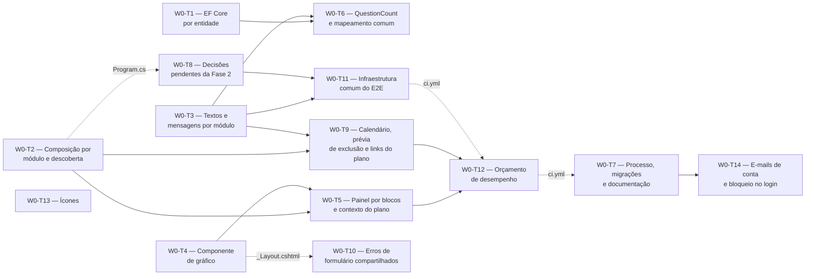

# Onda 0 — Base compartilhada: detalhamento

> **Situação:** aprovada pelo autor em 18/10/2026, com todas as opções recomendadas. Prepara a Onda A, em que as Fases 3,
> 4 e 5 e a Fase 7a (PWA) são desenvolvidas em paralelo, conforme o plano em ondas aprovado
> pelo autor em 17/10/2026 ([roteiro](../05-roteiro.md#ondas)). Implementada e integrada à
> `main` em 19/10/2026 (PR #8, [situação das tarefas](#situação-das-tarefas)). As quatro
> [perguntas levantadas na implementação](#perguntas-levantadas-na-implementação) foram
> respondidas no mesmo dia, e a P8 e a P9 viraram a
> [W0-T14](#w0-t14--e-mails-de-conta-e-bloqueio-no-login-accounts-web), num PR próprio.

## Objetivo

Criar, antes da Onda A, as peças que mais de uma fase usa e os pontos de composição que
deixam as quatro fases trabalharem em paralelo sem editar os mesmos arquivos. A Onda 0 não
entrega funcionalidade nova para o aluno, exceto as decisões pendentes da Fase 2, a
confirmação com contagens na exclusão de disciplina e de tópico, exigida pela
[2.2](../02-dominio-e-regras.md#regras-de-negócio-e-onde-são-garantidas) e que hoje só existe
na exclusão do plano, e os ícones que hoje aparecem vazios nas telas de Contas e
Administração.

## Por que antes

Verificado no código da `main` (`2cf9d81`):

| Ponto de conflito | Situação hoje | Efeito se as fases rodarem em paralelo |
|---|---|---|
| Migrações | Cada fase cria uma migração, e todas alteram o snapshot do modelo nos dois contextos | Conflito certo nos snapshots |
| Configuração do EF Core | Todas as entidades num único `OnModelCreating` (`AppDbContext.cs:61`) | Todas as fases editam o mesmo método |
| Registro de serviços | Stores de reserva no `AddApplication` (`Application/DependencyInjection.cs:15`), stores reais no `AddInfrastructure` (`Infrastructure/DependencyInjection.cs:162`), e `AuthorizeFolder` por pasta no `Program.cs` | As fases editam os três pontos de composição |
| Textos e mensagens | Um `SharedResource.resx` com 843 linhas. O `ResultResponder` traduz os códigos só pelo `IStringLocalizer<SharedResource>` (`ResultResponder.cs:228`), e o `UiText` do E2E lê só esse arquivo | Com um `.resx` por módulo, códigos como `practice.entry.date_in_future` apareceriam crus, e os E2E novos quebrariam no `UiText.Get` |
| Peças comuns | Não existem gráfico, painel, `QuestionCount`, "hoje" do usuário nem semana. A prévia de exclusão tem campos fixos do `Planning` (`PlanningModels.cs:90-105`) | As Fases 3, 4 e 5 criariam versões diferentes da mesma peça e editariam arquivos do `Planning` |
| Exclusão sem confirmação | Só o plano tem confirmação com contagens (`Details.cshtml:325`). Disciplina e tópico são excluídos direto, e a prévia do tópico existe só como resposta JSON sem uso na tela (`Subject.cshtml.cs:501`) | Com a Fase 3, excluir um tópico apagaria histórico sem aviso |
| Painel e isolamento | A página inicial (`Trail.Web.Pages.IndexModel`) não tem varredura de isolamento, e as varreduras comparam o namespace por igualdade | O seletor de plano e os blocos ficariam fora de toda varredura |
| E2E | Um admin, um container e uma coleção sem paralelismo (`DockerAppFixture`). O cadastro é `Closed` por padrão, e convites são recusados nesse modo | As asserções do painel e a regra de uma sessão aberta por usuário dependeriam da ordem da suíte. Depois da 7a, o service worker controlaria as páginas de todos os E2E |
| Ícones | O sprite tem 4 ícones (`house`, `menu`, `sun-moon` e `x`), gerados da lista `LucideIcon` de `eng/frontend.props`, com o SHA-256 fixado e conferido pelo `VendoredFilesTests`. As telas de Contas e Administração e o `_Conflict.cshtml` já usam `check-circle`, `alert-circle`, `info` e `alert-triangle`, que não estão no sprite e aparecem vazios; o teste só confere a página inicial | Duas fases editariam as mesmas linhas e um arquivo gerado com hash, e um ícone fora do sprite passaria despercebido |
| Erros de formulário | `_FormErrors.cshtml` e `FormErrorList` ficam em `Pages/Plans`, sem `role="alert"` (pendência 3 da Fase 2) | Três implementações da mesma lista |
| Orçamento de desempenho | Nenhum workflow agendado, e o passo de testes do `ci.yml` roda projetos inteiros | Um teste de desempenho rodaria em todo PR, e cada fase criaria o seu workflow |

## Depende de

- [Fase 1 — Contas, e-mail e isolamento](fase-1-contas-email-isolamento.md): `UserSettings`,
  convites e links manuais.
- [Fase 2 — Planos e conteúdo](fase-2-planos-e-conteudo.md), já na `main`.
- Os detalhamentos da Onda A, que usam estas peças e trazem a seção "Ícones":
  [Fase 3](fase-3-questoes-desempenho-historico.md),
  [Fase 4](fase-4-simulados-e-taf.md), [Fase 5](fase-5-tempo-de-estudo.md) e
  [Fase 7a](fase-7a-pwa.md).
- ADRs [0003](../adr/0003-sqlite-e-postgresql.md), [0011](../adr/0011-estilo-arquitetural.md),
  [0013](../adr/0013-frontend-tailwind-daisyui.md), [0014](../adr/0014-ddd-tatico.md),
  [0015](../adr/0015-resultado-padrao.md) e [0016](../adr/0016-observabilidade.md).

## Decisões da onda

| # | Tema | Decisão |
|---|---|---|
| D1 | Pontos de composição | `Program.cs`, `AddApplication` e `AddInfrastructure` só são editados na Onda 0. Ela cria os métodos de cada módulo novo, vazios e já chamados, e a descoberta por convenção das peças que os módulos acrescentam. Na Onda A, cada fase só preenche os métodos do próprio módulo, e nenhuma mapeia endpoint no `Program.cs`: as respostas dos módulos são Razor Pages, inclusive `/sw.js` e `/manifest.webmanifest` da 7a |
| D2 | Textos | Um `.resx` por módulo novo, com a classe marcadora em `src/Trail.Web/` (`PracticeResource`, `FitnessResource`, `StudyTimeResource` e `PwaResource`), no padrão do `SharedResource`. O prefixo do código (`practice.`, `fitness.`, `studytime.`, `pwa.`) escolhe o `.resx`; os demais códigos e os textos do layout ficam no `SharedResource`. Os textos de Contas e Planejamento não mudam de arquivo. `Interchange` fica para a Onda B |
| D3 | EF Core | Uma `IEntityTypeConfiguration<T>` por entidade, em `Infrastructure/Persistence/Configurations/<Módulo>/`, aplicadas pelo assembly, sem `DbSet` novo no `AppDbContext`. Na Onda A, só a Fase 4 edita a `StudyPlanConfiguration` (provas do TAF, com `Include` explícito no store dela, sem `AutoInclude`) |
| D4 | Calendário | `IUserCalendar` (`Application/Abstractions`) dá o fuso, o "hoje" e o instante atual do usuário, e `CalendarWeek` (`Domain/Common`) dá a semana de segunda a domingo. A conversão de instantes em dias locais (meia-noite inexistente, horário de verão) fica no `StudyCalendar` da Fase 5. As Fases 3 e 4 trabalham com `DateOnly` e só precisam do `Today` |
| D5 | Prévia de exclusão | O `Planning` resolve o alcance (`DeletionScope`), e cada módulo informa o que apaga junto por um `IDeletionImpactContributor`, como itens `(Code, Count)`. A prévia vira uma lista traduzida pelo prefixo, com singular e plural, usada na exclusão do plano, da disciplina e do tópico |
| D6 | Painel | O painel tem o seletor de plano (`?plano=`) e passa o `DashboardContext` a cada `IDashboardBlock`. O endpoint HTMX de um bloco fica na pasta de páginas do módulo dele, coberto pela varredura do módulo. Uma consulta que lê um módulo fica nele; uma que lê vários fica em `Application/Dashboard` |
| D7 | Gráficos | Tag helper `<chart>` e script externo `charts.js`, carregados pelo layout junto com o Chart.js, para que um gráfico trazido por troca do HTMX encontre o script. A tabela equivalente sai do mesmo modelo do gráfico |
| D8 | Migrações | 100% geradas pelo `dotnet ef`, nunca editadas à mão. A Onda 0 não cria migração. Cada fase da Onda A mantém uma migração local, e a integração gera de novo uma migração por fase, em ordem, nos dois contextos |
| D9 | E2E | Um usuário novo por teste, criado por convite e link manual; service worker bloqueado por padrão; sempre contra o container SQLite. As fases não alteram a fixture |
| D10 | Ícones | A Onda 0 acrescenta de uma vez os ícones listados na seção "Ícones" de cada detalhamento da Onda A e corrige os que as Fases 1 e 2 já usam fora do sprite, sempre com o nome canônico do Lucide fixado (o gerador do sprite não aceita os nomes antigos). Nenhuma fase acrescenta ícones |
| D11 | Desempenho | A Onda 0 cria o harness e o workflow agendado. As fases só acrescentam cenários |

## Tarefas e ordem

- Linha cheia: dependência real. Linha pontilhada: o mesmo arquivo, alterado em sequência.
- T1, T2, T3, T4 e T13 começam juntas.
- Respostas do autor: a T9 espera a P1; a T8, a P2 e a P3; a T5, a P4; a T7, a P5, a P6 e a
  P7. A T13 espera os detalhamentos da Onda A aprovados, com a seção "Ícones".
- Como uma fase: uma branch e um PR, com um commit por tarefa
  ([4.3](../04-qualidade-e-entrega.md#43-fluxo-de-trabalho-no-git)).

### Situação das tarefas

| Tarefa | Situação | Observação |
|---|---|---|
| W0-T1 | Concluída | — |
| W0-T2 | Concluída | Uma regra de arquitetura mantém as classes `*Metrics` em `Trail.Application.Telemetry` |
| W0-T3 | Concluída | Também traduziu os erros do Identity, uniformizou as respostas de contas e tirou os dados pessoais dos logs de e-mail ([correções](#correções-no-comportamento-das-fases-1-e-2)) |
| W0-T4 | Concluída | — |
| W0-T5 | Concluída | — |
| W0-T6 | Concluída | A soma acima do total (`practice.question_count.answers_exceed_total`) aponta para o campo `Correct` |
| W0-T7 | Concluída | Os gatilhos do `ci.yml` não mudaram (P5, opção A) |
| W0-T8 | Concluída | O login passou a conferir a senha antes do estado da conta. O teste de acesso anônimo registra o status esperado de cada página pública ([3.11](../03-arquitetura.md#login-no-app-inteiro)) |
| W0-T9 | Concluída | — |
| W0-T10 | Concluída | Também os erros de Contas e Administração sob os campos, e a regra global dos erros de conversão ([3.9](../03-arquitetura.md#formulários-e-erros)) |
| W0-T11 | Concluída | O override do E2E também eleva o limite de tentativas do login, só no E2E |
| W0-T12 | Concluída | O `performance.yml` também roda num PR que altera o harness ou o workflow |
| W0-T13 | Concluída | — |
| W0-T14 | Concluída | Criada depois do PR da onda, com as respostas da P8 e da P9. Também traduziu os e-mails de conta, que estavam em inglês no código |

As convenções que as tarefas criaram estão na arquitetura, e os detalhamentos da Onda A as
citam:

| Convenção | Onde |
|---|---|
| Métodos de registro por módulo e pontos de extensão | [3.5](../03-arquitetura.md#composição-por-módulo) |
| `.resx` por módulo, registro de prefixos, teste de tradução e textos com quantidade | [3.5](../03-arquitetura.md#textos-e-mensagens) |
| Uma porta de store por módulo | [3.6](../03-arquitetura.md#uma-porta-de-store-por-módulo) |
| Erros de formulário e erros de conversão | [3.9](../03-arquitetura.md#formulários-e-erros) |
| Componente `<chart>` | [3.9](../03-arquitetura.md#gráficos) |
| Configuração por entidade e migrações geradas | [3.10](../03-arquitetura.md#dois-bancos) |
| `QuestionCount` e `HasQuestionCount` | [3.10](../03-arquitetura.md#contagem-de-questões) |
| `IUserCalendar` e `CalendarWeek` | [3.10](../03-arquitetura.md#calendário-do-usuário) |
| Login no app inteiro e lista pública | [3.11](../03-arquitetura.md#login-no-app-inteiro) |
| Varredura de isolamento por namespace | [3.11](../03-arquitetura.md#isolamento) |
| Respostas uniformes e riscos residuais | [3.14](../03-arquitetura.md#314-segurança) |
| Fluxo de integração da Onda A | [4.3](../04-qualidade-e-entrega.md#43-fluxo-de-trabalho-no-git) |
| Fixture do E2E, harness e workflow de desempenho | [4.1](../04-qualidade-e-entrega.md#41-estratégia-de-testes) e [4.4](../04-qualidade-e-entrega.md#44-integração-contínua-github-actions) |

### W0-T1 — Configuração do EF Core por entidade (`Infrastructure`)

- Uma `IEntityTypeConfiguration<T>` por entidade, em
  `Persistence/Configurations/Accounts/` (`UserSettings`, `AccountInvitation`) e
  `Persistence/Configurations/Planning/` (`StudyPlan`, `Section`, `SubjectPlacement`,
  `Subject`, `Topic`, `TopicNote`), aplicadas com `ApplyConfigurationsFromAssembly`.
- O laço global do `AppDbContext` (`Version`, filtro por dono e conversores de ID) continua
  depois das configurações, para que toda entidade nova os receba sem editar o contexto.
- Stores novos usam `Set<T>()`.

**Testes:** em `Trail.Application.Tests/Persistence/`, um teste exige, para cada entidade do
modelo (fora as do Identity e os tipos próprios), uma configuração na pasta do módulo do
tipo no `Domain`.

**Pronto quando:** `has-pending-model-changes` não acusa mudança nos dois contextos, nenhuma
migração é criada, e as suítes passam em SQLite e PostgreSQL.

### W0-T2 — Composição por módulo e descoberta por convenção (`Application`, `Infrastructure`, `Web`)

- Métodos vazios, já chamados nos pontos de composição:

  | Módulo | `Application` (chamado pelo `AddApplication`) | `Infrastructure` (chamado pelo `AddInfrastructure`) | `Web` (chamado pelo `Program.cs`) |
  |---|---|---|---|
  | Practice | `AddPracticeApplication` | `AddPracticeInfrastructure` | `AddPracticeWeb` |
  | Fitness | `AddFitnessApplication` | `AddFitnessInfrastructure` | `AddFitnessWeb` |
  | StudyTime | `AddStudyTimeApplication` | `AddStudyTimeInfrastructure` | `AddStudyTimeWeb` |
  | Pwa | — | — | `AddPwaWeb` |

- Arquivos: `src/Trail.Application/<Módulo>/<Módulo>ApplicationServices.cs`,
  `src/Trail.Infrastructure/<Módulo>InfrastructureServices.cs` e
  `src/Trail.Web/<Módulo>/<Módulo>WebServices.cs` (a 7a usa `src/Trail.Web/Pwa/`). Os
  registros existentes de Contas e Planejamento ficam onde estão.
- Descoberta por convenção, como o `AddHandlersFrom`:
  - classes públicas terminadas em `Metrics` em `Trail.Application.Telemetry`, como
    singleton;
  - implementações de `IPlanActivityContributor` (W0-T5) e de `IDeletionImpactContributor`
    (W0-T9), nos assemblies da `Application` e da `Infrastructure` (quem conta linhas fica
    na `Infrastructure`);
  - implementações de `IDashboardBlock` (W0-T5) e de `IPlanLinkContributor` (W0-T9), no
    assembly da `Web`.

**Testes:** em `DependencyInjectionTests`, a descoberta aplicada a tipos de exemplo do
próprio projeto de testes registra cada tipo uma vez, com o tempo de vida certo, e ignora
classes abstratas e não públicas.

**Pronto quando:** os dez métodos existem e são chamados, e nenhuma fase da Onda A precisa
editar o `Program.cs`, o `AddApplication` ou o `AddInfrastructure`.

### W0-T3 — Textos e mensagens por módulo (`Web`, `E2E.Tests`)

- Classes marcadoras `PracticeResource`, `FitnessResource`, `StudyTimeResource` e
  `PwaResource` em `src/Trail.Web/`, com o `.resx` vazio em `src/Trail.Web/Resources/`.
- `_ViewImports.cshtml` em `Pages/Practice`, `Pages/Fitness` e `Pages/StudyTime`, com o
  localizador do módulo injetado, para as Fases 3 e 4 não criarem o mesmo arquivo.
- Registro de prefixos na `Web`: `practice.` → `PracticeResource`, `fitness.` →
  `FitnessResource`, `studytime.` → `StudyTimeResource`, `pwa.` → `PwaResource`, e o
  `SharedResource` para os demais. O `ResultResponder` e a prévia de exclusão (W0-T9)
  traduzem os códigos por ele.
- `UiText` do E2E lê os cinco `.resx`: os códigos de mensagem pelo prefixo, e as demais
  chaves pelo módulo informado na chamada.

**Testes:**

- Todo código literal de mensagem no `Domain` e na `Application` (nas chamadas a
  `Message.*` e `AddErrorIf`) tem tradução no `.resx` do seu prefixo. Hoje são 72 códigos,
  todos traduzidos no `SharedResource`.
- `ResultResponder` com um código de cada prefixo, com e sem HTMX, mostra o texto
  traduzido.

**Pronto quando:** os testes passam, e nenhuma fase da Onda A precisa editar o
`SharedResource.resx`, o `ResultResponder` ou o `UiText`.

### W0-T4 — Componente de gráfico (`Web`, `E2E.Tests`)

- Tag helper `<chart>`: renderiza o `<canvas>` com o modelo em JSON num atributo `data-*` e a
  tabela equivalente gerada do mesmo modelo. Sem script nem estilo inline (CSP com nonce).
- `wwwroot/js/charts.js`, carregado pelo layout com o Chart.js (`defer`):
  - lê os tokens do tema (OKLCH, `Styles/app.css`), converte para sRGB desenhando um pixel
    num `<canvas>` e define as cores de hover, porque o Chart.js 4 não interpreta
    `oklch()`;
  - redesenha com as cores novas quando `data-theme` muda (`MutationObserver`);
  - cria o gráfico em `htmx:after:process` e chama `chart.destroy()` em
    `htmx:before:cleanup` (eventos do HTMX 4.0.0 vendorizado), evitando vazamento e
    "Canvas is already in use";
  - cria o gráfico de um `
` fechado só quando ele abre.
- Recursos que as fases já pedem: barras horizontais, série tracejada (mediana), lacunas
  (`spanGaps`), dois gráficos com os mesmos rótulos, eixos simétricos (−100 a 100 e −T a T)
  e formatos pt-BR (porcentagem, pontos e horas).

**Testes:**

- `Trail.Web.Tests`: o HTML do tag helper (JSON, tabela com as mesmas linhas, nenhum
  `<script>` inline nem atributo `style`).
- `Trail.E2E.Tests`: uma página estática do projeto de E2E, servida por `page.RouteAsync` na
  origem do container, carrega `htmx.min.js`, `chart.umd.min.js` e `charts.js` do próprio
  container e prova o desenho depois de uma troca do HTMX, a destruição na limpeza (sem erro
  no console), a troca de tema, cores de hover válidas e o gráfico dentro de um `
`,
  com zero violações do axe nos dois temas.

**Pronto quando:** os testes passam em `390x844` e `1280x800`.

### W0-T5 — Painel por blocos e contexto do plano (`Application`, `Web`, `Web.Tests`)

- A página inicial (`/`) continua pública: quem não está autenticado vê a apresentação de
  hoje, e quem está vê o painel.
- `GetDashboardContextHandler` em `Application/Dashboard/` devolve o `DashboardContext`:
  os planos do usuário para o seletor e o plano escolhido. `?plano=` de outro usuário ou
  inexistente dá `NotFound` (404). Sem `?plano=`, vale a regra da P4 (opção A): o plano
  com a atividade mais recente, informada pelos módulos por `IPlanActivityContributor`
  (`Application/Abstractions`, a última atividade de cada plano do usuário, em UTC). Sem
  nenhuma contribuição, vale o primeiro plano na ordem da lista de planos.
- `IDashboardBlock` em `src/Trail.Web/Dashboard/`: ordem e view component. A página invoca
  cada bloco com o `DashboardContext`.
- O seletor funciona por `GET` sem JavaScript e, com HTMX, troca o conteúdo do painel com
  `hx-push-url`.
- Estados vazios: sem plano, boas-vindas com o link para criar o primeiro; com plano e sem
  blocos (o estado da Onda 0 em produção), o seletor e o link para o plano escolhido.
- Isolamento:
  - varredura do painel para o namespace `Trail.Web.Pages`: `?plano=` de outro usuário dá
    404, e nenhum nome da vítima aparece;
  - cada varredura declara o namespace que cobre, e um teste falha quando um namespace de
    páginas com handlers não tem varredura nem dispensa justificada (`Account` e `Admin`,
    cobertos pelos testes da Fase 1). As fases acrescentam varreduras sem editar arquivo
    comum.

**Testes:** o handler nos dois bancos (padrão, plano escolhido e plano alheio); um bloco de
exemplo registrado no teste, com um `<chart>`, aparece com o contexto certo, com e sem HTMX;
a varredura do painel e o teste de namespaces.

**Pronto quando:** os testes passam nos dois bancos, e as Fases 3, 4 e 5 acrescentam os
blocos sem editar a página do painel.

### W0-T6 — `QuestionCount` e mapeamento comum (`Domain`, `Infrastructure`)

- `Trail.Domain/Practice/QuestionCount.cs`: `Total`, `Correct`, `Wrong` e `Blank` derivado,
  com as invariantes da [2.2](../02-dominio-e-regras.md#invariantes) (`Total > 0`,
  `Correct ≥ 0`, `Wrong ≥ 0` e `Correct + Wrong ≤ Total`) e códigos `practice.question_count.*`
  no `PracticeResource.resx`.
- Mapeamento comum em `Persistence/Configurations/Practice/`: tipo complexo com as colunas
  `Total`, `Correct` e `Wrong` (`HasColumnName`, sem o prefixo que o EF Core gera) e um
  `CHECK` com os nomes entre aspas (`"Total" > 0 AND "Correct" >= 0 AND "Wrong" >= 0 AND
  "Correct" + "Wrong" <= "Total"`), igual nos dois bancos. Sem aspas, o PostgreSQL passaria
  os nomes para minúsculas e não acharia as colunas. As Fases 3 e 4 só chamam o mapeamento.

**Testes:**

- Unidade e propriedades (CsCheck) das invariantes, com cobertura de 100%.
- Num agregado de teste em `Trail.Application.Tests/Persistence/`, nos dois bancos: os nomes
  das colunas, o `CHECK` recusando uma linha inválida gravada por SQL direto, e `GROUP BY`
  com `SUM` sobre o tipo complexo dando o mesmo resultado.

**Pronto quando:** os testes passam em SQLite e PostgreSQL, sem mudança no modelo do
produto.

### W0-T7 — Processo, migrações e documentação (`docs`, `.github`)

- Fluxo de integração, conforme a P5 (opção A): um PR por fase para a `main`, na ordem
  3 → 4 → 5 → 7a (salvo outra ordem do autor); antes do merge, a integração faz o rebase
  sobre a `main`, apaga a migração local da fase e gera de novo a migração com o mesmo nome
  (`AddQuestionEntries`, `AddMockExamsAndFitnessTest`, `AddStudyTime`) nos dois contextos,
  confere `has-pending-model-changes` e espera o CI verde. O autor aprova cada PR.
- Regra: migrações 100% geradas, nunca editadas à mão.
- CI: com a P5 na opção A, os gatilhos atuais bastam (todo PR para a `main` roda o CI), e
  os gatilhos do `ci.yml` não mudam.
- Documentos atualizados com as respostas do autor:
  - [4.3](../04-qualidade-e-entrega.md#43-fluxo-de-trabalho-no-git) (fluxo das ondas) e
    [4.4](../04-qualidade-e-entrega.md#44-integração-contínua-github-actions) (gatilhos e
    workflow de desempenho);
  - [3.5](../03-arquitetura.md#35-camadas-módulos-e-padrões-internos) (métodos de cada
    módulo, pontos de extensão e lugar das consultas do painel) e
    [3.6](../03-arquitetura.md#36-pontos-de-variação) (uma porta de store por módulo, o
    padrão real desde a Fase 2, no lugar de "sem repositórios");
  - [2.2](../02-dominio-e-regras.md#22-modelo), [3.10](../03-arquitetura.md#310-dados-dois-bancos-integridade-e-concorrência)
    e o [roteiro](../05-roteiro.md), conforme a P6 e a P7.

**Pronto quando:** os documentos refletem as respostas da P5 à P7, e os detalhamentos da
Onda A citam estas convenções.

### W0-T8 — Decisões pendentes da Fase 2 (`Web`, `Application`)

1. **Convites no modo `Closed`**, conforme a P2 (opção A): a tela de administração esconde
   os convites nesse modo e explica o modo atual, e o caso de uso recusa o convite com
   mensagem própria (`accounts.invitation.registration_closed`).
2. **Login no app inteiro**, conforme a P3 (opção B): `FallbackPolicy` que exige usuário
   autenticado. `AllowAnonymous` explícito na página inicial, nas páginas de `Account`
   (exceto `Settings`), na `Error`, em `MapHealthChecks` (health check do Docker,
   `compose --wait` e espera do Testcontainers) e em `MapStaticAssets` (o CSS da tela de
   login). O `AuthorizeFolder("/Plans")` sai, porque fica redundante.

**Testes:** requisição anônima a cada página: as da lista pública respondem 200, e as demais
levam ao login (com HTMX, a navegação da página inteira, como na Fase 2). A lista pública
fica fixa no teste. Health checks e arquivos estáticos respondem sem login. Os convites
seguem a P2, nos testes de casos de uso e HTTP.

**Pronto quando:** Preferências e Administração levam ao login quem não está autenticado,
como as páginas de planos, e os testes passam nos dois bancos.

**Na implementação:** as páginas públicas não respondem todas 200 a uma requisição
anônima sem parâmetros. A lista pública do `AnonymousAccessTests` guarda o status esperado
de cada uma (a `Error` responde 500, a `ConfirmEmail` 422, e a `AcceptInvite` e a `Logout`
redirecionam), e uma URL sem endpoint responde 404, com e sem login
([3.11](../03-arquitetura.md#login-no-app-inteiro)).

### W0-T9 — Calendário, prévia de exclusão e links do plano (`Domain`, `Application`, `Infrastructure`, `Web`)

Conforme a P1 (opção A):

- **Calendário:**
  - `CalendarWeek` em `Trail.Domain/Common/`: a semana de segunda a domingo de um
    `DateOnly`;
  - `IUserCalendar` em `Application/Abstractions`:
    `Task<UserCalendarSnapshot> GetAsync(CancellationToken)`, com o `TimeZoneInfo` do
    usuário, `DateOnly Today` e `DateTime UtcNow`. Implementação na `Infrastructure`, a
    partir do `UserSettings` e do `TimeProvider` (sem registro, vale o fuso padrão), com a
    implementação de reserva na `Application`, como nas outras portas;
  - `Microsoft.Extensions.TimeProvider.Testing` (`FakeTimeProvider`) no
    `Directory.Packages.props` e em `Trail.Application.Tests` e `Trail.Web.Tests`, com os
    arquivos de lock. No E2E, conforme a W0-T11.
- **Prévia de exclusão:**
  - `DeletionTargetKind` passa para `Application/Abstractions`, com
    `DeletionScope(Kind, PlanId, SubjectIds, TopicIds)`, resolvido pelo
    `GetDeletionImpactHandler` (na exclusão de bloco, as listas ficam vazias);
  - `IDeletionImpactContributor` devolve itens `(Code, Count)`, só do que aquela exclusão
    alcança. As contagens do próprio `Planning` (blocos, disciplinas, tópicos e anotações)
    viram itens do mesmo formato;
  - o `DeletionImpactView` passa a levar a lista de itens. O texto de cada item vem das
    chaves `<Code>.one` e `<Code>.other`, no `.resx` do prefixo;
  - um parcial em `Pages/Shared` mostra a lista na exclusão do plano, e a disciplina e o
    tópico ganham a confirmação em `<dialog>`, com a prévia carregada pelo HTMX (o
    `OnGetDeleteTopicImpactAsync` passa a devolver o parcial, e o `DetailsModel` ganha o
    handler da prévia da disciplina, incluído na varredura da Fase 2).
- **Links do plano:** `IPlanLinkContributor` na `Web` recebe o `StudyPlanDetailView` e
  decide se mostra o link. O `Details.cshtml` mostra os links contribuídos. Previstos:
  Histórico (Fase 3, `/planos/{planId}/historico`, escondido com a regra `None`), Simulados
  e TAF (Fase 4, o TAF só quando ativo) e Horas (Fase 5, `/tempo/horas?plano={planId}`).

**Testes:**

- Propriedades (CsCheck) do `CalendarWeek`: cada data cai em exatamente uma semana, de sete
  dias, começando na segunda.
- `IUserCalendar` nos dois bancos, com `FakeTimeProvider`: às 23h30 em São Paulo (02h30 UTC
  do dia seguinte), o `Today` é o dia local; usuário sem preferências usa o fuso padrão; as
  preferências de outro usuário nunca entram.
- As contagens da Fase 2 não mudam na exclusão de plano, bloco, disciplina e tópico; um
  contribuinte de teste aparece traduzido, no singular e no plural.
- Um link de teste aparece ou some conforme o plano.

**Pronto quando:** os testes passam nos dois bancos, e as Fases 3, 4 e 5 acrescentam
contagens e links sem editar arquivos do `Planning`.

**Na implementação:** cada item da prévia é um `DeletionImpactItem.Create(code, count)`, e
o texto sai do `CountedMessage`, com a chave `.one` só para exatamente 1 e o formato
"2 blocos" no lugar de "Blocos: 2" ([P10](#p10--regra-do-plural-nos-textos-com-quantidade)
e [P11](#p11--formato-dos-itens-da-prévia-de-exclusão)). Os três diálogos de exclusão são
descritos pelo alvo, pelo aviso e pelas contagens (`aria-describedby`) e abrem com o foco
em "Cancelar". O `IPlanLinkContributor` devolve um `PlanLink` (texto, página, valores de
rota e um `PlanLinkIcon`: `RotateCcwClock`, `ClipboardCheck` ou `Dumbbell`).

### W0-T10 — Erros de formulário compartilhados (`Web`)

- `_FormErrors.cshtml` e `FormErrorList` passam para `Pages/Shared`, com os auxiliares
  genéricos de `PlanFormErrors` (`For` e `HasErrors`). As constantes de campo do `Planning`
  ficam em `Pages/Plans`.
- A lista ganha `role="alert"`, e `wwwroot/js/form-errors.js`, carregado pelo layout, põe o
  foco no primeiro campo com `aria-invalid="true"` depois de uma resposta 422 do HTMX e ao
  abrir uma página com 422 (WCAG 4.1.3).

**Testes:** o parcial com `role="alert"` e o `id` usado pelo `aria-describedby`; os
formulários do `Planning` com erro, com e sem HTMX; um E2E que envia um formulário do
`Planning` com erro do servidor e confere o foco e a lista.

**Pronto quando:** a pendência 3 da Fase 2 está resolvida, e as Fases 3, 4 e 5 usam o
parcial comum.

### W0-T11 — Infraestrutura comum do E2E (`E2E.Tests`, `.github`)

- A fixture cria um usuário novo por teste: convite do admin, cadastro pelo convite e
  confirmação pelo link manual, por requisições HTTP, sem passar pelas telas. Com a P2 na
  opção A, o modo `InviteOnly` vem de um override do compose só do E2E
  (`tests/Trail.E2E.Tests/compose.e2e.yml`), usado pelo job de E2E do `ci.yml`, e da mesma
  variável no container do Testcontainers.
- A fixture também abre um segundo contexto autenticado do mesmo usuário, para os testes
  de "outro aparelho" da Fase 5.
- O contexto do navegador nasce com `ServiceWorkers = Block`. Só o `PwaE2ETests` pede
  `Allow`.
- Para o host em processo do pomodoro (Fase 5, pergunta 8, opção C), a Onda 0
  acrescenta ao projeto de E2E `Microsoft.Extensions.TimeProvider.Testing`,
  `Microsoft.AspNetCore.Mvc.Testing` e a referência ao `Trail.Web`, com o arquivo de lock. A
  Fase 5 só cria a fixture desse host, num arquivo novo.
- O lançamento do Chromium não muda: `127.0.0.1` e `localhost` já são contextos seguros.
- Testes existentes: o `PlansE2ETests` passa a usar um usuário novo, e o
  `AccountsE2ETests` passa a conferir a recusa sem convite
  (`accounts.registration.invite_required`). O modo `Closed` continua coberto nos testes
  HTTP e de casos de uso.

**Testes:** dois usuários novos não veem os planos um do outro; o segundo contexto vê os
dados do mesmo usuário; com o padrão da fixture, nenhum service worker é registrado.

**Pronto quando:** os E2E passam contra o container SQLite, e cada classe de teste passa
também sozinha (`--filter-class`), sem depender da ordem da suíte.

**Na implementação:** a API da fixture (`CreateUserAsync`, `CreatePageAsync`,
`CreateOtherDevicePageAsync` e `CreateAdminPageAsync`) e os auxiliares internos
`E2EBrowserContexts` e `AppHttpSession`, que o host em processo da Fase 5 reusa, estão
descritos na [4.1](../04-qualidade-e-entrega.md#41-estratégia-de-testes). Cada página nova
fecha os contextos dos testes anteriores no mesmo navegador. O `compose.e2e.yml` define
`Registration__Mode: InviteOnly` e `Security__AuthRateLimitPermitLimit: "1000"`, porque
cada teste faz login, e o container do Testcontainers recebe as mesmas variáveis
(`ComposeOverrideTests`), numa imagem com uma tag própria, removida no fim. O job de E2E do
`ci.yml` passa o override ao subir, ao ler os logs e ao derrubar o compose. Uma execução
precisa de uma instância nova, porque o admin é a primeira conta. A suíte tem 38 testes
E2E.

### W0-T12 — Orçamento de desempenho (`Web.Tests`, `.github`)

- Harness em `Trail.Web.Tests/Performance/`: cria um plano com 1.000 tópicos, mede o tempo
  do servidor (p95 de 20 requisições, depois do aquecimento) e falha acima de 300 ms
  ([3.15](../03-arquitetura.md#315-verificações-automáticas-da-arquitetura)). Os testes têm
  o traço `Category=Performance`.
- Cenários da Onda 0: página do plano (com os links e as contribuições da W0-T9), página da
  disciplina e painel.
- As fases acrescentam o seu volume e os seus cenários em classes novas que usam o harness:
  10.000 lançamentos (Fase 3) e 10.000 sessões (Fase 5).
- O passo de testes do `ci.yml` exclui o traço (`--filter-not-trait "Category=Performance"`),
  e o `.github/workflows/performance.yml` roda só esses testes, todo dia e sob demanda, em
  SQLite e PostgreSQL.

**Pronto quando:** o `performance.yml` passa numa execução manual, e o log do CI de um PR
mostra que os testes de desempenho não rodaram.

**Na implementação:** o harness (`PerformanceFixture`, `PerformanceScenario` e
`PerformanceBudget.Default`) está descrito na
[4.1](../04-qualidade-e-entrega.md#41-estratégia-de-testes). Os cenários da Onda 0 são a
página do plano, a página da maior disciplina, as prévias de exclusão da disciplina e do
tópico, e o painel com o plano escolhido e com a regra padrão. Além do agendamento e da
execução manual, o `performance.yml` roda num PR que altera o harness ou o próprio
workflow, para o PR provar a mudança
([4.4](../04-qualidade-e-entrega.md#44-integração-contínua-github-actions)).

### W0-T13 — Ícones (`eng`, `Web`)

- O gerador do sprite só aceita o nome do arquivo no Lucide fixado (1.58.0), não os nomes
  antigos. Por isso, os ícones das Fases 1 e 2 que estão fora do sprite trocam de nome nas
  views e entram na lista: `check-circle` → `circle-check-big` (5 usos em `Account` e
  `Admin`), `alert-circle` → `circle-alert`, `alert-triangle` → `triangle-alert`, e `info`.
- Os ícones da seção "Ícones" dos detalhamentos das Fases 3, 4, 5 e 7a entram de uma vez na
  lista `LucideIcon` de `eng/frontend.props`, também com o nome canônico. Pedidos até agora:

  | Fase | Ícones |
  |---|---|
  | 3 | `plus`, `pencil`, `trash` (era `trash-2`), `rotate-ccw-clock` (era `history`), `chart-bar`, `info` |
  | 4 | `plus`, `pencil`, `trash` (era `trash-2`), `info`, `clipboard-check`, `dumbbell` |
  | 5 | `play`, `square`, `skip-forward`, `bell`, `volume-2`, `volume-x`, `plus`, `pencil`, `trash` (era `trash-2`) |
  | 7a | Conforme o detalhamento |

- O sprite é gerado de novo, e o SHA-256 fixado é atualizado.
- O `StaticAssetsTests.Get_Home_UsesOnlyIconsPresentInSprite`, que só confere a página
  inicial, dá lugar a um teste que lê todas as views de `src/Trail.Web`, exige nome literal
  em todo `<icon name="…">` e confere cada nome no sprite. Um ícone fora do sprite faz o CI
  falhar.

**Pronto quando:** `VendoredFilesTests` e o teste de ícones passam, os ícones das telas de
Contas, Administração e conflito aparecem, e a Onda A não precisa de ícone novo. Uma
necessidade descoberta depois fica para a integração.

### W0-T14 — E-mails de conta e bloqueio no login (`Accounts`, `Web`)

Criada com as respostas do autor à [P8](#p8--envio-de-e-mail-fora-da-requisição) e à
[P9](#p9--mensagem-do-bloqueio-no-login), num PR próprio depois do PR da onda.

- **E-mails traduzidos:** os cinco e-mails de conta (confirmação, redefinição de senha,
  aviso de tentativa de cadastro, convite e e-mail de teste) tinham o texto em inglês no
  código. O assunto e o corpo passam a vir do `SharedResource.resx`, em pt-BR, por uma porta
  da `Application` implementada na `Web`, com os valores interpolados codificados no HTML.
- **Envio fora da requisição (P8):** a confirmação, a redefinição de senha, o reenvio da
  confirmação e o aviso de tentativa de cadastro entram numa fila em memória, enviada por um
  `BackgroundService`, e a resposta não espera o SMTP. O cadastro que chega a uma conta
  confirmada envia ao dono o aviso de que alguém tentou cadastrá-lo, com o link da
  recuperação de senha; a uma conta sem confirmação, uma confirmação nova; a uma conta
  desativada, nada. O convite e o e-mail de teste do admin continuam síncronos. Sem SMTP,
  os links manuais não mudam.
- **Contra o abuso:** o cadastro e o reenvio da confirmação ganharam o mesmo limite de
  tentativas do login, e o envio manda no máximo um e-mail por destinatário e tipo a cada
  15 minutos ([3.11](../03-arquitetura.md#e-mail)).
- **Mensagem única no bloqueio (P9):** senha errada, e-mail desconhecido e conta bloqueada
  respondem "E-mail ou senha incorretos, ou conta bloqueada temporariamente.", com o mesmo
  status (422) e o hash calculado também na conta bloqueada. A contagem do bloqueio não
  muda.

**Testes:** com um SMTP falso lento, o cadastro, a recuperação de senha e o reenvio da
confirmação respondem antes do envio, com o mesmo status e o mesmo texto para e-mail
cadastrado e desconhecido; o serviço de envio manda o que entrou na fila, registra as
métricas e a falha sem dados pessoais e esvazia a fila ao parar; o login responde igual nos
três casos, nos dois bancos.

**Pronto quando:** os dois riscos residuais de contas da
[3.14](../03-arquitetura.md#riscos-residuais) estão fechados, os testes passam nos dois
bancos, e nenhum e-mail de conta tem texto fora do `.resx`.

**Na implementação:** com um SMTP falso de 500 ms, a recuperação de senha e o reenvio da
confirmação para um e-mail cadastrado caíram de cerca de 510 ms para 3 ms (SQLite) e 4 ms
(PostgreSQL), como os de um e-mail desconhecido, e o cadastro de um e-mail novo, de
591 ms para 65 ms (SQLite), perto dos 63 ms de um e-mail existente. Resta a diferença de
poucos milissegundos da escrita no banco, aceita como risco residual da
[3.14](../03-arquitetura.md#riscos-residuais).

## Correções no comportamento das Fases 1 e 2

Além das decisões pendentes da Fase 2 (P2 e P3) e da confirmação na exclusão de disciplina
e de tópico, a Onda 0 corrigiu:

- **Erros do Identity traduzidos:** cada erro vira um código `accounts.identity.*`, no
  campo a que se refere (nova senha, senha atual ou e-mail), e um erro não previsto cai em
  `accounts.identity.default_error`. As mensagens não levam mais a descrição em inglês do
  Identity nem o e-mail digitado.
- **Redefinição de senha:** uma regra de senha não atendida aparece no campo da nova
  senha, em vez da mensagem de link inválido, que fica para o link inválido ou vencido e o
  usuário desconhecido.
- **Respostas uniformes nas contas:** o cadastro, a recuperação de senha, o reenvio da
  confirmação e o login respondem igual para e-mail cadastrado e desconhecido, no status,
  no texto e no hash da senha, sem esperar o SMTP, inclusive quando o envio do e-mail falha
  e quando a conta está bloqueada. O login confere a senha antes de informar que a conta
  está desativada ou sem confirmação, e os e-mails de conta saem fora da requisição
  ([W0-T14](#w0-t14--e-mails-de-conta-e-bloqueio-no-login-accounts-web) e
  [3.14](../03-arquitetura.md#314-segurança)).
- **E-mails em pt-BR:** os e-mails de conta tinham o texto em inglês no código e passaram a
  vir do `.resx`.
- **Logs sem dados pessoais:** a falha de envio de e-mail não registra mais o destinatário
  nem a mensagem da exceção, que pode repetir o endereço. A categoria de log que imprime a
  URL completa, com o token dos links, fica fixada em `Warning`.
- **Erros sob os campos:** nos formulários de Contas, Administração e Planejamento, o erro
  aparece sob o campo, com `aria-invalid` e `aria-describedby`, e o erro do formulário
  aparece uma vez, no formulário, sem repetir num toast. Os formulários de cadastro, login
  e administração mostram todos os erros, inclusive os de campo.
- **Valor inválido nos planos:** texto num campo numérico do formulário do plano fazia o
  caso de uso gravar o valor padrão. Agora a resposta é 422, sem chamar o caso de uso, com
  a mensagem traduzida, em todo formulário.
- **Exclusão de disciplina e de tópico:** passou a pedir confirmação num `<dialog>`, com a
  prévia do que será apagado, também sem JavaScript (pendência 4 da Fase 2). O painel de
  anotações da disciplina continua na tela depois de um envio inválido.
- **URLs desconhecidas:** com o login exigido no app inteiro, continuam respondendo 404,
  com e sem login, sem levar ao login nem gastar o limite de tentativas dele (ex.:
  `/favicon.ico`).
- **Ícones vazios:** os ícones das telas de Contas, Administração e conflito passaram a
  aparecer, com os nomes canônicos do Lucide.

## Pronto quando (onda)

- O CI fica 100% verde no PR da onda, com os E2E contra o container SQLite.
- O comportamento da Fase 2 não muda, fora o que esta onda decide (prévia em lista,
  confirmação na exclusão de disciplina e tópico, erros com `role="alert"` e login): o
  `PlansE2ETests` continua verde com o mesmo fluxo.
- A varredura do painel e o teste de namespaces de páginas passam nos dois bancos.
- Nenhuma mudança pendente no modelo e nenhuma migração nova.
- Os detalhamentos das Fases 3, 4, 5 e 7a usam estas peças com estes nomes, sem desenho
  condicional, e listam os seus ícones.
- As perguntas têm resposta: as P1 a P7 em 18/10/2026, registradas pela W0-T7, e as P8 a
  P11, levantadas na implementação, em 19/10/2026.

## Perguntas para o autor

> **Respondidas pelo autor em 18/10/2026:** todas as opções recomendadas foram aceitas.

### P1 — Peças comuns: calendário, prévia de exclusão e links do plano

As Fases 3, 4 e 5 precisam do "hoje" no fuso do usuário, e as Fases 3 e 5 da semana de
segunda a domingo. As três acrescentam contagens à prévia de exclusão, que hoje tem campos
fixos do `Planning`, e links à página do plano. Antes, a mesma dúvida aparecia na P9 da Fase
3, na pergunta 7 da Fase 4 e na pergunta 10 da Fase 5, com opções diferentes. Agora ela fica
só aqui, e as fases citam a W0-T9.

| Opção | Descrição | Prós | Contras |
|---|---|---|---|
| A (recomendada) | A W0-T9 completa: `IUserCalendar` e `CalendarWeek`, `DeletionScope` com `IDeletionImpactContributor`, `IPlanLinkContributor` e `FakeTimeProvider` | Uma regra só de "hoje" e de semana; nenhuma fase edita o `Planning` nem os arquivos das outras | A Onda 0 cresce uma tarefa |
| B | Só os pontos de extensão (prévia e links) na Onda 0; cada módulo calcula o "hoje" e a semana pela própria porta | Onda 0 menor; módulos independentes | Três implementações do "hoje" e duas da semana, que precisam concordar, cada uma com os seus testes |
| C | Nada na Onda 0: a Fase 3 cria a porta da prévia, e as Fases 4 e 5 se adaptam na integração | A Onda 0 não muda | As Fases 4 e 5 dependem de parte da Fase 3; conflitos em `GetDeletionImpactHandler`, `DeletionImpactView` e `Details.cshtml` |

### P2 — Convites no modo `Closed`

A tela de administração oferece convites no modo `Closed`, mas o convidado é recusado, porque
esse modo bloqueia novos cadastros (D2 da Fase 1). É a pendência 1 da Fase 2.

| Opção | Descrição | Prós | Contras |
|---|---|---|---|
| A (recomendada) | Esconder os convites no modo `Closed` e explicar o modo na tela; o E2E usa `InviteOnly` num override próprio | Mantém a D2 da Fase 1; a tela não oferece o que não funciona | Para convidar, o admin muda a configuração e reinicia o container |
| B | Um convite válido cria a conta mesmo no modo `Closed` | Convidar sem mexer na configuração; o E2E não precisa de override | Muda a D2: `Closed` e `InviteOnly` ficam quase iguais |
| C | Manter como está | Nada a fazer | A tela continua oferecendo um convite que sempre falha |

### P3 — Login no app inteiro

As páginas de planos exigem login pela convenção da pasta `/Plans`. Preferências e
Administração respondem 403 a quem não está autenticado, em vez de levar ao login. É a
pendência 2 da Fase 2.

| Opção | Descrição | Prós | Contras |
|---|---|---|---|
| A | Convenção por pasta: a Onda 0 registra `/Practice`, `/Fitness`, `/StudyTime`, `/Account/Settings` e `/Admin` | Nenhuma página pública muda | Cada pasta nova precisa ser lembrada (a Fase 6 traz `Interchange`); esquecer deixa a página aberta |
| B (recomendada) | Política única (`FallbackPolicy`), com `AllowAnonymous` explícito nas páginas públicas, nos health checks e nos arquivos estáticos | Segura por padrão: uma página nova nasce protegida; a lista pública fica fixa num teste | Sem o `AllowAnonymous` nos health checks, o health check do Docker, o `compose --wait` e o Testcontainers falham; sem ele nos estáticos, a tela de login fica sem CSS. Os dois casos têm teste |

### P4 — Qual plano o painel mostra

Os blocos das Fases 3, 4 e 5 dependem de um plano. Antes era a P2 da Fase 3, que punha o
seletor só no bloco de desempenho.

| Opção | Descrição | Prós | Contras |
|---|---|---|---|
| A (recomendada) | Seletor no painel, guardado em `?plano=`, aplicado a todos os blocos. Padrão: o plano com a atividade mais recente, informada pelos módulos (`IPlanActivityContributor`) | Serve para um ou vários planos, sem mudar o modelo; link salvável | Um seletor a mais; cada módulo com data de atividade implementa uma classe (lançamentos e sessões; simulados e TAF não têm instante gravado) |
| B | Um conjunto de blocos por plano, empilhados | Tudo à vista | Painel longo no celular e mais lento com vários planos |
| C | Plano "principal" marcado pelo aluno | Escolha explícita | Campo novo no `StudyPlan`, migração e mudança no formulário do plano, fora das fronteiras da Onda A |

### P5 — Fluxo de integração da Onda A

A [4.3](../04-qualidade-e-entrega.md#43-fluxo-de-trabalho-no-git) prevê uma branch e um PR
por fase, e o CI roda em PRs para a `main` e para `phase/**`. Falta decidir como as quatro
fases paralelas entram.

| Opção | Descrição | Prós | Contras |
|---|---|---|---|
| A (recomendada) | Um PR por fase para a `main`, na ordem 3 → 4 → 5 → 7a. Antes de cada merge: rebase sobre a `main`, migração gerada de novo e CI verde | Mantém a 4.3 e os gatilhos do CI; cada PR é revisado sozinho | As fases seguintes refazem o rebase depois de cada merge |
| B | Uma branch de integração (`wave/a`) com um único PR para a `main` | Um merge só na `main` | Muda a 4.3 ("um PR por fase") e exige o gatilho `wave/**` no `ci.yml`; um PR muito grande para revisar |

### P6 — Eventos de correção e exclusão

O modelo aprovado tem `QuestionEntryCorrected` e `QuestionEntryDeleted` (Fase 3), mas não
tem eventos para corrigir ou excluir sessões (Fase 5), simulados e tentativas do TAF (Fase
4). A métrica `trail.usecase.results` já conta cada caso de uso por status.

| Opção | Descrição | Prós | Contras |
|---|---|---|---|
| A | Eventos novos (`StudySessionCorrected`, `StudySessionDeleted` e os equivalentes de simulado e tentativa), com consumidores e métricas | Simetria com os lançamentos de questões | Seis eventos novos na 2.2, cada um com consumidor e teste, para uma contagem que já existe |
| B (recomendada) | Sem eventos novos: correções e exclusões aparecem em `trail.usecase.results`, por caso de uso e status | A 2.2 não muda; nenhum código a mais | Os lançamentos de questões continuam com eventos próprios, e os outros módulos não. Difere da recomendação anterior da Fase 5 (pergunta 6, opção A) |
| C | Sem correção: só excluir e lançar de novo | Menos código | Corrigir um horário ou um simulado vira duas operações |

### P7 — Ajustes ao modelo aprovado

Os detalhamentos da Onda A adotaram cinco ajustes ao modelo aprovado sem perguntar:

| Ajuste | Origem | O que muda |
|---|---|---|
| (a) Simulado sem a coluna `Blank` | Fase 4, D2 | A 2.2 lista `Blank` entre os campos do `MockExam`; com o `QuestionCount`, os brancos são derivados. Na planilha, a coluna C (branco) é digitada à mão, sem conferência com B − D − E; a importação (2.4) passa a conferi-la e avisar quando diverge, em vez de gravá-la |
| (b) Número do simulado único no plano | Fase 4, D2 | Regra nova, com índice único `(StudyPlanId, Number)` |
| (c) E4 testado na Fase 4 | Fases 3 e 4 | O critério "E1 a E5" da Fase 3 no roteiro passa a "E1, E2, E3 e E5", e o E4 vai para o da Fase 4, dona dos simulados |
| (d) Acerto do pomodoro numa gravação própria | Fase 5, D3 | Exceção a "um único `SaveChanges`" (3.5 e 3.10) |
| (e) Excluir as tentativas que ficam vazias ao excluir uma prova do TAF | Fase 4, pergunta 4 (a) | Uma operação que altera vários agregados, nova exceção na 2.2 |

| Opção | Descrição | Prós | Contras |
|---|---|---|---|
| A (recomendada) | Aprovar os cinco e registrá-los na 2.2, na 3.5, na 3.10 e no roteiro (W0-T7) | O modelo documentado volta a bater com o planejado | Cinco mudanças num modelo já aprovado |
| B | Aprovar item a item | Controle fino | As fases ajustam o desenho dos itens recusados antes de começar |
| C | Nenhum: as fases seguem o modelo aprovado | O modelo não muda | Coluna `Blank` redundante, números de simulado repetidos, E4 longe do dono dos simulados, acerto do pomodoro gravado junto com o comando seguinte e tentativas sem resultado |

## Perguntas levantadas na implementação

> **Respondidas pelo autor em 19/10/2026:** P8, opção A, implementada na Onda 0 como a
> [W0-T14](#w0-t14--e-mails-de-conta-e-bloqueio-no-login-accounts-web), num PR logo depois
> do PR da onda; P9, opção B, também na W0-T14; P10 e P11, opção A (o que já existe).

### P8 — Envio de e-mail fora da requisição

Com SMTP configurado (modo hospedado), a recuperação de senha e o reenvio da confirmação
para um e-mail cadastrado enviam o e-mail durante a requisição, e para um e-mail
desconhecido não enviam nada, em qualquer modo de cadastro. No modo `Open`, o cadastro de
um e-mail novo também envia, e o de um e-mail existente não. No `InviteOnly`, o convite
precisa existir e ser do e-mail digitado antes de qualquer busca pelo e-mail, então o
cadastro não revela contas. A resposta é a mesma, mas o tempo dela pode revelar se a conta
existe (risco residual da [3.14](../03-arquitetura.md#riscos-residuais), não medido). Sem
SMTP, não há diferença.

A correção é a mesma nas opções A a C, que diferem só no prazo: os e-mails de contas entram numa fila em
memória, enviada por um `BackgroundService`, e a resposta não espera o SMTP. Para os dois
caminhos do cadastro custarem o mesmo, o cadastro com um e-mail existente envia ao dono da
conta um aviso de que alguém tentou cadastrá-lo. O convite e o e-mail de teste do admin
continuam síncronos, porque o admin precisa ver o resultado. Uma mensagem na fila se perde
se o container parar antes do envio, e o usuário pede de novo; a falha continua no log e na
métrica.

| Opção | Descrição | Prós | Contras |
|---|---|---|---|
| A | Uma tarefa nova da Onda 0, antes do PR da onda | O risco fecha antes de qualquer instalação hospedada | Atrasa a apresentação e o PR da Onda 0 |
| B (recomendada) | Um PR próprio do módulo `Accounts`, em paralelo com a Onda A e antes da Fase 7b, que escreve o guia do modo hospedado | Não atrasa nenhuma onda e não conflita com as fases (nenhuma toca em Contas); fecha antes de o modo hospedado ser documentado | Um PR a mais para integrar durante a Onda A; o risco existe até o merge |
| C | Na Fase 7b, junto da auditoria e do guia do modo hospedado | Agrupa as correções de segurança | O risco atravessa as Ondas A e B, e a 7b cresce |
| D | Aceitar como risco residual documentado | Nenhum código | O modo hospedado mantém um jeito de descobrir contas, contra a ameaça da 3.14 |

### P9 — Mensagem do bloqueio no login

Na 5ª senha errada, o Identity bloqueia a conta por 15 minutos, e o login já responde
"Conta temporariamente bloqueada por excesso de tentativas" (403); da tentativa seguinte
em diante, responde o mesmo sem calcular o hash. Um e-mail desconhecido nunca é bloqueado.
Com o limite de 10 tentativas por minuto e por IP, 5 requisições confirmam que um e-mail
tem conta (risco residual da
[3.14](../03-arquitetura.md#riscos-residuais)). Em qualquer opção, quem conhece o e-mail
consegue bloquear a conta por 15 minutos: é o custo do bloqueio contra a força bruta.

| Opção | Descrição | Prós | Contras |
|---|---|---|---|
| A | Manter a mensagem e o risco documentado | A pessoa bloqueada sabe exatamente o que aconteceu; nada muda | O login continua revelando contas, a única exceção às respostas uniformes da Onda 0 |
| B (recomendada) | Uma mensagem só para senha errada, e-mail desconhecido e conta bloqueada: "E-mail ou senha incorretos, ou conta bloqueada temporariamente.", com o mesmo status (422) e o hash calculado também na conta bloqueada | Fecha o último caminho de descoberta de contas no login, no status, no texto e no tempo; mudança pequena no `Accounts` | Muda o texto da tela; a pessoa bloqueada não sabe ao certo se errou a senha ou se foi bloqueada; um hash a mais por tentativa bloqueada |

### P10 — Regra do plural nos textos com quantidade

Os textos com quantidade, como os da prévia de exclusão, usam a chave `.one` só para
exatamente 1, e a `.other` para os demais, inclusive o 0: "0 anotações", "1 anotação",
"2 anotações". A regra do CLDR para o português põe o 0 no singular ("0 anotação"). Hoje só
existe o pt-BR ([ADR 0007](../adr/0007-idiomas.md)).

| Opção | Descrição | Prós | Contras |
|---|---|---|---|
| A (recomendada) | Manter: singular só para 1 | É a forma mais comum no Brasil ("0 anotações"); já implementada e testada | Difere do CLDR; um idioma novo precisaria das regras dele |
| B | Seguir o CLDR: 0 e 1 no singular | Segue o padrão das bibliotecas de internacionalização | "0 anotação" soa estranho para a maioria; muda os testes da prévia |
| C | Uma terceira chave para o zero (`.zero`: "nenhuma anotação") | O texto mais natural | Uma chave a mais por código em todos os módulos; mudam o `CountedMessage` e o teste de tradução, que passa a exigi-la |

### P11 — Formato dos itens da prévia de exclusão

A Fase 2 mostrava a prévia como rótulo e número ("Blocos: 2"). Com as contagens dos
módulos, a W0-T9 passou a usar o número seguido do nome, no singular ou no plural
("2 blocos").

| Opção | Descrição | Prós | Contras |
|---|---|---|---|
| A (recomendada) | "2 blocos", como hoje | Cada item lê como texto corrido ("2 blocos", "1 anotação"), e cada módulo escreve o seu com naturalidade | Duas chaves por código (`.one` e `.other`) |
| B | Voltar para "Blocos: 2" | Uma chave por código, sem plural | Menos natural; muda o `_DeletionImpact`, o uso do `CountedMessage`, o teste de tradução e as chaves de todos os módulos |
